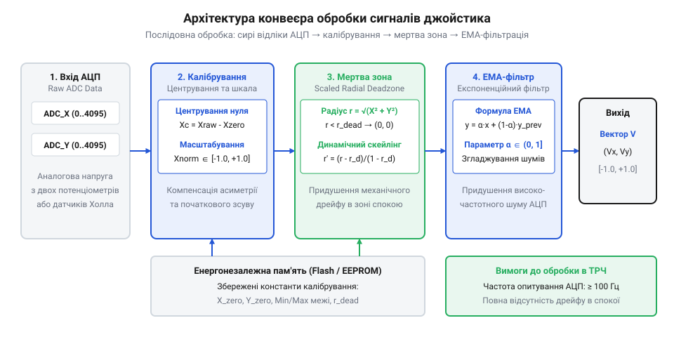
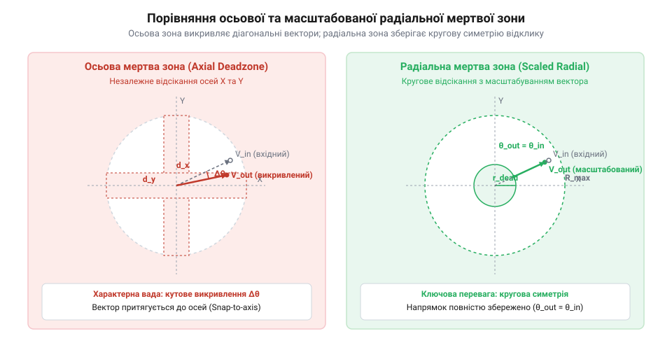

# Програмний модуль калібрування й фільтрації аналогового стика на мікроконтролері

<preknowlist>
- [KY-023 — джойстик-модуль](root:cat-hw-controls/ky-023-joystick) — схему виводів та принцип роботи потенціометричного джойстика
- [Стік на давачах Холла (Hall Effect Gimbal)](root:cat-hw-controls/hall-effect-gimbal-joystick) — відмінності між Холлівськими та потенціометричними сенсорами
</preknowlist>

## Проблема дрейфу нуля та тремтіння АЦП

Вхідні сигнали від аналогових органів керування піддаються постійним апаратним завадам. Коли користувач відпускає [поворотний потенціометр](root:cat-hw-controls/rotary-potentiometer) або важіль [джойстик-модуля KY-023](root:cat-hw-controls/ky-023-joystick), механічна пружина відновлює центр лише з певною точністю. Неминучий пружинний люфт, механічне зношування дорожок та температурне розширення матеріалів викликають постійний апаратний зсув нуля (від англ. @@en|zero-drift@@). У результаті сирі відліки аналогово-цифрового перетворювача (від англ. @@en|analog-to-digital converter@@; @@en|ADC@@ — АЦП) у стані спокою не відповідають теоретичному геометричному центру, а мимовільно відхиляються на кілька десятків одиниць у довільний бік.

Ситуація ускладнюється пульсаціями шини живлення мікроконтролера та високочастотними завадами на аналогових виводах. Шум квантування та наведення від сусідніх цифрових ліній викликають тремтіння АЦП (від англ. @@en|ADC jitter@@), через яке виміряне значення коливається навіть при нерухомому важелі. Додатковим джерелом похибок є високий вихідний опір джерела (від англійського @@en|source resistance@@) потенціометричного датчика. Цей опір утворює `RC`-ланцюг із внутрішньою ємністю вибірки-зберігання АЦП (від англійського @@en|sample-and-hold capacitor@@). При високій частоті квантування тривалість вибірки стає занадто короткою для повного заряджання вхідного конденсатора. Неповний заряд спричиняє паразитний перехресний зв'язок між каналами мультиплексора АЦП та додатково підсилює амплітуду шуму. Зниженню рівня завад сприяє фізичне розділення аналогового заземлення (від англ. *analog ground*; далі — @@en|AGND@@) від цифрової шини та налаштування бітів тактування АЦП у регістрах подільника частоти (від англ. *prescaler*; далі — @@en|prescaler@@). Збільшення тривалості вибірки у реєстрах конфігурації АЦП розв'язує аналогову й цифрову частини, даючи конденсаторові час для стабілізації напруги. Без додаткових програмних заходів такі коливання сприймаються керуючою системою як постійні мікрокоманди, викликаючи мимовільний дрейф виконавчих механізмів, тремтіння сервоприводів та хибні спрацьовування в нейтралі. Для подолання цих явищ обробку вхідних вибірок будують у вигляді послідовного конвеєра обробки даних.

*Послідовність проходження аналогового сигналу від вибірки АЦП до нормованого вектора.*

## Захоплення нейтралі та інтерактивне калібрування

Першим етапом конвеєра обробки є динамічне захоплення нейтральної точки при кожному включенні живлення. Оскільки температура та механічний стан важеля змінюються, фіксоване центральне значення АЦП призводить до помилок. Під час старту системи розробляють алгоритм, який утримує обробку вибірок і накопичує вибірку з `N` сирих відліків у стані спокою. Обчислення арифметичного середнього дозволяє точніше зафіксувати поточне центральне значення осей `center_x` та `center_y`.

:::code proj-stm32-stick-calibration-and-filtering/c/include/stick_drift_filter.h 19-26
:::code proj-stm32-stick-calibration-and-filtering/c/src/stick_drift_filter.c 40-60

На відміну від нерухомої нейтралі, крайні фізичні межі відхилення осей фіксуються в режимі інтерактивного калібрування. Користувач обертає шток [стіка на давачах Холла](root:cat-hw-controls/hall-effect-gimbal-joystick) по повному колу, а програма фіксує абсолютні мінімуми `min_x`, `min_y` та максимуми `max_x`, `max_y`. На базі отриманих параметрів виконується несиметричне масштабування: кожен з двох півдіапазонів відхилення осі ділиться на власний виміряний розмах. Це гарантує точне приведення сирого відліку АЦП до нормованого діапазону від `-1.0` до `+1.0` незалежно від асиметрії механічних упорів.

Отримані калібрувальні параметри та контрольна сума серіалізуються для збереження в неенергозалежній пам'яті (від англ. @@en|non-volatile memory@@; @@en|NVM@@). Для запобігання роботі з пошкодженою конфігурацією Flash-пам'яті або EEPROM профіль захищається циклічним надлишковим кодом (від англ. @@en|cyclic redundancy check@@; @@en|CRC16@@). При завантаженні драйвер обчислює контрольну суму та верифікує цілісність даних перед ініціалізацією конвеєра. У разі виявлення розбіжності CRC16 (пошкодження сектора, неініціалізована пам'ять чи помилка зчитування) функція `begin()` відхиляє некоректний профіль з кодом `CRC_MISMATCH` і переходить до процедури скидання: система автоматично завантажує застраховані заводські налаштування за замовчуванням (центр `2048`, межі `0...4095`), генерує для них новий дійсний CRC16 та перезаписує NVM, що гарантує захист від блокування пристрою та відновлює безпечний базовий режим керування. При зміщенні нуля внаслідок нагрівання сенсорів застосовують двох-точкову температурну компенсацію: у NVM зберігають два опорні центри `center_cold` і `center_hot` для датчиків при температурах `T_cold` та `T_hot`. Під час обробки вибірок поточний центр `center_T` динамічно розраховується за допомогою лінійної інтерполяції `center_T = center_cold + (T_curr - T_cold) × (center_hot - center_cold) / (T_hot - T_cold)` за даними термодатчика, упереджуючи угляд дрейфу нуля за межі радіальної відсічки при нагріванні корпусу.

:::code proj-stm32-stick-calibration-and-filtering/cpp/JoystickCalibration.h 34-47
:::code proj-stm32-stick-calibration-and-filtering/cpp/JoystickCalibration.cpp 115-130

## Масштабована радіальна мертва зона

Найпростішим способом усунення дрейфу нуля двоосьового механічного важеля є незалежна осьова мертва зона (від англ. *axial deadzone*; далі — @@en|axial deadzone@@). У такому підході кожен аналоговий канал обробляється окремо: якщо абсолютне значення координати X або Y не перевищує заданого порогу, воно примусово скидається в нуль. Проте така зрізка повністю спотворює полярну геометрію відклику органів керування. Область зрізки в двовимірній площині утворює хрестоподібну або квадратну зону, через яку діагональне відхилення важеля викликає різкий скачок однієї з координат, коли вектор виходить за межі квадратного порогу. Для якісного маніпулятора, як-от [джойстик KY-023](root:cat-hw-controls/ky-023-joystick) або пристрої з [давачами Холла](root:cat-hw-controls/hall-effect-gimbal-joystick), це призводить до втрати плавності руху та ступенів вільності вздовж кутових напрямків.

Розв'язанням цієї проблеми є масштабована радіальна мертва зона (від англ. *scaled radial deadzone*; далі — @@en|scaled radial deadzone@@). Алгоритм обчислює евклідову довжину вектора відхилення у 2D-просторі та застосовує масштабування не до окремих осей, а до амплітуди загального радіального вектора. Якщо довжина вектора менша за внутрішній радіус порогу, вихідні координати дорівнюють нулю. Якщо ж вектор виходить за внутрішню межу, його довжина плавно нормується від 0.0 до 1.0 в інтервалі між внутрішньою мертвою зоною та зовнішньою межею насичення, зберігаючи вхідний полярний кут без кутового викривлення.

*Порівняльний аналіз осьового та радіального алгоритмів обробки: масштабована радіальна зона зберігає кругову симетрію та усуває стрибки швидкості.*

Математичний розрахунок масштабованого радіального вектора виконується у декілька послідовних кроків після нормування сирих відліків аналого-цифрового перетворювача (від англ. *analog-to-digital converter*; далі — @@en|ADC@@) у діапазон [-1.0..+1.0]. Перш ніж отримати підсумкові координати, обчислюють початкову довжину вектора `R`, після чого масштабують амплітуду `R_scaled`:

    R = √(norm_x² + norm_y²)
    clamped_R = min(max(R, R_inner), R_outer)         [обрізання за порогом насичення]
    R_scaled = (clamped_R - R_inner) / (R_outer - R_inner) [плавне масштабування радіуса]
    out_x = (norm_x / R) × R_scaled                    [збереження полярного кута X]
    out_y = (norm_y / R) × R_scaled                    [збереження полярного кута Y]

Де `norm_x` та `norm_y` — нормовані координати важеля відносно зафіксованого центра, `R_inner` — внутрішній радіус мертвої зони (наприклад, 0.10, що відповідає 10%), а `R_outer` — зовнішній поріг насичення (наприклад, 0.95). Двовимірне масштабування ліквідує розрив першої похідної швидкості при перетині межі відсічки, завдяки чому відклик керування стає абсолютно лінійним і передбачуваним у будь-якому радіальному напрямку. Якщо евклідова довжина вектора перевищує зовнішній поріг `R_outer` через механічний розмах або крайні кутові положення важеля, функція обрізання `min(max(R, R_inner), R_outer)` фіксує радіальну амплітуду на рівні `R_outer`, що дає `R_scaled = 1.0` і гарантує досягнення повного 100% відклику. Повторне множення одиничного направляючого вектора `(norm_x / R, norm_y / R)` на кліповане значення амплітуди обмежує підсумковий вектор одиничним диском, повністю зберігаючи вхідний полярний кут і відсікаючи кутові спотворення у кутах механічного ходу.

## Експоненційне згладжування EMA та фільтрація

Навіть після зрізки мертвої зони сирий аналоговий сигнал важеля містить високочастотні шуми квантування АЦП, пульсації шин живлення та дрібні механічні вібрації важеля. Без фільтрації ці вимірювальні завади (від англ. *ADC jitter*; далі — @@en|ADC jitter@@) передаються у виконавчу систему та викликають тремтіння координат у позиціях відхилення. Для стабілізації потоку координат застосовують експоненційне ковзне середнє (від англ. *exponential moving average*; далі — @@en|EMA@@), яке виконує роль цифрового фільтра низьких частот першого порядку.

Алгоритм EMA оновлює поточний стан фільтра на кожному кроці дискретизації за допомогою лінійної рекурсивної комбінації нового нормованого відліку та попереднього згладженого значення. Формула обчислення має наступний вигляд:

    yₙ = yₙ₋₁ + α × (xₙ - yₙ₋₁)                       [рекурсивне обчислення EMA]

Де `xₙ` — поточне значення координати після масштабованої радіальної зони, `yₙ₋₁` — відфільтрована координата з попереднього такту обробки, а `α` (`ema_alpha`) — коефіцієнт згладжування в інтервалі `0.0 < α ≤ 1.0`.

Вибір коефіцієнта `α` визначає баланс між придушенням високочастотного шуму та часовою затримкою відклику (фазовим зсувом):
* Малі значення `α` (`0.05..0.15`) гарантують високе придушення завад від [потенціометричних датчиків](root:cat-hw-controls/rotary-potentiometer), але створюють відчутне запізнення реакції при різкому кидку стика.
* Великі значення `α` (`0.30..0.50`) забезпечують швидкий відклик для динамічного керування з мінімальною затримкою, вимагаючи при цьому чистішої апаратної частини.

Важливою умовою стабільної роботи є правильна ініціалізація внутрішнього стану фільтра. На першому такті після увімкнення живлення змінна `y₀` мусить приймати значення першого виміряного відліку `x₀`, інакше фільтр тривалий час виходитиме на робочий рівень із нуля, викликаючи хибний перехідний процес. Зв'язок між безрозмірним коефіцієнтом `α` та фізичними параметрами вимірювальної системи задається через інтервал дискретизації `dt` (період опитування АЦП) і постійну часу фільтра `τ` співвідношенням `α = dt / (τ + dt)`. Звідси еквівалентна частота зрізу цифрового фільтра низьких частот за рівнем -3 dB становить `f_c = α / (2 · π · dt · (1 - α))`. Наприклад, при частоті вибірок `f_s = 100 Hz` (`dt = 0.01 s`) та `α = 0.30` частота зрізу дорівнює близько `6.8 Hz`, що надійно приглушує високочастотні наводки та тремтіння, зберігаючи динаміку людських жестів. У мікроконтролерах без апаратного блоку обчислень із плаваючою комою (від англ. *floating-point unit*; далі — @@en|FPU@@) EMA-фільтрація успішно реалізується в цілочисельній арифметиці із фіксованою точкою (від англ. *fixed-point arithmetic*; далі — @@en|fixed-point@@) шляхом масштабування коефіцієнтів на `2ⁿ`.

## Реалізація прошивкового модуля та верифікація

Для практичного застосування на мікроконтролерах (від англ. *microcontroller unit*; далі — @@en|MCU@@) алгоритми автокалібрування, масштабованої радіальної мертвої зони та EMA-фільтрації об'єднуються у цілісний конвеєр обробки даних. Конвеєр гарантує неблокуюче виконання, приймаючи сирі 12-бітні відліки АЦП та видаючи стійкий вектор векторних координат [-1.0..+1.0] з довжиною вектора `magnitude`.

Архітектура прошивкового модуля на мові C розроблена з урахуванням суворих вимог до обробки у реальному часі. Структура `stick_calibration_t` зберігає калібрувальний профіль, `stick_filter_t` утримує конфігурацію та стан EMA-фільтра, а функція `stick_filter_process()` реалізує повний обчислювальний цикл:

:::code proj-stm32-stick-calibration-and-filtering/c/include/stick_drift_filter.h 19-50

Процес обробки несиметричного нормування, радіальної зони та експоненційного згладжування інтегровано у функцію обробки:

:::code proj-stm32-stick-calibration-and-filtering/c/src/stick_drift_filter.c 87-134

У середовищі C++ та платформах на кшталт Arduino модуль оформлено у вигляді ООП-класу `JoystickCalibration`. Профіль конфігурації захищено контрольною сумою (від англ. *cyclic redundancy check*; далі — @@en|CRC16@@) для надійного збереження у енергонезалежній пам'яті (від англ. *non-volatile memory*; далі — @@en|NVM@@) чи EEPROM:

:::code proj-stm32-stick-calibration-and-filtering/cpp/JoystickCalibration.h 34-63

Використання об'єктного модуля в циклі `loop()` Arduino дає змогу проводити неблокуюче автокалібрування нейтралі при утриманні кнопки та отримувати фільтровані координати:

:::code proj-stm32-stick-calibration-and-filtering/cpp/sketch.ino 40-74

Для верифікації стійкості системи виконують тестування при навмисному механічному зсуві нейтралі. За допомогою функції `stick_calibrate_center()` (або `startNeutralCalibration()`) система вимірює серію відліків у стані спокою та фіксує фактичний центр АЦП (наприклад, `X = 2070, Y = 2030` замість ідеальних `2048`). Подальша перевірка на потоці тестових даних у `main.c` підтверджує, що навіть при наявності дрейфу та шуму підсумковий вектор `R` у стані спокою залишається строго рівним `0.000`, а при повному відхиленні досягає значення `1.000` без дрейфу координатного вектора. Метод оцінки динамічного відклику полягає у подачі ступенчастого впливу (стрімкий кидок важеля з центру до межі) та вимірюванні часу виходу фільтрованого вектора на рівень 95% від амплітуди. При коефіцієнті `α = 0.30` та інтервалі дискретизації `dt = 10 ms` час встановлення становить близько `84 ms` (близько 8-9 тактів обробки), що дає змогу виміряти фазове запізнення осі осцилографом або логером і скоригувати значення `ema_alpha` під конкретні вимоги до швидкодії.

:::code proj-stm32-stick-calibration-and-filtering/c/src/main.c 41-60
