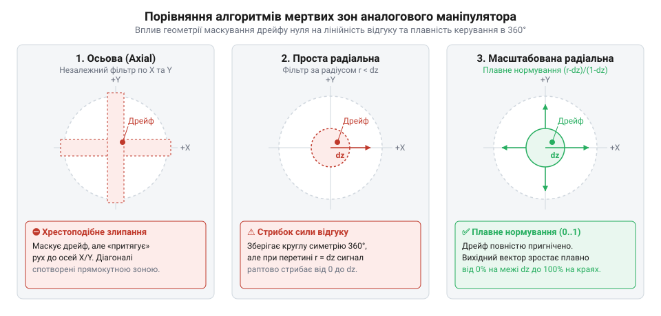
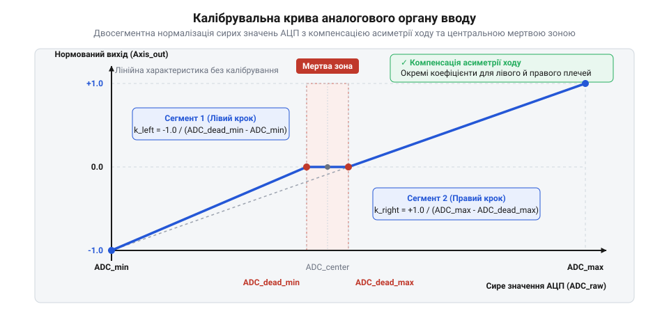

# Дрейф нуля та калібрування органів вводу

<preknowlist>
- [Поворотний потенціометр](root:cat-hw-controls/rotary-potentiometer) — пристрій резистивного дільника напруги та механіку зносу вугільної доріжки
- [KY-023 — джойстик-модуль](root:cat-hw-controls/ky-023-joystick) — конструкцію двохвісного потенціометричного маніпулятора з центральним пружинним поверненням
</preknowlist>

## Фізика дрейфу нуля в аналогових органах

Коли важіль аналогового контролера відпускають, пружини центрування мають повертати його у вихідне нульове положення. На практиці вихідна напруга, яку зчитує мікроконтролер, майже ніколи не залишається точно посередині робочого діапазону. Виникає небажане зміщення вихідного сигналу спокою — @@en|дрейф нуля@@ (англ. @@en|zero drift@@, від герм. @@en|drift@@). Через це пристрій фіксує уявний рух важеля навіть тоді, коли людина взагалі не торкається органів керування. Самовільне зміщення курсора чи об'єкта в системі викликає хибні спрацьовування та робить управління нестабільним.

Основа цієї проблеми криється у фізико-механічній та схемотехнічній природі вимірювальних вузлів. У традиційних резистивних давачах, таких як [потенціометричний джойстик](root:cat-hw-controls/ky-023-joystick), під час постійного руху рухливий струмознімач поступово стирає резистивний шар. На вугільній доріжці утворюються мікроскопічні вибоїни й стружка, через що опір у центрі змінюється нелінійно. Електричний опір вугільного шар-треку має помітну температурну залежність із від'ємним температурним коефіцієнтом опору (від англійського @@en|temperature coefficient of resistance@@, TCR), через що при нагріванні корпусу від сусідніх компонентів опір доріжки падає на 0.5–1% на кожні 10 °C. Одночасно з цим металеві пружини центрування під час тривалої експлуатації зазнають механічної втоми (від англійського @@en|metal fatigue@@), що призводить до падіння коефіцієнта жорсткості та виникнення залишкової деформації пружини, а в пластикових підвісах з'являються люфти. У результаті важіль зупиняється щоразу в трохи іншому фізичному положенні. Не менш критичним електричним чинником є нестабільність ліній живлення: оскільки [поворотний потенціометр](root:cat-hw-controls/rotary-potentiometer) включено як аналоговий дільник напруги, будь-які пульсації, високочастотні наводки чи просідання опорної напруги живлення VCC (від англійського @@en|collector supply voltage@@) безпосередньо транслюються у вихідну напругу знімача. Додатковим джерелом нелінійності є температурна залежність напруги зміщення p-n переходу (від англійського @@en|p-n junction@@) випрямних і захисних діодів у колах живлення АЦП, де прямий спад напруги зменшується приблизно на `-2.0 мВ/°C` при нагріванні, що змінює вихідний рівень опорної напруги. Якщо опорна напруга АЦП VREF та живлення потенціометра не є строго логометрично узгодженими (від англійського @@en|ratiometric@@) або мають низьке придушення високочастотного шуму цифрових шин, навіть ідеально нерухомий важіль викликає хаотичні флуктуації та плавання вихідного відцифрованого коду в межах кількох молодших розрядів LSB.

Історично інженери намагалися компенсувати ці відхилення на рівнях механіки та аналогових підбудовних резисторів. У розкладці джойстиків ранніх обчислювальних систем 1970-х років встановлювали фізичні ручки підстроювання центру для кожної осі окремо. Детальніше про розвиток методів боротьби зі зміщенням можна прочитати у [історичному огляді еволюції](root:cat-hw-controls/stick-drift-mitigation/hist-joystick-drift-evolution.md) органів вводу. Зі зростанням вимог до компактності та надійності апаратне налаштування поступилося місцем цифровим алгоритмам обробки.

Для точної діагностики стану джойстика необхідно аналізувати його електричне підключення. Фізичні розпіновки та параметри електричних сигналів описані у [довіднику електричного інтерфейсу](root:cat-hw-controls/stick-drift-mitigation/api-analog-joystick-hardware-interface.md) аналогових маніпуляторів. Альтернативним апаратним шляхом зменшення зносу є перехід на [давачі Холла в органах](root:cat-hw-controls/hall-effect-gimbal-joystick) керування, але навіть вони не позбавлені температурного дрейфу та люфтів підвісу, що робить програмну обробку сигналу обов'язковою. Для високоточних промислових та авіаційних систем абсолютне позиціонування забезпечують [оптичні та індуктивні давачі положення](root:cat-hw-controls/optical-and-inductive-position-encoders) органів вводу.

## Цифрові мертві зони та їх конфігурація

Щоб відсікти дрібні флуктуації та незначний дрейф у стані спокою, у програмі формують @@en|мертву зону@@ (англ. @@en|deadzone@@). Це визначений діапазон навколо центральної точки, у межах якого будь-які зміни вхідного сигналу ігноруються, а вихідне значення примусово вважається нульовим. Проте просте відсікання порогу без перерахунку координат призводить до ступінчастого стрибка значення, коли важіль перетинає межу центрального проміжку.

Для двоосьових органів керування існує кілька способів геометричної побудови мертвих зон. Найпростіший підхід — @@en|осьова мертва зона@@ (англ. @@en|axial deadzone@@), де кожна вісь x та y обробляється незалежно. Це створює хрестоподібну область спокою, яка викривляє діагональний рух важеля, адже незалежне відсікання малих відхилень вздовж кожної осі призводить до «прилипання» курсора до координатних осей. Натомість @@en|радіальна мертва зона@@ (англ. @@en|radial deadzone@@) оцінює векторну відстань `r = √(x² + y²)` від центра, створюючи ідеально кругову область спокою радіуса `R_dead`. Математична відмінність між ними полягає у тому, що осьова зона зрізає прямокутний квадрат навколо нуля, спотворюючи напрямок малого вектора відхилення, тоді як радіальна зберігає справжній кут повороту важеля `θ = arctan2(y, x)`. Найбільш досконалою є @@en|масштабована радіальна мертва зона@@ (англ. @@en|scaled radial deadzone@@), яка відсікає шум у центрі й плавно нормалізує залишковий вектор від нуля до максимуму за формулою `r_scaled = (r - R_dead) / (1 - R_dead)`, запобігаючи стрибкоподібному виходу координати при перетині межі. Якщо ж асиметрія механічних підтяжок або нерівномірний знос куліс утворює анізотропний дрейф уздовж осей (коли поріг `R_x ≠ R_y`), кругова зона трансформується в овальну розету. У цьому разі для довільного кута `θ` розраховують змінний поріг спокою `R_dead(θ) = (R_x · R_y) / √(R_y² · cos²(θ) + R_x² · sin²(θ))`, після чого нормалізовану величину вектора `r_scaled = (r - R_dead(θ)) / (R_outer(θ) - R_dead(θ))` розкладають назад на тригонометричні складові `x_norm = r_scaled · cos(θ)` та `y_norm = r_scaled · sin(θ)`, що зберігає лінійність відгуку в усіх напрямках. Окрім внутрішніх флуктуацій у центрі, механіка маніпулятора має нелінійності й у крайніх відхиленнях важеля: через виробничі допуски корпуса, люфти чи знос обмежувального кільця важіль може фізично не доходити до крайніх електричних значень АЦП. Для усунення цих крайових дефектів формують @@en|зовнішню мертву зону@@ (англ. @@en|outer deadzone@@), яка встановлює верхній поріг `R_outer` (наприклад, 95% від максимального радіуса), понад який будь-яке відхилення примусово вважається 100% виходу, гарантуючи як стабільний нуль у центрі, так і впевнене досягнення максимуму при крайніх нахилах важеля.

*Форми мертвих зон та їхній вплив на доступну робочу область і плавність переміщення важеля.*

Математичні формули розрахунку радіуса вектора та плавного масштабування наведено у [математичних моделях мертвих зон](root:cat-hw-controls/stick-drift-mitigation/math-deadzone-and-normalization-models.md). При зчитуванні значень АЦП важливо також придушувати високочастотні наведення, застосовуючи алгоритми з [методів фільтрації шуму](root:cat-hw-controls/stick-drift-mitigation/math-noise-filtering-for-analog-inputs.md). Готова реалізація функцій нормалізації координат та конфігурації діапазонів міститься у [програмній бібліотеці калібрування](root:cat-hw-controls/stick-drift-mitigation/api-input-calibration-library-interface.md) органів вводу.

## Фільтрація шумів та згладжування координат

Сигнал із виводу потенціометра чи маніпулятора під час перетворення аналого-цифровим перетворювачем (від англійського @@en|ADC@@) піддається впливу електричних завад, теплового шуму та флуктуацій опору контактного шару. У результаті навіть у нерухомому стані органу керування значення АЦП постійно коливається на кілька молодших розрядів. При прямому використанні цих даних курсор або об'єкт керування зазнаватиме хаотичного мікротремтіння.

Для придушення високочастотного шуму застосовують цифрове згладжування. Найпростіший метод — ковзне середнє (від англійського @@en|moving average@@), яке усереднює останні `N` відліків. Проте воно вимагає виділення буфера пам'яті. Більш ефективним для мікроконтролерів є експоненційне згладжування (від англійського @@en|exponential moving average@@, EMA), яке обчислює нове значення на основі попереднього згладженого результату та поточного відліку. Вибір коефіцієнта `α` тісно пов'язаний із частотою дискретизації АЦП `f_s` (від англійського @@en|sampling rate@@). При високій частоті опитування (наприклад, `1000 Гц`) навіть мале значення `α = 0.05` оновлюється кожну мілісекунду і не створює відчутного запізнення, забезпечуючи глибоку фільтрацію завад. Проте при низькій частоті опитування (`50 Гц`) занадто малий коефіцієнт `α` вносить критичну фазову затримку (від англійського @@en|phase lag@@), через яку реакція на швидке відхилення важеля розтягується на сотні мілісекунд. Математично для цифрового фільтра низьких частот першого порядку постійна часу обчислюється через частоту зрізу як `τ = 1 / (2π · f_cutoff)`, а сам коефіцієнт зв'язаний із періодом опитування `T_s = 1 / f_s` співвідношенням `α = T_s / (τ + T_s) = 2π · f_cutoff / (2π · f_cutoff + f_s)`. При високій частоті опитування (`f_cutoff ≪ f_s`) формула спрощується до лінійного наближення `α ≈ 2π · f_cutoff / f_s`, що дозволяє строго розраховувати коефіцієнт згладжування під задану граничну частоту зрізу:

        y[n] = α · x[n] + (1 - α) · y[n-1]
        = y[n-1] + α · (x[n] - y[n-1])      [зведення до різницевої форми]

Де `x[n]` — поточне сире значення АЦП, `y[n-1]` — попереднє згладжене значення, а `α` (альфа) — коефіцієнт фільтрації у діапазоні від `0.0` до `1.0`. Чим менше значення `α`, тим сильніше приглушується шум, але тим більша затримка відгуку виникає при швидких рухах важеля. На практиці значення `α` у межах `0.15...0.3` забезпечує оптимальний баланс між завадостійкістю та динамікою.

Для усунення залишкових мікрофлуктуацій у стані спокою після фільтрації застосовують гістерезисний фільтр (від грецького @@en|hysteresis@@). Він оновлює вихідну координату лише тоді, коли зміна сигналу перевищує заданий поріг чутливості. Більш гнучким рішенням є адаптивний фільтр експоненційного згладжування, в якому коефіцієнт `α` динамічно перераховується залежно від модуля різниці між поточним відліком `x[n]` і попереднім результатом `y[n-1]`. При малій швидкості зміни сигналу (у стані спокою чи повільного наведення) `α` зменшується до мінімального значення (наприклад, `0.02`), що забезпечує максимальну завадостійкість і стабільність координати. При різкому русі важеля модуль відхилення перевищує порогову дельту, і коефіцієнт `α` автоматично зростає аж до `1.0`, миттєво знімаючи фазову затримку для точного відслідковування швидких маневрів. Детальні математичні моделі та спектральний аналіз фільтрів наведено у матеріалі про [математичні методи фільтрації шуму й дрейфу АЦП](root:cat-hw-controls/stick-drift-mitigation/math-noise-filtering-for-analog-inputs.md), а фізичні нюанси зчитування розкрито в описі про [схему підключення та електричний інтерфейс аналогового джойстика](root:cat-hw-controls/stick-drift-mitigation/api-analog-joystick-hardware-interface.md).

## Калібрування нейтралі та повного робочого діапазону

Через механічні допуски пружин повернення та розкид опору резистивних доріжок, якими володіє [поворотний потенціометр](root:cat-hw-controls/rotary-potentiometer), фізична центральна позиція важеля майже ніколи не відповідає ідеальному середині діапазону АЦП (наприклад, `2048` для 12-бітного перетворювача). Крім того, крайні положення можуть не досягати технологічних меж `0` та `4095`.

Щоб забезпечити точну симетрію керування, застосовують двохсегментне лінійне перетворення. Під час процедури калібрування фіксують три ключові параметри для кожної осі: мінімальне відхилення `ADC_min`, нейтральну точку `ADC_center` та максимальне відхилення `ADC_max`. У разі зсуву чи апаратної відмови давача знаменники двохсегментних формул (`ADC_center - ADC_min`) або (`ADC_max - ADC_center`) можуть наблизитися до нуля, що загрожує винятком ділення на нуль (від англійського @@en|division by zero@@). Для запобігання цьому алгоритм перевіряє гарантований мінімальний інтервал (наприклад, не менше 50 відліків АЦП), і при його недосягненні підставляє дефолтні технологічні межі. Крім того, вихідні значення після перетворення піддаються жорсткому обмеженню (від англійського @@en|clamping@@) у межах від `-1.0` до `+1.0`, що запобігає виходу координат за допустимий діапазон при екстремальних відхиленнях важеля за зафіксовані межі калібрування.

*Графік двохсегментного перетворення: сирі значення АЦП перераховуються у нормований діапазон із відсіканням шумів у центральній мертвій зоні.*

Формула перетворення розподіляє обробку на два незалежні сегменти відносно нейтралі:

        якщо x < ADC_center:
            y = (x - ADC_center) / (ADC_center - ADC_min)
        інакше:
            y = (x - ADC_center) / (ADC_max - ADC_center)

Після цього до вихідного значення `y` застосовують цифрову мертву зону (від англійського @@en|deadzone@@), яка відсікає залишковий [дрейф нуля](root:cat-hw-controls/stick-drift-mitigation/hist-joystick-drift-evolution.md) у центрі та забезпечує гарантований нуль у стані спокою. Результат обмежується функцією насичення у діапазоні від `-1.0` до `+1.0`.

Профіль калібрування зберігається в енергонезалежній пам'яті (Flash або EEPROM). Формування цього профілю відбувається у спеціальному режимі налаштування (англ. @@en|calibration mode@@), під час якого оператор описує важелем кілька повних кіл уздовж фізичних обмежувачів розети. Алгоритм збору параметрів у циклі опитування АЦП реалізує динамічне визначення екстремумів (англ. @@en|peak detection@@): після початкової фіксації нейтралі `ADC_center` у стані спокою, прошивка безперервно порівнює поточний відлік із зафіксованими межами, оновлюючи `ADC_min = min(ADC_min, sample)` та `ADC_max = max(ADC_max, sample)` за кожною віссю. Щоб випадковий імпульсний шум або поодинокий аномальний викид АЦП (англ. @@en|outlier@@) не спотворив фізичні межі, алгоритм застосовує медіанну фільтрацію пачки відліків і підтверджує новий екстремум лише при його стабільності протягом кількох підряд вимірювань. По завершенні кругового обходу система перевіряє розмах `ADC_max - ADC_min` на відповідність технологічному мінімуму, запобігаючи збереженню некоректних даних при неповному відхиленні важеля. Для захисту від пошкодження даних у пам'яті підсумкову таблицю налаштувань обов'язково супроводжують магічним заголовком і контрольною сумою алгоритму CRC16-CCITT (англ. @@en|CRC16-CCITT@@). Алгоритм обробляє байтовий масив структури з початковим значенням `0xFFFF` та стандартизованим поліномом `0x1021`, виконуючи побітові зсуви й виключне АБО `(crc << 8) ^ table[(crc >> 8) ^ byte]`. Під час запуску прошивка повторно обчислює контрольну суму збереженого блоку пам'яті: якщо підсумкове значення не збігається із записаним кодом або магічний ідентифікатор спотворений, система відхиляє зашкоджений профіль і примусово відновлює заводські дефолтні конфігурації. Математичний апарат розрахунку радіальних та нормалізованих моделей викладено у матеріалі про [математичні моделі мертвих зон та нормалізації координат](root:cat-hw-controls/stick-drift-mitigation/math-deadzone-and-normalization-models.md).

## Грамотна компенсація дрейфу на практиці

У цілісній архітектурі прошивки тракт обробки аналогового вводу будується у формі послідовного конвеєра:

1. **Апаратне зчитування АЦП** — отримання сирого значення розряду.
2. **Низькочастотна фільтрація** — застосування EMA-фільтра для згладжування шуму.
3. **Нормалізація калібрування** — двохсегментне мапування відносно `ADC_center`.
4. **Накладання мертвої зони** — масштабована радіальна або осьова компенсація дрейфу.
5. **Формування вихідного звіту** — упакування у стандартний формат, такий як [формування USB HID звітів та дескрипторів ігрових контролерів](root:com-protocol/usb-hid-descriptor-and-gamepad-reports).

Поширеною помилкою є неправильний порядок етапів — наприклад, застосування мертвої зони до сирих даних АЦП до проведення калібрування нуля. Це призводить до несиметричного зрізання чутливості. Інша помилка — відсутність перевірки цілісності збережених даних, через що при першому включенні пристрій зчитує незаповнені комірки пам'яті й блокує відгук. Окремим критичним аспектом є обробка апаратних відмов: при обриві шлейфа, замиканні сигнальної лінії на шину живлення чи землю, або при фізичному виході з ладу одного з каналів АЦП вихідне значення фіксується на крайніх межах розрядності (0 або 2ⁿ - 1). Щоб запобігти видачі неконтрольованих екстремальних команд у систему, конвеєр обробки аналізує граничні захисні інтервали (зазвичай нижче 1% та вище 99% повної шкали АЦП): у разі виходу сигналу за ці межі тракт негайно формує прапор апаратної відмови (від англійського @@en|hardware fault flag@@), примусово переводить координатний звіт осі в безпечний нульовий стан і блокує виконання автокалібрування. Для компенсації додаткового розігріву чи плавного декременту пружин під час тривалих ігрових або робочих сесій у штатному режимі просунуті прошивки застосовують алгоритм динамічного перекалібрування «на льоту» (від англійського @@en|auto-zero tracking@@). Якщо поточне згладжене значення АЦП перебуває в межах розширеного порогу спокою (наприклад, ±3% від ADC_center) протягом тривалого тайм-ауту (понад 3–5 секунд) без виявлення динамічних рухів, алгоритм плавно коригує значення ADC_center зі швидкістю 1 відлік / секунду. Проте під час утримання вбудованої тактильної кнопки стика механічне натискання на важіль створює додатковий паразитний зсув координат уздовж осей через деформацію підвісу. Щоб запобігти помилковому сприйняттю цього механічного натягу як нової точки спокою, алгоритм обов'язково призупиняє автотрекінг нуля на весь час активності дискретного сигналу кнопки та відновлює тайм-аут лише після її відпускання. Це дозволяє усувати повільний температурний дрейф нуля без необхідності перезавантаження пристрою або виклику ручного меню калібрування.

Нижче наведено приклад реалізації повного тракту обробки аналогової осі мовами C та C++:

:::tabs
:::code stick-drift-mitigation-d/c/esp-idf/axis-processor-init.c
:::code stick-drift-mitigation-d/cpp/arduino/axisprocessor.cpp
:::

Повноцінні робочі бібліотеки та приклади реалізації для промислових контролерів детально розібрано в [проєкті модуля калібрування й фільтрації аналогового стика на мікроконтролері](root:cat-hw-controls/stick-drift-mitigation/proj-stm32-stick-calibration-and-filtering.md) та довідникові про [програмний інтерфейс бібліотеки калібрування та обробки аналогового вводу](root:cat-hw-controls/stick-drift-mitigation/api-input-calibration-library-interface.md). Для безконтактних вузлів підвищеної надійності використовують [безконтактні джойстики та давачі Холла в органах керування](root:cat-hw-controls/hall-effect-gimbal-joystick).
