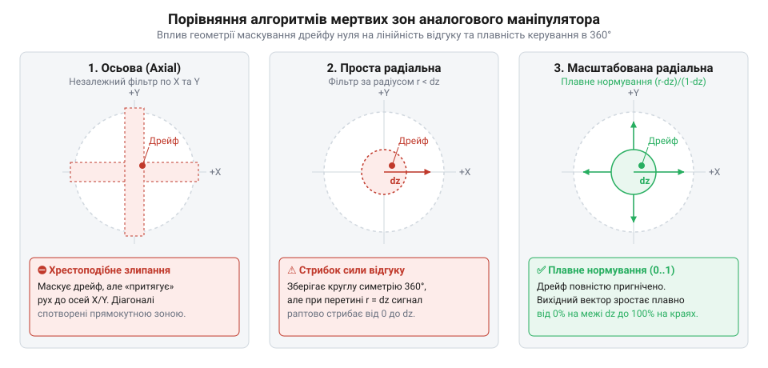
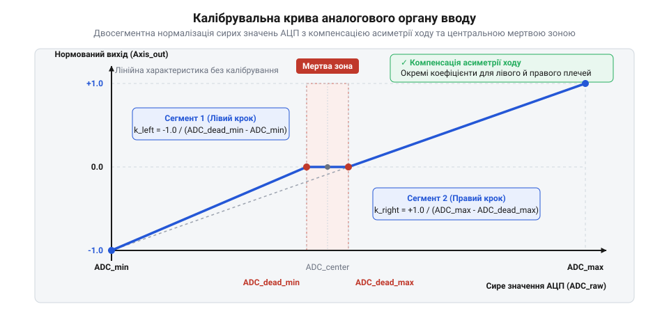

# Дрейф нуля та калібрування органів вводу

<preknowlist>
- [Поворотний потенціометр](root:cat-hw-controls/rotary-potentiometer) — принцип резистивного дільника напруги та механіка зносу вугільної доріжки
- [KY-023 — джойстик-модуль](root:cat-hw-controls/ky-023-joystick) — конструкція двовісного потенціометричного маніпулятора з центральним пружинним поверненням
</preknowlist>

## Фізичні причини дрейфу нуля

Аналогові важелі керування на основі [KY-023 — джойстик-модуль](root:cat-hw-controls/ky-023-joystick) у стані спокою рідко видають стабільне значення нейтралі. Головною фізичною причиною є абразивний знос вуглецевих доріжок, якими рухається струмознімач [поворотного потенціометра](root:cat-hw-controls/rotary-potentiometer). З часом мікрочастинки графіту стираються, змінюючи місцевий опір контактного переходу.

Друга причина — механічна втома повертальних пружин та люфти підвісу маніпулятора. Після відпускання важеля пружина не повертає його в ідеальний центр, через що виникає зміщення механічного нуля ΔV_center. Схемотехнічним чинником виступають високочастотні завади та пульсації опорної напруги АЦП (англ. @@en|ADC reference voltage@@; далі — @@en|ADC reference voltage@@). Математична залежність вихідного цифрового коду N_ADC від напруги потенціометра V_in та опорної напруги V_ref описується формулою N_ADC = (V_in ÷ V_ref) · (2ⁿ - 1). При зміщенні механічного нуля на ΔV_center та коливанні живлення на ΔV_ref підсумковий зсув відліків становить ΔN = [((V_center + ΔV_center) ÷ (V_ref + ΔV_ref)) - 0.5] · (2ⁿ - 1), що спричиняє хаотичне тремтіння молодших розрядів і зсув нейтралі навіть за нерухомого важеля. Для беззбійного позиціонування застосовують [стік на давачах Холла](root:cat-hw-controls/hall-effect-gimbal-joystick) або програмну компенсацію.

## Геометрія та типи мертвих зон

Для відсікання дрейфу нуля навколо нейтралі формують цифрову мертву зону (англ. @@en|deadzone@@). Найпростіший підхід — осьова мертва зона (англ. @@en|axial deadzone@@), де відліки `x` та `y` обнуляються незалежно. Проте це викликає ефект прилипання до осей та викривлення діагональних векторів руху.

*Порівняння моделей мертвих зон джойстика та їхній вплив на плавність відхилення.*

Проста радіальна мертва зона (англ. @@en|radial deadzone@@) вимірює відстань `r = √(x² + y²)`. За умов `r < d` сигнал обнуляється, але при перетині межі `d` виникає раптовий стрибок відгуку від 0 до `d`. Найкращим рішенням є масштабована радіальна мертва зона (англ. @@en|scaled radial deadzone@@): вона плавно перераховує довжину вектора у нормований діапазон `0.0..1.0` від межі `d` до максимуму за формулою:

r_out = (r - d) ÷ (1 - d)      [масштабування величини відхилення]

Після обчислення нормованої величини `r_out` підсумкові координати вихідного вектора отримують шляхом збереження початкового напрямку `(x / r, y / r) · r_out`. Завдяки цьому при `r = d` вихідна величина дорівнює точно `0.0`, що повністю усуває розрив відгуку, а при подальшому відхиленні важеля координати плавно та лінійно зростають до `1.0`. Це гарантує неперервність керування, точність кута за всіма 360 градусами та високу чутливість при дрібних мікровідхиленнях.

## Фільтрація шуму та двохсегментне калібрування

Високочастотне тремтіння відліків АЦП придушують цифровим фільтром EMA (англ. @@en|Exponential Moving Average@@; експоненційне ковзне середнє). Фільтр згладжує різкі сплески сигналу без помітної затримки відгуку на рух важеля.

*Графік двохсегментного перетворення відліків АЦП у симетричний діапазон.*

Асиметрію ходу важеля через зміщення механічного центру виправляють за допомогою двохсегментного калібрування (англ. @@en|two-segment calibration@@). Під час налаштування фіксують відліки мінімуму `ADC_min`, реальної нейтралі `ADC_neutral` та максимуму `ADC_max`. Обробка окремо масштабує ліву (або нижню) та праву (або верхню) ділянки відносно нуля. Підсумковий профіль калібрування зберігають в енергонезалежній пам'яті для стабільної роботи пристрою.
