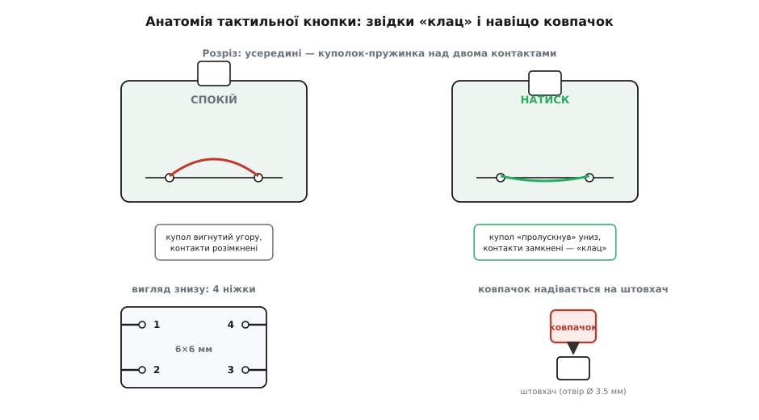
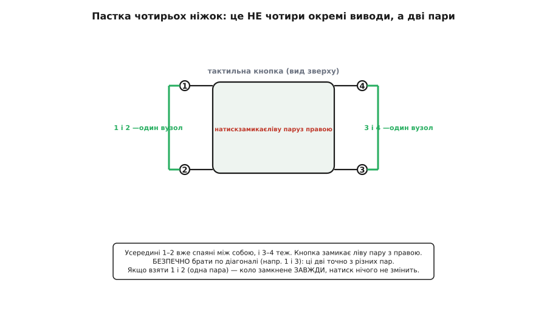
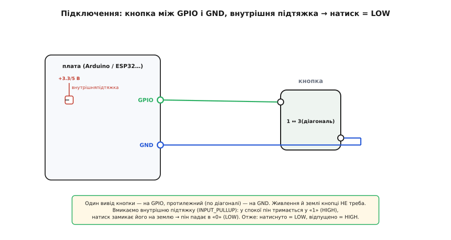

# Тактильні кнопки з ковпачками

## Що це і звідки «клац»

Коли орган керування не має чіткого відгуку, людина змушена тиснути «на віру» та перевіряти спрацювання очима, що призводить до помилок і подвійних натисків. Надійний вхід розв'язує **тактильна кнопка** (англ. *@@en|tactile switch@@*, від лат. *@@la|tactilis@@* — «відчутний на дотик»). Це крихітний @@en|momentary switch@@ (миттєвий вимикач), який замикає коло лише доки його тримають пальцем.

Усередині кнопки під штовхачем розташований пружний металевий куполок. У спокійному стані він вигнутий угору й не торкається контактів. При натисканні штовхач продавлює купол, і той різко пролускує вниз, замикаючи коло, що створює виразний дотиковий поштовх і тихий звук — @@en|tactile feedback@@ (тактильний зворотний зв'язок). Щойно палець прибирають, купол сам вискакує назад, розмикаючи контакти.

*Уся механіка — в одній пружній пластині. Спокій: купол дашком, коло розімкнене. Натиск: купол пролускує вниз, замикає контакти й дає відчутний та чутний «клац».*

## Пастка чотирьох ніжок кнопки

На платі тактильна кнопка має чотири металеві ніжки, через що виникає враження, ніби це чотири окремі виводи. Проте усередині корпусу вони спаяні попарно: дві ніжки з одного боку утворюють один вузол, а дві з протилежного — другий. Таке дублювання потрібне для міцного механічного кріплення кнопки на платі та зручності розводки друкованих доріжок.

Через таку будову існує ризик помилки: якщо під'єднатися до двох сусідніх ніжок однієї пари, коло виявиться замкненим постійно, і кнопка не реагуватиме на натиски. Щоб уникнути цього, виводи завжди беруть **по діагоналі**. Ніжки по діагоналі гарантовано належать до різних пар, тож кнопка чесно замикатиме й розмикатиме коло.

*Чотири ніжки — це насправді дві пари. Ніжки з одного боку спаяні всередині. Візьмеш виводи по діагоналі — вони точно з різних пар, і кнопка працює.*

## Ковпачки: одне тіло — багато кнопок

Гола кнопка має малий однаковий штовхач, який незручно натискати й важко візуально позначити на панелі. Цю проблему вирішує кольоровий **ковпачок** (англ. *@@en|cap@@* — «шапочка»), який надівається на штовхач тертям. Знімні ковпачки дозволяють використовувати одне базове тіло кнопки для всіх елементів керування, задаючи колір або позначки (наприклад, «пуск» чи «стоп») без зміни паяння.

При виборі ковпачків важливо враховувати посадкові розміри штовхача. Для стандартних кнопок 6×6 мм отвір ковпачка становить близько 3.5 мм, тоді як для великих кнопок 12×12 мм використовуються інші ковпачки. Вони не є взаємозамінними, тому тип штовхача звіряють заздалегідь.

## Схема підключення та читання рівня

Оскільки кнопка є просто механічним контактом, для її підключення не потрібні окремі лінії живлення. Один вивід кнопки (по діагоналі) з'єднують із цифровим входом @@en|GPIO@@ мікроконтролера, а інший — із землею (@@en|GND@@). Щоб вхід не «висів» у повітрі й не ловив завади при відпущеній кнопці, у коді вмикають внутрішню підтяжку до плюса (@@en|INPUT_PULLUP@@).

За такої схеми працює інвертована логіка: у спокійному стані підтяжка тримає на піні високий рівень (@@en|HIGH@@, «1»), а при натисканні кнопка закорочує пін на землю, переводячи його в низький рівень (@@en|LOW@@, «0»). Під час замикання виникає механічний брязкіт контактів — коротка серія хибних перемикань тривалістю 1–10 мс, яку програмно усувають часовою затримкою або витримуванням стабільного рівня.

*Два дроти й нічого більше. Внутрішня підтяжка тримає пін у «1», поки кнопку не чіпають; натиск замикає пін на землю, і той падає в «0».*

## Де це стоїть і що винести

Тактильні кнопки застосовують практично в усій електроніці: від кнопок скидання на платах розробки до пультних клавіш і панелей приладів. На їхній основі будують і складніші органи вводу — такі як [матрична клавіатура 4×4](root:cat-hw-controls/keypad-4x4-tactile) з шістнадцяти кнопок або готовий [модуль KY-004](root:cat-hw-controls/ky-004-button) зі зручним підключенням.

Головний висновок: тактильна кнопка — це миттєвий вимикач із пружним куполом, який дає чіткий дотиковий відгук. Чотири ніжки об'єднані у дві пари, тому підключення завжди роблять по діагоналі. Електрично кнопка замикає @@en|GPIO@@ на @@en|GND@@ при режимі @@en|INPUT_PULLUP@@ (натиснуто = @@en|LOW@@), брязкіт гасять у коді, а зовнішній вигляд регулюють ковпачками.
