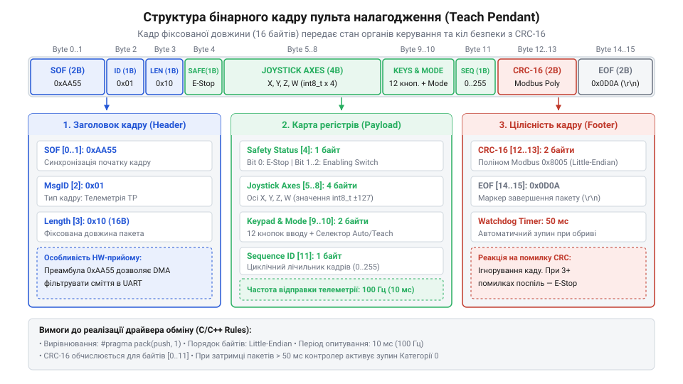
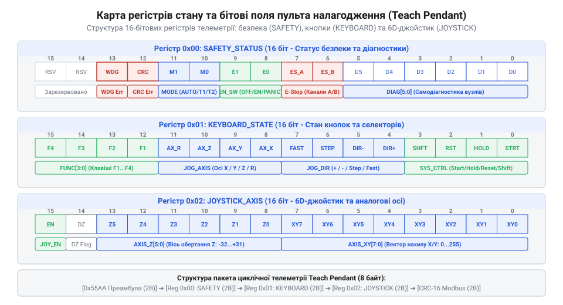

# Програмний протокол та бінарна карта регістрів комунікації пульта налагодження

<preknowlist>
- [Трипозиційні кнопки дозволу та педалі «мертвої руки»](root:cat-hw-controls/enabling-switches-and-dead-man-pedals) — принципи формування дискретних прапорів безпеки
- [Кнопка аварійного стопу грибок та органи безпечного відключення (IEC 60947-5-5)](root:cat-hw-controls/estop-mushroom-button) — стан контактних груп сухих контактів аварійного зупинення
</preknowlist>

## Структура бінарного кадру та заголовок

Під час обміну даними між пультом налагодження (від англ. @@en|Teach Pendant@@ — навчальний підвіс) та головним робототехнічним контролером безпосереднє зчитування неструктурованого послідовного потоку байтів призводить до втрати меж пакетів, зміщення вирівнювання та помилкового зчитування телеметрії. Для гарантованої синхронізації прийомопередавачів протокол використовує фіксовану структуру бінарного кадру (англ. @@en|binary frame@@), де кожен пакет починається з двобайтової преамбули `0x55AA` (від англ. @@en|preamble@@ — вступний маркер). Преамбула дозволяє приймачу миттєво відшукати початок кадру у неперервному потоці даних навіть після збоїв та тимчасових завад у лінії. Якщо ж унаслідок випадання байта виникає зміщення кадру (англ. @@en|frame misalignment@@), кінцевий автомат прийому втрачає синхронізацію та не знаходить маркера у розрахованій позиції. У цей момент вимикається пасивне очікування і вмикається механізм від'ємного квитування (від англ. @@en|negative acknowledgment@@, скорочено @@en|NACK@@, від лат. *negativus* — заперечний та англ. *acknowledgment* — квитування): приймач формує короткий службовий кадр із кодом помилки зміщення потоку та номером останнього коректно обробленого пакета. Отримавши NACK, передавач негайно припиняє відправлення поточної черги, скидає свій вихідний буфер і повторно транслює втрачений кадр від знайденої межі. Це позбавляє систему тривалих затримок у разі таймаутів, хоча обробка від'ємного квитування вимагає додаткових обчислювальних ресурсів мікроконтролера, а за постійних завад у кабелі надмірна кількість NACK-пакетів ризикує переповнити лінію зв'язку штормом повторних передач (англ. @@en|retransmission storm@@).

Слідом за преамбулою розтікається заголовок пакета (англ. @@en|frame header@@), який складається з однобайтового ідентифікатора типу кадру `frame_type` (наприклад, `0x01` для поточної телеметрії органа вводу чи `0x02` для налаштувань), лічильника послідовності `sequence_id` (0..255) та двобайтового поля довжини корисного навантаження `payload_len`. Послідовний номер `sequence_id` дозволяє контролеру виявляти пропущені пакети або повтори під час транспортування. Якщо при розборі заголовка значення `payload_len` перевищує максимально припустимий розмір приймального буфера (наприклад, понад 256 байтів) або не відповідає фіксованому розміру для даного типу кадру `frame_type`, парсер кінцевого автомата фіксує невалідну довжину. У такій винятковій ситуації приймач миттєво скидає поточний кадр, інкрементує лічильник помилок кадрування (англ. @@en|framing error@@) та повертається в початковий стан очікування преамбули `0x55AA`, що запобігає переповненню буфера (англ. @@en|buffer overflow@@, від англ. *buffer* — буфер та *overflow* — переповнення) та зависанню обробника.

*Структурна схема бінарного пакета телеметрії пульта налагодження з розбивкою побайтово.*

Усі багатобайтові поля заголовка та карти регістрів пакуються суворо в порядку прямування байтів молодшим уперед — порядок байтів (від англ. @@en|Little-Endian@@ — молодшим байтом вперед). Це усуває кросплатформові помилки при обміні між 8-бітним мікроконтролером пульта та 32- або 64-бітними процесорами шафи керування роботом. Усі структури даних декларуються без внутрішніх проміжків вирівнювання компілятора (упакована структура, від англ. @@en|packed structure@@), що гарантує фіксоване зміщення кожного поля незалежно від архітектури обчислювача.

## Бінарна карта регістрів стану пульта

Внутрішній адресний простір пульта налагодження оцифровується у вигляді компактної карти регістрів (англ. @@en|register map@@), де кожен біт або слово описують конкретний фізичний орган керування. Першим у карті стоїть 16-бітний регістр стану кіл безпеки та системних прапорів `REG_SAFETY_STATUS` (адреса `0x0001`). Біт 0 цього регістру показує сухі контакти [кнопками аварійної зупинки](root:cat-hw-controls/estop-mushroom-button) (0 — замкнено/норма, 1 — натиснуто/стоп). Біти 1–2 кодують статус [трипозиційні кнопки дозволу](root:cat-hw-controls/enabling-switches-and-dead-man-pedals) (00 — відпущено, 01 — серединне положення дозволу руху, 11 — панічне перетискання). Біт 3 відображає положення тумблера вибору режиму ручний/автоматичний (T1/Auto), а біт 4 — прапор апаратної самодіагностики пульта. Для деталізації несправностей у системі виділено регістр діагностики `REG_ADC_DIAG_ERR` (адреса `0x0009`), бітова маска якого конкретизує апаратні помилки потенціометрів та сенсорів Холла. У ньому біти 0–5 вказують на вихід аналогового сигналу відповідної осі за безпечний діапазон 0.5–4.5 В (від англ. @@en|out of range error@@, від *out* — поза, *range* — діапазон та *error* — помилка), біт 6 фіксує обрив чи коротке замикання опорної напруги (англ. @@en|ADC reference fault@@), а біти 7–12 прапорують розсогласування диференціальних сигналів (від англ. @@en|differential mismatch@@, від лат. *differentia* — різниця та англ. *mismatch* — розсогласування) між основними та резервними доріжками здвоєного потенціометра понад 5%. Таке побітове маскування дає змогу керуючому контролеру за один такт виявити знос струмознімальних доріжок або обрив кабелю і миттєво заблокувати небезпечний рух, хоча підтримка діагностичної маски потребує постійного аналого-цифрового перетворення і піддається хибним спрацьовуванням при короткочасних імпульсних наводках.

*Розподіл полів бінарного регістру телеметрії пульта: прапори безпеки, бітові маски кнопок та осей джойстика.*

Наступний 16-бітний регістр `REG_KEYPAD_MASK` (адреса `0x0002`) містить бітову маску натиснутих клавіш зміщення, якими оснащена [матрична клавіатура](root:cat-hw-controls/keypad-4x4-membrane). Кожен біт відповідає за один з напрямків декартового чи поосьового руху маніпулятора (X+, X-, Y+, Y-, Z+, Z-, Rx+, Rx-, Ry+, Ry-, Rz+, Rz-). Для плавного просторового позиціонування виділено шість 16-бітних регістрів зі знаком `REG_JOYSTICK_X`..`REG_JOYSTICK_RZ` (адреси `0x0003`..`0x0008`), у які пакуються нормовані значення від `-32768` до `32767` з 6-осьового аналогового джойстика. Для виявлення апаратних відмов аналогового каскаду додано регістр самодіагностики `REG_ADC_DIAG_ERR` (адреса `0x0009`), бітові прапори якого фіксують вихід сигналів потенціометрів та сенсорів Холла (англ. @@en|Hall effect sensor@@) за безпечний діапазон напруг (0.5–4.5 В), обрив ліній живлення АЦП та невідповідність диференціальних сигналів. Таке щільне маскування дозволяє стиснути весь фізичний стан консолі ручного вводу у поле корисного навантаження обсягом лише 18 байтів.

## Контроль цілісності кадру та CRC-16

В умовах промислових цехів електричні наводки від зварювальних апаратів та частотних перетворювачів приводять до спотворення окремих бітів у послідовних лініях зв'язку. Для виявлення будь-яких помилок трансформації даних наприкінці кожного кадру додається двобайтова контрольна сума (від англ. @@en|cyclic redundancy check@@, скорочено @@en|CRC-16 Modbus@@). Алгоритм описується породоутворювальним поліномом `0xA001` із початковим значенням `0xFFFF`.

Приймальний модуль головного контролера обчислює контрольне значення для всіх отриманих байтів кадру, починаючи від преамбули і закінчуючи останнім байтом корисного навантаження. Для виключення обчислювальних затримок у жорсткому реальному часі побітовий розрахунок замінюють на табличний метод (англ. @@en|lookup table@@): попередньо розрахований 256-елементний масив 16-бітних констант у пам'яті Flash дозволяє замінити вісім ітерацій зсуву й XOR для кожного байта однією операцією вибірки за індексом, вивільняючи ресурси процесора ціною лише 512 байтів флешпам'яті. Якщо обчислена сума не збігається з даними у кінцевих байтах кадру, пакет вважається зіпсованим і миттєво відкидається. Контролер збільшує лічильник помилок `crc_error_counter` та ігнорує команди з цього кадру, запобігаючи несанкціонованим ривкам маніпулятора.

:::tabs
:::code api-teach-pendant-firmware-protocol/c/calculate-crc16-modbus.c
<!-- slide -->
:::code api-teach-pendant-firmware-protocol/cpp/snippet-2.cpp
:::

## Сторожовий таймер та неперервність зв'язку

Обрив комунікаційного кабелю чи замикання в лінії під час руху роботизованого маніпулятора у режимі навчання створюють критичну загрозу: якщо маніпулятор продовжить рух за останньою отриманою командою, відбудеться зіткнення. Для упередження таких аварій протокол спирається на неперервний циклічний запит-відповідь (від англ. @@en|Heartbeat@@ — серцебиття або @@en|Keep-Alive@@ — підтримка активності) з періодом оновлення 10–20 мс.

На стороні головного контролера запускається апаратний або програмний сторожовий таймер (від англ. @@en|Watchdog timer@@). Щоразу при успішному зчитуванні та верифікації бінарного кадру з пульта таймер скидається в нуль. Для запобігання хибним спрацьовуванням через часове розсіювання затримок (англ. @@en|jitter@@ — джиттер) у каналі передачі протокол реалізує алгоритм синхронізації часових позначок (англ. @@en|timestamp@@, від англ. @@en|time@@ — час та нім. @@de|Stempel@@ — печатка). Передавач пульта вбудовує в заголовок кожного кадру 32-бітне значення системного лічильника мікросекунд `T_send`, а приймач контролера зіставляє його з моментом надходження пакета `T_recv`. Обчислюючи плинне середнє значення затримки `ΔT = T_recv - T_send`, алгоритм адаптивно компенсує джиттер буферизації трансивера та відкидає запізнілі чи порушені за послідовністю кадри. Якщо ж упродовж допустимого граничного таймауту (зазвичай 50 мс) контролер не отримує жодного валідного кадру телеметрії або похибка затримки `ΔT` перевищує устави безпеки, сторожовий таймер спрацьовує і негайно подає сигнал на [реле безпеки](root:cat-hw-controls/safety-relays-and-controllers), що знеструмлює силові контактори сервоприводів та зупиняє робота за категорією зупинки 0 або 1 відповідно до IEC 60204-1.

## Реалізація пакування кадру мовами C/C++

Практична реалізація драйвера обміну полягає у створенні чітких бінарних структур та функцій пакування й розпакування даних. Застосування специфікаторів компілятора `__attribute__((packed))` дає змогу відобразити структуру C/C++ безпосередньо на байтовий масив трансивера без проміжних буферів. Для прийому на стороні контролера робота функція розпакування й валідації перш за все перевіряє відповідність розміру буфера `sizeof(TeachPendantFrame_t)`, константу преамбули `0x55AA` та збіг контрольної суми CRC-16. Лише у разі проходження всіх перевірок кадр визнається дійсним, а показники регістрів безпеки, маски клавіатури й осей джойстика безпечно копіюються в робочу пам'ять системи керування.

Нижче наведено ідіоматичні модулі пакування телеметрії пульта налагодження та перевірки кадру на стороні контролера для мов C та C++.

:::tabs
:::code api-teach-pendant-firmware-protocol/c/--attribute--.c
<!-- slide -->
:::code api-teach-pendant-firmware-protocol/cpp/teachpendantframe.cpp
:::
