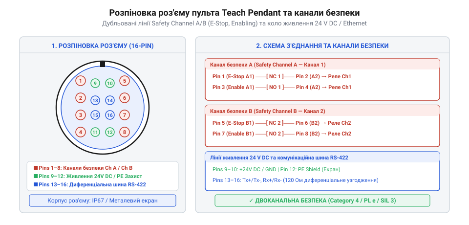
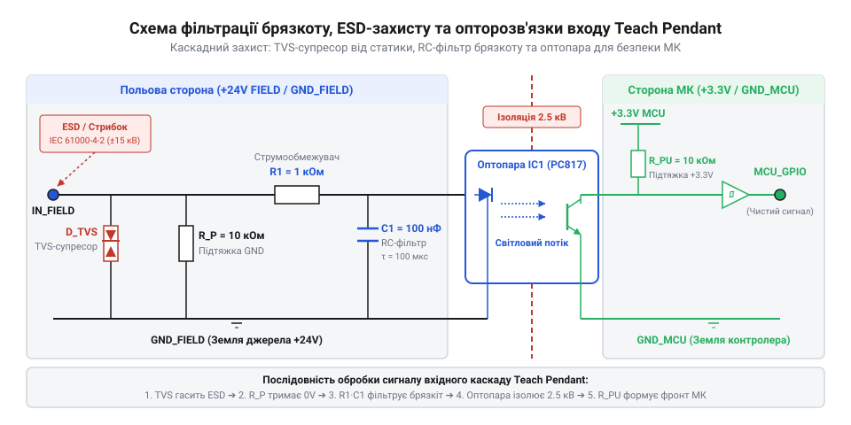

# Апаратний залізничний інтерфейс та схема розведення роз'ємів пульта налагодження

<preknowlist>
- [Кнопка аварійного стопу грибок та органи безпечного відключення (IEC 60947-5-5)](root:cat-hw-controls/estop-mushroom-button) — Примусове розмикання контактів та дубльовані лінії аварійного зупинення.
- [Трипозиційні кнопки дозволу та педалі «мертвої руки»](root:cat-hw-controls/enabling-switches-and-dead-man-pedals) — Принцип дії трипозиційних контактних механізмів панічного захисту.
- [Реле безпеки та контролери захисного відключення](root:cat-hw-controls/safety-relays-and-controllers) — Принципи побудови двоканальних кіл безпеки.
</preknowlist>

## Проблема надійності зв'язку та безпеки пульта

Підвісний пульт налагодження (від англ. @@en|Teach Pendant@@, де @@en|pendant@@ означає підвісний модуль) є мобільним терміналом керування, з яким оператор перебуває безпосередньо біля маніпулятора або всередині робочої зони роботизованого осередку. Кабельний шлейф пристрою зазнає постійних механічних вигинів, значних розтягувальних зусиль та діє в умовах потужних електромагнітних завад від зварювальних апаратів і частотних перетворювачів приводів. Будь-яке пошкодження провідників або виникнення брязкоту контактів у роз'ємах створює дві критичні загрози: хибні аварійні зупинки автоматизованої лінії або ненадійне спрацьвування кіл захисного відключення при натисканні аварійних органів вводу.

На відміну від стаціонарних пультів, де застосовуються [тумблери та блокування важелів](root:cat-hw-controls/toggle-switches-and-switch-guards), апаратний залізничний інтерфейс пульта налагодження змушений одночасно об'єднувати силове живлення низької напруги, високошвидкісні диференціальні шини цифрового зв'язку та дубльовані кола апаратної безпеки з напругою 24 В постійного струму (англ. @@en|DC@@, від @@en|Direct Current@@ — постійний струм). Пошкодження ізоляції чи наведення високочастотних імпульсів у таких комбінованих кабелях можуть призвести до наведення завад на цифрову шину або пробою сигналів безпеки на кола живлення. Для запобігання механічному руйнуванню внутрішніх провідників під час тривалої експлуатації конструкція кабельного шлейфу розраховується на допустимий мінімальний радіус вигину — @@en|minimum bend radius@@ (англ. @@en|minimum bend radius@@, від @@en|minimum@@ — мінімальний, @@en|bend@@ — вигин та @@en|radius@@ — радіус), величина якого залежить від зовнішнього діаметра кабелю `D`:

```
R_min = 10 × D      [мінімальний радіус вигину для динамічного кабельного шлейфу]
```

**Обчислення мінімального радіуса вигину для комбінованого шлейфу з зовнішнім діаметром `D = 15` мм:**

```
R_min = 10 × 15 мм      [застосування коефіцієнта динамічної гнучкості]
      = 150 мм          [мінімальний допустимий радіус вигину шлейфу]
```

Окрім геометричного обмеження радіуса `R_min = 150` мм, кабель піддається ресурсному випробуванню на стійкість до згинання — @@en|flex cycle test@@ (англ. @@en|flex cycle test@@, від @@en|flex@@ — згинати, @@en|cycle@@ — цикл та @@en|test@@ — випробування). Стандарт вимагає проходження випробувального циклу вигину та скручування на кут `±180°` тривалістю не менше `5 × 10⁶` циклів під навантаженням. Це гарантує збереження цілісності екранів і відсутність мікротріщин у мідних жилах та зовнішній поліуретановій оболонці @@en|TPU@@ протягом усього терміну служби роботизованого комплексу.

Для забезпечення функціональної надійності за міжнародним стандартом ISO 13849-1 апаратний інтерфейс пульта вимагає суворого фізичного та схемотехнічного відокремлення кіл. Схема розведення роз'ємів та трасування друкованої плати інтерфейсного модуля будуються за принципом гальванічної ізоляції цифрових даних від дубльованих ліній безпеки Safety Channel A та Safety Channel B.

## Схема розпіновки головного роз'єму та ліній безпеки

Головний багатоконтактний роз'єм пульта налагодження виконується у вигляді герметичного промислового з'єднувача (наприклад, серій @@en|M23@@ чи @@en|Han Heavy Duty@@) із позолоченими обтискними контактами, що забезпечують перехідний опір менше ніж 5 мОм. Розпіновка контактора суворо розподіляє виводи за функціональними зонами для запобігання перехресним наведенням та коротким замиканням:

1. **Контакти основного живлення**: виводи `+24V_MAIN` (pin 1) та `GND_MAIN` (pin 2) подають постійний струм для живлення внутрішнього мікроконтролера та рідкокристалічного монітора, а вивід `24V_AUX` (pin 3) живить додаткові світлодіодні індикатори.
2. **Дубльований канал безпеки Safety Channel A**: виводи `ESTOP_A1` (pin 4) та `ESTOP_A2` (pin 5) комутують розмикальний NC-контакт [кнопки аварійного зупину](root:cat-hw-controls/estop-mushroom-button), а виводи `ENABLE_A1` (pin 6) та `ENABLE_A2` (pin 7) підключаються до першого каналу [трипозиційної кнопки дозволу](root:cat-hw-controls/enabling-switches-and-dead-man-pedals).
3. **Дубльований канал безпеки Safety Channel B**: виводи `ESTOP_B1` (pin 8) та `ESTOP_B2` (pin 9) підключають другий NC-контакт кнопки E-Stop, а виводи `ENABLE_B1` (pin 10) та `ENABLE_B2` (pin 11) утворюють другий канал кнопки дозволу.
4. **Диференціальні комунікаційні пари**: виводи `TX+` / `TX-` (pins 12, 13) та `RX+` / `RX-` (pins 14, 15) виділено для передачі даних за протоколами RS-422 або Industrial Ethernet.
5. **Захисне заземлення екрана**: металевий корпус роз'єму `PE_SHIELD` (pin 16) комутується із захисним заземленням.


*Принципова схема розпіновки головного роз'єму демонструє ізольоване розведення подвоєних апаратних ліній E-Stop та Enabling Switch поруч із шинами живлення й даних.*

Схемотехніка ліній безпеки вимагає, щоб провідники Safety Channel A та Safety Channel B проходили у кабелі у складі окремих ізольованих скручених пар. Це унеможливлює виникнення прихованого перехресного замикання між каналами при механічному роздавлюванні кабелю й дозволяє дубльованим [реле безпеки та контролерам](root:cat-hw-controls/safety-relays-and-controllers) у шафі керування миттєво фіксувати розбіжність сигналів Discrepancy Fault та знеструмлювати приводи маніпулятора.

Для активного виявлення міжканального короткого замикання чи пробою на зовнішню шину живлення без відключення силових контакторів контролер безпеки подає в лінії Safety Channel A та Safety Channel B короткочасні тестові імпульси чергування (англ. @@en|test pulse@@, від лат. @@la|pulsus@@ — поштовх). Схемотехніка формувача періодично призупиняє подачу напруги в один із каналів на фіксований час t_pulse = 200 µс. Оскільки механічні та силові елементи відключення мають інерційність і час реакції t_relay ≈ 15 мс, розрахункове співвідношення гарантує відсутність хибного розмикання кіл:

    t_pulse < t_relay
    200 µs < 15000 µs        [умова нечутливості механічних контакторів до тестових імпульсів]

Якщо у разі пошкодження кабелю провідники Channel A та Channel B замкнуться між собою, тестовий імпульс із першого каналу пройде у другий канал під час його паузи, що електронна схема захисту зафіксує як замикання (англ. @@en|cross-circuit fault@@) і заблокує повторний запуск обладнання.

## Фільтрація брязкоту контактів та ESD-захист

Механічні клавіші, тактильні кнопки та тумблери вибору режимів на панелі пульта піддаються явищу брязкоту контактів (англ. @@en|contact bounce@@). Під час натискання пружні металеві площадки здійснюють серію хаотичних мікровідскоків тривалістю від 2 до 10 мс, створюючи пачку хибних імпульсів напруги. Для придушення цього ефекту кожен дискретний сигнальний вхід інтерфейсного модуля оснащують пасивним низькочастотним RC-фільтром (від англ. @@en|low-pass filter@@ — фільтр низьких частот).

Частота зрізу RC-фільтра `f_c` обчислюється за формулою:

```
f_c = 1 ÷ (2 · π · R_f · C_f)
```

При використанні підтягувального резистора `R_pull = 10 кОм`, обмежувального резистора фільтра `R_f = 1 кОм` та керамічного конденсатора `C_f = 100 нФ` постійна часу складає `τ = R_f · C_f = 100 мкс`. Це дає частоту зрізу `f_c ≈ 1.59 кГц`, що повністю згладжує високочастотний брязкіт контактів без відчутної затримки реакції системи.

Крім того, оскільки оператор постійно торкається пульта руками, виникає загроза електростатичного розрядження (англ. @@en|Electrostatic Discharge@@, скорочено @@en|ESD@@) з потенціалом до 15 кВ. Для захисту чутливих напівпровідникових компонентів паралельно вхідним лініям безпосередньо біля роз'єму монтують двоспрямовані супресори TVS-діодів (від англ. @@en|Transient Voltage Suppressor@@ — придушувач тимчасових перенапруг). Перевага TVS-діодів над класичними оксидно-металевими варисторами (англ. @@en|metal-oxide varistor@@) полягає у їхньому пікосекундному часі спрацьовування `t_clamping < 1 нс` проти `t_varistor = 5...25 нс` у варисторів, що є критичним для перехоплення швидких фронтів ESD-імпульсів за стандартом @@en|IEC 61000-4-2@@. Напруга обмеження `V_clamp` супресора обчислюється через напругу пробою `V_BR` та коефіцієнт обмеження `C_clamp`:

```
V_clamp = V_BR × C_clamp
```

При робочій зворотній напрузі лінії `V_RWM = 24 В` вибирають TVS-діод із напругою пробою `V_BR = 26.7 В` та питомим опірним коефіцієнтом `C_clamp ≈ 1.4`, що обмежує піковий сплеск на рівні `V_clamp = 26.7 × 1.4 ≈ 37.4 В`. Варистори при аналогічному піковому струмі пропускають залишкову напругу понад `60...80 В` і деградують від кожного розряду, тоді як TVS-діод витримує мільйони циклів без зміни характеристик. Для повної ізоляції мікроконтролера від залишкової перенапруги дискретні сигнали після TVS-захисту пропускають через високошвидкісні оптопари (від англ. @@en|optocoupler@@ — оптичний сполучувач).


*Принципова схемотехніка вхідного сигнального каскаду забезпечує фільтрацію брязкоту контактів, захист від електростатичних розрядів TVS-діодом та гальванічну ізоляцію оптопарою.*

## Узгодження диференціальних пар та заземлення екрана

Передача даних між мікроконтролером пульта налагодження та центральним робототехнічним контролером здійснюється за допомогою диференціальних інтерфейсів RS-422 або Industrial Ethernet 100BASE-TX. Диференціальна передача сигналів (англ. @@en|differential signaling@@) забезпечує високу завадостійкість шляхом формування двох протифазних сигналів `TX+` та `TX-`, синфазні завади на яких взаємно віднімаються на приймальному кінці.

Щоб запобігти відбиттю високочастотних сигналів від кінців довгого кабельного шлейфу (довжиною від 10 до 20 м), хвильовий імпеданс провідників на друкованій платі повинен суворо відповідати характеристичному імпедансу кабелю `Z_diff` (120 Ом для RS-422 та 100 Ом для Ethernet). На приймальному кінці між лініями паралельно підключають термінальний резистор `R_term`:

```
R_term = Z_diff
```

Нехтування термінаційним резистором призводить до появи стоячих хвиль, викривлення прямокутних фронтів цифрових імпульсів та зростання кількості помилок пакета даних CRC.

Захист від зовнішніх електромагнітних полів забезпечується подвійним екрануванням кабельного шлейфу: внутрішнім екраном з алюмінієвої фольги та зовнішнім мідним плетеним рукавом. Для запобігання утворенню замкнених контурів заземлення (англ. @@en|ground loop@@ — земляна петля), які викликають низькочастотний фон, зовнішній екран заземлюється на 360° на металевий корпус роз'єму шафи керування `PE`. На стороні пульта налагодження екран підключають до апаратного корпуса через паралельний RC-ланцюг (`R = 1 МОм`, `C = 10 нФ`, розрахований на робочу напругу 2 кВ), що розриває постійний струм земляної петлі, але забезпечує низький імпеданс для скидання високочастотних завад та енергії ESD.
