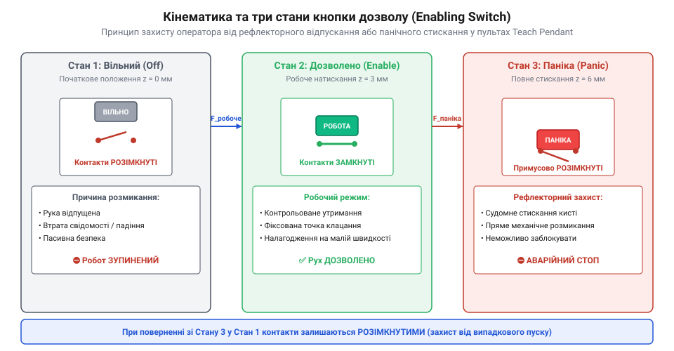
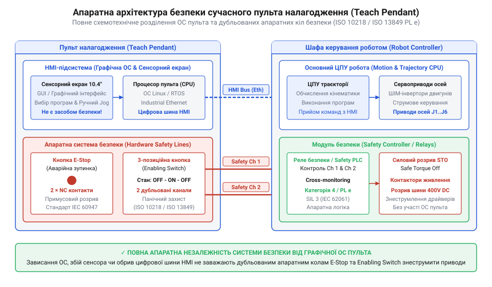

# Еволюція пультів налагодження від перших дротових кнопочних блоків Unimate до інтелектуальних сенсорних панелей

<preknowlist>
- [Кнопка аварійного стопу грибок та органи безпечного відключення (IEC 60947-5-5)](root:cat-hw-controls/estop-mushroom-button) — поняття про примусове розмикання та дубльовані лінії аварійного зупинення
- [Трипозиційні кнопки дозволу та педалі «мертвої руки»](root:cat-hw-controls/enabling-switches-and-dead-man-pedals) — принцип дії трипозиційних контактних механізмів панічного захисту
- [Реле безпеки та контролери захисного відключення](root:cat-hw-controls/safety-relays-and-controllers) — принципи побудови двоканальних кіл безпеки
</preknowlist>

## Перші кнопочні блоки роботів Unimate

На початку 1960-х років поява першого промислового маніпулятора Unimate 1900 (від англ. universal automation — універсальна автоматизація) змусила інженерів шукати спосіб завдання просторових траєкторій безпосередньо біля робочої зони. Творці робота Джордж Девол (англ. @@en|George Devol@@) та Джозеф Енгельбергер (англ. @@en|Joseph Engelberger@@) реалізували метод навчання відтворення (англ. @@en|teach-in@@). Для цього налагоджувальник брав у руки важкий металевий корпус, з'єднаний із шафою керування товстим джгутом дротів, і ставав безпосередньо в зоні досяжності гідравлічної руки. На цьому первинному пульті налагодження (від англ. @@en|Teach Pendant@@, де @@en|pendant@@ означає підвісний пульт) розміщувалися дискретні [тумблери та перемикачі](root:cat-hw-controls/toggle-switches-and-switch-guards) для поосьового вибору напрямку руху та кнопки занесення координат у пам'яті.

Оператор покроково зміщував кожну ланку маніпулятора, подаючи електричні сигнали на гідравлічні клапани. Коли робочий орган досягав потрібного положення, натисканням кнопки поточні координати з кутових кодерів (англ. @@en|shaft encoder@@) записувалися на магнітний барабан пам'яті (англ. @@en|magnetic drum memory@@, від лат. @@la|memoria@@ — пам'ять). Схемотехніка запису спиралася на паралельне опитування абсолютних енкодерів кожної осі: діодні дешифратори та транзисторні стробувальні ключі одночасно зчитували паралельний кодовий комбінат усіх п'яти осей маніпулятора. Для точної фіксації даних використали синхронізаційну доріжку (англ. @@en|clock track@@, від англ. *clock* — годинник та *track* — доріжка) барабана: у момент натискання кнопки записи синхроімпульс (англ. @@en|strobe pulse@@, від грец. @@gr|strobos@@ — вихор, обертання) дозволяв передачу коду, відкриваючи імпульсні підсилювачі (англ. @@en|write driver@@). Останні подавали потужні струмові імпульси на індуктивні голівки запису (англ. @@en|write head@@), які намагнічували окремі паралельні доріжки на нікель-кобальтовому покритті циліндра, що безперервно обертався. Кожен крок навчання формував на барабані двійкове слово точних просторових координат разом із технологічними командами стискання схвата. Під час автономного виконання системні голівки зчитування (англ. @@en|read head@@) детектували зміни магнітного потоку, перетворюючи їх назад у електричні сигнали для аналогових порівняльно-підсилювальних кіл. Схема порівняння зіставляла зчитані з барабана координати з поточним станом осей і керувала електрогідравлічними сервоклапанами (англ. @@en|servo valve@@) до повного збігу величин, завдяки чому робот послідовно зчитував записані точки та відтворював траєкторію з високою повторюваністю.

Ця технологія заклала основи програмування роботів, але створила критичний ризик для життя оператора. Гідравлічний привід @@en|Unimate@@ розвивав колосальне зусилля, а людина під час навчання перебувала всередині робочого простору. Перші пульти не мали жодних апаратних засобів захисту: не існувало ані системи обмеження швидкості, ані елементів аварійного відключення. Будь-яка помилка оператора або збій у гідророзподільнику призводили до моментального травмування без можливості зупинити маніпулятор.

## Вимоги безпеки та кнопка дозволу

Масове впровадження промислових маніпуляторів у 1970-х роках супроводжувалося зростанням кількості важких травм під час налагодження. Вирішальним поворотом у галузі став 1981 рік, коли на заводі Kawasaki (англ. @@en|Kawasaki Heavy Industries@@) стався перший офіційно зареєстрований смертельний випадок від удару маніпулятором. Це змусило міжнародні організації розробити жорсткі стандарти безпеки, серед яких ключове місце посів стандарт @@en|ISO 10218@@. Норматив зобов'язав оснащувати кожен пульт налагодження органом панічного захисту, що дістав назву [трипозиційні кнопки дозволу](root:cat-hw-controls/enabling-switches-and-dead-man-pedals) (від англ. @@en|Enabling Switch@@ або @@en|dead-man switch@@ — вимикач «мертвої руки»).

Інженерне рішення базувалося на аналізі фізіологічної реакції людини на несподівану небезпеку. У момент переляку чи больового шоку м'язи людини реагують одним із двох способів: рефлекторним розтисканням долоні або судомним стисканням кисті у кулак. Звичайна двопозиційна кнопка відключає привід лише при відпусканні, але виявляється безпорадною, якщо людина від переляку стискає рукоятку пульта. Трипозиційний механізм розриває коло примусово у двох крайніх положеннях.

*Трипозиційна кнопка дозволу замикає лінії безпеки лише у серединному стані, запобігаючи аваріям як при випусканні пульта, так і при панічному стисканні.*

Механізм має три послідовні стани. Початковий стан 1 відповідає повністю відпущеній клавіші: електричні контакти розмикаються пружиною, і приводи робота знеструмлені. Для початку руху оператор натискає клавішу до серединного стану 2, де контактна група замкнена — це дозволяє моторам виконувати мікропереміщення. Якщо людина з переляку повністю продавлює клавішу до стану 3, внутрішній кулачок зриває контакти та розмикає коло безпеки. Щоб унеможливити відмову через зварювання контактів під час струмового пробою, комутаційний вузол будують дубльованим із примусовим механічним розмиканням контактів: жорсткий кулачковий штовхач силою натискання примусово розриває зварені електричною дугою контактні площадки двох незалежних каналів, гарантуючи розрив кола. Важливою особливістю є те, що при поверненні з третього стану у початковий контакти стану 2 не замикаються повторно без повного скидання клавіші. Однак одного лише механічного штовхача недостатньо для виявлення прихованих відмов: дубльовані контакти підключають до зовнішніх [реле безпеки та контролерів](root:cat-hw-controls/safety-relays-and-controllers) за двоканальною схемою моніторингу. Контролер постійно порівнює стан обох ліній; якщо на одній із контактних площадок виникає зварювання чи електричне приварювання, реле фіксує часове розсогласування між каналами під час розмикання, відразу блокує повторне ввімкнення силових контакторів і переводить маніпулятор у захисний стоп.

Згідно з вимогами @@en|ISO 10218@@, кнопка дозволу повинна працювати у зв'язці з дубльованими [реле безпеки](root:cat-hw-controls/safety-relays-and-controllers) та червоною [кнопками аварійної зупинки](root:cat-hw-controls/estop-mushroom-button). Крім того, стандарт ввів режим зниженої швидкості @@en|T1@@ (від англ. @@en|Teach 1@@, не більше 250 мм/с) при налагодженні з пульта, що дає оператору часовий запас для реакції на небезпечний рух робота.

## Впровадження 6-осьових джойстиків та екранів

У 1990-х роках ускладнення технологічних операцій змусило розробників робототехніки відмовитися від рутинного поланкового переміщення суглобів маніпулятора. Ручне вирівнювання інструмента за допомогою матричних блоків клавіш вимагало від оператора почергового натискання кнопок кожної осі, що призводило до помилок орієнтації у просторі та збільшувало час налагодження. Інженерний прорив відбувся із впровадженням у пультах компаній @@en|FANUC@@, @@en|KUKA@@ та @@en|ABB@@ тривимірних важелів — 6-осьових джойстиків (англ. @@en|6-axis joystick@@, від @@en|joy@@ — радість та @@en|stick@@ — палиця) та алфавітно-цифрових рідкокристалічних екранів (англ. @@en|alphanumeric display@@).

Завдяки вбудованим математичним моделям перетворення координат оператор отримав змогу керувати рухом маніпулятора відносно точки центру інструмента — @@en|Tool Center Point@@ (англ. @@en|Tool Center Point@@, від @@en|tool@@ — інструмент та @@en|center@@ — центр), скорочено @@en|TCP@@. Математично перехід від нерухомої світової системи координат @@en|World@@ (англ. @@en|world coordinate system@@, від @@en|world@@ — світ) до рухомої системи @@en|TCP@@ реалізують через однорідні матриці перетворення (англ. @@en|homogeneous transformation matrix@@, від @@en|homogeneous@@ — однорідний та @@en|matrix@@ — матриця). Контролер обчислює підсумкову позицію виразом `T_TCP = T_World × T_Tool`, де матриця `T_Tool` містить лінійний зсув `[x, y, z]` і кути орієнтації `[W, P, R]` фланця пальника чи схвата. При відхиленні важеля уздовж осі інструмента контролер перераховує вектор швидкостей усіх суглобів за допомогою оберненої матриці Якобі — @@en|Jacobian matrix@@ (англ. @@en|Jacobian matrix@@, від імені математика Карла Ґустава Якобі). Це викликає синхронний розрахунок швидкостей усіх приводів робота, забезпечуючи прямолінійне переміщення інструмента в його власній орієнтації чи плавне обертання навколо точки @@en|TCP@@. Одночасно текстовий дисплей відображав поточні координати, режими роботи та повідомлення про помилки, виключивши потребу у зовнішніх моніторах.

Для забезпечення надійності система розділяла схему пульта на два незалежних рівня. Сигнали джойстика, клавіатури та дані для дисплея передавалися цифровою шиною зв'язку до основного процесора контролера. Натомість кола панічного захисту, що включали [трипозиційні кнопки дозволу](root:cat-hw-controls/enabling-switches-and-dead-man-pedals), проходили крізь пульт у вигляді виділених апаратних ліній. Жодна затримка у передачі даних чи збій у роботі текстового екрана не могли заблокувати або викривити спрацьвування механічного захисту.

## Інтелектуальні консолі та розвінчання міфу

Поява кольорових сенсорних планшетних пультів на початку 2000-х років створила поширену ілюзію, ніби апаратні кнопки та вимикачі на панелях налагодження стали застарілим рудиментом. Утім, спроба перенести кнопки аварійного вимкнення та підтвердження дій на графічний інтерфейс екрана наразилася на жорсткі фізичні та програмні обмеження. Будь-яка операційна система пульта (на кшталт @@en|Linux@@ чи @@en|Windows CE@@) піддається ризику зависання графічного сервера, затримок сенсорної панелі через забруднення мастилом або випадкових натискань.

Повторювані нещасні випадки та суворі вимоги міжнародних стандартів @@en|ISO 10218@@ і @@en|ISO 13849@@ категорично забороняють довіряти функції захисту програмному забезпеченню. Сучасна інтелектуальна консоль — це комбінований пристрій, де сенсорний екран слугує виключно для візуалізації та налаштування параметрів, а ключові елементи безпеки залишаються апаратними.

*Відокремлення логіки сенсорного графічного інтерфейсу від подвоєних апаратних ліній аварійної зупинки та захисного утримання у планшетному пульті.*

Навіть у найновіших графічних консолях [кнопка аварійного стопу грибок](root:cat-hw-controls/estop-mushroom-button) з дубльованими контактами примусового розмикання та [трипозиційні кнопки дозволу](root:cat-hw-controls/enabling-switches-and-dead-man-pedals) впаяні безпосередньо у фізичні лінії безпеки. Ці лінії прокладаються через гнучкий кабель пульта до шафи керування та комутують [реле безпеки та контролери](root:cat-hw-controls/safety-relays-and-controllers) захисного відключення. Конструктивний захист таких пультів відповідає класу @@en|IP65@@ чи @@en|IP67@@ для стійкості до падінь, пилу та рідин, задовольняючи рівень надійності @@en|PL d@@ або @@en|PL e@@ (англ. @@en|Performance Level@@, від @@en|performance@@ — продуктивність та @@en|level@@ — рівень). У сучасних бездротових пультах налагодження, де фізичний кабель відсутній, зв'язок реалізують за принципом «чорного каналу» — @@en|black channel@@ (англ. @@en|black channel@@, від @@en|black@@ — чорний та @@en|channel@@ — канал), де незахищене радіосередовище передає цикли детермінованих промислових протоколів безпеки @@en|openSAFETY@@ або @@en|PROFIsafe@@. Схемотехніка таких пультів вимагає дубльованого мікроконтролера безпеки, який додає до кожного кадру унікальний ідентифікатор пристрою, порядковий номер пакету, таймер очікування @@en|watchdog@@ та контрольну суму @@en|CRC@@. Це дозволяє миттєво виявити затримку, втрату чи спотворення радіосигналу та апаратно розімкнути кола живлення маніпулятора, зберігши високий категорійний рівень захисту без фізичного кабелю.
