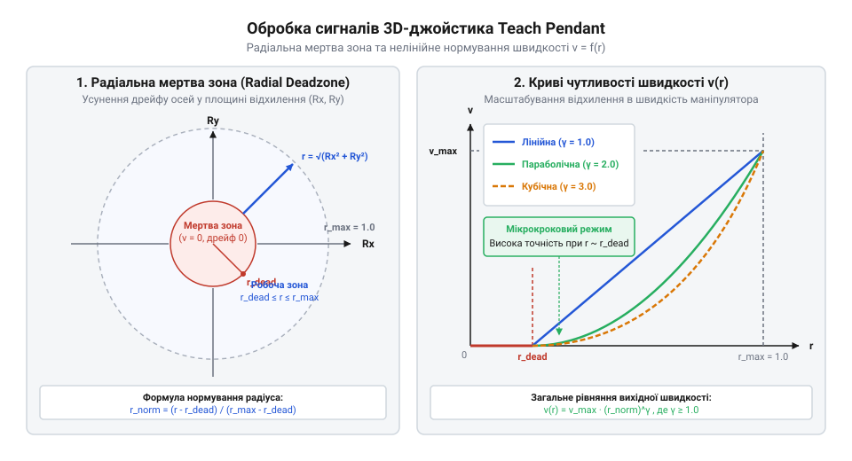
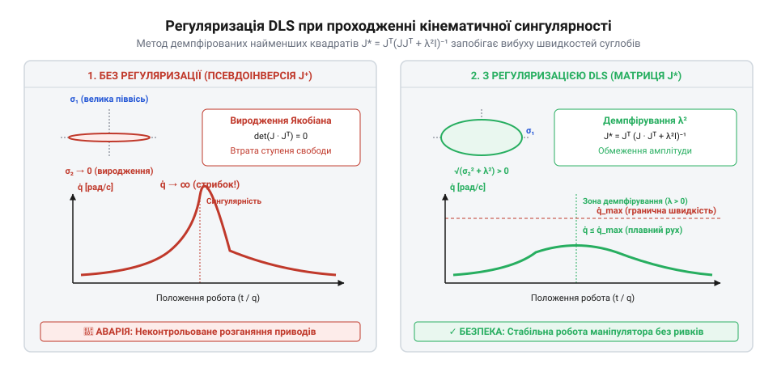

# Математичні моделі перетворення сигналів джойстика у кінематичні швидкості руху робота

<preknowlist>
- [Трипозиційні кнопки дозволу та педалі «мертвої руки»](root:cat-hw-controls/enabling-switches-and-dead-man-pedals) — Логіка активного дозволу руху та блокування команд під час ручного оперування пультами.
- [Реле безпеки та контролери захисного відключення](root:cat-hw-controls/safety-relays-and-controllers) — Принципи розрахунку часових інтервалів безпечної зупинки та апаратного переривання руху.
</preknowlist>

## Нормування та криві чутливості джойстика

Обробка сигналів ручного вводу у пультах навчання починається з усунення фізичних недосконалостей аналогових датчиків 3D-@@en|джойстика@@ (від англ. joystick — важіль керування). Неточність механічного повернення важеля у центр, варіації опору потенціометрів та дрейф нуля створюють паразитну напругу навіть у вільному стані важеля. Якщо ці сигнали подати на двигуни робота напряму, маніпулятор здійснюватиме неконтрольований дрейф, що порушує вимоги безпечного оперування кнопками з [трипозиційними кнопками дозволу](root:cat-hw-controls/enabling-switches-and-dead-man-pedals).

Для запобігання мимовільному руху сирий вектор відхилень `u = (u_x, u_y, u_z)ᵀ` піддають радіальному нормуванню. Спершу обчислюють евклідову норму відхилення `r_raw`:

```
r_raw = √(u_x² + u_y² + u_z²)
```

**Обчислення на прикладі:** Нехай сирий вектор відхилення важеля становить `u = (0.30, 0.40, 0.50)ᵀ` при максимально допустимому ході `r_max = 1.00`, радіусі мертвої зони `r_dead = 0.10` та коефіцієнті гамма-корекції `γ = 2.0`. Покроковий розрахунок нормованого вектора швидкості `v_norm` виконують за такою послідовністю:

```
r_raw = √(0.30² + 0.40² + 0.50²)
= √(0.09 + 0.16 + 0.25)                           [піднесення компонентів до квадрата]
= √0.50                                           [сумування квадратів відхилень]
≈ 0.7071                                          [обчислення евклідової норми]

r_scaled = (0.7071 - 0.10) ÷ (1.00 - 0.10)        [віднімання радіуса мертвої зони r_dead = 0.10]
= 0.6071 ÷ 0.90                                   [масштабування активного діапазону]
≈ 0.6746                                          [лінійний нормований радіус]

r_final = (0.6746)²                               [накладання гамма-кривої з γ = 2.0]
≈ 0.4551                                          [підсумковий скалярний коефіцієнт швидкості]

v_norm = 0.4551 × ((0.30, 0.40, 0.50)ᵀ ÷ 0.7071)  [множення скаляра на одиничний вектор напрямку]
= 0.4551 × (0.4243, 0.5657, 0.7071)ᵀ              [нормування напрямку]
≈ (0.1931, 0.2575, 0.3218)ᵀ                       [підсумковий нормований вектор задавання]
```

Отриманий вектор `v_norm ≈ (0.1931, 0.2575, 0.3218)ᵀ` має амплітуду `0.4551`, що суттєво менше за сирий радіус `0.7071`: нелінійна гамма-корекція стискає амплітуду у зоні середніх і малих відхилень, забезпечуючи оператору високу точність позиціонування.

```
r_raw = √(u_x² + u_y² + u_z²)
```

Якщо значення `r_raw` не перевищує радіус мертвої зони `r_dead` (зазвичай від `0.05` до `0.1` від повного ходу), вихідний вектор швидкості приймається рівним нулю. Для відхилень поза мертвою зоною виконують лінійне масштабування радіуса `r_scaled` у діапазон від `0` до `1`:

```
r_scaled = (r_raw - r_dead) ÷ (r_max - r_dead)
```

Для забезпечення подвійного режиму оперування — мікрокрокового прецизійного позиціонування та швидкісного переміщення — скалярний радіус пропускають через нелінійну криву чутливості з покажчиком степеня `γ`:

Однак на практиці апаратні осі @@en|джойстика@@ нерідко мають асиметричний механічний хід `u_max_x ≠ u_max_y ≠ u_max_z` або різний опір вимірних потенціометрів. Просте незалежне ділення кожної координати на її максимум `u_scaled_i = u_i ÷ u_max_i` викривляє напрямок вектора (перетворюючи сферичну мертву зону на еліпсоїд), через що діагональне відхилення важеля призводить до бокового дрейфу маніпулятора. Щоб зберегти вимірну ортогональність, застосовують комбіноване нормування: спочатку формують зважений вектор відхилень `u_scaled`, після чого обчислюють його норму та напрямок:

```
u_scaled = (u_x ÷ u_max_x, u_y ÷ u_max_y, u_z ÷ u_max_z)ᵀ
r_raw = √(u_scaled_x² + u_scaled_y² + u_scaled_z²)
n = u_scaled ÷ r_raw
```
[Крок 1: обчислення зваженого вектора асиметричних осей та його одиничного напрямку]

Далі радіус `r_raw` пропускають через мертву зону та гамма-криву за загальним алгоритмом, а підсумковий скаляр `r_final` множать на вектор напрямку `n`. Такий підхід гарантує рівномірний відгук маніпулятора за будь-яким діагональним напрямком незалежно від апаратних розбіжностей датчиків, конфігурованих через [DIP-перемикачі та джамперні блоки](root:cat-hw-controls/dip-switches-and-configuration-blocks).

```
r_final = (r_scaled)^γ
```

При `γ = 2.0...3.0` у зоні малих відхилень важеля коефіцієнт передачі є мінімальним, що дозволяє оператору плавно позиціонувати схват із точністю до часток міліметра. Нормований вектор напрямку `n = u ÷ r_raw` множиться на `r_final`, формуючи остаточний нормований вектор задавання `v_norm = r_final × n`.


*Залежність нормованої амплітуди швидкості від радіального відхилення важеля з мертвою зоною та експоненційними гамма-кривими чутливості.*

## Трансформація швидкостей у системах координат

Отриманий нормований вектор `v_norm` задає напрямок та відносну інтенсивність руху, однак для фізичного переміщення робота його необхідно прив'язати до конкретної тривимірної бази. У робототехніці @@en|кінематична@@ (від грец. κίνημα — рух) швидкість органу маніпулювання визначається просторовим гвинтом — вектором узагальненої швидкості `V = (v_x, v_y, v_z, ω_x, ω_y, ω_z)ᵀ`, де перші три компоненти задають лінійну швидкість, а останні три — кутову швидкість повороту.

Оператор пульта може вибирати один із трьох основних режимів керування: у світовій системі координат (@@en|World frame@@), інструментальній (@@en|Tool frame@@) або користувацькій (@@en|User frame@@). Якщо обрано світовий базис, вектор швидкості `V_world` обчислюється множенням нормованого вектора `v_norm` на константні максимальні швидкості лінійного `v_max` та кутового `ω_max` переміщення:

```
V_world = (v_max · v_norm_x, v_max · v_norm_y, v_max · v_norm_z, ω_max · ω_norm_x, ω_max · ω_norm_y, ω_max · ω_norm_z)ᵀ
```

Якщо ж керування здійснюється у рухомій системі координат інструмента (Tool frame), командний вектор `V_tool = (v_tool, ω_tool)ᵀ` необхідно перерахувати у нерухому базову систему робота за допомогою ортогональної матриці повороту `R_B_T`. Векторне перетворення лінійної `v_tool` та кутової `ω_tool` швидкостей виконується шляхом їх скалярно-матричного множення на матрицю орієнтації: `v_base = R_B_T · v_tool` та `ω_base = R_B_T · ω_tool`. Для уникнення кінематичних сингулярностей та карданного замкнення, притаманних кутам Ейлера, матрицю `R_B_T` обчислюють безпосередньо через нормований кватерніон (англ. @@en|unit quaternion@@, від латинського *quaterni* — по чотири) орієнтації схвата `q = (q_w, q_x, q_y, q_z)` за виразом:

```
R_B_T = [ 1 - 2(q_y² + q_z²)     2(q_x·q_y - q_w·q_z)   2(q_x·q_z + q_w·q_y) ]
        [ 2(q_x·q_y + q_w·q_z)   1 - 2(q_x² + q_z²)     2(q_y·q_z - q_w·q_x) ]
        [ 2(q_x·q_z - q_w·q_y)   2(q_y·q_z + q_w·q_x)   1 - 2(q_x² + q_y²) ]
```

Тут `q_w` — скалярна частина кватерніона, а `q_x`, `q_y`, `q_z` — його векторний інваріант, що задовольняє умову нормування `q_w² + q_x² + q_y² + q_z² = 1`. Отримана матриця `R_B_T` є строго ортогональною (`R_B_Tᵀ = R_B_T⁻¹`), що гарантує збереження довжини векторів швидкостей та кутових пропорцій при ручному оперуванні ручкою джойстика.

Окрім інструментального базису, у промисловій робототехніці широко застосовують користувацьку систему координат (англ. @@en|User frame@@, від англ. *User* — користувач та *frame* — система координат), яка прив'язана до похилого робочого стола, похилої деталі або конвеєрної лінії. При керуванні у даному режимі нормований вектор швидкостей `v_user` та `ω_user` перераховується у нерухому базову систему робота за допомогою ортогональної матриці повороту користувацького базису `R_B_U`:

```
v_base = R_B_U · v_user
ω_base = R_B_U · ω_user
```
[Крок 1: перетворення векторів лінійної та кутової швидкостей з користувацького базису у базовий]

Матриця R_B_U визначається під час калібрування робочої зони за трьома реперними точками й залишається константною для даної позиції деталі. Таке перетворення дозволяє операторові переміщувати схват уздовж похилої плоскості деталі при відхиленні важеля джойстика вгору чи вбік без виникнення похибок орієнтації, полегшуючи ручне налагодження траєкторій зварювання чи нанесення клею у зв'язці з [реле безпеки та контролерами](root:cat-hw-controls/safety-relays-and-controllers).

```
v_base = R_B_T · v_tool
ω_base = R_B_T · ω_tool
```

Матриця `R_B_T` є тривимірною матрицею орієнтації схвата відносно бази, обчисленою через поточні кути суглобів. Це гарантує, що при штовханні джойстика «вперед» схват рухатиметься строго вздовж своєї поздовжньої осі незалежно від поточного просторового нахилу робота.

## Диференціальна кінематика та матриця Якобі

Сформований просторовий вектор швидкості `V_base` описує бажаний рух робочого органу у @@en|декартівському@@ (від лат. @@la|Cartesius@@ — Рене Декарт) просторі. Однак виконавчі сервоприводи робота обертають шарніри у суглобовому просторі (@@en|Joint space@@) з кутовими швидкостями `q̇ = (q̇₁, q̇₂, ..., q̇_n)ᵀ`. Зв'язок між векторними швидкостями суглобів та просторовим гвинтом схоплювача задається основоположним рівнянням диференціальної кінематики через @@en|Якобіан@@ (від лат. @@la|Jacobianus@@ — на честь математика К. Г. Я. Якобі). Тут математично важливо розрізняти @@en|геометричний Якобіан@@ `J_g(q)` та @@en|аналітичний Якобіан@@ `J_a(q)` (від грец. @@el|analytikos@@ — розкладений на складові). Математична структура геометричного Якобіана `J_g(q) = [J₁, J₂, ..., J_n]` пов'язує кутові швидкості суглобів безпосередньо з вектором лінійної швидкості `v` та вектором миттєвої кутової швидкості `ω` схвата у тривимірному просторі `V_base = [v; ω]ᵀ`. Стовпчики `J_i` геометричного Якобіана будуються прямо з геометрії звеньїв: для обертальних суглобів верхня лінійна частина стовпчика формується через векторний добуток `z_(i-1) × (p - p_(i-1))`, де `z_(i-1)` — орт осі обертання, `p` — вектор положення схвата, а `p_(i-1)` — координати центрів осей, тоді як нижня частина дорівнює напрямному орт-вектору `z_(i-1)`. Натомість аналітичний Якобіан `J_a(q)` виводиться як часова похідна від вектора просторового стану `x = [p; ϕ]ᵀ`, де орієнтація `ϕ` задається мінімальним набором кутів (наприклад, кутами Ейлера). Оскільки похідна кутів Ейлера `ϕ̇` не збігається з фізичною кутовою швидкістю `ω` (`ω = E(ϕ) · ϕ̇`), аналітичний Якобіан вносить додаткові параметричні сингулярності матриці `E(ϕ)` — зокрема @@en|карданний замок@@ (англ. @@en|gimbal lock@@). При ручному керуванні роботом від 3D-джойстика, що задає векторні швидкості `[v; ω]ᵀ`, застосовують саме геометричний Якобіан, який гарантує інваріантність відносно параметризації орієнтації та запобігає штучному блокуванню суглобів. У результаті просторовий гвинт швидкостей виражається матричним добутком:

```
V_base = J(q) · q̇
```

Де `J(q)` — матриця Якобі розмірністю `6 × n`, елементи якої є частковими похідними просторових координат за кутами суглобів `q`. Для обчислення необхідних кутових швидкостей шарнірів `q̇`, які повинен відпрацювати контролер приладів у відповідь на відхилення джойстика, виконують обернення матричного рівняння:

```
q̇ = J⁺(q) · V_base
```

Де `J⁺(q)` — псевдоінверсна матриця Мура-Пенроуза (англ. @@en|Moore-Penrose pseudoinverse@@). Для ненадлишкового 6-осьового маніпулятора у невироджених станах псевдоінверсна матриця збігається зі звичайною оберненою матрицею:

```
J⁺(q) = J⁻¹(q)
```

Обчислення `q̇` виконується у кожному циклі сервоконтролера з періодом від `1` до `4` мілісекунд. Проте коли маніпулятор витягується у повну довжину або складає суглоби у площину, детермінант матриці Якобі наближається до нуля `det(J) → 0`. У цих вироджених точках обернена матриця `J⁻¹` прямує до нескінченності, що призводить до математичного розриву та небезпечного стрибка швидкостей сервоприводів.

## Регуляризація сингулярностей та Демпфіровані найменші квадрати

Під час оперування маніпулятором за допомогою джойстика рухома конструкція може потрапляти у вироджені конфігурації — сингулярності (англ. @@en|singularity@@, від лат. @@la|singularis@@ — поодинокий). У цих точках детермінант матриці Якобі прямує до нуля `det(J(q)) → 0`, що означає втрату одного або кількох ступенів свободи у декартовому просторі. При застосуванні класичного псевдообернення Мура — Пенроуза `q_dot = J⁺ · V` обернена матриця містить зникаюче малі дільники, через що обчислені кутові швидкості сервоприводів `q_dot` прямують до нескінченності. Практично це спричиняє небезпечні аварійні рывки суглобів маніпулятора навіть при незначному відхиленні важеля джойстика.

Для усунення нескінченних швидкостей та забезпечення стійкого руху у зоні сингулярностей застосовують метод регуляризації демпфованих найменших квадратів (англ. @@en|Damped Least Squares@@, скорочено DLS). Замість точного розв'язання рівняння кінематики DLS мінімізує зважену суму похибки відстеження швидкості схвата та величини кутових швидкостей суглобів. Математична модель регуляризованого обернення Якобіана описується формулою:

```
q_dot = Jᵀ · (J · Jᵀ + λ² · I)⁻¹ · V      [регуляризоване обчислення швидкостей суглобів]
```

тут `Jᵀ` — транспонована матриця Якобі, `I` — одинична матриця відповідної розмірності, а `λ` — параметр демпфування (англ. @@en|damping factor@@). Коефіцієнт `λ` розраховують динамічно на основі показника маніпулятивності Йошікави `w = √(det(J · Jᵀ))`.


*Схема трансформації овалу маніпулятивності та згладжування швидкостей суглобів методом Демпфірованих найменших квадратів у зоні кінематичної сингулярності.*

Коли маніпулятор перебуває далеко від вироджених точок (`w ≥ w_0`), параметр демпфування дорівнює нулю `λ = 0`, і формула DLS повністю збігається з точним псевдооберненням. При наближенні до сингулярності (`w < w_0`) коефіцієнт `λ²` плавно зростає за квадратичним законом:

```
λ² = λ_max² · (1 - w / w_0)²             [динамічний коефіцієнт демпфування]
```

Збільшення параметра демпфування `λ` створює математичний компроміс між обмеженням кутових швидкостей суглобів `q_dot` та виникненням векторної похибки відстеження швидкості схвата `ΔV = V - J · q_dot`. Підстановка регуляризованого Якобіана у вираз похибки дає пряму алгебраїчну залежність відхилення напрямку від `λ²`:

```
ΔV = V - J · Jᵀ · (J · Jᵀ + λ² · I)⁻¹ · V
= (I - J · Jᵀ · (J · Jᵀ + λ² · I)⁻¹) · V   [винесення вектора заданої швидкості V]
= λ² · (J · Jᵀ + λ² · I)⁻¹ · V             [приведення до спільного знаменника]
```

Для наочної геометричної інтерпретації похибки напрямку застосовують сингулярний розклад (англ. @@en|singular value decomposition@@, скорочено SVD) матриці Якобі `J = U · Σ · Vᵀ`, де `U` — ортогональна матриця власних векторів декартового простору `u_i`, `V` — ортогональна матриця осей суглобів `v_i`, а `Σ = diag(σ₁, σ₂, ..., σ_m)` — діагональна матриця сингулярних чисел `σ_i`. Підстановка SVD-розкладу у вираз похибки розкладає вектор `ΔV` за осями декартового овалу маніпулятивності:

```
ΔV = U · diag(λ² / (σ_i² + λ²)) · Uᵀ · V   [проекція похибки на осі декартового простору]
```

Із цього коефіцієнтного розкладу видно геометричну суть регуляризації: для головних напрямків з великим сингулярним числом `σ_i ≫ λ` ваговий множник `λ² / (σ_i² + λ²) → 0`, що зберігає точний рух без відхилень. Уздовж виродженої осі з зникаюче малим `σ_i ≪ λ` множник прямує до одиниці `λ² / (σ_i² + λ²) → 1`, через що похибка повністю поглинає задану швидкість `ΔV_i ≈ V_i`. Метод DLS працює як вибірковий геометричний фільтр: він пригнічує лише небезпечну складову руху уздовж сингулярної осі `u_i`, залишаючи переміщення за іншими незбуреними напрямками повністю точним.

```
ΔV = V - J · Jᵀ · (J · Jᵀ + λ² · I)⁻¹ · V
= (I - J · Jᵀ · (J · Jᵀ + λ² · I)⁻¹) · V   [винесення вектора заданої швидкості V]
= λ² · (J · Jᵀ + λ² · I)⁻¹ · V             [приведення до спільного знаменника]
```

З отриманої формули видно, що уздовж сингулярної осі з малим сингулярним числом `σ_i ≪ λ` похибка напрямку досягає `ΔV_i ≈ V_i`, що означає м'яке пригнічення руху в напрямку виродження. Це запобігає нескінченному зростанню швидкостей сервоприводів `q_dot_i = (σ_i / (σ_i² + λ²)) · V_i`, утримуючи їх у межах допуску.

```
λ² = λ_max² · (1 - w / w_0)²             [динамічний коефіцієнт демпфування]
```

Введення параметра `λ²` гарантує, що матриця `(J · Jᵀ + λ² · I)` залишається строго позитивно визначеною з обмеженим детермінантом у будь-якій точці робочого простору. Ціною цього є виникнення незначної геометричної похибки напрямку руху `ΔV` у безпосередній близькості до сингулярності, проте кутові швидкості суглобів `q_dot` залишаються суворо обмеженими, що виключає хибні спрацьовування у [реле безпеки та контролерах захисного відключення](root:cat-hw-controls/safety-relays-and-controllers).

## Обмеження швидкостей та робочого простору

Обчислені після DLS-регуляризації кутові швидкості `q_dot` визначають бажану динаміку суглобів, проте вони повинні підпорядковуватися фізичним обмеженням приводу та безпечним межам робочого простору (англ. @@en|workspace limits@@). Кожен сервопривід маніпулятора має граничну конструктивну швидкість `q_dot_max`, а кожна вісь — апаратні кутові межі `[q_min, q_max]`.

Якщо при швидкому відхиленні важеля джойстика одна з компонент вектора швидкості перевищує допустимий поріг `|q_dot_i| > q_dot_i_max`, просте обмеження цієї однієї координати викривлює підсумковий вектор руху схвата робота. Для збереження заданого напрямку переміщення у декартовому просторі драйвер застосовує пропорційне векторне масштабування:

```
s = min_i (q_dot_i_max / |q_dot_i|)       [скалярний коефіцієнт масштабування]
q_dot_scaled = s · q_dot                   [коригування вектора швидкості]
```

Якщо скалярний коефіцієнт `s < 1`, увесь вектор кутових швидкостей пропорційно зменшується, зберігаючи траєкторію руху схвата без відхилення від вказівки оператора.

Для запобігання ударам об механічні упори при наближенні суглоба `q_i` до меж `q_min` або `q_max` у межах буферної зони `Δq_buf` впроваджують коефіцієнт гальмування `k_decel`:

Окрім абсолютних швидкостей, реальні механічні вузли обмежені моментом двигунів і не можуть змінювати швидкість миттєво без ризику перевантаження приводів чи збудження вібрацій маніпулятора. Динамічну здатність сервоприводу описує граничне кутове прискорення `q_ddot_max` (англ. @@en|angular acceleration limit@@, від @@en|angular@@ — кутовий, @@en|accelerate@@ — прискорювати та @@en|limit@@ — межа). За один крок дискретизації контролера `Δt` зміна швидкості `i`-го суглоба `|q_dot_i(t) - q_dot_i(t - Δt)|` не повинна перевищувати допустимий приріст `q_ddot_i_max · Δt`. Якщо при різкому русі важеля джойстика потрібне прискорення хоча б однієї осі виходить за цю межу, драйвер застосовує пропорційне зрізання приросту для всього вектора швидкостей:

```
s_acc = min_i (q_ddot_i_max · Δt ÷ |q_dot_i(t) - q_dot_i(t - Δt)|)    [скалярний коефіцієнт обмеження прискорення]
q_dot_acc(t) = q_dot(t - Δt) + min(1, s_acc) · (q_dot(t) - q_dot(t - Δt))  [коригування вектора швидкості за прискоренням]
```

Завдяки цьому величина зміни швидкостей узгоджується з фізичними можливостями приводів, а робот плавно розганяється та гальмує строго уздовж заданої джойстиком траєкторії.

Окрім абсолютних швидкостей, реальні механічні вузли обмежені моментом двигунів і не можуть змінювати швидкість миттєво без ризику перевантаження приводів чи збудження вібрацій маніпулятора. Динамічну здатність сервоприводу описує граничне кутове прискорення `q_ddot_max` (англ. @@en|angular acceleration limit@@, від @@en|angular@@ — кутовий, @@en|accelerate@@ — прискорювати та @@en|limit@@ — межа). За один крок дискретизації контролера `Δt` зміна швидкості `i`-го суглоба `Δq_dot_i = q_dot_i(t) - q_dot_i(t - Δt)` не повинна перевищувати допустимий приріст `q_ddot_i_max · Δt`. Якщо при різкому русі джойстика потрібне прискорення хоча б однієї осі виходить за цю межу, драйвер застосовує пропорційне зрізання приросту для всього вектора швидкостей:

```
s_acc = min_i (q_ddot_i_max · Δt ÷ |q_dot_i(t) - q_dot_i(t - Δt)|)    [скалярний коефіцієнт обмеження прискорення]
q_dot_acc(t) = q_dot(t - Δt) + min(1, s_acc) · (q_dot(t) - q_dot(t - Δt))  [коригування вектора швидкості за прискоренням]
```

Завдяки цьому величина зміни швидкостей узгоджується з фізичними можливостями приводів, а робот плавно розганяється та гальмує строго уздовж заданої джойстиком траєкторії.

```
k_decel = (q_max - q_i) / Δq_buf           [коефіцієнт гальмування біля верхньої межі]
```

Коефіцієнт `k_decel` плавно зменшує допустиму швидкість у напрямку межі від `1` до `0`, що забезпечує м'яку зупинку приводу. У поєднанні з [трипозиційними кнопками дозволу](root:cat-hw-controls/enabling-switches-and-dead-man-pedals) таке математичне масштабування створює повний завадостійкий контур керування роботом від ручного джойстика.
