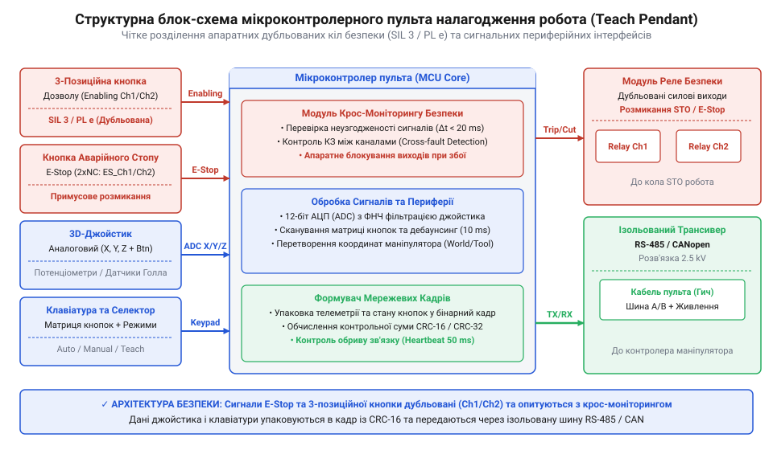
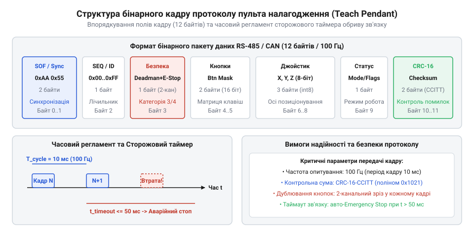

# Проєктування та прошивкова реалізація мікроконтролерного модуля безпечного пульта налагодження

<preknowlist>
- [Трипозиційні кнопки дозволу та педалі «мертвої руки»](root:cat-hw-controls/enabling-switches-and-dead-man-pedals) — принципи 3-позиційного зчитування та тристадійного контактування
- [Кнопка аварійного стопу грибок та органи безпечного відключення (IEC 60947-5-5)](root:cat-hw-controls/estop-mushroom-button) — концепція подвійного розмикання та примусового розриву контактів
- [Реле безпеки та контролери захисного відключення](root:cat-hw-controls/safety-relays-and-controllers) — алгоритми діагностики розсинхронізації каналів та реакції на відмови
</preknowlist>

## Вимоги та архітектура пульта налагодження

Пульт налагодження (Teach Pendant) є основним органом ручного оперування та програмування промислового робота в безпосередній близькості від його робочої зони. Оскільки оператор перебуває в зоні потенційного досягнення маніпулятора, до схемотехніки та прошивки пульта висуваються найвищі вимоги безпеки згідно зі стандартами ISO 13849-1 (рівень PL d/e) та IEC 62061 (SIL 2/3).

Ключовий архітектурний принцип полягає в суворому фізичному та логічному розділенні двох функціональних трактів: кола екстреного відключення (кола безпеки) та тракту телеметрії й органів вводу (джойстик, матрична клавіатура, перемикач режимів).

*Схемотехнічна архітектура пульта налагодження з двоканальним дублюванням кіл безпеки та відокремленими лініями вводу телеметрії.*

Апаратна структура пульта базується на мікроконтролері, який опитує аналогові та цифрові сенсори і формує захищені пакети даних для передачі на головний контролер робота через диференціальну шину RS-485 (протокол Modbus RTU або замовний) або CAN-шину. Двоканальні лінії від кнопки аварійної зупинки та 3-позиційного клавіша дозволу підключаються до окремих входів мікроконтролера з апаратною фільтрацією для подальшого програмного крос-моніторингу (від англ. @@en|cross-monitoring@@). Особлива увага приділяється обробці аналогових ліній 3D-джойстика, які схильні до зчитування високочастотних імпульсних завад від силових приводів маніпулятора. Для придушення завад безпосередньо біля виводів АЦП інтегрують пасивні апаратні RC-фільтри низьких частот (від англ. @@en|low-pass RC filter@@) із частотою зрізу (від англ. @@en|cutoff frequency@@) у діапазоні 300–1500 Гц (типові номінали R = 1 кОм ... 4.7 кОм та C = 10 нФ ... 100 нФ). Частоту дискретизації АЦП (від англ. @@en|sampling rate@@) обирають на рівні 100–1000 Гц із застосуванням апаратного оверсемплінгу (від англ. @@en|oversampling@@) та усереднення, що дозволяє ефективно згладити флуктуації напруги й відфільтрувати мережевий шум без виникнення відчутної групової затримки (від англ. @@en|group delay@@) при ручному керуванні роботом.

Для забезпечення узгодженості даних між прошивкою пульта та робототехнічним контролером вирівнювання структур у пам'яті фіксується упаковкою `#pragma pack(push, 1)`. У мові C компілятори за замовчуванням вирівнюють поля за кордонами 2, 4 або 8 байтів залежно від розрядності цільової архітектури. Наприклад, 32-бітний мікроконтролер ARM Cortex-M та 64-бітний процесор x86 промислового ПК вставляють різну кількість байтів заповнення (@@en|padding@@) між одиничними прапорами й 16-бітними масивами осей джойстика. Без примусового пакування кадру пряме накладання вихідного бінарного буфера на структуру в пам'яті призведе до зсуву полів, викривлення значень телеметрії та помилки обчислення контрольної суми CRC.

:::code proj-industrial-teach-pendant-controller/c/include/pendant_types.h 61-70

В об'єктно-орієнтованій реалізації на C++ структуру мережевого кадру також жорстко пакують для гарантії байтової ідентичності бінарного представлення.

:::code proj-industrial-teach-pendant-controller/cpp/include/teach_pendant_controller.hpp 31-42

## Обробка двоканальних сигналів органів безпеки

Для запобігання нещасним випадкам при апаратних відмовах (наприклад, зварюванні контактів або обриві проводу) усі органи безпеки пульта виконуються дубльованими. [Кнопка аварійного стопу грибок та органи безпечного відключення (IEC 60947-5-5)](root:cat-hw-controls/estop-mushroom-button) має два розмикальні контакти (Normally Closed, NC), а 3-позиційна кнопка дозволу — два незалежні контактні блоки.

Зчитування органів безпеки базується на алгоритмі крос-моніторингу (від англ. @@en|cross-monitoring@@). Мікроконтролер постійно порівнює логічні стани першого та другого каналів. У нормі контакти повинні перемикатися одночасно. Якщо між спрацьовуванням каналів виникає часовий розсинхрон (через механічний знос або електричний брязкіт), запускається програмний таймер неузгодженості `PENDANT_DISCREPANCY_TIMEOUT_MS` (зазвичай 50 мс). При короткочасних мікродефлексіях або вібраціях контактів, коли розсинхрон триває менше порогу і відновлюється, таймер автоматично скидається. Такий часовий гістерезис запобігає хибним спрацьовуванням від транзитних завад, проте якщо розсинхронізація триває довше допустимого порогу 50 мс, система фіксує фатальну помилку (від англ. @@en|Discrepancy Fault@@) та незворотно блокує дозвіл руху `safety_ok = false`. Поряд із часовим моніторингом, для виявлення перехресних коротких замикань між суміжними лініями ще до моменту натискання кнопок застосовується схемотехніка імпульсного самотестування (від англ. @@en|pulse testing@@). Виходи контролера T1 та T2 подають у кола каналів зсунуті по фазі тестові імпульси нульового потенціалу тривалістю в кілька сотень мікросекунд. Якщо лінії каналів замкнуті між собою, тестовий спалах 0 В каналу T1 проникає у канал T2, що дозволяє мікроконтролеру негайно зафіксувати апаратне коротке замикання (від англ. @@en|cross-channel short circuit@@) і перевести систему в стан відмови.

Програмний аналіз [трипозиційних кнопок дозволу та педалей «мертвої руки»](root:cat-hw-controls/enabling-switches-and-dead-man-pedals) розрізняє три фізичні стани:
1. **Позиція 1 (Released / Off):** Клавіш повністю відпущено. Контакти розімкнені. Рух робота заборонено.
2. **Позиція 2 (Center Enabled):** Клавіш утримується в середньому положенні. Контакти замкнені. Рух робота дозволено (за умови `ESTOP_OK`).
3. **Позиція 3 (Panic Compressed):** Оператор у паніці стиснув клавіш до упору. Контакти примусово розмикаються. Рух негайно заблоковано.

Діагностика збоїв кіл безпеки інтегрується безпосередньо в базовий цикл обробки пульта, аналогічно до того, як це виконують зовнішні [реле безпеки та контролери захисного відключення](root:cat-hw-controls/safety-relays-and-controllers).

Обробник у мові C реалізує покроковий крос-моніторинг із фіксацією часових позначок неузгодженості:

:::code proj-industrial-teach-pendant-controller/c/include/pendant_driver.h 20-31

:::code proj-industrial-teach-pendant-controller/c/src/pendant_driver.c 29-92

У C++ реалізації обробку стану кнопки дозволу винесено в окремий метод автомата станів, який декодує комбінації двоканальних пінів у строгий `enum class EnablingState`:

:::code proj-industrial-teach-pendant-controller/cpp/src/teach_pendant_controller.cpp 14-26

## Опитування джойстика та матричної клавіатури

Ручне переміщення маніпулятора (Jogging) здійснюється за допомогою 3D-джойстика позиціонування та допоміжної [матричної клавіатури 4×4 (тактильної)](root:cat-hw-controls/keypad-4x4-tactile) або [мембранної клавіатури](root:cat-hw-controls/keypad-4x4-membrane). Основні завдання прошивки при опитуванні джойстика — компенсація дрейфу аналогового нуля, усунення нечутливості навколо центру та неблокуюче згладжування брязкоту контактів кнопок.

Аналогові сигнали осей X, Y, Z зчитуються 12-бітним АЦП (діапазон відліків 0..4095, початкова теоретична центральна точка 2048). Для компенсації початкової технологічної похибки потенціометрів джойстика та температурного дрейфу нуля (від англ. @@en|zero-drift compensation@@) при кожному ввімкненні прошивки пульта виконується процедура автоматичного вимірювання кастомного зсуву нейтралі (@@en|auto-zero calibration@@). Упродовж перших 500 мкс після подачі живлення, коли важіль джойстика гарантовано перебуває у вільному стані під дією утримувальних пружин, мікроконтролер виконує серію з N = 64 вибірок АЦП для кожної осі й обчислює математичне середнє `V_zero_x`, `V_zero_y`, `V_zero_z`, яке зберігається в оперативній пам'яті як реальний центр `V_center`. Навколо обчисленого відкаліброваного центру задається зона нечутливості deadband (наприклад, ±120 відліків від `V_zero`). Якщо поточне значення АЦП перебуває всередині цієї зони, координата вважається строго нульовою, що виключає самовільне сповзання робота. При виході відхилення за межі deadband лінійний відлік нормалізується відносно розрахованого `V_center` у симетричний діапазон швидкості -1000..+1000. Для досягнення високої точності позиціонування застосовується нелінійне квадратичне масштабування чутливості (@@en|quadratic scaling@@): при малих нахилах важеля швидкість зростає плавно для ювелірного мікропереміщення робота, а при наближенні джойстика до крайніх положень квадратична крива стрімко виходить на максимальні значення швидкості.

Критичний інваріант безпеки: якщо прапор `safety_ok == false` (E-Stop натиснуто або кнопка дозволу не в середньому положенні), вихідні координати джойстика в кадрі телеметрії примусово обнуляються, незалежно від фізичного нахилу важеля оператором.

*Упаковка бінарного кадру телеметрії з виділенням прапорів стану безпеки, осей джойстика та контрольної суми CRC-16.*

Після формування карти регістрів обчислюється 16-бітна контрольна сума CRC-16 (Modbus або CCITT) по всьому тілу кадру. Контролер робота перевіряє CRC-16 та при трьох послідовних помилках або затримці пакета понад 50 мс через Watchdog активує зупинку робота.

Функції фільтрації осей джойстика та упакування кадру мовою C реалізовано наступним чином:

:::code proj-industrial-teach-pendant-controller/c/src/pendant_driver.c 94-173

Приклад циклу роботи та симуляції сценаріїв збоїв у головній програмі C:

:::code proj-industrial-teach-pendant-controller/c/main.c 30-96

В об'єктно-орієнтованому модулі C++ неблокуюча фільтрація брязкоту контактів (debounce 10 мс), обчислення CRC16 та збірка пакета виконуються всередині класу `TeachPendantController`:

:::code proj-industrial-teach-pendant-controller/cpp/src/teach_pendant_controller.cpp 28-100

Перевірка та розпакування кадру телеметрії в обробнику C++:

:::code proj-industrial-teach-pendant-controller/cpp/src/main.cpp 42-72

## Пакування кадрів зв'язку та контроль телеметрії

Передача розрізнених сигналів органів вводу через довгий промисловий кабель вимагає упаковки даних у бінарний кадр з апаратним захистом цілісності. Пряме передавання сирих аналогових чи цифрових рівнів не гарантує захисту від електромагнітних завад, що спричиняють викривлення значень координат 3D-джойстика чи стану кнопок. Для забезпечення надійної телеметрії прошивка пульта формує структурований пакет даних із фіксованим заголовочним байтом `0xAA`, маскою кнопок, нормалізованими координатами осей та апаратно перевіряється в контролері робота.

Для уникнення розбіжностей у вирівнюванні полів структура кадру пакується директивою `#pragma pack(push, 1)`. Для виявлення викривлення бітів під час передачі по шині RS-485 обчислюється програмна 16-бітна контрольна сума (від англ. @@en|CRC-16 Modbus@@), яка виявляє пачки завад до 16 біт. При адаптації пульта під шину CAN телеметрія пакується у кадри, де бітові прапори заголовка визначають формат повідомлення: прапор розширеного кадру IDE (від англ. @@en|Identifier Extension bit@@) задає 11-бітний базовий або 29-бітний розширений ідентифікатор CAN ID, прапор RTR (від англ. @@en|Remote Transmission Request@@) відокремлює інформаційний кадр даних від запиту передачі, а поле DLC вказує довжину корисного навантаження. На відміну від прикладного CRC-16 Modbus, апаратний CRC-15 CAN (від англ. @@en|CRC-15 CAN@@) обчислюється безпосередньо контролером шини на рівні канального шару разом із біт-стаффінгом (від англ. @@en|bit stuffing@@). Завдяки Хеммінговій відстані (від англ. @@en|Hamming distance@@) HD = 6, CRC-15 гарантує виявлення до 5 поодиноких спотворених бітів у кадрі, забезпечуючи вищу стійкість у критично завадопідданих промислових середовищах. Додатково приймальна сторона контролюється сторожовим таймером (від англ. @@en|watchdog timer@@): якщо новий кадр із валідною контрольною сумою не надходить упродовж заданого часового вікна (наприклад, 50 мс), приймальний модуль ініціює безпечне відключення приводів через [реле безпеки](root:cat-hw-controls/safety-relays-and-controllers). Алгоритм вибору тривалості сторожового таймера `T_wd` жорстко прив'язаний до швидкості шини RS-485 та періоду циклічної відправки пакетів `T_poll`. Розрахунок граничної частоти телеметрії виконується за тривалістю кадру: при передачі `16` байтів із форматоутворенням 10 біт на байт (1 стартовий, 8 даних, 1 стоп-біт) на швидкості 115200 біт/с фізичний час передачі становить `T_frame = (10 · 16) / 115200 ≈ 1.39 мс`, що дає максимальну межу `1 / 1.39 мс ≈ 719 Гц`. Задля збереження завантаження шини не вище 15–20% прошивка пульта надсилає кадри з періодом `T_poll = 10 мс` (частота 100 Гц). Допустимий поріг `T_wd` обирають у діапазоні від 3 до 5 періодів опитування (30..50 мс), що дозволяє проігнорувати 1–2 поодинокі спотворення кадрів через короткочасні імпульсні завади на шині, але при справжньому обриві кабелю гарантує активацію аварійного зупину Категорії 0 раніше, ніж вибіг робота вийде за допустимі межі безпеки ISO 13849-1.

:::tabs
@c
:::code proj-industrial-teach-pendant-controller/c/include/pendant_types.h 61-70
:::code proj-industrial-teach-pendant-controller/c/src/pendant_driver.c 130-174

@cpp
:::code proj-industrial-teach-pendant-controller/cpp/include/teach_pendant_controller.hpp 32-42
:::code proj-industrial-teach-pendant-controller/cpp/src/teach_pendant_controller.cpp 68-101
:::

## Збірка прошивки пульта та тестування

Об'єднання всіх периферійних модулів у єдину систему здійснюється за допомогою неблокуючого скінченного автомата станів (@@en|FSM@@). Головний цикл прошивки періодично опитує контакти [кнопки аварійного стопу](root:cat-hw-controls/estop-mushroom-button) та [трипозиційного вимикача дозволу](root:cat-hw-controls/enabling-switches-and-dead-man-pedals), передаючи сирі значення в модуль крос-моніторингу для виявлення розсинхронізації каналів. Лише за умови повної відповідності обох ліній та відсутності помилок таймера неузгодженості виставляється результуючий прапор `safety_ok`, який дозволяє трансляцію оцифрованих координат джойстика у кадр керування. У разі виникнення фатальної відмови каналів автомат засуває стан помилки (@@en|latched fault@@) та заносить її код у діагностичний журнал (@@en|event log@@). Скидання прапорів апаратних відмов можливе лише після усунення розсинхронізації, повернення кнопок у вихідне розімкнене положення та проходження процедури квитування (@@en|fault reset sequence@@), що виключає випадковий запуск робота після збою.

Тестування прошивки охоплює симуляцію основних експлуатаційних сценаріїв: штатного утримання клавіша дозволу в середньому положенні, рефлекторного панічного стискання до упору, натискання грибка E-Stop та виникнення апаратного розриву одного з дубльованих кіл. У разі зафіксованої відмови автомат станів негайно обнуляє вихідні вектори руху в бінарному кадрі та блокує передачу активних команд до відновлення працездатності кіл.

:::tabs
@c
:::code proj-industrial-teach-pendant-controller/c/main.c 17-98

@cpp
:::code proj-industrial-teach-pendant-controller/cpp/src/main.cpp 15-73
:::
