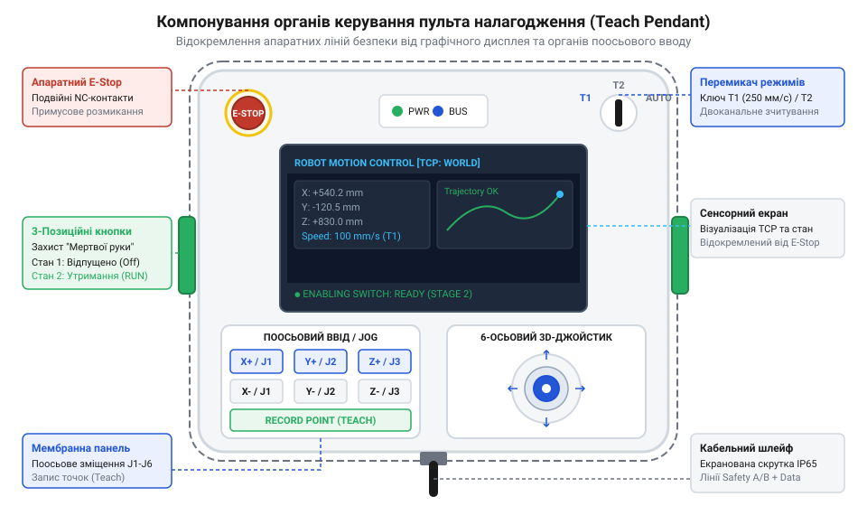
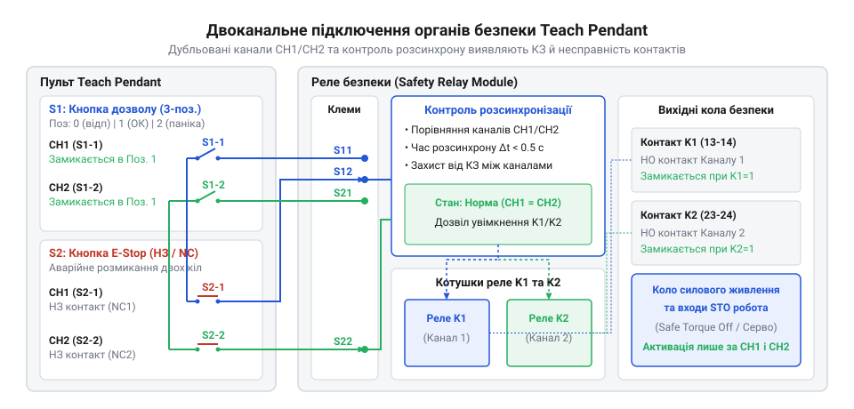
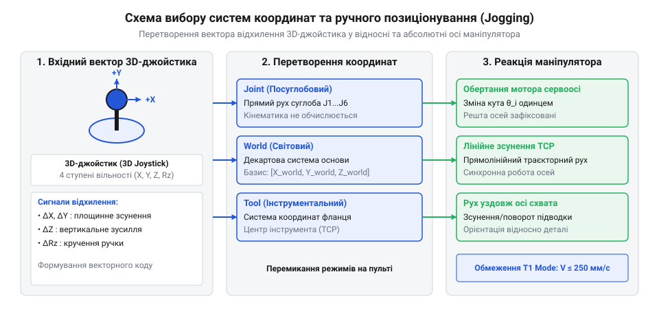

# Пульт налагодження промислових роботів (Teach Pendant)

<preknowlist>
- [Кнопка аварійного стопу грибок та органи безпечного відключення (IEC 60947-5-5)](root:cat-hw-controls/estop-mushroom-button) — Принципи роботи розмикальних контактів із примусовим відкриттям та фіксацією стану.
- [Трипозиційні кнопки дозволу та педалі «мертвої руки»](root:cat-hw-controls/enabling-switches-and-dead-man-pedals) — Функціонування 3-позиційного механізму дозволу в станах спокою, натиснення та паніки.
- [Реле безпеки та контролери захисного відключення](root:cat-hw-controls/safety-relays-and-controllers) — Принцип обробки двоканальних сигналів та діагностика перехресних коротких замикань.
</preknowlist>

## Призначення та ризики ручного налагодження

Точне програмування траєкторій маніпулятора, позиціонування робочого органу (сваркового клеща, захоплювача чи фрези) та сервісне обслуговування робототехнічного осередку неможливо виконати виключно за допомогою віртуального симулятора. Інженер-налагоджувальник змушений заходити безпосередньо в робочу зону (англ. @@en|working envelope@@) маніпулятора, щоб наочно верифікувати геометрію точок. Знаходження людини поруч із багатоосьовим роботом вагою у кілька тонн, що здатен розвивати лінійну швидкість понад 2 м/с із колосальним крутним моментом суглобів, створює критичні ризики затискання, відрізання кінцівок та смертельного удару під час неконтрольованого руху приводів.

Для безпечного ручного керування та навчання роботизованих комплексів застосовують пульт налагодження (англ. @@en|teach pendant@@, від *@@en|teach@@* — навчати та *@@en|pendant@@* — підвісний блок). Це переносний термінал людино-машинного інтерфейсу, який поєднує в одному корпусі апаратні органи безпечного відсікання живлення та елементи позиціонування. Історично пульти пройшли шлях від найпростіших релейних кнопочних блоків 1960-х років до сучасних інтелектуальних графічних консолей, що детально описано у [нарисі еволюції пультів налагодження](root:cat-hw-controls/teach-pendant-interface/hist-teach-pendant-evolution.md).


*Ергономічне розміщення органів керування на корпусі пульта: трипозиційна кнопка дозволу розташована на зворотному боці під пальці утримання, а кнопка аварійного стопу — на лицьовій панелі в зоні миттєвого досягнення.*

У звичайному автоматичному режимі (англ. @@en|Automatic mode@@) робоча зона захищена фізичними огорожами, світловими бар'єрами та дверними блокуваннями. Проте під час налагодження оператор за допомогою апаратного ключа-маркера повертає двоканальний [замок-перемикач режимів](root:cat-hw-controls/toggle-switches-and-switch-guards) (англ. @@en|mode selector switch@@), вибираючи між ручним зниженим режимом (T1 / Manual Reduced Speed) та ручним повношвидкісним випробуванням (T2 / Manual High Speed). На рівні схемотехніки електричне вимикання блокувальних дверних вимикачів обґрунтовується перекомутацією потенціалу 24 В DC: замкнені контакти перемикача режимів перенаправляють струм тестового контуру в обхід замків дверей напряму на контакти кнопки дозволу, що фізично відключає периметральне блокування за умови підтвердженого апаратного вибору T1. У разі вибору режиму T2, де робот може розвивати 100% робочої швидкості, стандарти безпеки ISO 10218-1 вимагають суворого розмежування схемотехніки: контакти перемикача T2 вводять у послідовний ланцюг додаткову вимогу утримання апаратної кнопки підтвердження (англ. @@en|enabling button@@), розміщеної на зовнішній шафі керування поза робочою зоною, або утримання другого органу дозволу зовнішнім спостерігачем. Сигнал вибору режиму передається на зовнішній [модуль реле безпеки](root:cat-hw-controls/safety-relays-and-controllers), який апаратно байпасує (шунтує) захисні кола дверних вимикачів, вмикаючи у послідовний ланцюг контролю контакти кнопки дозволу пульта. У цей момент автоматичні блокування дверей тимчасово відключаються, і єдиним бар'єром між людиною та небезпечним рухом стають апаратні засоби самого @@en|teach pendant@@. Якщо оператор втратить свідомість, злякається чи інстинктивно стисне руку через раптову судому, система повинна миттєво знеструмити силові інвертори робота за допомогою функції безпечного відключення моменту (англ. @@en|Safe Torque Off@@, скорочено @@en|STO@@). Активація сигналу STO апаратно блокує імпульси керування ключами інвертора, знімаючи електромагнітний момент у обмотках серводвигунів. Одночасно з цим знеструмлюються керувальні котушки електромеханічних стояночних гальм (англ. @@en|holding brake@@, від *@@en|hold@@* — утримувати та *@@en|brake@@* — гальмо), пружини яких миттєво затискають фрикційні диски на валах моторів. Це забезпечує надійне механічне фіксування суглобів та запобігає небезпечному гравітаційному просіданню вертикальних ланок маніпулятора під дією власної ваги. Повний опис апаратної реалізації функцій STO та безпечного обмеження швидкості наведено у матеріалі про [контроль безпечного руху](root:hw-motion/industrial-robot-safe-motion-control).

Головний принцип архітектури @@en|teach pendant@@ полягає в тому, що жодне програмне командування рухом не має сили без одночасного фізичного підтвердження оператором безпечного стану. Для цього швидкість переміщення робота в режимі налагодження апаратно й програмно обмежується безпечною межею 250 мм/с згідно зі стандартом ISO 10218-1, а будь-яка команда на рух осей від джойстика чи мембранної клавіатури вимагає безперервного утримання спеціальної кнопки дозволу. Фізичний сенс межі 250 мм/с полягає в тому, що за середнього часу реакції людини у 200–500 мс робот встигає переміститися максимум на 50–125 мм, даючи операторові змогу розімкнути контакти до зіткнення. Проте для важких маніпуляторів із великою масою корисного навантаження (понад 100–300 кг), де значна інерція `I_payload` створює високу кінетичну енергію `E_k = (1/2) · m · v²`, гальмівний шлях (англ. @@en|stopping distance@@) при аварійній зупинці розтягується. У разі виконання невідновлюваних траєкторій (англ. @@en|non-recoverable trajectory@@) біля жорсткого оснащення прошивка пульта дає змогу вибирати додаткові ступені програмно-апаратного зниження швидкості (T1-Low preset: 100 мм/с, 50 мм/с або 10% оверрайд). Це гарантує, що при відпусканні кнопки дозволу механічний гальмівний шлях не вийде за межі захисного зазору і не спричинить зрізання шпонкових з'єднань приводів.

## Апаратні кола забезпечення систем безпеки

Надійність захисних функцій пульта налагодження не може покладатися на звичайні мікроконтролери чи програмне забезпечення графічного інтерфейсу, оскільки збій прошивки чи зависання процесора призвели б до втрати контролю над роботом. Згідно зі стандартами ISO 13849-1 (рівень продуктивності @@en|Performance Level@@ d/e) та IEC 62061 (рівень повноти безпеки @@en|SIL@@ 2/3), кола безпеки @@en|teach pendant@@ будуються виключно на дубльованій апаратній схемотехніці з резервованими каналами. Математична оцінка цієї архітектури базується на розрахунку середнього часу до небезпечної відмови (англ. @@en|Mean Time to Dangerous Failure@@, скорочено `MTTF_d`) та рівня охоплення діагностикою (англ. @@en|Diagnostic Coverage@@, скорочено `DC_avg`). Для кожного з двох дубльованих каналів сумарний показник `MTTF_d_ch` обчислюється через інтенсивності небезпечних відмов окремих елементів `λ_d_i = 1 ÷ MTTF_d_i`:

```
MTTF_d_ch = 1 ÷ (∑ (1 ÷ MTTF_d_i))               [підсумовування інтенсивностей відмов елементів каналу]
DC_avg = (∑ (DC_i ÷ MTTF_d_i)) ÷ (∑ (1 ÷ MTTF_d_i)) [зважене середнє значення охоплення діагностикою]
```

Для досягнення Категорії 3/4 та рівня PL e вимагається значення `MTTF_d` понад 30 років (значення High) та показник `DC_avg ≥ 99%`. Напряму в схемотехніці пульта таке високе охоплення діагностикою досягається імпульсним опитуванням жил та контролем часу розсинхронізації контактних груп, що миттєво виявляє заліпання контактів та міжжильні короткі замикання до настання аварійної ситуації.

Основою захисного інтерфейсу є двоканальна лінія, у яку послідовно включені контактні групи трипозиційної кнопки дозволу (англ. @@en|enabling switch@@), кнопки аварійного зупинення та замка-перемикача режимів роботи (англ. @@en|mode selector switch@@).


*Принципова схемотехніка дубльованих кіл безпеки пульта налагодження з імпульсним опитуванням для діагностики перехресних коротких замикань між жилами шлейфу.*

Ключовим органом захисту під час переміщення маніпулятора є 3-позиційний механізм дозволу, конструктивні особливості якого вивчено в описі [трипозиційних кнопок дозволу](root:cat-hw-controls/enabling-switches-and-dead-man-pedals). Перемикач має дві незалежні дубльовані контактні групи (Канал 1 та Канал 2):
1. **Стан 1 (Відпущено)** — оператор не торкається кнопки. Контакти розімкнені, кола живлення приводів знеструмлені.
2. **Стан 2 (Натиснено наполовину)** — оператор утримує кнопку в середньому робочому положенні. Контакти замкнені, робот має дозвіл на рух зі зниженою швидкістю.
3. **Стан 3 (Панічне стискання)** — оператор від переляку чи судоми стискає кнопку до упору. Внутрішній кулісно-пружинний механізм примусово розмикає контакти, активуючи аварійне гальмування.

Захист від повторного випадкового ввімкнення під час повернення зі Стану 3 у Стан 1 забезпечується внутрішньою кулісною засувкою з підпружиненим фіксатором (англ. @@en|linkage mechanism@@). Під час панічного дотискання до Стан 3 кулісна засувка вискакує з зачеплення зі штовхачем кнопок, розмикаючи контакти. Коли оператор відпускає кнопку і пружина повертає штовхач назад у Стан 1 через проміжне положення Стан 2, контактна група залишається розімкненою, оскільки куліса знімається з блокування лише після повного повернення штовхача у вихідну точку Стану 1.

Важливою властивістю механізму є асиметричне повернення: при відпусканні кнопки зі Стану 3 у Стан 1 контакти залишаються розімкненими під час проходження через Стан 2, запобігаючи повторному випадковому ввімкненню робота.

Послідовно з кнопкою дозволу в кола безпеки підключається кнопка аварійного стопу (грибок) з фіксацією та примусовим розмиканням контактів, детально описана серед органів [аварійного відключення](root:cat-hw-controls/estop-mushroom-button). Замок-перемикач режимів роботи дає змогу вибирати між автоматичним (Auto), ручним зниженим (T1) та ручним повношвидкісним (T2) режимами за допомогою ключ-маркера, запобігаючи несанкціонованій зміні конфіденційних налаштувань.

Для діагностики пошкоджень гнучкого [кабельного шлейфу пульта](root:cat-hw-parts/industrial-pendant-cable-harnessing-and-shielding) зовнішній [модуль реле безпеки](root:cat-hw-controls/safety-relays-and-controllers) або [програмований контролер безпеки](root:cat-hw-drivers/industrial-safety-relays-and-safety-plc) використовує метод динамічного імпульсного опитування (англ. @@en|pulse testing@@). Контролер генерує короткі прямокутні тестові імпульси тривалістю 100–500 мкс із періодом 10–50 мс, які зсунуті за фазою на 180° між виходами T₁ та T₂. Щоб запобігти пробою високої промислової напруги (24 В DC або наведених сплесків) у чутливі низьковольтні мікроконтролерні кола, виходи генератора тестових імпульсів та вхідні приймальні канали R₁ і R₂ оснащуються гальванічною розв'язкою на швидкісних оптронах (англ. @@en|optoisolator@@) або високочастотних імпульсних трансформаторах. Оскільки тестові імпульси двох каналів не збігаються в часі, при виникненні перехресного короткого замикання (англ. @@en|cross-circuit fault@@) між жилами шлейфу імпульс із виходу T₁ проникає на приймальний вхід R₂, що миттєво фіксується часовим логічним аналізатором і викликає аварійне відключення менше ніж за 1 мс. Проте погонний опір жили `r_line` та міжжильна ємність `c_line` шлейфу довжиною `L` утворюють розподілену RC-лінію, яка затягує спад прямокутного імпульсу. Максимально припустима довжина шлейфу `L_max` обчислюється виходячи з гранично допустимого часу спаду `t_decay_max`, який не повинен викривляти тривалість імпульсу та спричиняти хибні спрацьовування таймера розсинхронізації:

```
τ = r_line · c_line · L²         [постійна часу розсіювання RC-шлейфу]
t_decay = 3 · τ                  [час згасання спаду тестового імпульсу]
L_max = √(t_decay_max ÷ (3 · r_line · c_line))  [гранична довжина шлейфу пульта]
```

Якщо спад тестового імпульсу розтягується понад `t_decay_max`, приймач сприймає згасаючий потенціал як хибне перехресне замикання або втрату сигналу. Одночасно з цим дискретний алгоритм опитування (англ. @@en|sampling algorithm@@, від *@@en|sample@@* — вибірка та *@@en|algorithm@@* — алгоритм) з оцифровуванням кожні 1–2 мс відстежує час розсинхронізації контактів (англ. @@en|discrepancy time@@) Δt. У разі механічного зносу, дребезгу (англ. @@en|contact chatter@@) чи заліпання контактних груп кнопки дозволу таймер розсинхронізації стартує за фронтом першого каналу: якщо другий канал не замикається протягом заданого вікна Δt у межах 100–500 мс, система засуває засувку апаратної помилки й блокує повторний запуск до усунення несправності.

## Органи вводу та інтерфейсні елементи

Окрім апаратних кіл безпеки, викладених у попередніх розділах, лицьова панель пульта налагодження містить цілу систему органів вводу, призначених для точного позиціонування осей та керування параметрами прошивки. Специфіка промислової експлуатації вимагає, щоб елементи керування залишалися працездатними в умовах цехового пилу, бризок олив та вібрацій, а також забезпечували зручну роботу оператора у грубих захисних рукавицях.

Основним органом пропорційного позиціонування осей маніпулятора є багатоосьовий 3D-джойстик (англ. @@en|3D joystick@@, від *@@en|joystick@@* — важіль керування). На відміну від побутових контролерів, у промислових @@en|teach pendant@@ застосовують джойстики на безконтактних сенсорах Холла або оптичних енкодерах. Вони виключають механічний знос резистивності й забезпечують вимірювання відхилення за трьома ступенями свободи: лінійне відхилення за осями X та Y плюс обертання рукоятки навколо власної осі Z. Для зчитування положення важеля кожен канал осей оснащується мостовими елементами Холла (англ. @@en|Hall bridge sensor@@). Оскільки зміщення магніту під час нахилу важеля викликає лише мікровольтні зміни потенціалу на виході моста, сигнал подається на прецизійний диференціальний вимірювальний підсилювач (англ. @@en|instrumentation amplifier@@) із високим коефіцієнтом пригнічення синфазних завад. Підсилений диференціальний сигнал оцифровується багатоканальним аналогово-цифровим перетворювачем (англ. @@en|analog-to-digital converter@@, скорочено @@en|ADC@@) високої розрядності (12–16 біт). Кутове відхилення важеля `θ` розраховується з підсиленої напруги `V_out` та поточної температури `T` за допомогою математичного перетворення з компенсацією температурного дрейфу чутливості `k_T` та початкового зсуву нуля `V_0` при базовій температурі `T_0`:

```
V_comp = (V_out - V_0) ÷ (1 + k_T × (T - T_0))   [нормування напруги з компенсацією температурного дрейфу]
θ = arcsin(V_comp ÷ S_H)                          [перетворення компенсованого сигналу в кут відхилення]
```

Для одночасного відсікання апаратної зони нечутливості (англ. @@en|deadband@@) за трьома осями `X`, `Y`, `Z` обчислюється тривимірний сферичний радіус відхилення `r` з урахуванням порогу дрейфу `r_dead` та максимальних кутів `θ_xmax`, `θ_ymax`, `θ_zmax`:

```
r = √((θ_x ÷ θ_xmax)² + (θ_y ÷ θ_ymax)² + (θ_z ÷ θ_zmax)²)   [обчислення радіуса 3D-відхилення]
r_scaled = (r - r_dead) ÷ (1 - r_dead)                     [масштабування радіуса поза межею deadband]
v_norm = (r_scaled ÷ r) · [θ_x ÷ θ_xmax, θ_y ÷ θ_ymax, θ_z ÷ θ_zmax]ᵀ  [нормований тривимірний вектор швидкості]
```

Якщо `r ≤ r_dead`, вектор `v_norm` обнуляється `[0, 0, 0]ᵀ`, що повністю усуває дрейф у стані спокою і забезпечує лінійну гладкість набору швидкості в усіх просторових напрямках.

```
V_comp = (V_out - V_0) ÷ (1 + k_T × (T - T_0))   [нормування напруги з компенсацією температурного дрейфу]
θ = arcsin(V_comp ÷ S_H)                          [перетворення компенсованого сигналу в кут відхилення]
```

Отримане кутове значення `θ` для кожної з осей подається в прошивку контролера, де для запобігання плаванню нуля через залишкові температурні відхилення налаштовується апаратна зона нечутливості (англ. @@en|deadband@@), яка відсікає мікрозміщення важеля у стані спокою.

Для дискретного вводу команд та покрокового переміщення осей використовують герметичні панелі на основі [матричної мембранної клавіатури](root:cat-hw-controls/keypad-4x4-membrane) з класом захисту IP65/IP67. Найважливіші функції (вибір осі, зміна швидкості, кроковий рух Jog) дублюються за допомогою випуклих [тактильних кнопок з ковпачками](root:cat-hw-controls/tactile-buttons), які забезпечують чіткий механічний клік під час натискання крізь рукавицю. Допоміжні режимні тумблери захищаються від випадкового зачіпання за допомогою [тумблерів із захисними ковпачками](root:cat-hw-controls/toggle-switches-and-switch-guards). Під час механічного замикання клем неминуче виникає високочастотний дребезг контактів (англ. @@en|contact bounce@@), який без фільтрації спричиняє хибні повторні спрацьовування команд руху. Для його відсікання схемотехніка вводу застосовує апаратну фільтрацію (англ. @@en|hardware debounce@@) на основі згладжувального RC-фільтра нижніх частот (англ. @@en|RC low-pass filter@@) із часовою константою τ = R · C ≈ 1 мс (резистор 10 кОм та конденсатор 100 нФ), вихід якого підключається до вхідного буфера з тригером Шмітта (англ. @@en|Schmitt trigger@@). Сформований прямокутний сигнал остаточно валідується в прошивці мікроконтролера за допомогою програмного таймера затримки (англ. @@en|software debounce@@), що фіксує стан кнопки лише при його стабільності понад 10–20 мс.

Сучасні пульти налагодження оснащуються індустріальними проекційно-ємнісними сенсорними екранами (англ. @@en|capacitive touchscreen@@) із хімічно загартованим склом завтовшки до 2 мм. Для надійного запобігання хибним спрацьовуванням від імпульсних завад частотних інверторів та високовольтних наводок схемотехніка сенсорного модуля містить прозорий струмопровідний екранувальний шар (англ. @@en|shielding layer@@), заземлений на чисту аналогову шину, а лінії живлення захищаються синфазними дроселями (англ. @@en|common-mode choke@@) та феритовими фільтрами (англ. @@en|ferrite bead@@). Опитування матриці сенсора винесено на виділений контролер торкань (англ. @@en|touch controller IC@@), який зв'язаний із головним процесором через апаратно ізольовану шину I²C або SPI з гальванічною розв'язкою та цифровим контролем цілісності кадрів. Графічна оболонка у поєднанні з апаратною фільтрацією застосовує спеціальні алгоритми пригнічення хибних торкань (англ. @@en|palm rejection@@), які ігнорують випадкові притискання долоні, краплі олив чи вологи на склі.

Критично важливе правило промислової безпеки: жодна команда фізичного руху робота не може бути активована виключно через сенсорний екран. Екран слугує лише для вибору режимів, візуалізації координат та редагування тексту програми, тоді як фізичний виконком руху вимагає обов'язкового утримання кнопкового органу (джойстика чи тактильної клавіатури) разом із кнопкою дозволу. Електрична схема узгодження та комунікаційні рівні цих органів деталізовані в [апаратній специфікації інтерфейсу](root:cat-hw-controls/teach-pendant-interface/api-teach-pendant-hardware-interface.md) та в [проєктуванні мікроконтролерного модуля пульта](root:cat-hw-controls/teach-pendant-interface/proj-industrial-teach-pendant-controller.md).

## Режими позиціонування та системні координати

Під час ручного переміщення (англ. @@en|jogging@@) маніпулятора перед інженером постає завдання маніпулювати складною багаторамно-суглобовою системою. Пряме керування окремими моторами суглобів зручне лише для відведення робота у вихідне положення, проте абсолютно непридатне для виконання точних просторових операцій — наприклад, ведення зварювального пальника уздовж прямолінійного шва. Тому @@en|teach pendant@@ підтримує перемикання між трьома основними системами координат.


*Візуалізація ручного позиціонування маніпулятора в суглобовій (Joint), світовій (World) та інструментальній (Tool) системах координат за допомогою відхилення 3D-джойстика.*

1. **Суглобова система (англ. @@en|joint coordinate system@@, Joint)** — відхилення важелів пульта безпосередньо повертає окремі серводвигуни осей J₁, J₂, ..., J₆. Це найпростіший режим, який не вимагає складних математичних розрахунків і не має проблем із кінематичними сингулярностями (мертвими точками кінематики).

2. **Світова декартова система (англ. @@en|world coordinate system@@, World)** — базова декартова система координат (англ. @@en|Cartesian coordinate system@@, від імені математика *@@en|Descartes@@*), прив'язана до основи робота або підлоги цеху. Відхилення джойстика за віссю +X викликає строгий прямолінійний рух фланця маніпулятора паралельно підлозі, при цьому контролер робота автоматично розраховує та узгоджує обертання всіх суглобів одночасно.

3. **Інструментальна система (англ. @@en|tool coordinate system@@, Tool / TCP)** — декартова система, прив'язана безпосередньо до центру робочої точки інструмента (англ. @@en|tool center point@@, скорочено @@en|TCP@@). У цьому режимі вісь +Z збігається з напрямком вильоту електрода чи стиснутого захоплювача. Переміщення за віссю Z спрямовує інструмент строго вперед убік деталі незалежно від того, під яким кутом робот нахилений у просторі. Оскільки контролер робота з заводу знає лише геометрію монтажного фланця (англ. @@en|flange@@), для прив'язки нової системи координат виконують процедуру калібрування TCP на пульті налагодження — найчастіше методом чотирьох точок (англ. @@en|four-point calibration method@@) з додатковими точками орієнтації. Оператор за допомогою джойстика пульта почергово підводить кінчик інструмента до однієї й тієї ж нерухомої опорної голки (англ. @@en|reference point@@) у просторі під чотирма суттєво різними кутами нахилу фланця та фіксує кожне положення в пам'яті контролера. Математично для кожної вибірки `i ∈ {1, 2, 3, 4}` координати точки голки `P_ref` виражаються через вектор позиції фланця `Pᵢ` та 3×3 матрицю орієнтації `Rᵢ`. Для обертального руху інструмента навколо самого TCP заданий оператором вектор кутової швидкості `ω_tool = [ω_x, ω_y, ω_z]ᵀ` перераховується у кутові швидкості осей маніпулятора `q̇` за допомогою кінематичної матриці Ейлера (від імені математика Леонарда @@en|Euler@@; англ. @@en|Euler transformation matrix@@, скорочено `E`). Контролер перераховує кутові швидкості з інструментального фрейму в базову систему `ω_base = R_tcp · ω_tool`, після чого зв'язує похідні кутів Ейлера `ė = [ϕ̇, θ̇, ψ̇]ᵀ` через матрицю перетворення `ω_base = E(e) · ė`. Шляхом інтегрування з ротаційним блоком Якобіана `J_rot(q)` обчислюється вектор швидкостей суглобів `q̇ = J_rot⁻¹(q) · R_tcp · ω_tool`, що дозволяє зберігати нерухомою точку TCP під час довільної зміни просторового нахилу робочого органу.

```
P_ref = Pᵢ + Rᵢ · V_tcp      [базове геометричне рівняння позиції]
```

Шляхом віднімання рівняння першої вибірки з трьох наступних вектор голки `P_ref` виключається, утворюючи систему відносно тривимірного вектора зміщення `V_tcp = [x_tcp, y_tcp, z_tcp]ᵀ`:

```
(Rᵢ - R₁) · V_tcp = P₁ - Pᵢ  [система рівнянь для i = 2, 3, 4]
```

Для визначення повного кутового фрейму орієнтації `R_tcp` оператор фіксує 5-ту точку `P₅` уздовж лінії вильоту інструмента та 6-ту точку `P₆` у площині XZ. Орти осей інструментального фрейму розраховуються через векторний добуток:

```
Z_tcp = (P₅ - P_ref) ÷ ||P₅ - P_ref||                 [нормований орт вильоту осі Z]
Y_tcp = (Z_tcp × (P₆ - P_ref)) ÷ ||Z_tcp × (P₆ - P_ref)|| [ортогональний орт осі Y]
X_tcp = Y_tcp × Z_tcp                                 [орт осі X з доповненням до базису]
```

Результуюча ортонормована матриця `R_tcp = [X_tcp  Y_tcp  Z_tcp]` задає точний просторовий нахил осей TCP відносно фланця, що гарантує збереження орієнтації інструмента при маніпуляціях.

        P_ref = Pᵢ + Rᵢ · V_tcp      [базове геометричне рівняння позиції]

Шляхом віднімання рівняння першої вибірки з трьох наступних координатний вектор голки `P_ref` виключається, утворюючи систему відносно шуканого тривимірного вектора зміщення `V_tcp = [x_tcp, y_tcp, z_tcp]ᵀ`:

        (Rᵢ - R₁) · V_tcp = P₁ - Pᵢ  [система рівнянь для i = 2, 3, 4]

Розв'язання цієї перевизначеної системи зв'язаних рівнянь визначає точний вектор зміщення кінчика інструмента відносно фланця, що забезпечує ідеальне обертання інструмента навколо власного кінчика без зміщення в просторі.

Математичне перетворення координат між відхиленням важеля джойстика та вектором швидкостей у просторі здійснюється через обернення матриці Якобі маніпулятора, деталізоване у [математичних моделях перетворення сигналів джойстика](root:cat-hw-controls/teach-pendant-interface/math-pendant-jogging-kinematics-and-joystick-mapping.md). Проте при наближенні маніпулятора до кінематичних сингулярностей (англ. @@en|kinematic singularity@@) — наприклад, при випрямленні ліктя робота або співвісному вирівнюванні 4-ї та 6-ї осей кисті, — детермінант матриці Якобі прямує до нуля `det(J) → 0`. Пряме обернення `J⁻¹` вимагало б безкінечної швидкості обертання окремих суглобів, що призводить до заклинювання руху (англ. @@en|singularity lock@@) або аварійного вимкнення приводів через перевищення швидкості. Для обходу сингулярностей під час декартового ручного переміщення (англ. @@en|jogging@@) прошивка контролера застосовує алгоритм демпфованого квадратичного регулювання (англ. @@en|damped least squares method@@, скорочено DLS):

```
J⁺ = Jᵀ · (J · Jᵀ + λ² · I)⁻¹   [обчислення псевдооберненої регуляризованої матриці Якобі]
q̇ = J⁺ · v_cartesian             [вектор швидкостей суглобів із пригніченням сингулярного сплеску]
```

Коефіцієнт демпфування `λ` динамічно зростає у зоні сингулярності, примусово обмежуючи кутову швидкість суглобів `q̇` за рахунок мікроскопічного допустимого відхилення траєкторії інструмента. Якщо кут між осями кисті стає меншим за поріг (наприклад, `θ_sing < 5°`), контролер активує режим обходу сингулярностей (англ. @@en|singularity avoidance@@), плавно змінюючи орієнтацію фрейму для безперервного прямолінійного позиціонування без зупину маніпулятора.

У всіх режимах @@en|jogging@@ у режимі T1 контролер суворо обмежує швидкість руху межею 250 мм/с та застосовує програмне згладжування прискорення. Якщо оператор різко відхилить джойстик на максимум, робот не зробить ривка, а плавно набере допустиму швидкість, що дає операторові час оцінити обстановку й у разі потреби відпустити кнопку дозволу. Програмний протокол обміну цими командами описується у специфікації [протоколу обміну даними](root:cat-hw-controls/teach-pendant-interface/api-teach-pendant-firmware-protocol.md).

## Промисловий комунікаційний інтерфейс та шлейф

Фізичний зв'язок між пультом налагодження та головною шафою керування робота здійснюється через гнучкий пуповинний кабель (англ. @@en|umbilical cable@@, від *@@en|umbilical@@* — пуповинний кабель) завдовжки від 5 до 15 метрів. У реальних умовах виробничого цеху цей шлейф піддається постійному вигинанню, волочінню по підлозі, наступанню важкої техніки та інтенсивним електромагнітним завадам (англ. @@en|electromagnetic interference@@) від зварювальних трансформаторів, частотних перетворювачів та потужних електродвигунів. Пошкодження кабелю не повинно за жодних обставин спричинити хибне спрацьовування чи блокування кіл безпеки.

Усередині шлейфу застосовується чітке функціональне розділення сигнальних жильних груп:
1. **Апаратні лінії безпеки** — дубльовані канали кнопкових органів (кнопки дозволу, аварійного стопу та ключа режимів) прокладаються окремими витими парами із підвищеною товщиною ізоляції. При цьому для 15-метрового шлейфу погонна ємність витих пар (близько 60–100 пФ/м, сумарно до 1.5 нФ) та опір гнучких мідних жил `R_line` утворюють розподілений RC-ланцюг. Під час динамічного імпульсного опитування цей RC-ланцюг викликає загладжування фронтів тестових імпульсів з постійною часу `τ = R · C`, через що круті спади прямокутних сигналів розтягуються в часі. Щоб загладжені фронти імпульсів тривалістю 100–500 мкс не викликали хибного спрацьовування компараторів реле безпеки через неотримання чіткого логічного нуля, вхідні приймальні канали оснащуються узгодженими порогами дискретизації та апаратними фільтрами низьких частот. Вони підключаються напряму до апаратних реле без проходження через цифрові мікроконтролери пульта.
2. **Диференціальні лінії даних** — високошвидкісна передача графічного зображення для екрана, координат джойстика та статусних діалогів здійснюється через завадостійкі диференціальні інтерфейси (англ. @@en|differential signaling@@), такі як RS-422, CAN bus або Industrial Ethernet (EtherCAT). Для узгодження ліній та запобігання відбиттю сигналів виті пари розраховують на суворе дотримання хвильового імпедансу (англ. @@en|characteristic impedance@@) 100–120 Ом та оснащують крайовими термінуючими резисторами (англ. @@en|termination resistor@@). Аби ефективно пригнічувати високочастотні імпульсні завади від частотних інверторів і водночас відвернути протікання вирівнювальних струмів через контур заземлення (англ. @@en|ground loop@@), реалізують комбіноване заземлення екрана (англ. @@en|shield grounding@@): пряме суцільне заземлення на 360 градусів через притискну електромагнітну муфту (англ. @@en|EMC cable gland@@) на ввезенні в шафу керування та ємнісну високочастотну розв'язку на боці пульта.

Для надійного захисту від завад застосовують подвійне екранування: індивідуальні фольговані екрани для кожної витої пари та спільне мідне плетене екранування (англ. @@en|braided shield@@) з низьким імпедансом, яке заземлюється на боці шафи керування. Корпусний захист доповнюється розвантажувачами натягу (англ. @@en|strain relief@@) та міцною поліуретановою оболонкою, стійкою до розрізів, олив та гарячих зварювальних бризок. З огляду на постійне динамічне переміщення пульта, жили шлейфу виготовляють із надгнучких тонковолочених мідних ниток, розрахованих на мільйони циклів згину в кабельних треках (англ. @@en|cable drag chain@@). Для запобігання втомному зламу мідних жил суворо дотримуються вимоги до мінімального радіуса вигину (англ. @@en|minimum bend radius@@), який у динамічному режимі має становити не менше 10–12 зовнішніх діаметрів кабелю. Крім того, кабель повинен мати високий показник стійкості до кручення (англ. @@en|torsion rating@@) — щонайменше ±180° на один метр довжини, що відвертає деформацію екрана й внутрішнє перетискання жил під час маніпуляцій оператора в робочій зоні. Детальні правила побудови та заземлення таких конструкцій викладено в керівництві з [кабельних шлейфів та заземлення пультів оператора](root:cat-hw-parts/industrial-pendant-cable-harnessing-and-shielding).

Діагностика обриву або відключення кабелю реалізується на двох рівнях. На апаратному рівні схема порівняння струмів у витих парах фіксує будь-яке розмикання кола. На програмному рівні контролер робота веде постійний моніторинг серцебиття (англ. @@en|heartbeat monitoring@@): пульт безперервно відправляє періодичні кадри стану (кожні 20–50 мс). Якщо через обрив шлейфу чи висмикування роз'єму кадр відгуку не надходить у межах встановленого тайм-ауту, контролер маніпулятора негайно ініціює аварійну зупинку робота за Категорією 0 або 1. При повторному підключенні пульта в режимі гарячої заміни (англ. @@en|hot-plugging@@) активується суворий багатоетапний протокол відновлення обміну (англ. @@en|re-connection handshake@@). Спочатку замкнення апаратного контакту присутності (англ. @@en|present pin@@) ініціює таймер стабілізації живлення та дебаунсингу (50–100 мс), після чого зовнішній [модуль реле безпеки](root:cat-hw-controls/safety-relays-and-controllers) виконує динамічне імпульсне опитування (англ. @@en|pulse testing@@) дубльованих ліній дозволу та аварійного стопу. Потім пульт і контролер обмінюються криптографічними ідентифікаційними токенами через диференціальну шину для підтвердження парного зв'язку, і лише після скидання засувки помилки вручну система повертається у робочий стан.

Схемотехніка оптичної розв'язки диференціальних пар та цокольовка роз'ємів наведені в [апаратній специфікації інтерфейсу](root:cat-hw-controls/teach-pendant-interface/api-teach-pendant-hardware-interface.md), а бінарна структура кадрів діагностики — у [протоколі обміну даними](root:cat-hw-controls/teach-pendant-interface/api-teach-pendant-firmware-protocol.md).
