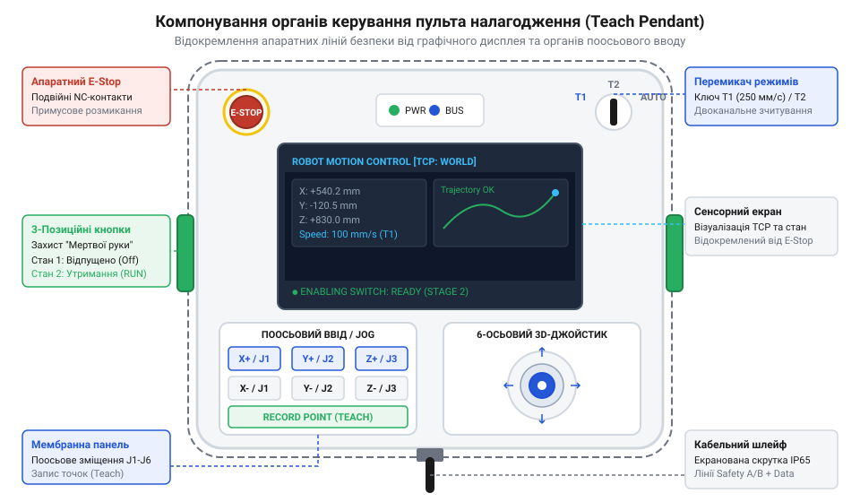
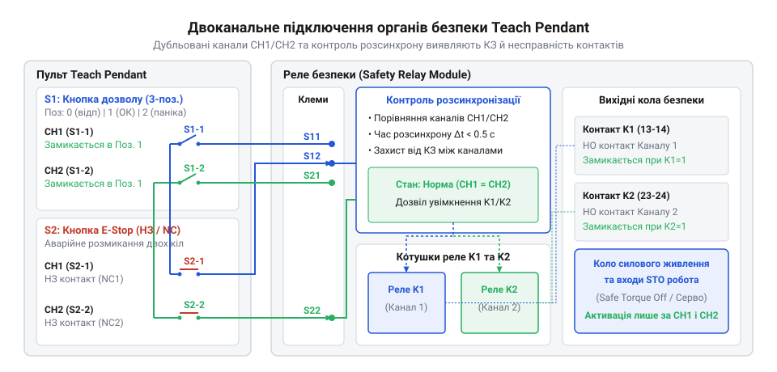
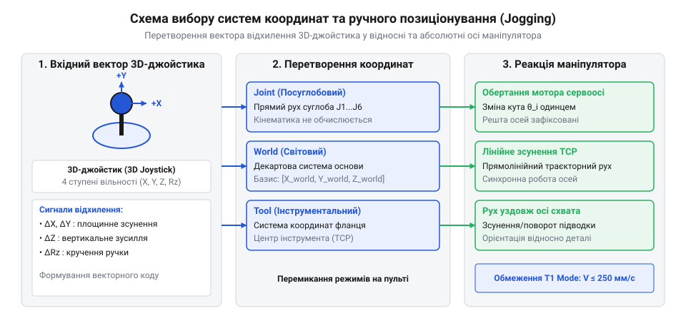

# Пульт налагодження промислових роботів (Teach Pendant)

<preknowlist>
- [Кнопка аварійного стопу грибок та органи безпечного відключення (IEC 60947-5-5)](root:cat-hw-controls/estop-mushroom-button) — Принципи роботи розмикальних контактів із примусовим відкриттям та фіксацією стану.
- [Трипозиційні кнопки дозволу та педалі «мертвої руки»](root:cat-hw-controls/enabling-switches-and-dead-man-pedals) — Функціонування 3-позиційного механізму дозволу в станах спокою, натиснення та паніки.
- [Реле безпеки та контролери захисного відключення](root:cat-hw-controls/safety-relays-and-controllers) — Принцип обробки двоканальних сигналів та діагностика перехресних коротких замикань.
</preknowlist>

## Призначення та ризики ручного налагодження

Налагодження промислових маніпуляторів вимагає присутність інженера безпосередньо у робочій зоні робота. Рух багатоланкового механізму з високою швидкістю створює ризик травмування або притискання людини. Для безпечного ручного програмування траєкторій використовують пульт налагодження (від англ. @@en|teach pendant@@) — переносний термінал із вбудованими апаратними органами захисту.

*Компонування передньої панелі пульта налагодження робота.*

Апаратний ключ вибору режимів перемикає роботу між автоматичним циклом та налагоджувальним режимом T1. У режимі T1 швидкість переміщення інструмента апаратно обмежується до `250 мм/с`, а силова автоматика активує функцію захисного відключення моменту (від англ. @@en|Safe Torque Off@@, @@en|STO@@) при виході з ладу систем спостереження. Для миттєвого знеструмлення приводів у разі небезпеки на корпусі встановлена [кнопка аварійного стопу грибок](root:cat-hw-controls/estop-mushroom-button).

## Апаратні кола забезпечення систем безпеки

Схемотехніка пульта будується на двоканальних дубльованих колах безпеки згідно зі стандартом ISO 13849-1. На тильному боці корпусу розташовані [трипозиційні кнопки дозволу та педалі «мертвої руки»](root:cat-hw-controls/enabling-switches-and-dead-man-pedals), які дозволяють рух робота лише в середньому утриманому стані. Відпускання кнопки або панічне стискання до упору негайно розмикає силовий контур.

*Схемотехніка зв'язку органів безпеки пульта з шафою керування.*

Для виявлення коротких замикань між жилами шлейфу контролер генерує короткі тестові імпульси в лінії безпеки. Зсув фаз або розсинхронізація розмикання дубльованих контактів понад `100 мс` фіксується як апаратний збій. Обробку цих сигналів виконують спеціалізовані [реле безпеки та контролери захисного відключення](root:cat-hw-controls/safety-relays-and-controllers).

## Органи вводу та інтерфейсні елементи

Позиціонування осей виконується за допомогою 3D-джойстика на безконтактних сенсорах Холла (від англ. @@en|Hall effect sensor@@). Для запобігання мимовільному дрейфу маніпулятора у програмі задається зона нечутливості (від англ. @@en|deadband@@), що ігнорує мікрозміщення важеля у стані спокою.

Для точного дискретного покрокового введення координат та налаштування параметрів використовується [матрична клавіатура 4×4 (мембранна)](root:cat-hw-controls/keypad-4x4-membrane) із маслостійким захисним покриттям. Сигнали кнопок проходять апаратну та програмну фільтрацію дребезгу контактів із часовим вікном `10...20 мс`.

## Режими позиціонування та системні координати

Ручний рух маніпулятора реалізується в трьох основних системах координат. Суглобовий режим (від англ. @@en|Joint mode@@) обертає окремі осі робота незалежно одна від одної. Світова система (від англ. @@en|World frame@@) переміщує інструмент уздовж фіксованих декартових осей `X`, `Y`, `Z` цеху.

*Схема позиціонування робота в суглобових та декартових системах координат.*

Інструментальний режим прив'язує рух до центральної точки інструмента (від англ. @@en|Tool Center Point@@, @@en|TCP@@). Для калібрування TCP оператор торкається реперної голки інструментом під чотирма різними кутами, що дозволяє обчислити матрицю зсуву. При наближенні до геометричних сингулярностей алгоритми контролера застосовують демпфовані методи обчислень для відвернення різких стрибків швидкості.

## Промисловий комунікаційний інтерфейс та шлейф

Зв'язок пульта з шафою керування реалізується через гнучкий маслостійкий шлейф підвищеної міцності. Всередині кабелю суворо розділені фізичні жили: прямі аналогові лінії безпеки `24 В` прокладаються окремо від екранованих витих пар завадостійкого цифрового інтерфейсу.

Інформаційний обмін підтримує неперервну передачу циклічного сигналу активності (від англ. @@en|heartbeat signal@@). Обрив шлейфу або втрата зв'язку тривалістю понад `100 мс` сприймається контролером як аварійна ситуація та викликає зупинку робота. Підключення або знімання пульта під час гарячої заміни виконується через спеціальний байпасний модуль без хибного спрацьовування захисту.
