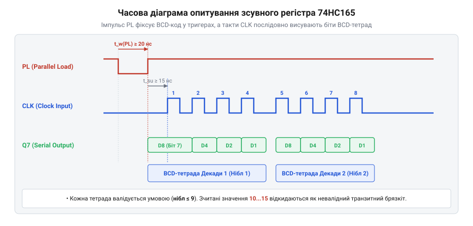
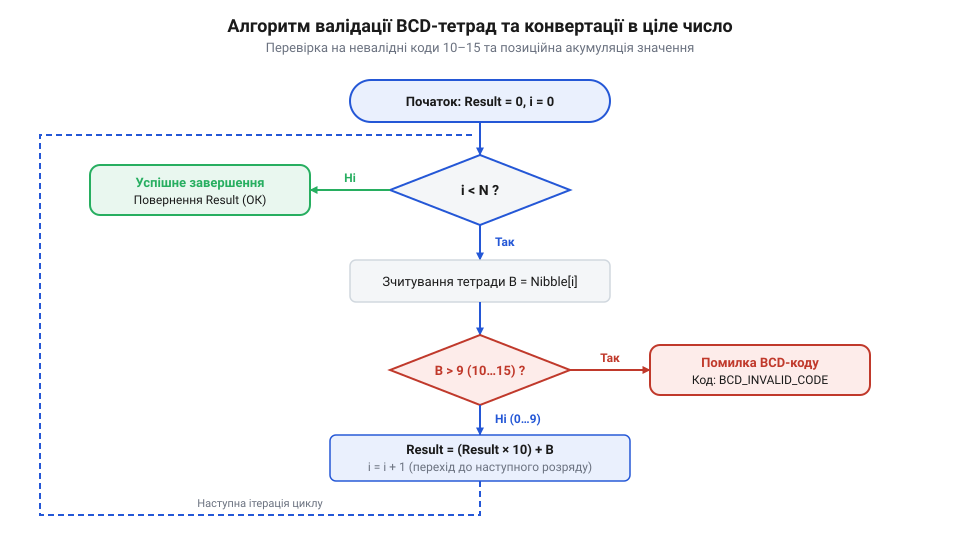

# Програмний API: інтерфейс драйвера зчитування, фільтрації брязкоту та валідації BCD-кодів

<preknowlist>
- [DIP-перемикачі та джамперні блоки конфігурації](root:cat-hw-controls/dip-switches-and-configuration-blocks) — принципи зчитування дискретних кодових перемикачів та BCD-кодування
</preknowlist>

## Непередбачувані дані без програмного драйвера

Спроба зчитувати покази декадних барабанних перемикачів (від англ. @@en|thumbwheel switch@@) напряму з вхідних пінів мікроконтролера або шини зсувних регістрів без спеціалізованої програмної обробки призводить до збоїв та непередбачуваної поведінки пристрою. Механічна природа перемикача створює дві основні проблеми: фізичний контактний брязкіт (від англ. @@en|contact bounce@@) та виникнення транзитних кодових комбінацій під час повертання барабана. Додатково при матричному опитуванні декількох секцій без застосування розв'язувальних діодів виникає фізичний механізм паразитних зворотних струмів (від англ. @@en|sneak path@@): коли стробувальна лінія `SEL_0` перебуває в активному низькому стані, а сусідня лінія `SEL_1` утримується під високим потенціалом `V_CC`, струм із невибраної лінії `SEL_1` тече через зімкнений контакт першого біта `2⁰` другого барабана в спільну шину BCD-коду. Якщо на першому барабані зімкнені контакти двох бітів (наприклад, `2⁰` та `2¹`), цей зворотний струм проходить через замкнений контакт `2⁰` до лінії `SEL_0` і повертається у шину через контакт `2¹`, створюючи хибне потенціальне зсунення на другій лінії та фантомне спрацьовування (від англ. @@en|ghosting@@) невибраного розряду. Для запобігання утворенню таких паразитних контурів у послідовний ланцюг кожного BCD-виходу перемикача впаюють апаратні розв'язувальні діоди (від англ. @@en|decoupling diode@@), які блокують зворотні протікання струму.

Коли оператор прокручує ротор від однієї цифри до іншої, пружинні пелюстки щіток розмикаються й замикаються не одночасно через механічні допуски виготовлення плати. На коротку мить (від `1` до `5 ms`) вихідні лінії опиняються у проміжній фазі, кодуючи двійкові тетради у діапазоні `10...15`, які не відповідають жодній десятковій цифрі двійково-кодованого десяткового коду BCD (від англ. @@en|binary-coded decimal@@). Якщо керівна програма прочитає значення саме в цей мікросекундний інтервал, уставку буде викривлено — замість цифри `7` контролер може зчитати `14` або `0` та видати помилкову команду в технологічний процес. Подібно до того, як зчитуються [DIP-перемикачі та джамперні блоки конфігурації](root:cat-hw-controls/dip-switches-and-configuration-blocks), ручний ввід вимагає створення проміжного шару драйвера, який відфільтровує брязкіт, валідує коди та видає в прикладну програму гарантовано чисте ціле число.

## Ініціалізація та конфігурація периферії

Перед початком циклічного знімання даних драйвер вимагає налаштування цифрових ліній мікроконтролера та виділення пам'яті під внутрішню структуру стану `thumbwheel_driver_t`. Для опитування каскаду зсувних регістрів 74HC165 використовуються три керуючі лінії: вихід завантаження `PL` (від англ. @@en|parallel load@@ — паралельне завантаження), вихід тактування `CLK` (від англ. @@en|clock@@ — тактовий сигнал) та вхід послідовних даних `DATA` (лінія `Q7`). Під час виконання процедури ініціалізації `thumbwheel_init` драйвер зберігає отриману конфігурацію та налаштовує прапор інверсної логіки `active_low_logic` (від англ. @@en|active-low logic@@ — активний низький рівень). Якщо схемотехніка барабанного перемикача використовує загальний провідник `GND` із підтягувальними резисторами (від англ. @@en|pull-up resistor@@ — підтягувальний резистор) до `V_CC`, замкнена контактна група формує на вході регістра фізичний низький рівень `0`. Фіксація прапора `active_low_logic = true` у контексті драйвера гарантує, що при кожному зчитуванні кадрів зсувного регістра сирий масив бітів буде автоматично інвертовано побітовою маскою перед розбиттям на BCD-тетради, абстрагуючи вищі рівні ПЗ від фізичної полярності підключення контактів. При цьому обсяг оперативної пам'яті (від англ. @@en|random-access memory@@ — пам'ять довільного доступу), який займає структура стану `thumbwheel_driver_t`, становить лише 21 байт для типової конфігурації з чотирьох декад (5 байтів конфігурації `thumbwheel_config_t`, 2 байти сирого кадру `raw_latch`, по 4 байти під поточні тетради `nibbles`, лічильники часової стабілізації `debounce_cnt` і попередні заміри `prev_nibbles`, а також 2 байти підтвердженого значення `validated_value`). З урахуванням вирівнювання даних у пам'яті (від англ. @@en|data structure padding@@ — вирівнювання полів структури) під 32-бітні архітектури реальний обсяг структури становить 24 байти. За зменшення кількості розрядів до 2 декад структура потребує 15 байтів (16 байтів з вирівнюванням), а при масштабуванні драйвера до 8 декад зі збільшенням розрядності `raw_latch` до 32 бітів витрати RAM досягають 37 байтів (40 байтів з вирівнюванням). Статичне виділення цього фіксованого буфера повністю виключає використання динамічної пам'яті (від англ. @@en|dynamic memory allocation@@ — динамічне виділення пам'яті), що гарантує детермінований розподіл ресурсів у системах реального часу.

Конфігурація периферійного інтерфейсу та внутрішній стан описуються C/C++ структурами даних:

:::tabs
:::code api-thumbwheel-driver-software-interface/c/snippet-1.c
<!-- slide -->
:::code api-thumbwheel-driver-software-interface/cpp/thumbwheelstatus.cpp
:::

Функція ініціалізації конфігурує піни `PL` та `CLK` як цифрові виходи Push-Pull із початковим високим рівнем, а пін `DATA` — як цифровий вхід із підтягувальним резистором (від англ. @@en|pull-up resistor@@) до `V_CC`.

## Циклічне опитування зсувного регістра

Процес зчитування даних із каскаду регістрів 74HC165 відбувається за строгими часовими інтервалами. Спочатку мікроконтролер формує від'ємний стробувальний імпульс на лінії `PL` тривалістю не менше `20 ns`, засуваючи логічні рівні всіх BCD-ліній перемикачів у тригери регістра. Після відновлення високого рівня `PL` мікроконтролер циклічно тактує лінію `CLK`, зчитуючи по одному біту з лінії `DATA` на кожному спадаючому або наростаючому фронті. Вибір програмних затримок `delay_ns(50)` (або `1...5 мкс` при винесенні кнопочних панелей) визначається ємністю та довжиною кабельного джгута `L`. Хоча мікросхема 74HC165 підтримує тактування до `25 МГц`, паразитні ємності довгого кабелю `C_line ≈ 50...100 пФ/м` розмивають фронти сигналів та викликають затримку поширення (від англ. @@en|signal propagation delay@@). Для забезпечення надійного зчитування тривалість напівперіоду тактування `T_half = 1 / (2 · f_CLK)` має перевищувати час перезарядження паразитної ємності джгута `t_settle = 3 · R_out · C_line · L`. Для типового драйвера з вихідним опором `R_out = 100 Ом`, погонною ємністю джгута `C_line = 100 пФ/м` та частотою тактування `f_CLK = 500 кГц` математичний розрахунок граничної довжини джгута `L_max` має вигляд:

        T_half = 1 / (2 · f_CLK)                     [напівперіод тактового імпульсу CLK]
        = 1 / (2 · 500·10³ Гц)                       [підстановка тактової частоти 500 кГц]
        = 1 мкс                                      [інтервал для встановлення рівня лінії]
        t_settle = 3 · R_out · C_line · L            [час досягнення 95% напруги логічного рівня]
        = 3 · 100 Ом · 100·10⁻¹² Ф/м · L             [підстановка опору драйвера 100 Ом та ємності 100 пФ/м]
        = 30·10⁻⁹ · L с/м                            [погонний час перезарядження лінії 30 нс/м]
        L_max = T_half / (3 · R_out · C_line)        [гранична довжина кабелю за критерієм крутизни фронту]
        = 1·10⁻⁶ с / (30·10⁻⁹ с/м)                   [розрахунок відношення напівперіоду до погонної затримки]
        ≈ 33.3 м                                     [максимальна довжина джгута для частоти 500 кГц]

Розраховане значення `L_max ≈ 33.3 м` показує, що штучне обмеження тактової частоти `f_CLK` за допомогою затримок `delay_ns` гарантує повне заспокоєння перехідних процесів та виключає зчитування спотворених BCD-кодів у довгих кабельних лініях, що аналогічно завадозахисту вхідних ліній при зчитуванні [DIP-перемикачів та джамперних блоків конфігурації](root:cat-hw-controls/dip-switches-and-configuration-blocks).

*Часова діаграма тактування сигналів PL та CLK: показано паралельне завантаження вхідних ліній BCD та послідовне зчитування бітів зсувного регістра 74HC165.*

:::tabs
:::code api-thumbwheel-driver-software-interface/c/thumbwheel-read-raw-shift-reg.c
<!-- slide -->
:::code api-thumbwheel-driver-software-interface/cpp/snippet-4.cpp
:::

## Програмна фільтрація контактного брязкоту

Зчитаний сирий кадр містить 4-бітні тетради для кожної декади. Для придушення контактного брязкоту драйвер виконує часову стабілізацію (від англ. @@en|debounce@@): новий стан вважається дійсним лише тоді, коли протягом `N` послідовних опитувань з періодичністю `T_poll = 5...10 ms` кожна тетрада зберігає абсолютно однакове значення. Математичний вибір порогу стабілізації `N = DEBOUNCE_THRESHOLD` визначається співвідношенням `N ≥ t_bounce / T_poll = t_bounce · f_poll`, де `t_bounce` позначує максимальну тривалість механічного брязкоту контактів (зазвичай `10...20 ms`), а `f_poll = 1 / T_poll` — частоту виклику функції опитування. Наприклад, при періоді опитування `T_poll = 5 ms` (`f_poll = 200 Hz`) та тривалості брязкоту `t_bounce = 15 ms` мінімально необхідний поріг становить `N = 15 ms / 5 ms = 3`. Завелика величина `N` викликає помітну затримку відгуку на ручне введення, а замала (`N · T_poll < t_bounce`) пропускає хибні проміжні кодові комбінації BCD (значення 10…15) у робочий буфер.

:::tabs
:::code api-thumbwheel-driver-software-interface/c/thumbwheel-filter-process.c
<!-- slide -->
:::code api-thumbwheel-driver-software-interface/cpp/snippet-6.cpp
:::

Якщо під час перемикання барабана зчитується нестабільна тетрада, лічильник стабілізації скидається у 0, запобігаючи проникненню брязкоту у вихідний буфер.

## Конвертація BCD-тетрад та валідація

Останнім етапом обробки є валідація BCD-діапазону та обчислення фінального цілого числа. Оскільки BCD-код використовує лише комбінації від `0` (`0000_2`) до `9` (`1001_2`), значення тетрад від `10` (`1010_2`) до `15` (`1111_2`) є забороненими транзитними станами. Якщо при затримці ротора у проміжному положенні невалідний код зберігається тривалий час (понад нормований таймаут `500 мс`), верхній рівень ПЗ застосовує захисну стратегію обробки помилок: система блокує оновлення робочої устави, утримує попереднє валідне значення координати та виставляє апаратний прапор несправності (від англ. @@en|stuck-at fault@@). Це запобігає передачі фальшивих параметрів виконачим органам при механічному заклинюванні барабана або зносі контактних доріжок, підтримуючи вимоги відмовостійкості аналогічно принципам конфігурування [DIP-перемикачів та джамперних блоків](root:cat-hw-controls/dip-switches-and-configuration-blocks). У разі використання модифікацій перемикачів із прямим чи інверсним кодом Грея (від англ. @@en|Gray code@@) драйвер застосовує попереднє декодування: для прямого коду Грея виконується побітове перетворення `bcd = gray ^ (gray >> 1) ^ (gray >> 2) ^ (gray >> 3)`, а для інверсного коду Грея (від англ. @@en|inverted Gray code@@) спочатку реалізується побітова інверсія `gray = ~raw_gray & 0x0F`. Оскільки код Грея гарантує зміну лише одного біта при переході між сусідніми позиціями, виявлення неузгодженого бітового стрибка або невалідного значення після декодування означає апаратний обрив лінії та викликає формування статусу помилки `THUMBWHEEL_ERR_GRAY_CORRUPT`.

*Блок-схема алгоритму конвертації та валідації BCD-тетрад: ілюструє послідовну перевірку кожної тетради на діапазон 0–9 та формування цілочисельного значення або коду помилки.*

:::tabs
:::code api-thumbwheel-driver-software-interface/c/thumbwheel-decode-value.c
<!-- slide -->
:::code api-thumbwheel-driver-software-interface/cpp/snippet-8.cpp
:::

У разі виявлення тетради зі значенням понад `9` функція негайно повертає код помилки `THUMBWHEEL_ERR_INVALID_BCD` (`-1`), повідомляючи верхній шар про те, що барабан перебуває в моменті прокручування. Припускаючи валідність усіх розрядів, вихідне ціле число формується як математична сума вагових десяткових множників (`1`, `10`, `100`, `1000`).
