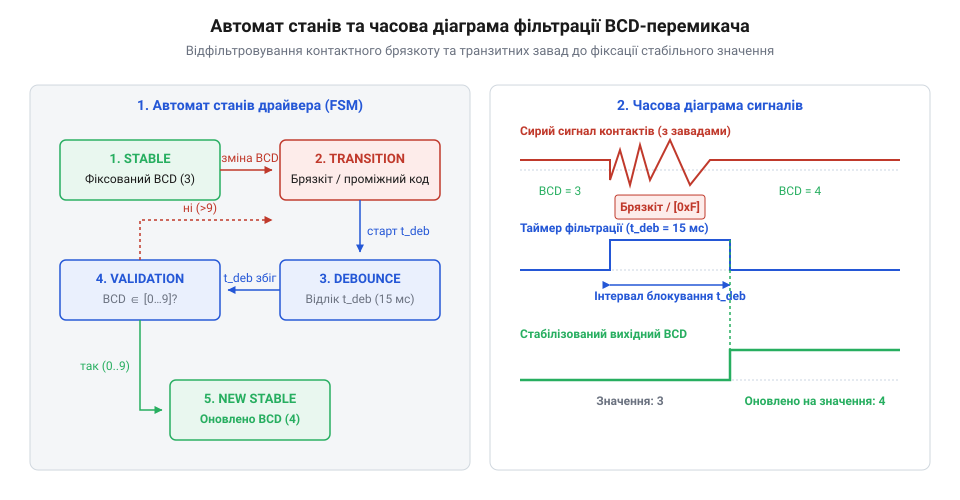
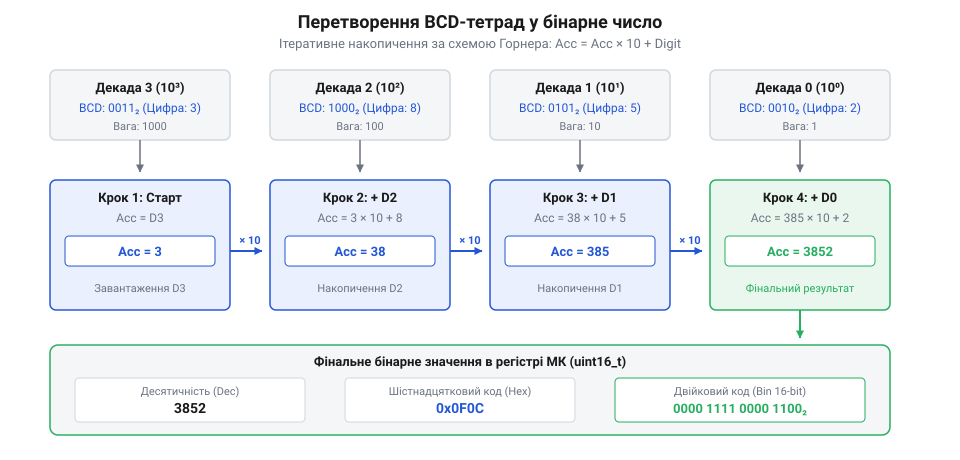

# Програмний інтерфейс драйвера зчитування та фільтрації барабанних перемикачів

<preknowlist>
- [DIP-перемикачі та джамперні блоки конфігурації](root:cat-hw-controls/dip-switches-and-configuration-blocks) — Розуміння принципів двійкового кодування та зчитування цифрових станів.
- [Матрична клавіатура 4×4 (мембранна)](root:cat-hw-controls/keypad-4x4-membrane) — Розуміння принципів матричного опитування та сканування рядочків і стовпчиків.
</preknowlist>

## Ризики хибних уставок та задачі драйвера

Пряме підключення механічних декадних перемикачів до цифрових портів мікроконтролера створює приховану загрозу для стабільності автоматизованих систем керування. У момент, коли оператор вручну повертає рифлений барабан від одного фіксованого значення до іншого (наприклад, з позиції `7` у позицію `8`), контактні щітки з берилієвої бронзи ковзають по платі статора. Оскільки механічні контактні групи не розмикаються й не замикаються абсолютно одночасно, під час транзитного переходу (від англ. @@en|hazard state@@ — ризикований стан) виникають проміжні некоректні комбінації сигналів. Для BCD-коду (від англ. @@en|Binary Coded Decimal@@ — двійково-кодований десятковий) перехід від `7` (`0111₂`) до `8` (`1000₂`) на частки мілісекунди проходить крізь незафіксовані стани `1111₂` (`15₁₀`) або `0000₂` (`0₁₀`). Оскільки максимальна тривалість контактного брязкоту становить `t_bounce = 5 мс`, мінімальний період сканування таймерного переривання `T_scan` та поріг стабільності `N_deb` розраховують аналітично за умовою перекриття найбільшого часу завади:

```
t_confirm = N_deb · T_scan
= 5 · 2 мс    [підстановка порогу N_deb = 5 тиків та періоду сканування T_scan = 2 мс]
= 10 мс       [гарантований час підтвердження, що перевищує t_bounce = 5 мс у 2 рази]
```

Вибір періоду `T_scan = 2 мс` при `N_deb = 5` гарантує, що сумарний час фільтрації `10 мс` повністю перекриває з запасом фізичну тривалість брязкоту `5 мс`, унеможливлюючи хибні спрацьовування.

Окрім часових параметрів фільтрації, вибраний період визначає обчислювальні витрати центрального процесора (від англ. @@en|Central Processing Unit@@, @@en|CPU@@) на регулярне зчитування портів. При періоді сканування `T_scan = 2 мс` таймерне переривання викликається з частотою `f_scan = 1 / T_scan = 500 Гц`. Якщо середня тривалість виконання процедури зчитування та дебаунсингу в обробнику переривання (від англ. @@en|Interrupt Service Routine@@, @@en|ISR@@) становить `t_exec = 2 мкс`, то відносне процесорне навантаження `P_cpu` розраховують як відношення часу виконання до періоду сканування:

```
P_cpu = (t_exec / T_scan) · 100%
= (2 мкс / 2000 мкс) · 100%    [підстановка тривалості обробника t_exec = 2 мкс та періоду T_scan = 2 мс = 2000 мкс]
= 0.1%                          [частка обчислювальних ресурсів МК, виділена на регулярний дебаунсинг]
```

Значення `P_cpu = 0.1%` свідчить про те, що регулярне таймерне сканування практично не відбирає ресурси мікроконтролера, залишаючи понад `99.9%` продуктивності для виконання основної керуючої програми.

Якщо логіка контролера зчитує стан портів ввід-виводу у довільний момент часу без цифрової фільтрації, керуючий алгоритм сприйме хибне значення `15` або `0`. У системах регулювання температури, тиску чи швидкості приводів такий транзитний сплеск викликає аварійне спрацьовування захистів, ривки виконавчих механізмів чи хибні тривоги. Ситуація ускладнюється механічним брязкотом контактів (від англ. @@en|contact bounce@@), який супроводжує кожне перемикання серією високочастотних імпульсів тривалістю від `1` до `5 мс`.

Головною задачею мікроконтролерного драйвера є створення ізольованого апаратного бар'єра між фізичною комутацією та системним програмним забезпеченням. Драйвер виконує три послідовні функції: часову дебаунс-фільтрацію, перевірку валідності отриманої BCD-тетради (відсіювання кодових комбінацій понад `9`) та підтвердження стабільності нового значення впродовж заданого інтервалу. Лише після проходження всіх трьох етапів відфільтроване числове значення передається в основний алгоритм керування.

## Структури даних конфігурації та стану

Для забезпечення гнучкості та масштабованості драйвера на етапі компіляції та ініціалізації розмежовують конфігураційні параметри апаратури й динамічний контекст стану. Конфігураційна структура описує розрядність барабанного блоку (кількість декад), тип використаного кодування, режим логічних рівнів (активний низький чи високий) та призначені номери GPIO-пінів для ліній сканування і шини даних. Щоб мінімізувати обсяг оперативної пам'яті (від англ. @@en|SRAM@@ — статична ОЗП) та уникнути штрафів шини живлення при виконанні коду, поля структур розміщують з урахуванням вирівнювання (від англ. @@en|alignment@@). На 32-бітних мікроконтролерах (ARM Cortex-M) 32-бітові покажчики `scan_pins` та `data_pins` групують на початку структури на 4-байтових межах, а однобайтові поля `uint8_t` та `bool` розташовують послідовно в кінці, запобігаючи появі невикористаних байт-заповнювачів (від англ. @@en|padding@@). Для 8-бітних мікроконтролерів (AVR) вирівнювання не вимагається, тому застосовують атрибут щільної упаковки `__attribute__((packed))`, що дає змогу зекономити кожен байт ОЗП при зчитуванні конфігурацій, аналогічних до [DIP-перемикачів](root:cat-hw-controls/dip-switches-and-configuration-blocks).

Динамічний стан кожної декади зберігає поточне сире значення, відфільтроване стабільне значення, лічильник підтвердження стабільності та прапорці помилок. Загальний контекст драйвера об'єднує масив декадних станів і підсумкове цілочисельне значення уставки.

Окремим аспектом безпеки є ініціалізація початкового стану декади під час первинного подання живлення або скидання мікроконтролера (так званого холодного старту — від англ. @@en|cold start@@). Поля `candidateCode` та `debouncedCode` примусово заповнюються маркерним сторожовим значенням `0xFF` (від англ. @@en|sentinel value@@), яке завідомо лежить поза межами допустимого діапазону BCD-цифр (0–9) та 16-ричних символів (0–15). Якщо ініціалізувати дані нулем (`0x00`), драйвер при першому ж скануванні може помилково сприйняти нуль за підтверджену уставку барабана і пропустити цикл первинної часової фільтрації. Маркер `0xFF` гарантує, що під час першого опитування скан-матриці будь-яке зчитане значення змусить автомат станів розпочати повний цикл підтвердження антибрязкоту, а прапорець `isValid` залишатиметься `false` до завершення необхідної кількості тактів стабілізації.

:::tabs
:::code api-thumbwheel-firmware-reading-and-debouncing/c/snippet-1.c
:::code api-thumbwheel-firmware-reading-and-debouncing/cpp/thumbwheelcodetype.cpp
:::

Чітке відокремлення статичної конфігурації у постійній пам'яті (від англ. @@en|flash memory@@) від оперативної пам'яті стану дозволяє обслуговувати кілька незалежних барабанних панелей єдиним екземпляром коду драйвера без виділення динамічної пам'яті.

## Процедури сканування та цифрової фільтрації

Процедура опитування драйвера призначена для виклику у регулярному таймерному перериванні (наприклад, із періодом `1–5 мс`). Опитування проводиться послідовно по кожній декаді шляхом подачі активного рівня на відповідну лінію сканування та зчитування 4-бітової шини даних. Для зменшення кількості задіяних виводів мікроконтролера лінії сканування можуть керуватися через паралельно-послідовний зсувний регістр або через матричне сканування, аналогічно до [матричної клавіатури](root:cat-hw-controls/keypad-4x4-membrane).


*Схема станів та часова діаграма цифрової фільтрації драйвера, що ілюструє пригнічення брязкоту контактів та фільтрацію некоректних транзитних BCD-кодів.*

Під час кожного тику сканування драйвер виконує цифровий алгоритм кінцевого автомата (від англ. @@en|state machine@@):

Для досягнення мінімальної затримки виконання у високочастотному обробнику переривань розгалуження умови `active_low` оптимізують за допомогою побітової маски безкомандного обчислення (від англ. @@en|branchless programming@@). Замість умовних інструкцій переходів, які викликають скидання конвеєра мікроконтролера, інверсію тетради виконують за один такт арифметико-логічного пристрою (від англ. @@en|ALU@@) виразом `raw = (raw ^ inv_mask) & 0x0F`. Якщо прапорець інверсії увімкнений, маска `inv_mask` дорівнює `0x0F`, і операція виключного "АБО" (`XOR`) миттєво змінює кожен біт на протилежний (`0 ^ 1 = 1`, `1 ^ 1 = 0`); якщо інверсія вимкнена, маска дорівнює `0x00`, і значення залишається незмінним. Накладання побітової маски `& 0x0F` гарантує обнулення старших незадіяних розрядів банку GPIO, виключаючи потрапляння сміттєвих бітів у подальшу валідацію.

Математичний розрахунок гарантованого часу підтвердження нової уставки `t_confirm` визначається як добуток кількості необхідних послідовних збігів `N_ticks` (параметр `debounce_ticks`) на період системного таймерного переривання `T_timer`:

```
t_confirm = N_ticks · T_timer
= 5 · 2 мс    [підстановка кількості тиків підтвердження N_ticks = 5 та періоду таймера T_timer = 2 мс]
= 10 мс       [обчислення підсумкового часу підтвердження уставки]
```

Отриманий інтервал `t_confirm = 10 мс` визначає часову затримку між фізичним завершенням обертання барабана та появою оновленого чисельного значення в системному контексті. Такий розрахунок гарантує, що час фільтрації перевищує максимальну тривалість контактного брязкоту (`5 мс`), але залишається суттєво меншим за фізіологічний поріг сприйняття людини (`50–100 мс`), забезпечуючи миттєвий тактильний відгук керування при завадостійкому зчитуванні, аналогічно до систем опитування [матричних клавіатур](root:cat-hw-controls/keypad-4x4-membrane).

1. **Зчитування та інверсія:** Зчитується байт із шини даних. Якщо конфігурація передбачає інверсну логіку (`active_low`), прочитана тетрада інвертується.
2. **Перевірка діапазону BCD:** Для стандартного BCD-кодування значення тетради має перебувати у межах від `0` до `9`. Значення в інтервалі від `10` до `15` (`0x0A..0x0F`) є невалідними BCD-кодами й відсіюються негайно: лічильник стабільності скидається в `0`, а поточна декада позначається як транзитна.
3. **Накопичення стабільності:** Якщо новий прочитаний код збігається з кандидатом, збільшується `stability_counter`. Якщо прочитаний код змінився, кандидат оновлюється, а лічильник скидається.
4. **Фіксація значення:** Коли `stability_counter` досягає порогу `debounce_ticks` (наприклад, `5` послідовних однакових відліків), кандидат заносовується у `debounced_code` як підтверджене стабільне значення.

:::tabs
:::code api-thumbwheel-firmware-reading-and-debouncing/c/thumbwheel-scan-tick.c
:::code api-thumbwheel-firmware-reading-and-debouncing/cpp/snippet-4.cpp
:::

Такий неблокуючий алгоритм гарантує повне усунення хибних спрацьовувань під час руху ротора без затримки виконання основної програми мікроконтролера.

## Декодування BCD та конвертація даних

Після того, як процедура сканування підтвердила стабільність усіх декад, виникає задача конвертації масиву відфільтрованих BCD-тетрад у ціле бінарне число (від англ. @@en|integer value@@), яке використовується у математичних розрахунках контролера.


*Потік даних алгоритму перетворення масиву валідованих BCD-тетрад у підсумкове ціле бінарне число.*

Конвертація починається від молодшої декади (від англ. @@en|least significant digit@@ — LSD) до старшої декади (від англ. @@en|most significant digit@@ — MSD). На кожному кроці значення BCD-цифри множиться на відповідний ваговий коефіцієнт (`1`, `10`, `100`, `1000` і так далі) та додається до накопичувальної суми.

При зчитуванні багатодекадних панелей, що містять 10 і більше барабанних перемикачів, максимальне значення суми `9 999 999 999` перевищує розрядність 32-бітного результуючого регістру `UINT32_MAX = 4 294 967 295`. Для запобігання арифметичному переповненню (від англ. @@en|integer overflow@@) та згортанню числа драйвер виконує попередню перевірку граничних значень перед кожною операцією множення. Якщо ваговий множник `multiplier` досягає `1 000 000 000` (10-та декада) і поточний результат `total` разом із новою BCD-цифрою перевищує поріг `4 294 967 295`, драйвер зупиняє розрахунок, виставляє прапорець апаратної помилки `has_error = true` та повертає статус `false`. Такий захист гарантує усунення хибних обчислень при використанні багатодекадних блоків у конфігураційних панелях [DIP-перемикачів](root:cat-hw-controls/dip-switches-and-configuration-blocks) та промислових пристроях.

Обчислення результуючого значення `V` описується математичним виразом:

        V = ∑ dᵢ × 10ⁱ      [сумування за розрядами i від 0 до N-1]

де `dᵢ` — відфільтроване значення BCD-цифри `i`-ї декади, а `i` — індекс розряду.

:::tabs
:::code api-thumbwheel-firmware-reading-and-debouncing/c/thumbwheel-read-value.c
:::code api-thumbwheel-firmware-reading-and-debouncing/cpp/snippet-6.cpp
:::

Використання подібного драйвера в індустріальних конфігураційних модулях, аналогічно до налаштувань [DIP-перемикачів](root:cat-hw-controls/dip-switches-and-configuration-blocks), забезпечує 100% завадостійкість читання числових устави у найскладніших завадових умовах.
