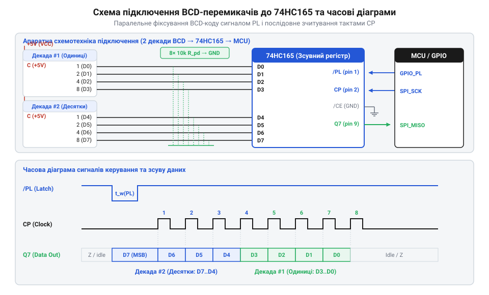

# Залізний та програмний API-довідник сполучення BCD-перемикачів із МК через 74HC165

<preknowlist>
- [DIP-перемикачі та джамперні блоки конфігурації](root:cat-hw-controls/dip-switches-and-configuration-blocks) — принципи підключення підтягувальних резисторів та формування двопозиційних двійкових сигналів.
- [Матрична клавіатура 4×4 (мембранна)](root:cat-hw-controls/keypad-4x4-membrane) — розуміння дискретного введення даних та принципів сканування й фільтрації контактів.
</preknowlist>

## Проблема зчитування багатодекадних BCD-панелей

Багатодекадні BCD-перемикачі (від англ. @@en|thumbwheel switch@@ — барабанний перемикач) широко застосовують у промислових операторських панелях для введення числових уставив. Кожна декада такого селектора має 4 дискретні виходи (`1-2-4-8`) та спільний контакт `C`. Пряме підключення кожного виходу до ліній @@en|GPIO@@ мікроконтролера швидко вичерпує виводи керування: панель із 4 декад потребує 16 ліній, а 8 декад — вже 32 виводи. На відміну від ситуацій, де застосовують [матричну клавіатуру 4×4](root:cat-hw-controls/keypad-4x4-membrane), матричне сканування BCD-декад ускладнене механічною замкненістю декількох контактів одночасно. Наприклад, коли у BCD-коді числа 3 замкнено виходи 1 і 2 на лінію `C`, а в сусідній декаді замкнено вихід 1, подача активного рівня на спільний контакт однієї декади спричиняє зворотний потік струму через її замкнену групу у вихід 2 другої декади. Без розв'язувальних діодів у розриві кожного виходу ці паразитичні обхідні струми створюють хибні логічні рівні на сусідніх розрядних шинах. Як і при конфігуруванні [DIP-перемикачів](root:cat-hw-controls/dip-switches-and-configuration-blocks), пряме опитування перестає бути масштабованим.

Розв'язанням цієї проблеми є використання послідовно-паралельних зсувних регістрів 74HC165 (від англ. @@en|PISO@@ — @@en|parallel-in serial-out@@, паралельний вхід, послідовний вихід). Кожен 8-бітний регістр приймає паралельні сигнали від двох BCD-декад і трансформує їх у послідовний потік даних. Каскадування декількох мікросхем дозволяє зчитувати довільну кількість декад всього через 3 або 4 лінії мікроконтролера.

## Схемотехніка та розводка сигналів 74HC165

Мікросхема 74HC165 містить 8 інформаційних входів `D0`–`D7`, вивід паралельного завантаження `PL` (від англ. @@en|parallel load@@ — паралельне завантаження, активний нуль), тактовий вхід `CP` (від англ. @@en|clock pulse@@ — тактовий імпульс), дозвіл тактування `CE` (від англ. @@en|clock enable@@ — дозвіл тактування, активний нуль) та послідовний вихід `Q7`. Для каскадування вихід `Q7` першого регістру підключають до послідовного входу `DS` (від англ. @@en|data serial@@ — послідовні дані) наступного, а лінії `PL`, `CP` та `CE` об'єднують паралельно.

*Принципова електрична схема сполучення BCD-перемикачів із зсувним регістром 74HC165 та часові діаграми сигналів фіксації.*

Виходи `1-2-4-8` першої BCD-декади підключають до входів `D0`–`D3`, а другої — до `D4`–`D7`. Спільний контакт `C` заземлюють, а лінії `D0`–`D7` підтягують до живлення `VCC` через зовнішні резистори 10 кОм (від англ. @@en|pull-up resistor@@ — підтягувальний резистор). При замкненому контакті на відповідному вході формується логічний 0, що відповідає інверсній логіці зчитування. Вибір номіналу 10 кОм обґрунтований балансом між струмом споживання та завадозахищеністю: при напрузі живлення `VCC` = 5 В струм через один замкнений контакт становить 0.5 мА (I = 5 В / 10 кОм), що навіть для 8 декад дає сумарне пікове споживання до 16 мА. Збільшення номіналу до 100 кОм знижує струм, але створює високоімпедансний вузол, чутливий до промислових електромагнітних наводок та затримок заряду паразитної ємності монтажу (C_in ≈ 15 пФ), тоді як зменшення до 1 кОм необґрунтовано збільшує струм споживання до 5 мА на лінію.

## Часові діаграми фіксації та тактування

Зчитування даних проходить у два детерміновані етапи: фіксація стану контактів та послідовний зсув бітів. Спочатку мікроконтролер подає низький рівень на вивід `PL` на час не менше за затримку засувки (t_w > 20 нс). У цей момент стан усіх паралельних входів `D0`–`D7` одночасно фіксується у внутрішніх тригерах регістру незалежно від сигналів тактування. Після повернення `PL` у високий рівень будь-який механічний дребезг контактів (від англ. @@en|contact bounce@@ — відскік контактів) або перемикання барабанів під час зчитування більше не спотворюють зафіксовані дані.

Далі лінію `CE` підтягують до землі, і за кожним фронтом (від англ. @@en|rising edge@@ — зростаючий фронт) на тактовому вході `CP` біти зсуваються на вихід `Q7`. Завдяки цьому інтерфейс 74HC165 апаратно сумісний із периферичним модулем @@en|SPI@@ мікроконтролера, де `PL` виконує роль вибору мікросхеми, `CP` — тактового сигналу `SCK`, а `Q7` — шини `MISO`.

## Програмний API зчитування та валідації

Програмний інтерфейс (від англ. @@en|API@@ — @@en|application programming interface@@) реалізує ініціалізацію портів, вичитання сирих байтів та конвертацію BCD-коду з перевіркою цілісності. Кожен байт містить дві 4-бітні тетради (від англ. @@en|nibble@@ — півбайт). Оскільки фізично використовується підтяжка до `VCC`, отримане значення інвертують побітово. Допустимими BCD-кодами є значення `0x0`...`0x9`. Комбінації від `0xA` до `0xF` виникають при зносі контактів або проміжних станах барабана й трактуються як помилка введення.

:::tabs
@tab c|esp-idf
:::code api-thumbwheel-hardware-and-74hc165-interface/c/bcd-decode-buffer.c
@tab cpp|arduino
:::code api-thumbwheel-hardware-and-74hc165-interface/cpp/bcdthumbwheelreader.cpp
:::
