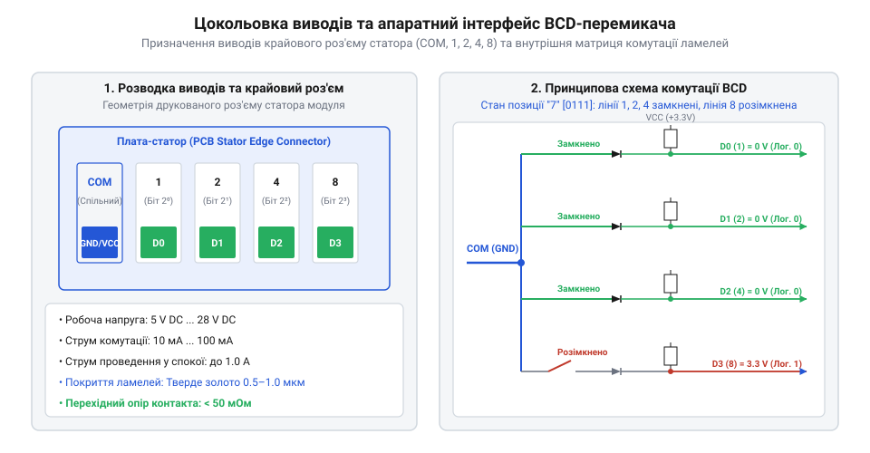
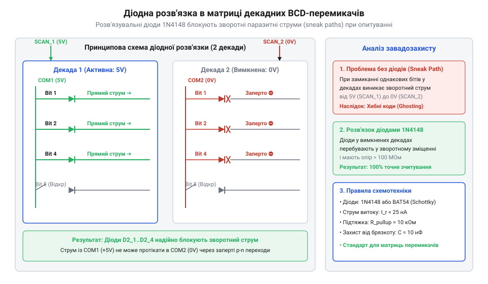

# Апаратний інтерфейс, кодові таблиці та схемотехніка підключення барабанних перемикачів

<preknowlist>
- [DIP-перемикачі та джамперні блоки конфігурації](root:cat-hw-controls/dip-switches-and-configuration-blocks) — Принципи дискретної комутації контактних груп та підтяжки цифрових ліній.
- [Матрична клавіатура 4×4 (тактильна)](root:cat-hw-controls/keypad-4x4-tactile) — Схемотехніка сканування матричних контактних сіток.
</preknowlist>

## Призначення виводів та геометрія контактних груп

Конструктивна база барабанного перемикача (англ. @@en|thumbwheel switch@@) являє собою модульну секцію, на задньому або нижньому боці якої розташовано групу контактних виводів (англ. @@en|terminal pins@@). Електрична схема модуля складається із одного спільного провідника (англ. @@en|common terminal@@, позначеного як `COM` або `C`) та декількох вихідних кодових шин, кількість яких визначається обраною системою кодування.

Усередині пластикового корпусу розташовано друковану плату статора з нанесеними мідними доріжками (англ. @@en|laminated PCB tracks@@), покритими захисним шаром зносостійкого покриття. На обертальному роторі закріплено контактну щітку (англ. @@en|sliding wiper@@) із берилієвої бронзи, яка поєднує високу пружинну пружність, електропровідність та стійкість до втоми матеріалу, забезпечуючи постійний притискний тиск без пластичної деформації впродовж сотень тисяч перемикань. Для запобігання передчасному стиранню доріжок статора металевими щітками на мідний провідний малюнок наносять шар гальванічного твердого золота (від англ. @@en|hard gold plating@@, від лат. @@la|aurum@@ — золото) строго нормованої товщини `0.5–1.0 мкм` (у відповідальних авіаційних модулях — до `1.5–3.0 мкм`) поверх нікелевого підшару `1.5–3.0 мкм`. Тонке м'яке імерсійне золото (`< 0.1 мкм`) зруйнувалося б за кілька сотень циклів тертя, тоді як гальванічне тверде золото з легуванням кобальтом забезпечує мікротвердість до `130–200 HK25` та тривалий комутаційний ресурс. При повертанні ротора пальцем щітка ковзає по доріжках статора, замикаючи спільну лінію `COM` із тими кодовими виводами, які відповідають поточній цифрі.

*Конструктивне розміщення контактних ламелей та виводів підключення на друкованій платі статора барабанного модуля.*

Для стандартного 10-позиційного модуля з кодуванням BCD (8-4-2-1) плата має 5 виводів: один `COM` та чотири розрядних виводи, марковані цифрами `1`, `2`, `4` та `8` відповідно до двійкових вагових коефіцієнтів `2⁰`, `2¹`, `2²` та `2³`.

## Кодові таблиці замикання BCD та Hex

Апаратна специфікація барабанних перемикачів визначається таблицями замикання контактів для різних типів вихідного коду. У прямому BCD-кодуванні розрядний вихід замкнений на лінію `COM` (стан логічної `1`), якщо відповідний біт у двійковому представленні цифри дорівнює одиниці.

Таблиця замикання виводів прямого BCD (8-4-2-1) та інверсного (комплементарного) BCD:

| Цифра ротора | Прямий BCD (`COM` замкнено з) | Інверсний BCD (`COM` розімкнено з) | Код бітів (8-4-2-1) |
| :---: | :---: | :---: | :---: |
| **0** | Немає (усі розімкнені) | 1, 2, 4, 8 (усі замкнені) | `0000` |
| **1** | 1 | 2, 4, 8 | `0001` |
| **2** | 2 | 1, 4, 8 | `0010` |
| **3** | 1, 2 | 4, 8 | `0011` |
| **4** | 4 | 1, 2, 8 | `0100` |
| **5** | 1, 4 | 2, 8 | `0101` |
| **6** | 2, 4 | 1, 8 | `0110` |
| **7** | 1, 2, 4 | 8 | `0111` |
| **8** | 8 | 1, 2, 4 | `1000` |
| **9** | 1, 8 | 2, 4 | `1001` |

У 16-позиційних шістнадцяткових модулях Hexadecimal (від 0 до F) кодування розширюється на значення `A` (`1010`), `B` (`1011`), `C` (`1100`), `D` (`1101`), `E` (`1110`) та `F` (`1111`). У десяткових перемикачах 1-з-10 присутні 10 окремих виходів (від `0` до `9`), де у позиції `k` замкнено лише лінію `k`. Схожі принципи комутації цифрових шин застосовують також у ротаційних [DIP-перемикачах](root:cat-hw-controls/dip-switches-and-configuration-blocks).

Особливості схемотехнічного підключення 10-позиційних десяткових модулів формату 1-з-10 залежать від конфігурації спільного виводу `COM`. При схемі із заземленим виводом `COM` (підключеним до шини `GND`) усі 10 вихідних кодових ліній (від `0` до `9`) підтягуються окремими резисторами `R_pull` до напруги живлення `V_CC`. У цьому випадку обрана ротором позиція `k` єдиною замикається на землю, формуючи активний низький рівень (логічний `0`), тоді як решта дев'яти ліній перебувають під високим потенціалом `V_CC`. У схемах із незаземленим виводом `COM` спільний контакт використовується як комутований шинний вхід: на нього подається імпульсний сигнал сканування від мікроконтролера або напруга збудження. Це дозволяє використовувати 1-з-10 перемикачі як комутатори сигналів або об'єднувати їх у скан-матриці без потреби у додаткових дешифраторах, проте вимагає встановлення підтягувальних резисторів на кожній вихідній лінії для запобігання плаваючим станам (англ. @@en|floating state@@).

## Електричні параметри та розрахунок підтягувальних резисторів

Електричні граничні характеристики контактних груп барабанних перемикачів визначаються номінальними значеннями напруги та струму комутації (англ. @@en|switching capacity@@):
* **Максимальна напруга комутації:** `28 В DC` або `120 В AC`.
* **Максимальний струм комутації:** `0.1 А` (без дугоутворення).
* **Струм у замкненому стані (без перемикання):** до `1.0 А`.
* **Опір замкненого контакту:** не більше `100 мОм`.
* **Час брязкоту контактів (англ. @@en|contact bounce time@@):** від `1` до `5 мс`.

Під час підключення контактних ліній до цифрових входів мікроконтролера вимагається використання підтягувальних резисторів (англ. @@en|pull-up resistors@@) `R_pull` для забезпечення чітких логічних рівнів. Якщо спільно лінію `COM` заземлено на `GND`, розрядні виходи підтягуються до напруги живлення `V_CC`.

Розрахунок номіналу підтягувального резистора виконується за умовою забезпечення мінімального струму через контакт для самоочищення від оксидів та обмеження максимального струму споживання, однак у реальних приладах верхню межу опору `R_max` жорстко обмежує паразитна ємність з'єднувального шлейфу. Паразитна ємність дротів і доріжок друкованої плати (англ. @@en|parasitic capacitance@@) `C_cable`, яка становить від `50` до `150 пФ` на метр довжини шлейфу, утворює разом із підтягувальним резистором `R_pull` низькочастотний RC-фільтр із сталістю часу `τ = R_pull · C_cable`. За високої частоти матричного сканування або коротких імпульсів опитування тривалість фронту наростання сигналу `t_rise ≈ 2.2 · τ` при завищеному опорі (наприклад, при використанні внутрішніх підтяжок мікроконтролера `30–50 кОм`) стає більшою за тривалість фази сканування. У результаті напруга на вихідній шині не встигає досягти мінімального порогу логічної одиниці `V_IH_min` до моменту зчитування, що призводить до спотворення коду та хибних зчитувань. Для довгого з'єднувального кабелю та високочастотного опитування верхню межу `R_pull` вимушено зменшують до `2.2–4.7 кОм`, прискорюючи заряд розрядних ємностей лінії.

        R_max = (V_CC - V_IH_min) ÷ I_leak      [максимальний опір за струмом витоку]
        R_min = (V_CC - V_OL) ÷ I_max_switch   [мінімальний опір за граничним струмом]

Для стандартних цифрових кіл при `V_CC = 5 В` оптимальний номінал `R_pull` становить від `4.7 кОм` до `10 кОм`.

## Схемотехніка матричного опитування та розв'язка діодами

При побудові багатодекадних панелей (наприклад, 4-розрядного табло) пряме підключення кожної декади вимагає `4 · N` цифрових входів мікроконтролера. Для зменшення кількості провідників застосовують схему динамічного матричного сканування (англ. @@en|matrix scanning@@).

У такій схемі однойменні кодові виходи `1`, `2`, `4`, `8` усіх секцій об'єднуються у спільну 4-бітну шину даних, а спільні лінії `COM` кожної декади підключаються до окремих виходів сканування мікроконтролера. Однак при з'єднанні шин виникає проблема паразитичних зворотних струмів (англ. @@en|sneak paths@@): якщо дві сусідні декади виставлені у цифри з однаковими активними бітами, струм від поданого сигналу сканування проникає через замкнені контакти сусіднього модуля у неактивні лінії, спотворюючи зчитане значення.

Для повного усунення обхідних струмових ланцюгів у послідовні лінії кожного виводу або списку `COM` вмикають розв'язувальні діоди (англ. @@en|decoupling diodes@@) типу 1N4148.

Вибір саме малосигнальних імпульсних діодів 1N4148 обґрунтований їхніми ключовими електричними параметрами: низьким падінням прямої напруги (англ. @@en|forward voltage drop@@) `V_F ≈ 0.6–0.7 В` та виключно малим часом зворотного відновлення (англ. @@en|reverse recovery time@@) `t_rr ≤ 4 нс`. Падіння напруги `V_F` підвищує логічний рівень нуля на вхідному піні мікроконтролера до `V_IL = V_OL + V_F ≈ 0.7–0.8 В`, що лишається в межах припустимого порогу розпізнавання логічного нуля для 5-вольтних цифрових кіл, а для 3.3-вольтних схем спонукає обирати діоди Шотткі (від нім. @@de|Schottky@@) із `V_F ≈ 0.3–0.4 В`. Водночас надшвидка комутація `t_rr ≤ 4 нс` та мала бар'єрна ємність p-n переходу (`C_j ≤ 4 пФ`) повністю усувають паразитні затримки відновлення запеченого заряду при високій частоті динамічного сканування (десятки кілогерц), запобігаючи перехресній наводці (англ. @@en|crosstalk@@) між сусідніми розрядами.

*Схема підключення діодів розв'язки на кодові виходи барабанних декад для виключення обхідних струмових ланцюгів при матричному опитуванні.*

Подібні принципи матричної комутації з діодною розв'язкою детально вивчено у схемотехніці [матричних тактильних клавіатур](root:cat-hw-controls/keypad-4x4-tactile).

## Інтерфейс підключення до зсувних регістрів 74HC165

Найбільш раціональним схемотехнічним рішенням для підключення багатьох декад до мікроконтролера з обмеженою кількістю GPIO-пінів є використання паралельно-послідовних зсувних регістрів 74HC165 (англ. @@en|parallel-in serial-out shift register@@, PISO).

Кожен регістр 74HC165 має 8 паралельних цифрових входів `D0...D7`, що дозволяє підключити дві BCD-декади (по 4 біти на секцію) до однієї мікросхеми. Регістри каскадуються послідовно: вихід `Q7` першого регістра з'єднується із послідовним входом `DS` наступного.

Процес зчитування даних виконується у два етапи:
1. Мікроконтролер формує короткий імпульс логічного нуля на лінії паралельного завантаження `PL` (англ. @@en|parallel load@@). У цей момент поточні кодові стани BCD-виходів усіх барабанних секцій одночасно защелкуються у внутрішні тригери регістрів.
2. Потім мікроконтролер тактує лінію `CLK`, вичитаючи збережені біти послідовним кодом через лінію даних `Q7` за допомогою апаратного модуля SPI.

Цей підхід дозволяє вичитувати довільну кількість барабанних декад (8, 16 або більше) всього через 3 сигнальні лінії мікроконтролера (`PL`, `CLK`, `DATA`).

Для оцінки швидкодії каскадованого блоку з 8 регістрів 74HC165 (що обробляє 16 BCD-декад або 64 біти) обчислюємо сумарний час зчитування `t_total` як суму затримки паралельного завантаження `t_load` та часу послідовного вичитання `t_shift`. При частоті шини SPI `f_CLK = 2 МГц` (період тактування біта `T_clk = 0.5 мкс`) та мінімальній тривалості стробу завантаження `t_load = 50 нс` розрахунок має такий вигляд:

        t_shift = N_bytes × 8 × T_clk
                = 8 × 8 × 0.5 мкс       [множення кількості байтів на 8 бітів та період такту]
                = 32.0 мкс               [обчислення часу зсуву 64 бітів]

        t_total = t_load + t_shift
                = 0.05 мкс + 32.0 мкс    [додавання затримки стробу защелкування]
                = 32.05 мкс              [підсумковий час зчитування 16 декад]

Витрата всього `32 мкс` для вичитання 16 розрядів свідчить про те, що регістрова схема через шину SPI забезпечує у десятки разів вищу швидкодію порівняно з програмним матричним опитуванням, вивільняючи процесорний час мікроконтролера.
