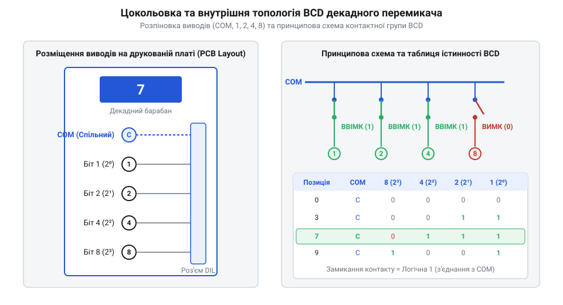
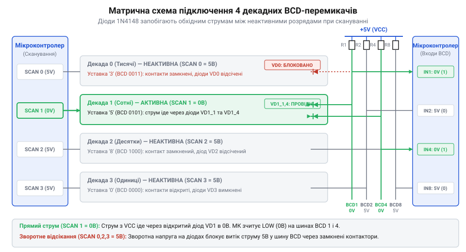

# Залізний API: схемотехніка підключення, розводка виводів та діодна розв'язка BCD-перемикачів

<preknowlist>
- [DIP-перемикачі та джамперні блоки конфігурації](root:cat-hw-controls/dip-switches-and-configuration-blocks) — розуміння принципу підтяжки ліній резисторами та двійкового конфігурування
</preknowlist>

## Цокольовка та фізичні виводи BCD-секції

Кожна окрема декада барабанного перемикача випускається у вигляді самостійного механічного модуля з власною кодовою друкованою платою та стандартизованим контактним роз'ємом. Апаратний залізний інтерфейс (від англ. @@en|hardware pinout interface@@) BCD-секції містить п'ять основних електричних виводів: один спільний контакт `COM` (від англ. @@en|common terminal@@) та чотири розрядні лінії кодування з двійковими вагами `1`, `2`, `4`, `8`.

Розташування виводів на задньому крайовому роз'ємі (від англ. @@en|edge connector pinout@@) має крок `2.54 мм` (`0.1 дюйма`), що відповідає стандартним макетним платам та шлейфовим з'єднувачам. У конструкціях ножового типу @@en|Card Edge@@ контактні майданчики розміщені на краях друкованої плати модуля у вигляді одностороннього або двостороннього ряду. При односторонньому виконанні контакти нумеруються послідовно від `1` до `5` (зліва направо при погляді на задню панель): крайній лівий контакт `1` призначено для спільної шини `COM`, а виводи `2`, `3`, `4`, `5` відповідають двійковим розрядам `1`, `2`, `4`, `8`. При двосторонньому виконанні використовується латинська позначка сторін плати: верхня сторона `A` (контакти `A1`…`A5`) слугує для знімання кодових сигналів, а нижня сторона `B` (контакти `B1`…`B5`) продубльована для надійного заземлення або паралельного шинування `COM`. Таке фізичне розпінування дозволяє встановлювати барабанні секції безпосередньо в слот материнської плати або з'єднувати їх через стандартний вилковий гніздовий роз'єм (від англ. @@en|card edge socket@@). Функціональне призначення виводів BCD-секції наведено в наступній таблиці:

| Позначення виводу | Фізична функція | Двійкова вага | Логічний стан при замкненні |
| :--- | :--- | :--- | :--- |
| `COM` | Спільна шина живлення або землі | — | Спільний потенціал |
| `1` | Біт 0 (найменший значущий біт, LSB) | 2⁰ = 1 | Потенціал шини `COM` |
| `2` | Біт 1 | 2¹ = 2 | Потенціал шини `COM` |
| `4` | Біт 2 | 2² = 4 | Потенціал шини `COM` |
| `8` | Біт 3 (найбільший значущий біт, MSB) | 2³ = 8 | Потенціал шини `COM` |


*Розташування виводів BCD-секції перемикача: спільний вивід COM та кодові виходи 1, 2, 4, 8.*

Для перевірки справності роторних контактів мультиметром у режимі вимірювання опору (або прозвонки) підключають один щуп до виводу `COM`, а інший послідовно до ліній `1`, `2`, `4`, `8`. При повертанні барабана опір замкненого ланцюга `R_closed` не повинен перевищувати `100 мОм`, а опір розімкненого `R_open` має прагнути до нескінченності (`> 10 МОм`). При прецизійній діагностиці чотирипровідним методом із використанням мікровольтметра та фіксованого вимірювального струму `I_test = 10 мА` максимально допустимий спад напруги `V_drop,max` на замкненому контакті обчислюється як:

        V_drop,max
        = I_test · R_closed,max               [формула спаду напруги за законом Ома]
        = 10 мА · 100 мОм                     [підстановка вимірювального струму 10 мА та межі опору 100 мОм]
        = 1.0 мВ                              [гранично припустимий спад напруги]

Перевищення виміряним спадом значення `1.0 мВ` свідчить про окиснення або трибологічний знос контактних доріжок секції, що аналогічно принципам контролю справності комутаційних елементів [DIP-перемикачів та джамперних блоків конфігурації](root:cat-hw-controls/dip-switches-and-configuration-blocks).

## Схемотехніка прямого підключення з підтяжками

Пряме підключення BCD-перемикача до дискретних входів (від англ. @@en|general-purpose input/output@@, GPIO) мікроконтролера застосовують при невеликій кількості декад (1...2 розряди). Спільний вивід `COM` підключають до шини землі `GND`, а кожні чотири бітові лінії `1`, `2`, `4`, `8` під'єднують до вхідних портів контролера, підтягнутих до напруги живлення `V_CC` через зовнішні або внутрішні резистори `R_pull`.

Схемотехнічна топологія та розподіл логічних рівнів працюють за принципом активного низького рівня (від англ. @@en|active-low logic@@):
- Коли контакт розімкнений, резистор `R_pull` утримує на лінії високий логічний рівень `V_CC` (логічна `1`).
- Коли контакт замкнений ротором на `COM` (`GND`), потенціал лінії падає до `0 В` (логічний `0`).

Розрахунок номіналу підтягувального резистора `R_pull` вибирається у межах `4.7...10 кОм`. Використання менших номіналів (`< 1 кОм`) призводить до невиправданого зростання струмоспоживання замкнених ліній, а занадто великі номінали (`> 100 кОм`) підвищують чутливість до наведених електромагнітних завад, що аналогічно принципам конфігурування [DIP-перемикачів та джамперних блоків конфігурації](root:cat-hw-controls/dip-switches-and-configuration-blocks). Електричний розрахунок максимального струму через спільний заземлений контакт `COM` враховує кількість одночасно замкнених бітових ліній `k` для конкретного BCD-символу (наприклад, для цифри `7` у коді `0111_2` замкнено 3 лінії: `1`, `2` та `4`). При напрузі живлення `V_CC = 5 В` та номіналі підтяжки `R_pull = 4.7 кОм` струм однієї лінії становить `I_line = V_CC / R_pull ≈ 1.06 мА`, а підсумковий струм через контакт `COM` обчислюється як:

        I_total
        = k · (V_CC / R_pull)               [підсумовування струмів k замкнених ліній]
        = 3 · (5 В / 4.7 кОм)               [підстановка значень для цифри 7 при 5 В]
        ≈ 3.18 мА                           [максимальний струм через контакт COM]

При виборі надто малого опору `R_pull = 1 кОм` цей струм зростає до `15 мА` на секцію, що при багаторозрядних барабанних блоках із десятків декад створює суттєве паразитне теплове та струмове навантаження на шину живлення.

Для програмного відновлення вихідного десяткового числа зчитуваний з порту 4-бітний вектор коду інвертують та маскують:

```c
// Зчитування прямого BCD-коду з інверсією активного низького рівня
uint8_t raw_gpio_state = READ_BCD_PORT(); 
uint8_t bcd_digit = (~raw_gpio_state) & 0x0F; // Маскування 4 молодших бітів
```

## Діодна розв'язка у скан-матрицях

При збільшенні кількості барабанних декад до 3...6 розрядів пряме підключення вимагає надмірної кількості ліній мікроконтролера (до 24 GPIO). Для скорочення кількості входів застосовують динамічне матричне сканування (від англ. @@en|matrix scanning@@), де однойменні кодові виходи `1`, `2`, `4`, `8` усіх декад об'єднують у спільну 4-бітну шину даних, а спільні виводи `COM1...COMn` використовують як лінії вибору розряду (від англ. @@en|strobe lines@@).

У такій схемі виникає проблема паразитних зворотних струмів (від англ. @@en|sneak paths@@ або фантомні струми): якщо у першій декаді замкнено контакти `1` і `2`, а у другій декаді замкнено контакт `2`, то струм сканування через замкнене коло другої декади потече у зворотному напрямку через контакт `2` першої декади у лінію `1`, викликаючи зчитування фальшивого коду.

Для запобігання зворотним струмам у послідовний ланцюг кожного кодового виводу `1`, `2`, `4`, `8` кожної декади впаюють малосигнальний швидкодіючий випрямний діод 1N4148.


*Схема матричного сканування BCD-перемикачів з ізолювальними діодами 1N4148 у кожному бітовому колі.*

Діоди 1N4148 вмикають анодами до кодових виводів перемикача, а катодами до спільної шини даних (або навпаки, залежно від полярності імпульсів сканування). Електричні параметри діодної розв'язки 1N4148:
- Прямий струм `I_F = 150 мА` (із запасом перекриває струми підтяжки `0.5 мА`).
- Час зворотного відновлення `t_rr ≤ 4 нс` (забезпечує високочастотне сканування без затримок).
- Пряме падіння напруги `V_F ≈ 0.6...0.7 В`, що слід враховувати при розрахунку порогу низького рівня КМОН-входів.

Наявність падіння напруги `V_F` безпосередньо звужує запас завадостійкості (від англ. @@en|noise margin@@) вхідного каскаду мікроконтролера. Для 3.3 В КМОН-логіки максимальна допустима напруга низького рівня становить `V_IL,max = 0.3 · V_CC ≈ 0.99 В`. За відсутності діода рівень логічного нуля близький до `0 В`, проте включення діода 1N4148 підвищує потенціал замкненої лінії на виході до `V_OL = V_F ≈ 0.65 В`. Результуючий запас завадостійкості `N_M` за низьким рівнем скорочується за розрахунком:

        N_M
        = V_IL,max - V_F                    [формула запасу завадостійкості за низьким рівнем]
        = 0.99 В - 0.65 В                   [підстановка значень для 3.3 В КМОН-логіки та діода 1N4148]
        = 0.34 В                            [залишковий запас завадостійкості]

Звуження запасу завадостійкості з `0.99 В` до `0.34 В` (більш ніж утричі) підвищує вразливість лінії до промислових завад, що аналогічно проблемам розв'язки контактів, зазначеним у описі [матричної клавіатури 4×4](root:cat-hw-controls/keypad-4x4-membrane).

Ця схемотехніка запозичує принципи ізоляції фантомних замикань, описані в документації на [матричну клавіатуру 4×4](root:cat-hw-controls/keypad-4x4-membrane).

## Каскадування через зсувний регістр 74HC165

Найбільш раціональним схемотехнічним рішенням для опитування багатодекадних BCD-блоків без використання динамічного сканування є застосування паралельно-послідовних зсувних регістрів 74HC165 (від англ. @@en|Parallel-In Serial-Out shift register@@, PISO). Один 8-розрядний регістр 74HC165 обслуговує дві BCD-декади, перетворюючи 8 паралельних кодових ліній у послідовний цифровий потік.

Схемотехнічне підключення BCD-виходів до регістра 74HC165:
- Виходи `1`, `2`, `4`, `8` першої декади підключають до паралельних входів `D0...D3` (піни 11, 12, 13, 14).
- Виходи `1`, `2`, `4`, `8` другої декади підключають до вхідних пінів `D4...D7` (піни 3, 4, 5, 6).
- Усі лінії підтягують резисторами `R_pull = 10 кОм` до `V_CC`, а виводи `COM1` та `COM2` заземлюють на `GND`.

Інтерфейс керування регістром 74HC165 з боку мікроконтролера вимагає лише трьох сигнальних ліній:
1. `PL` (від англ. @@en|Parallel Load@@, пін 1, активний низький): імпульс низького рівня фіксує поточний стан усіх 8 BCD-ліній у внутрішніх тригерах-засувках.
2. `CLK` (від англ. @@en|Clock Input@@, пін 2): кожен позитивний фронт тактового сигналу зсуває дані на один біт у напрямку послідовного виходу.
3. `Q7` (від англ. @@en|Serial Output@@, пін 9): послідовний вихід даних, підключений до входу `MISO` або будь-якого GPIO контролера.

Каскадування декількох регістрів виконується послідовним з'єднанням: вихід `Q7` першої мікросхеми підключають до послідовного входу `DS` (від англ. @@en|Serial Data Input@@, пін 10) наступного регістра. Сигнали `PL` та `CLK` об'єднують паралельно. Це дозволяє опитувати 4, 8 або 12 BCD-декад по тих самих трьох дротах мікроконтролера.

Часові параметри тактування регістра 74HC165 при напрузі живлення `V_CC = 5 В`:
- Мінімальна тривалість імпульсу завантаження `t_w(PL) ≥ 20 нс`.
- Час витримки даних перед тактовим імпульсом `t_su ≥ 15 нс`.
- Час відновлення після паралельного завантаження `t_rec(PL) ≥ 20 нс` — мінімальний часовий розкид між поверненням `PL` у високий рівень та першим наростаючим фронтом `CLK`.
- Максимальна тактова частота `f_MAX` сягає `25 МГц`, що дозволяє зчитувати дані всього блоку за кілька мікросекунд.

Дотримання затримки відновлення `t_rec(PL)` є критичним для запобігання апаратній гонці станів (від англ. @@en|race condition@@). Якщо перший тактовий фронт `CLK` подати передчасно (до завершення перехідних процесів у внутрішніх засувках тригерів), перший паралельний біт `D7` буде зсунутий або спотворений ще до його фіксації на виході `Q7`, що призведе до зчитування фальшивої BCD-цифри.
