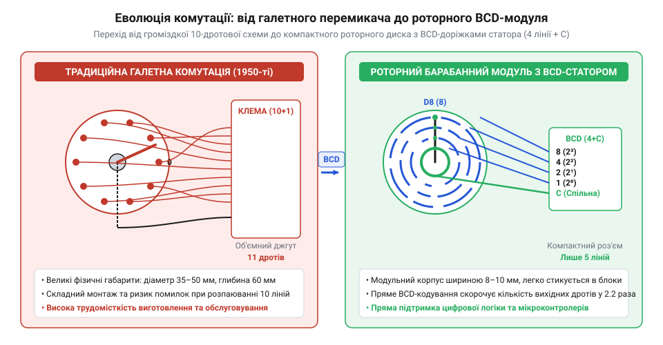

# Історія розвитку та еволюція декадних барабанних перемикачів

<preknowlist>
- [DIP-перемикачі та джамперні блоки конфігурації](root:cat-hw-controls/dip-switches-and-configuration-blocks) — розуміння принципів контактного цифрового кодування станів
- [Тумблери, захисні ковпачки Mollie та блокування важелів (Switch Guards)](root:cat-hw-controls/toggle-switches-and-switch-guards) — розуміння конструкції та обмежень електромеханічних тумблерів у панелях керування
</preknowlist>

## Криза галетних вимикачів в авіації

У першій половині XX століття введення числових уставок у радіолокаційних станціях, навігаційних обчислювачах та кабінах військової авіації здійснювалося за допомогою тумблерів та багатопозиційних галетних вимикачів. Пристрої такого типу вимагали значного вільного об'єму за лицьовою панеллю приладів: баварська або дискова галета разом із контактами сягала глибини від 5 до 12 сантиметрів. Оскільки кожна декада вимагала окремого вихідного провідника для кожної з десяти позицій (схема «1-з-10»), багаторозрядні числові табло обростали важкими джгутами з десятків мідних дротів.

Окрім вагових та габаритних обмежень, галетні вимикачі створювали високий ризик операторської помилки та технічних збоїв. Пілоти та оператори обчислювальних комплексів, працюючи у щільних льотних рукавицях під дією вібрації чи стресу, не могли швидко визначити поточний стан перемикача без окремих вимірювальних шкальних індикаторів. Звичайні електлектромеханічні [тумблери з блокуванням важелів](root:cat-hw-controls/toggle-switches-and-switch-guards) забезпечували лише двопозиційну комутацію «увімкнено-вимкнено», що змушувало будувати громіздкі матриці з десятків важелів для введення однієї координати. До того ж відкрита конструкція галетно-дискових контактів (від @@en|wafer switch@@) виявилася незахищеною від агресивного авіаційного середовища: постійна бортова вібрація викликала фреттинг-знос (від @@en|fretting wear@@) срібного покриття ламелей, а волога й озон приводили до швидкого окислення контактних поверхонь. Утворені плівки окислів спричиняли високий перехідний опір та спорадичні розриви кіл, що робило від відкритих галетних блоків джерело небезпечних плаваючих відмов у відповідальній апаратурі.

Виникла гостра інженерна потреба у компактному цифровому органі введення, який би поєднував роторну комутацію, чітку візуальну індикацію обраної цифри та мінімальні габарити глибини монтажу.

Критичним джерелом операторських помилок при використанні традиційних галетних вимикачів був оптичний паралакс (англ. @@en|parallax error@@, від грецького *παράλλαξις* — зміна, відхилення) при зчитуванні похилих шкал. У класичних панелях покажчик положення кріпився на ручці регулятора, а числова шкала наносилася на заглиблену циферблатну пластину із повітряним зазором `d` між ними. Коли пілот або оператор дивився на прилад під кутом `α` відносно нормалі (що було неминучим у тісних кабінах із бічним розміщенням приладів), кутовий зсув лінії зору викликав лінійне зміщення покажчика відносно поділок шкали `Δx = d · tan(α)`. При щільному розташуванні десяти декадних позначок цей зсув призводив до помилкового зчитування сусідньої цифри — наприклад, 6 замість 5 чи 7, що у військово-навігаційних комплексах спричиняло збій радіочастот чи координат цілі. Барабанні перемикачі усунули паралакс, розмістивши цифрові позначки безпосередньо на зовнішньому ободі роторного диска впритул до віконця лицьової панелі.

## Винайдення барабанного диска та BCD-кодування

Справжній технологічний прорив відбувся наприкінці 1950-х років. У 1957–1959 роках американський інженер Вейн Міллер (англ. @@en|Wayne Miller@@) та команда розробників компанії Digitran (Пасадена, Каліфорнія) розробили принципово новий вузол — модульний декадний барабанний перемикач (англ. @@en|thumbwheel switch@@).

Головною ідеєю конструкції стала відмова від осьового галетного вала на користь тонкого пластикового барабана-ротора з нанесеними на ободі цифрами 0–9. Ротор монтувався у вузькому корпусі паралельно до лицьової панелі, а вибір позиції здійснювався безпосередньо прокручуванням рифленого краю диска пальцем.

Другим вирішальним досягненням стала інтеграція контактних доріжок статора безпосередньо на друкованій платі (англ. *@@en|Printed Circuit Board@@*, PCB). Замість виведення 10 окремих сигнальних ліній для кожної цифри, топологія мідних доріжок плати статора формувала двійково-кодований десятковий код (англ. *@@en|binary-coded decimal@@*, BCD). При замиканні спільної шини (COM) роторними щітками з берилієвої бронзи на виході модуля утворювався 4-бітний паралельний код із вагами бітів 8-4-2-1 (2³-2²-2¹-2⁰). Математична таблиця істинності прямого коду BCD 8421 визначає однозначну відповідність позиції диска N = 0…9 до чотирьох бінарних виходів:

| Позиція N | Біт 8 (2³) | Біт 4 (2²) | Біт 2 (2¹) | Біт 1 (2⁰) |
|---|---|---|---|---|
| 0 | 0 | 0 | 0 | 0 |
| 1 | 0 | 0 | 0 | 1 |
| 2 | 0 | 0 | 1 | 0 |
| 3 | 0 | 0 | 1 | 1 |
| 4 | 0 | 1 | 0 | 0 |
| 5 | 0 | 1 | 0 | 1 |
| 6 | 0 | 1 | 1 | 0 |
| 7 | 0 | 1 | 1 | 1 |
| 8 | 1 | 0 | 0 | 0 |
| 9 | 1 | 0 | 0 | 1 |

Завдяки такій геометрії контактного поля кожна з позицій 0–9 апаратно замикала лише ті лінії, чия сума вагових коефіцієнтів дорівнювала обраній цифрі, дозволяючи передавати значення безпосередньо у логіку цифрових лічильників.

*Порівняльна схема еволюції від багатодротової галетної комутації до роторного диска з BCD-доріжками статора.*

Завдяки впровадженню BCD-кодування кількість міжмодульних дротів скоротилася з 10 до 4 на кожну декаду, що зменшило масу кабельних джгутів у бойових літаках та ракетах Minuteman більш ніж на 60%.

У 1960–1970-х роках барабанні модулі отримали бічні засувки для збирання багаторозрядних блоків та силіконові ущільнювальні кільця (англ. @@en|O-ring seal@@) для забезпечення пило- та водонепроникності рівня IP65. Згодом для конфігурування внутрішньоприладних плат з'явилися планарні [DIP-перемикачі та блоки конфігурації](root:cat-hw-controls/dip-switches-and-configuration-blocks), але для оперативного фронтального введення даних барабанні декади залишалися стандартом протягом кількох десятиліть.

Для вирішення проблеми складності прокручування ротора в операторських рукавицях та запобігання випадковому проскакуванню декількох цифр розробники створили двоклавішні кнопково-барабанні модулі (англ. @@en|push-button thumbwheel switch@@, або @@en|push-wheel switch@@). На лицьову панель комутатора вивели дві окремі клавіші крокового зміщення «+» та «-», сполучені з внутрішнім храповим механізмом (англ. @@en|ratchet mechanism@@). Натискання верхньої клавіші повертало барабан з BCD-контактами на одну позицію вперед, а нижньої — на одну позицію назад з чітким тактильним клацанням, подібним до спрацьовування [тактильних кнопок](root:cat-hw-controls/tactile-buttons). Таке двонаправлене дискретне перемикання спростило точне покрокове коригування устави в умовах вібрацій польоту та промислових цехів, виключивши потребу у безпосередньому торканні пальцем обертового диска.

*Конструктивний розвиток модульних барабанних і кнопкових блоків із бічними засувками та ущільнювачами IP65.*

## Модульне каскадування та захищені виконання

Упродовж 1960–1970-х років, на тлі стрімкого впровадження систем числового програмного керування (ЧПК) у металообробці, вимірювальних частотомірів та медичного обладнання, виникла потреба у зручному збиранні багаторозрядних табло устави. Окремі барабанні секції було важко монтувати поштучно на лицьові панелі приладів. Для вирішення цієї проблеми інженери розробили модульне каскадування (від латинського *modulus* — міра, та італійського *cascata* — послідовне з'єднання, @@en|modular cascadability@@).

Бічні поверхні пластикових корпусів барабанних модулів почали оснащувати пазами типу «ластівчин хвіст» (@@en|dovetail slot@@) або пружними засувками. Це дозволяло оперативно збирати окремі однорозрядні секції у єдине жорстке багаторозрядне блочне табло (@@en|decade bank@@) будь-якої розрядності. По краях блоку встановлювали бічні заглушки (@@en|end cap@@) та стяжні шпильки, що забезпечували монолітне закріплення конструкції у стандартному прямокутному вирізі панелі керування.

Проте експлуатація барабанних перемикачів у важких промислових умовах виявила нові конструктивні обмеження: масляний туман, агресивний пил та волога легко проникали крізь зазори відкритого барабана, спричиняючи корозію мідних доріжок друкованої плати. Крім того, оператор міг випадково зачепити виступаюче колесо рукавом та збити задану уставу. Для захисту від цих факторів інженери розробили дві нові конструкції, найбільш досконалою з яких став кнопковий барабанний модуль (від англійського @@en|push-button thumbwheel@@). В його основі лежить кінематичний привод на базі 10-зубого храпового колеса (@@en|ratchet wheel@@) та пружинного штовхача-собачки: при натисканні кнопок `+` чи `-` штовхач повертає роторний диск рівно на `36°` (один крок), а пружинний фіксатор-детентор (@@en|spring detent pin@@) миттєво заскакує у профільну виїмку, ґарантуючи точне позиціювання контактів та виключаючи зворотний люфт. Такий закритий храповий механізм повністю ізолював внутрішню роторну плату від зовнішнього середовища, уможлививши розробку наступних технічних рішень:

1. Герметизовані барабанні модулі (стандарт захисту `IP65` / `NEMA 4`): внутрішній роторний вал ущільнювали кільцевими гумовими прокладками (@@en|O-ring seal@@), а цифрову доріжку закривали прозорим силіконовим ковпачком.
2. Кнопкові декадні перемикачі (від грецького *deka* — десять, @@en|push-button thumbwheel@@): замість відкритого диска для прокручування пальцем на лицьовій панелі розмістили дві герметичні кнопки `+` та `-`. Натискання кнопки `+` за допомогою внутрішнього храповика (@@en|ratchet mechanism@@) повертало кодовий барабан на один крок уперед (наприклад, від `3` до `4`), а кнопка `-` повертала його назад.

Кнопкові декадні модулі стали вершиною еволюції контактного цифрового введення, забезпечивши повну герметичність та виключивши хибні зсуви устави. Вони масово застосовувалися у [промислових пультах налагодження](root:cat-hw-controls/teach-pendant-interface) та стійких панелях до кінця 1980-х років, поки їх не витіснили цифрові клавіатури, [DIP-перемикачі конфігурації](root:cat-hw-controls/dip-switches-and-configuration-blocks) та графічні сенсорні дисплеї.

## Спірна атрибуція та міфи походження

У популярній технічній літературі та інтернет-джерелах часто трапляються історичні плутанини та міфи щодо часу винайдення та авторів барабанних перемикачів. Найбільш поширеною помилкою є приписування концепції цифрового барабанного перемикача винахідникам XVII–XIX століть — Блезу Паскалю чи Чарльзу Беббіджу.

Для спростування цього міфу важливо розрізняти два фундаментально різних типи пристроїв:

- Механічний лічильник (від грецького *mechanike* — мистецтво будувати машини, @@en|mechanical counter wheel@@): числові коліщата суммарної машини Паскаля («Паскаліни», 1642 рік) або різницевої машини Беббіджа (1822 рік) слугували суто механічними регістрами накопичення та відображення чисел. Перенесення розрядів здійснювалося за допомогою зубчастих передач і важелів без будь-яких електричних кіл чи контактів.
- Електричний роторний BCD-перемикач (@@en|rotary BCD switch@@): комбінує візуальний барабан із друкованою платою-статором, що перетворює кутове положення ротора у двопозиційний цифровий електричний код (BCD).

Другим популярним міфом є твердження про використання барабанних BCD-перемикачів у шифрувальних машинах 1930–1940-х років (зокрема в роторних шифраторах «Енігма»). Справді, шифратор «Енігма» містив поворотні диск-ротори, проте їхня фізична суть була абсолютно іншою: ротори Енігми здійснювали динамічну багатопровідну аналогову підстановку літер алфавіту через комутаційну літерну матрицю з 26 скрізних провідників при кожному натисканні клавіші, тоді як декадний барабанний перемикач є статичним органом введення числової устави з 4-бітним двійковим виходом у коді BCD. Ротор Енігми виступав елементом динамічного криптографічного перетворення алфавітного сигналу (від англ. @@en|polyalphabetic substitution cipher@@ — багатоалфавітний шифр підстановки), з'єднуючи один із 26 вхідних контактів з одним із 26 вихідних, тоді як статор BCD-перемикача через друковану плату кодування постійно формує паралельний двійковий код позиції (виводи `1`, `2`, `4`, `8`), стабільно підтягнутий до спільної шини `COM`.

Справжня історія барабанного перемикача як електлектромеханічного цифрового органу введення розпочалася у 1957 році, коли американський інженер Вейн Міллер (@@en|Wayne Miller@@) у компанії Digitran (@@en|Digitran@@) запатентував компактний роторний перемикач на базі друкованої плати. Чітке розмежування між механічними обчислювальними регістрами та контактними BCD-перемикачами дозволяє точно оцінити технологічний прорив 1950-х років у створенні цифрових інтерфейсів людина-машина.

Порівняти класичні електромеханічні органи керування з іншими варіантами захисту можна у матеріалі про [захисні ковпачки тумблерів](root:cat-hw-controls/toggle-switches-and-switch-guards).
