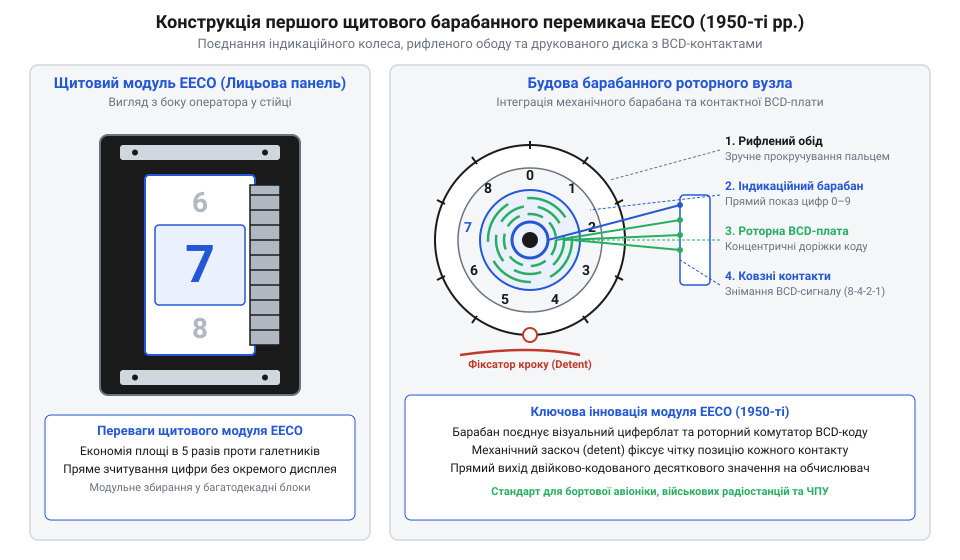
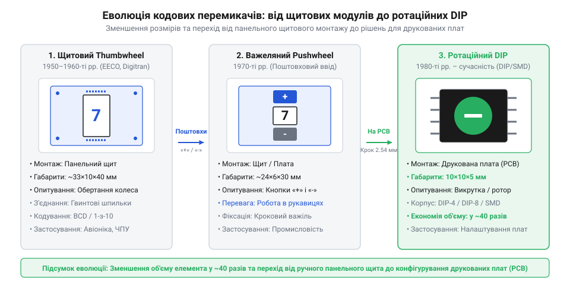

# Історія створення та еволюції декадних барабанних перемикачів

<preknowlist>
- [Декадні барабанні перемикачі (Thumbwheel Switches)](root:cat-hw-controls/thumbwheel-switches) — Принцип механічної комутації та формування двійково-кодованого десяткового BCD-коду.
- [DIP-перемикачі та джамперні блоки конфігурації](root:cat-hw-controls/dip-switches-and-configuration-blocks) — Призначення органів цифрового налаштування адрес та параметрів на друкованих платах.
- [Тумблери, захисні ковпачки Mollie та блокування важелів (Switch Guards)](root:cat-hw-controls/toggle-switches-and-switch-guards) — Особливості базісного панельного комутаційного обладнання середини XX століття.
</preknowlist>

## Криза авіоніки та громіздкі галетники

Наприкінці 1950-х років розвиток реактивної авіації, радіолокації та перших військових цифрових обчислювачів зіткнувся з гострою практичною проблемою — дефіцитом площі приладових панелей у кабінах пілотів та на операторських пультах. Базовими комутаційними елементами того часу слугували [тумблери з блокуванням важелів](root:cat-hw-controls/toggle-switches-and-switch-guards) та багатопозиційні галетні перемикачі. Гострота цієї кризи проявилася у бортовій авіоніці реактивних лайнерів Boeing 707 та Douglas DC-8, де у навігаційних приймачах радіомаяків VOR/DME (англ. @@en|VHF Omnidirectional Range / Distance Measuring Equipment@@) компаній @@en|Collins Radio Company@@ та @@en|Bendix Aviation@@ для вибору частоти в діапазоні 108.00–117.95 МГц доводилося встановлювати поруч чотири окремі галетні повертачі, кожен із яких мав власний набір контактних дивізіонів та займав до 4 см² переднього щита.

Кожен класичний галетник вимагав ручки великого діаметра для прикладання кутового зусилля та кругової шкали на лицьовій панелі. Притискання трьох-чотирьох таких вузлів поруч займало десятки квадратних сантиметрів дорогоцінного щитового простору. До того ж зчитування послідовності чисел із рознесених кругових шкал викликало втомлюваність очей оператора та призводило до небезпечних помилок у критичних режимах польоту. Виникла чітка технічна потреба у компактному модульному пристрої, який би дозволяв здійснювати прямолінійний фронтальний набір чисел великим пальцем руки й надавав миттєву візуальну індикацію набраної комбінації у єдиному інспекційному вікні.

## Перші барабанні модулі EECO та Digitran

Розв'язанням цієї інженерної кризи у 1957–1959 роках стала розробка перших секційних барабанних перемикачів (від англ. @@en|thumbwheel switch@@, від @@en|thumb@@ — великий палець, та @@en|wheel@@ — колесо; далі — @@en|thumbwheel switch@@). Пріоритет у створенні перших промислових зразків належить інженерам американських компаній @@en|EECO@@ (від англ. @@en|Electronic Engineering Company of California@@) та @@en|Digitran@@ (підрозділ корпорації @@en|Endevco@@ у місті Пасадена). Ключовим інженерним досягненням, закріпленим патентом США (англ. @@en|US Patent@@), стала концепція модульного конструктиву: окремі однодекадні корпуси мали бічні пази й виступи та стягувалися у довільну багаторарядну панель за допомогою бокових затискачів (англ. @@en|side clamps@@) і різьбових шпильок. Це дозволило споживачам самостійно збирати табло будь-якої розрядності для монтування в єдиний прямокутний виріз лицевої панелі без виготовлення індивідуальних несучих рам.

_Будова та внутрішнє компонування першого щитового барабанного перемикача компанії EECO кінця 1950-х років._

Конструктивний прорив полягав у відмові від громіздкої кругової ручки на користь вузького рифленого барабана (ротора), оцифрованого по периметру від 0 до 9. Модулі збиралися у єдине щільне табло бічними затискачами. Безпосередньо на тілі пластикового барабана або поруч із ним монтувався рухомий контактний струмознімач (англ. @@en|wiper@@), який ковзав по нерухомій друкованій платі статора з позолоченими доріжками. Спеціальний пружинний фіксатор (англ. @@en|detent mechanism@@) забезпечував чіткий тактильний клік при зміні цифри, запобігаючи довільному прокручуванню ротора від вібрацій авіаційного двигуна. Новий орган вводу зменшив необхідну площу приладового щита у 4–6 разів порівняно з галетними вузлами.

_Еволюційний ряд зменшення габаритних розмірів роторних органів комутації від щитових блоків до ротаційного DIP-формату._

## Стандартизація BCD-кодування в обчислювачах

Початкові версії барабанних перемикачів початку 1960-х років мали 10-вивідну комутаційну схему (1-з-10), де кожному положенню ротора відповідала окрема електрична лінія. З появою перших транзисторних цифрових ЕОМ та дискретних логічних мікросхем передача 10 дротів від кожної декади до обчислювального блоку стала головним вузьким місцем кабельних шлейфів. Для оптимізації комунікації інженери перейшли до двійково-кодованого десяткового формату, проте перші обчислювачі на германієвих p-n-p транзисторах та діодно-транзисторній логіці DTL (від англ. @@en|Diode-Transistor Logic@@; далі — @@en|DTL@@) працювали в системі від'ємної логіки (від англ. @@en|negative logic@@), де активним рівнем сигналу слугував потенціал землі. Прямий код вимагав би додаткових інверторних транзисторів для кожного розряду, тому виробники розробили барабанні модулі з топологією комплементарного BCD-коду (від англ. @@en|complementary BCD@@). У такому виконанні ковзний контакт статора замикав на спільний провід саме інверсні значення бітів, що дозволяло керувати входами транзисторної логіки напряму без витрат на складні міжкаскадні шифратори.

Масовий перехід на двоічно-кодований десятковий код BCD (від англ. @@en|Binary Coded Decimal@@; далі — @@en|BCD@@, 8421) дозволив кардинально оптимізувати комунікацію. Змінивши топологію контактних доріжок на друкованій платі статора, інженери досягли того, що кожне з 10 положень барабана одразу перетворювалося на 4-бітну двійкову комбінацію. Це скоротило кількість сигнальних жил кабелю з 10 до 4 на кожну числову декаду.

Пряме механічне BCD-кодування у барабанному модулі виявилося виключно вигідним: воно усунуло потребу у складних електронних шифраторах на дисках чи лампових схемах. Модульні барабанні блоки стали стандартом де-факто для задавання ставок у промислових лічильниках, налаштування систем узагальненого [декадного барабанного перемикача](root:cat-hw-controls/thumbwheel-switches), а також у військових робототехнічних комплексах та пультових інтерфейсах типу [пультів налагодження](root:cat-hw-controls/teach-pendant-interface). Згодом цей принцип мініатюризувався у ротаційних [DIP-перемикачах](root:cat-hw-controls/dip-switches-and-configuration-blocks).

## Перехід до поштовхових та ротаційних DIP-модулів

У 1970-х роках швидка мініатюризація напівпровідникової електроніки висунула нові вимоги до розмірів органів вводу. Поряд із класичними роторними перемикачами з'явилися поштовхові модулі (англ. @@en|pushwheel switch@@, від *@@en|push@@* — штовхати та *@@en|wheel@@* — колесо). Замість безпосереднього обертання рифленого обідка пальцем інженери додали дві підпружинені кнопки «+» та «-», що розміщувалися над і під індикаторним віконцем. Кінематика цього вузла базувалася на двонаправленому храповому механізмі (англ. @@en|ratchet mechanism@@): кожна кнопка була з'єднана із власною підпружиненою собачкою-штовхачем (англ. @@en|pawl@@). Натискання верхньої кнопки «+» зміщувало собачку вгору, зачіпаючи зубець внутрішнього храповика ротора й примусово повертаючи барабан строго на один кутовий крок в 36° (уперед), після чого зворотна пружина повертала кнопку у вихідний стан без зворотного розвороту вала. Нижнє плече кнопки «-» аналогічно задіяло протилежну собачку для крокового розвороту барабана в зворотному напрямку, а підпружинений кулісний фіксатор (англ. @@en|detent spring@@) жорстко утримував барабан у точній цифровій позиції. Це рішення виявилося надзвичайно зручним у промисловій автоматиці та авіоніці, де оператори працюють у грубих захисних рукавичках або в умовах сильної вібрації.

Паралельно масове впровадження друкованих плат стимулювало створення органів конфігурації, які монтувалися безпосередньо на плату всередині корпусу приладу. На початку 1980-х років конструктори об'єднали роторний механізм BCD-кодування з корпусною базою стандарту Dual In-line Package. Так виникли ротаційні [DIP-перемикачі](root:cat-hw-controls/dip-switches-and-configuration-blocks) (англ. @@en|rotary DIP switch@@), які мали крок виводів 2.54 мм та висоту профілю менше 5 мм. Вони замінили довгі ряди важільних перемикачів єдиним компактним диском із хрестоподібним шліцом під викрутку або мініатюрним ротором.

## Розвінчання міфів про першість барабанних перемикачів

У технічній історіографії нерідко виникає плутанина між малосигнальними декадними перемикачами та силовими барабанними контролерами (англ. @@en|drum controller@@) початку XX століття. Великі обертальні перемикачі з мідними кулачками використовувалися у трамваях, електровозах та мостових кранах ще у 1900-х роках для прямої комутації високої напруги тягових електродвигунів. Поширений міф стверджує, ніби декадні перемикачі (англ. @@en|thumbwheel switch@@) є лише зменшеною копією цих силових кулачкових апаратів. Проте ключова відмінність полягає у фізиці контактних матеріалів: силові контролери розраховувалися на струми в десятки й сотні ампер та комутаційну дугу, тому використовували масивні мідні сегменти з високим механічним тиском щіток. Натомість малосигнальні перемикачі працюють у слабострумових цифрових колах, де звичайна мідь швидко вкривається непровідною оксидною плівкою і спричиняє обриви сигналу. Для збереження стабільного перехідного опору при напругах у кілька вольт контактні доріжки статора вкривають шар іммерсійного або гальванічного золота завтовшки 1.5–3 мкм по нікелевому підшару, що унеможливлює окиснення й дозволяє ковзній щітці надійно замкнути коло без надмірного зношування контактної групи.

Насправді принципова відмінність полягає у цілі та схемотехніці: силові контролери комутували робочі струми двигунів за послідовними схемами пуску, тоді як перемикачі наприкінці 1950-х років були створені виключно як двійкові датчики коду для цифрової логіки. Справжнім патентованим проривом інженерів EECO та Digitran у 1957–1959 роках було не сам факт обертання циліндра, а інтеграція друкованої плати статора з ковзними щітками у вузький щитовий модуль, який формував BCD-код і збирався у багаторозрядні табло за допомогою бічних кришок.

## Сучасний стан та ніша в промисловості

Наприкінці XX століття масове дешевшання мікроконтролерів, рідкокристалічних індикаторів та сенсорних панелей витіснило барабанні перемикачі з побутової та загальнопромислової електронної техніки. Програмні меню дозволили задавати сотні параметрів через екран, у той час як фізичний барабанний блок вимагав вирізу у лицьовій панелі та ущільнення від пилу й вологи. Проте у бортовій авіоніці (від англ. @@en|avionics@@) роторні та барабанні модулі збереглися на панелях налаштування частот навігації та відповідачів транспондерів за рахунок адаптації до цифрових бортових шин за стандартом @@en|ARINC-429@@ (від англ. @@en|Aeronautical Radio, Incorporated@@). У сучасних кабінах пілотів паралельний BCD-код із барабанних секцій надходить на інтегрований панельний концентратор, який кодує вибране числове значення у 32-бітне цифрове слово @@en|ARINC-429@@ (із заповненням полів мітки @@en|Label@@, даних BCD, статусних бітів @@en|SSM@@ та біта парності @@en|Parity@@). Передача даних послідовною диференціальною крученою парою на тактових частотах `12.5 кбіт/с` або `100 кбіт/с` дозволяє поєднати миттєве тактильне встановлення параметрів важелями із високою надійністю та завадостійкістю обміну між блоками управління польотом (англ. @@en|Flight Management System@@).

Попри це, декадні барабанні перемикачі зберегли свою нішу у критично важливих галузях — авіоніці, військовій техніці та промислових системах безпеки. Головними перевагами залишаються абсолютна енергонезалежність без споживання струму, збереження налаштувань при повній знеструмленості приладу та захищеність від програмних збоїв чи кібератак. У приладах, де параметр виставляється раз на кілька років чи вимагає миттєвого візуального контролю без увімкнення живлення, роторні модулі та ротаційні [DIP-перемикачі](root:cat-hw-controls/dip-switches-and-configuration-blocks) залишаються незамінним розв'язком.
