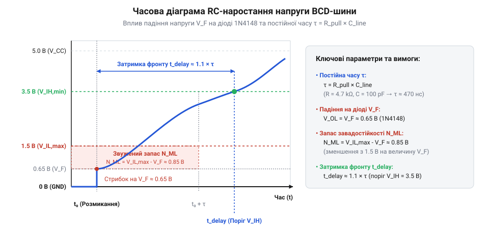

# Математичні розрахунки BCD-кодування та електричних параметрів шини

<preknowlist>
- [DIP-перемикачі та джамперні блоки конфігурації](root:cat-hw-controls/dip-switches-and-configuration-blocks) — розуміння принципів двопозиційного кодування станів контактних груп
- [Матрична клавіатура 4×4 (мембранна)](root:cat-hw-controls/keypad-4x4-membrane) — розуміння принципів матричного сканування та розрахунку струмів шини
</preknowlist>

## Комбінаторика роторної комутації BCD-коду

Механічна структура декадного барабанного перемикача виключає неоднозначність ручного введення завдяки прямому перетворенню кутового положення ротора в паралельний двійково-кодований десятковий код (від англ. @@en|binary-coded decimal@@, BCD). Кожна декада містить чотири вихідні кодові лінії з двійковими вагами `D1` (вага 1, 2⁰), `D2` (вага 2, 2¹), `D4` (вага 4, 2²) та `D8` (вага 8, 2³), а також один спільний вивід `C` (від англ. @@en|common pin@@). Залежно від обраної позиції від `0` до `9`, внутрішній роторний диск замикає спільний контакт із відповідною комбінацією кодових ліній.

У прямому BCD-кодуванні розряд вважається замкненим на спільну шину при логічній одиниці відповідного двійкового біта. Кількість активних (замкнених) контактів `N_active` для десяткової цифри `N_dec` визначається сумою бінарних коефіцієнтів її двійкового розкладу `b₀ + b₁ + b₂ + b₃`. Для аналізу статичного струму та оцінки енергоефективності кодової шини розраховують середньозважену кількість замкнених контактів `N_{avg}` на одну декаду при рівноймовірній появі цифр від `0` до `9`:

        N_{avg}
        = (1 / 10) · ∑ₖ₌₀⁹ N_active(k)   [усереднення кількості активних контактів за 10 позиціями]
        = (0 + 1 + 1 + 2 + 1 + 2 + 2 + 3 + 1 + 2) / 10
        = 15 / 10
        = 1.5                            [середньозважена кількість замкнених контактів на декаду]

На відміну від прямого, у комплементарному BCD-кодуванні контакти замкнені при інверсному стані (логічний 0), тому для позицій `0...9` формується детальний перелік замкнених ліній: `0` (1111, 4 контакти `D1+D2+D4+D8`), `1` (1110, 3 контакти `D2+D4+D8`), `2` (1101, 3 контакти `D1+D4+D8`), `3` (1100, 2 контакти `D4+D8`), `4` (1011, 3 контакти `D1+D2+D8`), `5` (1010, 2 контакти `D2+D8`), `6` (1001, 2 контакти `D1+D8`), `7` (1000, 1 контакт `D8`), `8` (0111, 3 контакти `D1+D2+D4`) та `9` (0110, 2 контакти `D2+D4`). Сума замкнених контактів за повний цикл становить 25, що дає середнє значення `N_{comp_avg} = 2.5` замкнених контактів на декаду.

Для комбінованої кодової матриці з `M` декад загальне середньозважене число одночасно замкнених контактів становить `N_{total_avg} = M · N_{avg}` (тобто `1.5 · M` для прямого та `2.5 · M` для комплементарного кодування), що є базою для обчислення середньозваженого струмоспоживання шини.

        N_active
        = b₀ + b₁ + b₂ + b₃      [сума активних двійкових розрядів BCD-коду]

Для прямого коду комбінаторні стани ліній у положеннях `0...9` описуються наступними значеннями: `0` (0000, 0 контактів), `1` (0001, 1 контакт `D1`), `2` (0010, 1 контакт `D2`), `3` (0011, 2 контакти `D1+D2`), `4` (0100, 1 контакт `D4`), `5` (0101, 2 контакти `D1+D4`), `6` (0110, 2 контакти `D2+D4`), `7` (0111, 3 контакти `D1+D2+D4`), `8` (1000, 1 контакт `D8`) та `9` (1001, 2 контакти `D1+D8`). На відміну від прямого, у комплементарному BCD-кодуванні (від англ. @@en|complementary BCD@@) контакти замкнені у стану логічного нуля, тому кількість замкнених контактів `N_comp` становить:

        N_comp
        = 4 - N_active           [кількість замкнених контактів інверсної логіки]

Розуміння цієї комбінаторики є основою для аналізу статичних і динамічних режимів роботи шини в таблицях [DIP-перемикачів та джамперних блоків конфігурації](root:cat-hw-controls/dip-switches-and-configuration-blocks).

## Електричний розрахунок статичного струмоспоживання

Електрична схема зчитування BCD-перемикачів будується за схемою з підтяжкою ліній до напруги живлення `V_CC` через підтягувальні резистори (від англ. @@en|pull-up resistors@@) `R_pull`, коли спільний вивід `C` підключено до потенціалу землі `GND`. Коли контакт ротора замкнений, струм протікає від джерела `V_CC` через резистор `R_pull` та замкнену контактну групу на землю, створюючи на вхідній лінії мікроконтролера низький логічний рівень.

Струм одного замкненого контакту `I_contact` обчислюється за законом Ома:

        I_contact
        = V_CC ÷ R_pull          [статичний струм одного замкненого контакту]

**Приклад обчислення:** Для стандартного цифрового кола з напругою живлення `V_CC = 5.0 В` та підтягувальним резистором `R_pull = 10 кОм` струм поодинокої лінії становить:

        I_contact
        = 5.0 ÷ 10000
        = 0.0005 А
        = 0.5 мА                 [струм однієї замкненої кодової лінії]

Найбільше статичне струмоспоживання однієї декади `I_decade_max` спостерігається в положенні `7` (BCD-код `0111`), де одночасно замкнені три лінії (`D1`, `D2`, `D4`):

        I_decade_max
        = 3 × I_contact
        = 3 × 0.5
        = 1.5 мА                 [максимальний статичний струм однієї декади]

Для `N_decades` декад, об'єднаних у паралельний блок (наприклад, `N_decades = 4` декади у комбінації `7777`), сумарне пікове споживання шини `I_total_max` сягає:

        I_total_max
        = N_decades × I_decade_max
        = 4 × 1.5
        = 6.0 мА                 [сумарне пикове споживання 4-розрядного блоку]

Середнє статичне споживання однієї декади `I_decade_avg` при рівноймовірному розподілі цифр `0...9` розраховується через середню кількість замкнених ліній (1.5 лінії на цифру) і становить `0.75 мА`. Розрахунок цих струмів критично важливий для нормування навантаження на контакти та запобігання їх електроерозійному зносу.

## Динаміка RC-фронтів та вибір R_pull

При розмиканні контактів ротора лінія шини переходить у стан високого логічного рівня за рахунок заряджання паразитної ємності монтажу `C_line` (від англ. @@en|parasitic bus capacitance@@) через резистор підтяжки `R_pull`. Динамічні властивості цього перехідного процесу визначаються постійною часу RC-кола `τ`:

        τ
        = R_pull × C_line        [постійна часу заряджання еквівалентної ємності лінії]

Напруга на лінії `V(t)` під час розмикання контакту зростає за експоненційним законом:

        V(t)
        = V_CC × (1 - e⁻ᵗ⁾⁽ᵀ)    [динаміка зростання напруги при заряджанні ємності]

*Динаміка заряджання паразитної ємності C_line через резистор R_pull та зміщення рівня логічного нуля через падіння напруги V_F.*

Час наростання сигналу `t_rise` до порогу логічної одиниці КМОН-входу `V_IH = 0.7 × V_CC` виводиться з рівняння заряджання:

        t_rise
        = τ × ln(1 ÷ (1 - 0.7))
        = R_pull × C_line × ln(3.333)
        ≈ 1.204 × R_pull × C_line [час досягнення порогу логічного високого рівня]

**Приклад обчислення:** Для паразитної ємності плати й кабелю `C_line = 50 пФ` та вимоги до часу наростання фронту `t_max = 5 мкс` граничний опір підтяжки `R_pull_max` становить:

        R_pull_max
        = t_max ÷ (1.204 × C_line)
        = 5.0 × 10⁻⁶ ÷ (1.204 × 50 × 10⁻¹²)
        = 5.0 × 10⁻⁶ ÷ (6.02 × 10⁻¹⁰)
        ≈ 8305 Ом
        ≈ 8.3 кОм                 [максимально допустимий опір R_pull за швидкодією]

Вибір номіналу `R_pull` вимагає компромісу: збільшення опору зменшує статичне струмоспоживання, але спотворює прямокутну форму імпульсів і затягує RC-фронти, що може спричинити збої зчитування при високочастотному матричному опитуванні, подібному до принципів [матричних клавіатур 4×4](root:cat-hw-controls/keypad-4x4-membrane).

## Вплив падіння напруги діодів на завадостійкість

Для усунення паразитних зворотних струмів між декадами у послідовний ланцюг кожної кодової лінії вмикають випрямні діоди 1N4148. Однак протікання струму через прямо включений діод викликає на ньому прямої падіння напруги `V_F` (від англ. @@en|forward voltage drop@@), що зміщує потенціал низького логічного рівня на шині `V_OL_bus` відносно земли:

        V_OL_bus
        = V_GND + V_F            [потенціал логічного нуля на кодовій лінії шини]

Це зміщення безпосередньо зменшує запас завадостійкості за низьким рівнем `V_NML` (від англ. @@en|noise margin low@@), який визначається як різниця між максимально допустимою напругою логічного нуля входу `V_IL_max` та фактичним рівнем `V_OL_bus`:

        V_NML
        = V_IL_max - V_OL_bus
        = V_IL_max - (V_GND + V_F) [запас завадостійкості з урахуванням діодної розв'язки]

**Приклад обчислення:** Для КМОН-входів із живленням `V_CC = 5.0 В` поріг логічного нуля становить `V_IL_max = 1.5 В`. При використанні кремнієвого діода 1N4148 з падінням напруги `V_F = 0.65 В` запас завадостійкості становить:

        V_NML
        = 1.5 - (0 + 0.65)
        = 0.85 В                 [запас завадостійкості для КМОН-входів із діодом 1N4148]

У випадку ТТЛ-входів (від англ. @@en|TTL@@), де `V_IL_max = 0.8 В`, використання діода 1N4148 залишає критично малий запас:

        V_NML
        = 0.8 - (0 + 0.65)
        = 0.15 В                 [критичний запас завадостійкості для ТТЛ-входів]

У завадливих промислових умовах такий малий запас у `0.15 В` призводить до фальшивих спрацьовувань при імпульсних наводках. Для відновлення завадостійкості застосовують діоди Шотткі (наприклад, BAT54 або BAR43) із малою прямою напругою `V_F ≈ 0.25 В`, що збільшує запас завадостійкості для ТТЛ-схем до безпечного значення `0.55 В`.
