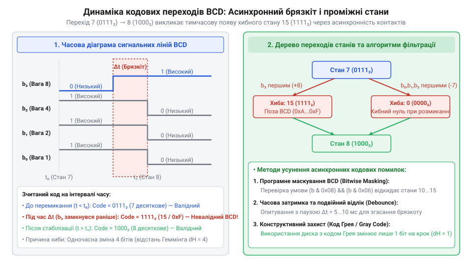
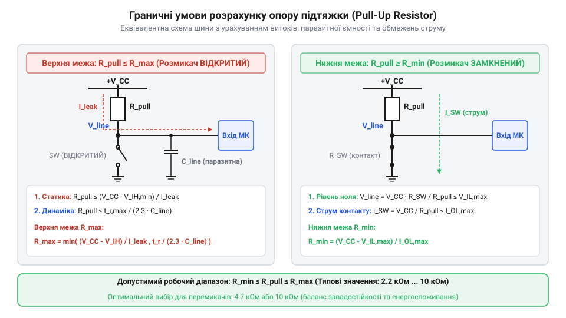

# Математика кодування BCD, інверсних станів та комбінаторна складність матричного сканування

<preknowlist>
- [DIP-перемикачі та джамперні блоки конфігурації](root:cat-hw-controls/dip-switches-and-configuration-blocks) — принципи паралельного зчитування дискретних логічних станів та роль підтягувальних резисторів
- [Матрична клавіатура 4×4 (мембранна)](root:cat-hw-controls/keypad-4x4-membrane) — геометрія матричної комутації та принципи почергової подачі опитувальних імпульсів по рядах і зчитування стовпчиків
</preknowlist>

## Помилки зчитування барабанних перемикачів

У панелях промислової автоматики та системах ручного вводу узагальнені [тумблери та блокування важелів](root:cat-hw-controls/toggle-switches-and-switch-guards) часто замінюють на обертові барабанні перемикачі (від англ. @@en|thumbwheel switch@@). Вони дозволяють операторові візуально встановлювати десяткові числа від 0 до 9 за допомогою дискретного ротора, який механічно комутує внутрішні контактні групи. Проте пряме зчитування електричних сигналів із таких роторних дисків створює значні апаратні й алгоритмічні проблеми.

Перша проблема полягає в механічній асинхронності комутації контактів під час повороту барабана. Коли ротор переходить між позиціями, контактні контактні доріжки окремих бітів розмикаються й замикаються не одночасно. Упродовж проміжного інтервалу часу на кодових лініях виникають хибні нестаціонарні комбінації сигналів. Якщо мікроконтролер виконає опитування в цей момент, система сприйме хаотичне числове значення, що призведе до збою алгоритмів автоматики.

Конструктивно роторний диск барабанного перемикача являє собою кругову друковану плату з концентричними мідними кодовими доріжками, по яких під час обертання ковзають пружні металеві щітки (від англ. @@en|wiper contact@@). Оскільки мідні сегменти різних бітових розрядів мають різний кутовий розмір та геометричний радіус, а пружні щітки мають природний технологічний розкид згину, комутація контактних кіл відбувається несинхронно. Навіть при плавному обертанні барабана щітка одного розряду розмикає чи замикає коло раніше за інші, створюючи фізичну часову розбіжність фронтів сигналів.

Механічно роторний диск барабанного перемикача являє собою кругову друковану плату з концентричними мідними доріжками, по поверхнях яких ковзають пружні металеві щітки (від англ. @@en|wiper contact@@). Оскільки мідні контактні майданчики різних бітових розрядів мають різну дугову довжину та кутове розміщення, а щітки мають технологічний допуск на згин і спрацювання, механічне замикання й розмикання кола для кожного біта відбувається з часовим зсувом. Навіть при плавній зміні кутового положення вала щітка одного розряду торкається контактної доріжки раніше за іншу, утворюючи фізичний проміжок асинхронної комутації.

Друга проблема пов'язана з комбінаторним зростанням кількості виводів. Для паралельного зчитування шестирозрядного десяткового масиву безпосередньо потрібно 24 лінії вводу-виводу. Для раціонального використання ресурсів контролера застосовують матричне сканування, подібно до того, як опитується [матрична клавіатура 4×4](root:cat-hw-controls/keypad-4x4-membrane). Для усунення цих двох проблем необхідний формальний математичний апарат кодування, аналізу перехідних станів та матричної комутації.

## Алгебра BCD та інверсних кодувань

Математична модель кодування роторного барабана спирається на дискретне відображення десяткової цифри D, де D належить множині {0, 1, 2, 3, 4, 5, 6, 7, 8, 9}, у чотириелементний двійковий вектор b = (b₃, b₂, b₁, b₀), де кожен елемент b_i належить множині {0, 1}. Це відображення виконується за позиційною вагою двійково-десяткового коду (від англ. @@en|Binary-Coded Decimal@@, @@en|BCD 8-4-2-1@@).

Значення десяткової цифри відновлюється з двійкового вектора за допомогою вагового розкладу:

D = 8·b₃ + 4·b₂ + 2·b₁ + 1·b₀

У шістнадцятковій системі числення вектори від (0,0,0,0)₂ до (1,0,0,1)₂ відповідають кодам від 0x0 до 0x9. Кодові комбінації від (1,0,1,0)₂ до (1,1,1,1)₂ (тобто від 0xA до 0xF) у стандартному прямому BCD-кодуванні є недопустимими й використовуються для діагностики помилок. Повна відповідність десяткових цифр, прямого й інверсного BCD-коду наведена в таблиці:

| Десяткова цифра D | Прямий BCD-вектор b | Прямий HEX | Інверсний BCD-вектор b_inv | Інверсний HEX |
| --- | --- | --- | --- | --- |
| 0 | (0,0,0,0)₂ | 0x0 | (1,1,1,1)₂ | 0xF |
| 1 | (0,0,0,1)₂ | 0x1 | (1,1,1,0)₂ | 0xE |
| 2 | (0,0,1,0)₂ | 0x2 | (1,1,0,1)₂ | 0xD |
| 3 | (0,0,1,1)₂ | 0x3 | (1,1,0,0)₂ | 0xC |
| 4 | (0,1,0,0)₂ | 0x4 | (1,0,1,1)₂ | 0xB |
| 5 | (0,1,0,1)₂ | 0x5 | (1,0,1,0)₂ | 0xA |
| 6 | (0,1,1,0)₂ | 0x6 | (1,0,0,1)₂ | 0x9 |
| 7 | (0,1,1,1)₂ | 0x7 | (1,0,0,0)₂ | 0x8 |
| 8 | (1,0,0,0)₂ | 0x8 | (0,1,1,1)₂ | 0x7 |
| 9 | (1,0,0,1)₂ | 0x9 | (0,1,1,0)₂ | 0x6 |

У реальних схемотехнічних рішеннях із підтягувальними резисторами замкнений контакт перемикача з'єднує лінію з землею GND (логічний 0), а розімкнений залишає потенціал живлення VCC (логічна 1). Це описується комплементарною інверсною логікою (від англ. @@en|complementary logic@@), де інверсний вектор b_inv утворюється поелементним запереченням прямих бітів b_i:

b_inv = (¬b₃, ¬b₂, ¬b₁, ¬b₀) = (1 - b₃, 1 - b₂, 1 - b₁, 1 - b₀)

Для прикладу, обчислимо інверсний BCD-код для десяткової цифри D = 6:

b_direct = (0, 1, 1, 0)₂          [прямий BCD-вектор для D = 6]
b_inv = (1 - 0, 1 - 1, 1 - 1, 1 - 0)₂ [поелементна інверсія b_i' = 1 - b_i]
= (1, 0, 0, 1)₂                  [результат інверсного BCD-коду 0x9]

Таким чином, для цифри 6 на фізичних виводах інверсного BCD-перемикача формується шістнадцятковий код 0x9.

Повна матриця відображення для всіх десяткових значень від D = 0 до D = 9 демонструє поінверсну симетрію між прямим та інверсним кодуванням:

| Десяткова цифра D | Прямий BCD-вектор b | Прямий HEX | Інверсний BCD-вектор b_inv | Інверсний HEX |
| --- | --- | --- | --- | --- |
| 0 | (0,0,0,0)₂ | 0x0 | (1,1,1,1)₂ | 0xF |
| 1 | (0,0,0,1)₂ | 0x1 | (1,1,1,0)₂ | 0xE |
| 2 | (0,0,1,0)₂ | 0x2 | (1,1,0,1)₂ | 0xD |
| 3 | (0,0,1,1)₂ | 0x3 | (1,1,0,0)₂ | 0xC |
| 4 | (0,1,0,0)₂ | 0x4 | (1,0,1,1)₂ | 0xB |
| 5 | (0,1,0,1)₂ | 0x5 | (1,0,1,0)₂ | 0xA |
| 6 | (0,1,1,0)₂ | 0x6 | (1,0,0,1)₂ | 0x9 |
| 7 | (0,1,1,1)₂ | 0x7 | (1,0,0,0)₂ | 0x8 |
| 8 | (1,0,0,0)₂ | 0x8 | (0,1,1,1)₂ | 0x7 |
| 9 | (1,0,0,1)₂ | 0x9 | (0,1,1,0)₂ | 0x6 |

З цієї структури видно, що операція відновлення значення D з інверсного вектора b_inv досягається або через проміжне заперечення b_i = 1 - b_inv_i, або за прямою вагомою формулою з відніманням кожного біта від максимальної суми ваг 15: D = 15 - (8·b_inv₃ + 4·b_inv₂ + 2·b_inv₁ + 1·b_inv₀).

## Комбінаторика нестаціонарних перехідних станів

Під час обертання барабана між двома суміжними позиціями u та v виникає механічний процес розмикання одних контактних груп та замикання інших. Кількість бітів, що змінюють свій стан між векторами u = (u₃, u₂, u₁, u₀) та v = (v₃, v₂, v₁, v₀), визначається як відстань Геммінга (від англ. @@en|Hamming distance@@):

d_H(u, v) = ∑ |u_i - v_i|

Якщо d_H(u, v) > 1, перехід не може відбутися миттєво й синхронно. Множина бітів, що змінюються, K = {i ∈ {0, 1, 2, 3} : u_i ≠ v_i}, через механічний технологічний допуск контактів розмикається асинхронно. У результаті утворюється множина проміжних нестаціонарних станів розмірністю до 2^(d_H) - 2.

Розглянемо перехід від цифри 3 до цифри 4. Зміна станів відбувається від вектора u = (0, 0, 1, 1)₂ до вектора v = (0, 1, 0, 0)₂. Відстань Геммінга дорівнює d_H(3, 4) = |0-0| + |0-1| + |1-0| + |1-1| = 3. У процесі перемикання біти b₀ та b₁ мають розімкнутися, а біт b₂ — замкнутися.

*Часовий графік та дерево станів розмикання й замикання контактів BCD-барабана.*

Через асинхронність на кодовій шині можуть тимчасово виникати паразитні коди (0, 1, 1, 1)₂ = 7, (0, 0, 0, 0)₂ = 0 або (0, 1, 0, 1)₂ = 5. Для запобігання зчитуванню таких помилкових слів застосовують математичний фільтр стаціонарності. Вектор w вважається дійсним значенням BCD тоді й тільки тоді, коли обчислене десяткове значення D(w) ≤ 9 та вектор залишається незмінним упродовж часового інтервалу T_debounce:

w(t) = w(t - Δt) = const, ∀ t ∈ [t₀, t₀ + T_debounce]

Якщо обчислений вектор w належить до недопустимих комбінацій {0xA, 0xB, 0xC, 0xD, 0xE, 0xF} або змінюється в межах вікна T_debounce, контролер відкидає його як нестаціонарний шум. Логічна перевірка недопустимості BCD-вектора реалізується апаратно чи програмно через булеву маску f_invalid(b), яка ідентифікує перевищення межі 9 за наявністю комбінацій біта b₃ з бітами b₂ та b₁:

f_invalid(b) = (b₃ ∧ b₂) ∨ (b₃ ∧ b₁)

Для валідного двійково-десяткового вектора вираз f_invalid дорівнює 0, тоді як для будь-якого зі станів від 0xA до 0xF приймає значення 1. Застосування цієї маски дозволяє виконувати миттєву первинну фільтрацію невалідних кодових слів на рівні бітових операцій до порівняння часового вікна стабільності T_debounce.

Для отримання прямої алгебричної формули маскування допустимих станів BCD застосовують оператор логічного заперечення (від англ. @@en|logical negation@@) до функції недопустимості. Перетворення предикату `f_valid(b)` до мінімальної диз'юнктивної форми виконують за законами де Моргана (від англ. @@en|De Morgan's laws@@):

f_valid(b)
= ¬f_invalid(b)                                [заперечення предикату недопустимості]
= ¬((b₃ ∧ b₂) ∨ (b₃ ∧ b₁))                     [підстановка виразу f_invalid]
= ¬(b₃ ∧ (b₂ ∨ b₁))                            [винесення спільного множника b₃ за дистрибутивним законом]
= ¬b₃ ∨ ¬(b₂ ∨ b₁)                             [перший закон де Моргана]
= ¬b₃ ∨ (¬b₂ ∧ ¬b₁)                            [другий закон де Моргана]

Диз'юнктивний вираз `f_valid(b) = ¬b₃ ∨ (¬b₂ ∧ ¬b₁)` приймає значення `1` тоді й тільки тоді, коли кодовий вектор належить діапазону від `0` до `9`. На рівні побітових операцій (від англ. @@en|bitwise operations@@) у мікроконтролері ця функція обчислюється однією масковою інструкцією `(b & 0x08) && (b & 0x06)`, що дозволяє мажорувати невалідні стани `0xA...0xF` за один такт процесора без розгалужень у виконанні коду.

## Мінімізація виводів у матричному скануванні

Підключення масиву з декількох барабанних BCD-перемикачів вимагає оптимізації кількості використовуваних виводів мікроконтролера. Якщо кожен перемикач підключається паралельно через 4 кодові лінії, загальна кількість виводів зростає лінійно P_par = 4·K, де K — кількість десяткових розрядів.

Для зменшення кількості виводів застосовують матричне сканування (від англ. @@en|matrix scanning@@), де спільні виводи перемикачів об'єднуються в N вибіркових рядків, а кодові виходи — у M вимірювальних стовпчиків. Для прикладу, масив із 8 BCD-перемикачів при прямому паралельному підключенні вимагає P_par = 8 · 4 = 32 виводи мікроконтролера. При організації матричної топології з N = 8 вибірковими рядками розрядів та M = 4 вимірювальними стовпчиками бітових ліній потрібна кількість виводів скорочується до P_matr = 8 + 4 = 12, що заощаджує 20 портів контролера. Загальна сумарна кількість потрібних ліній вводу-виводу для довільної комбінації описується функцією:

P(N, M) = N + M

За умови постійної кількості комутованих вузлів K_total = N·M мінімум функції P(N, M) досягається при рівності N = M = √K_total. Звідси мінімально можлива кількість виводів дорівнює:

P_min = 2·√K_total

При матричному опитуванні виникає пастка у вигляді паразитних струмових шляхів (від англ. @@en|stray current path@@). Якщо кілька перемикачів одночасно мають замкнені контактні групи, вибіркові імпульси активного рядка через внутрішні з'єднання сусідніх барабанів протікають у неактивні рядки, спотворюючи результати зчитування.

Для усунення паразитних обхідних кіл у шину кожного розряду послідовно вмикають розв'язувальні діоди. Вони забезпечують односпрямований прохід струму й гарантують апаратну ізоляцію суміжних точок комутації, за аналогією до того, як влаштована [мембранна матрична клавіатура 4×4](root:cat-hw-controls/keypad-4x4-membrane).

## Аналітичний розрахунок опорних резисторів

Надійне фіксування логічних рівнів на кодових шинах BCD вимагає підключення опорних резисторів. Залежно від схемотехніки застосовують підтягувальні резистори до живлення (від англ. @@en|pull-up resistor@@) або підтягувальні резистори до землі (від англ. @@en|pull-down resistor@@). Номінал підтяжки R_pull обмежується системою нерівностей за статичними та динамічними параметрами.

*Еквівалентна схема шини кодування з паразитною ємністю та струмами витоку.*

Верхня межа опору R_max_dc визначається допустимим падінням напруги від струму витоку (від англ. @@en|leakage current@@) I_leak на вході мікроконтролера та забезпеченням запасу завадостійкості (від англ. @@en|noise margin@@) за напругою логічної одиниці V_IH_min при напрузі живлення VCC. Оскільки в напівпровідникових виводах портів струм витоку зростає експоненціально з підвищенням температури (приблизно подвоюється на кожні 10 °C розігріву), розрахунок R_max_dc виконують для максимально допустимої робочої температури середовища T_max. Використання пікового значення струму витоку I_leak(T_max) гарантує, що при температурному дрейфі падіння напруги на резисторі підтяжки не призведе до зниження потенціалу шини нижче за поріг розпізнавання логічної одиниці:

Математично температурна залежність струму витоку описується показниковою функцією I_leak(T) = I_leak_25 · 2^((T - 25) / 10), де I_leak_25 — витоковий струм за кімнатної температури 25 °C, а T — поточна температура корпусу в градусах Цельсія. При зростанні температури від 25 °C до максимальної промислової межі 85 °C струм витоку збільшується в 2⁶ = 64 рази, що пропорційно зменшує допустиме значення статичного опору R_max_dc. Неурахування цього експоненціального температурного зростання спричиняє спотворення логічних рівнів та хибні спрацьовування вхідних дискримінаторів при нагріванні шафи автоматики.

VCC - I_leak·R_pull ≥ V_IH_min

Крім статичного струму, верхню межу R_max_ac обмежує паразитна ємність (від англ. @@en|parasitic capacitance@@) C_line лінії зв'язку. Для завершення заряду ємності за період сканування T_scan постійна часу (від англ. @@en|RC time constant@@) τ = R_pull·C_line має задовольняти умову 3·τ ≤ T_scan / 2.

Нижня межа опору R_min визначається максимально допустимим вихідним струмом розрядника I_out_max для запобігання перевантаженню виводів. Загальна система нерівностей обчислюється за кроками:

R_max_dc = (VCC - V_IH_min) / I_leak [статична межа за струмом витоку]
R_max_ac = T_scan / (6·C_line)     [динамічна межа за часом заряду RC]
R_max = min(R_max_dc, R_max_ac)     [підсумкова верхня межа опору підтяжки]
R_min = VCC / I_out_max             [нижня межа за граничним струмом ключа]

Допустимий номінал вибирається зі стандартного ряду опорів у межах нерівності R_min ≤ R_pull ≤ R_max.
