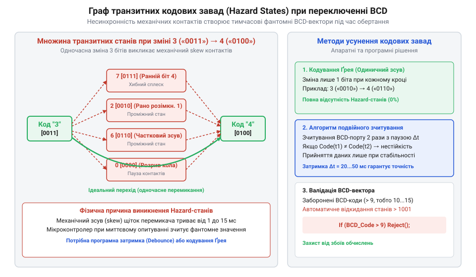

# Математика BCD-кодування, доповняльних кодів та розрахунку скан-матриць

<preknowlist>
- [DIP-перемикачі та джамперні блоки конфігурації](root:cat-hw-controls/dip-switches-and-configuration-blocks) — розуміння двійкового кодування станів
</preknowlist>

## Алгебра BCD та доповняльних кодів

У цифрових системах ручного вводу постає математична задача відображення десяткової цифри `d ∈ {0, 1, 2, ..., 9}` у двійковий вектор контактних станів `b = (b₃, b₂, b₁, b₀) ∈ {0, 1}⁴`. Кожен біт вектора відповідає стану замкнення контактної щітки на платі статора, де логічна `1` означає наявність електричного контакту зі спільною шиною, а логічний `0` — розімкнений стан.

Пряме двійково-кодоване десяткове кодування (від англ. @@en|binary-coded decimal@@, BCD) вибирає ваги розрядів `(w₃, w₂, w₁, w₀) = (8, 4, 2, 1)`. Десяткове число `d` виражається скалярним добутком вектора ваг на вектор бітів `(b₃, b₂, b₁, b₀)`. Для апаратної фіксації помилкових або позадіапазонних комбінацій `U_forbidden` (значення від 10 до 15 у десятковій системі) будується булева функція розпізнавання `F_forbidden(b₃, b₂, b₁, b₀)`. Оскільки всі позадіапазонні вектори мають старший біт `b₃ = 1` та принаймні один із двох наступних бітів `b₂ = 1` або `b₁ = 1`, булева функція апаратного декодера мінімізується за допомогою карт Карно (англ. @@en|Karnaugh map@@) до компактної диз'юнктивної форми:

        F_forbidden
        = b₃·b₂ + b₃·b₁                      [сума мінтермів 10-15]
        = b₃ · (b₂ ∨ b₁)                     [дистрибутивний закон диз'юнкції]

Коли функція `F_forbidden = 1`, логічна схема декодера або алгоритм контролера миттєво фіксує заборонений стан BCD-шини і блокує зчитування коректного числа до завершення перехідного процесу.

        d
        = w₃·b₃ + w₂·b₂ + w₁·b₁ + w₀·b₀      [скалярний добуток у двійковій системі]
        = 8·b₃ + 4·b₂ + 2·b₁ + 1·b₀          [підстановка вагових коефіцієнтів 8-4-2-1]

З усього простору `2⁴ = 16` можливих 4-бітних комбінацій для BCD валідними є лише 10 векторів, що відповідають числам `d ∈ [0, 9]`. Множина заборонених станів `U_forbidden` охоплює двійкові вектора від `1010` (десяткове 10) до `1111` (десяткове 15):

        U_forbidden
        = {b ∈ {0, 1}⁴ | 8·b₃ + 4·b₂ + 2·b₁ + 1·b₀ ≥ 10}     [визначення множини позадіапазонних векторів]

Для комплементарного BCD-кодування (інверсного коду) вектор станів `c = (c₃, c₂, c₁, c₀)` утворюється покомпонентним інверсуванням (від лат. @@la|inversio@@ — перевертання) бітів прямого коду:

        c_i
        = ¬ b_i                             [покомпонентна булева інверсія]
        = 1 - b_i                           [арифметичний еквівалент для біта b_i ∈ {0, 1}]

Алгебраїчна цінність інверсного BCD-коду полягає у його зв'язку з доповненням до 9 (від англ. @@en|nine's complement@@). Сума десяткового числа `d` та його доповнення `d_comp = 9 - d` дозволяє замінювати операцію віднімання у двійкових суматорах на додавання. Якщо для прямого вектора сума бітових ваг дає значення `d`, то сума комплементарного вектора дорівнює:

        d_inv
        = ∑ (1 - b_i)·w_i                    [сума ваг інвертованих бітів]
        = (8 + 4 + 2 + 1) - ∑ b_i·w_i        [лінійність підсумовування]
        = 15 - d                             [значення комплементарного вектора]

Позиційний код 1-з-10 використовує 10-вимірний вектор `v = (v₀, v₁, ..., v₉) ∈ {0, 1}¹⁰`, де для заданої цифри `d` виконується умова `v_k = 1`, якщо `k = d`, і `v_k = 0` при `k ≠ d`. Шістнадцятковий код (від англ. @@en|Hexadecimal@@) розширює область визначення на весь простір `2⁴ = 16` векторів, де `d ∈ [0, 15]`, усуваючи множину заборонених станів. Такий принцип двійкового кодування застосовують також у [DIP-перемикачах та джамперних блоках](root:cat-hw-controls/dip-switches-and-configuration-blocks).

## Комбінаторна модель транзитних завад

Під час механічного повертання барабана ротор переходить від десяткової позиції `d_A` до сусідньої позиції `d_B`. Оскільки пружинні контактні щітки окремих розрядів мають механічні допуски розташування `Δx`, розмикання та замикання чотирьох бітових ліній відбувається несинхронно у часовому інтервалі `Δt`.

Якщо початковий вектор `b(d_A)` та кінцевий вектор `b(d_B)` відрізняються у `k` бітових позиціях (відстань Геммінга `H(b(d_A), b(d_B)) = k > 1`), то в процесі руху система проходить через проміжні транзитні стани (від англ. @@en|hazard state@@ або @@en|glitch@@). Ймовірність `P_hazard` виникнення таких скан-завад напряму залежить від варіації механічних допусків розташування щіток `Δx`. Якщо відхилення позиції кожної з `k` щіток `x_i` розподілене рівномірно на інтервалі допусків `[-Δx, Δx]`, то розкид між моментами спрацьовування найпершого та найостаннішого контактів визначає просторову ширину некоректної зони `Δx_spread = max(x_i) - min(x_i)` з математичним сподіванням `E[Δx_spread] = 2 · Δx · (k - 1) ÷ (k + 1)`. При лінійній швидкості обертання барабана `v` очікувана часова тривалість транзитного вікна становить `E[Δt_hazard] = E[Δx_spread] ÷ v`, а ймовірність того, що випадкове асинхронне зчитування влучить у момент нестабільності під час переходу тривалістю `T_step`, дорівнює `P_hazard = E[Δt_hazard] ÷ T_step = 2 · Δx · (k - 1) ÷ (v · T_step · (k + 1))`. Множина можливих транзитних векторів `T(d_A, d_B)` визначається як булевий підкуб, обмежений початковим та кінцевим векторами:

        T(d_A, d_B)
        = {x ∈ {0, 1}⁴ | x_i ∈ {b_i(d_A), b_i(d_B)} ∀ i ∈ {0, 1, 2, 3}}      [підпростір проміжних бітових комбінацій]

Розглянемо критичний перехід від позиції `3` (`0011₂`) до позиції `4` (`0100₂`). Відстань Геммінга для цього переходу становить:

        H(0011₂, 0100₂)
        = |0 - 0| + |0 - 1| + |1 - 0| + |1 - 0|      [сума покомпонентних різниць бітів]
        = 0 + 1 + 1 + 1                               [визначення зміни трьох розрядів]
        = 3                                           [відстань Геммінга дорівнює 3]

Оскільки змінюються одразу 3 біти, підпростір транзитних векторів містить `2³ = 8` можливих станів, включаючи некоректні проміжні значення `0111₂` (десяткове 7) та `0000₂` (десяткове 0):

        T(3, 4)
        = {0000₂, 0001₂, 0010₂, 0011₂, 0100₂, 0101₂, 0110₂, 0111₂}           [множина комбінаторних спалахів]

*Граф комбінаторних переходів між станами BCD-коду: перехід 3 → 4 утворює 3-вимірний підкуб транзитних векторів через неузгодженість спрацьовування механічних контактів.*

Для цифрового фільтра зчитування будують булевий предикат валідності `P_valid(x)`, який відкидає позадіапазонні вектори `x ∈ U_forbidden`, а також виконують витримку часу `τ > Δt_max`, де `Δt_max ≈ 10–20 мс` — максимальна тривалість механічного переходу й брязкоту контактів.

## Комбінаторика скан-матриць та діодного блокування

При прямому паралельному підключенні `N` декадних BCD-перемикачів до цифрового контролера вимагається `L_direct` сигнальних ліній:

        L_direct
        = 4 · N                              [по 4 кодові лінії на кожну з N декад]

Для мінімізації кількості виводів застосовують динамічну скан-матрицю (від англ. @@en|scanning matrix@@). Кодовані виходи `1, 2, 4, 8` усіх `N` декад об'єднуються на спільну 4-бітну шину даних, а спільні виводи `COM_j` (`j ∈ {1, ..., N}`) підключаються до ліній вибору декади. Сумарна кількість ліній зв'язку `L_matrix` становить:

        L_matrix
        = N + 4                              [N ліній стробування + 4 лінії шини даних]

Економія ліній `ΔL` при переході від прямого підключення до скан-матриці обчислюється як:

        ΔL
        = 4·N - (N + 4)                      [різниця кількості ліній]
        = 3·N - 4                            [абсолютне зменшення кількості задіяних GPIO]

При `N = 4` декадах пряме підключення вимагає `16` ліній, тоді як скан-матриця використовує лише `4 + 4 = 8` ліній, що дає економію `50%` контактних з'єднань.

Однак без захисних елементів у матриці виникають паразитичні контури (від англ. @@en|sneak paths@@). Нехай у матриці опитується декада `m` шляхом подачі на її лінію `COM_m` активного потенціалу `VCC`. Якщо в неопитуваній декаді `k` (`COM_k` перебуває під потенціалом `GND` або у плаваючому стані) контакти замкнено у позиціях, що мають спільні замкнені лінії з декадою `m`, виникає зворотний струм `I_parasitic`.

Матричне рівняння струму через кодові лінії `i, r ∈ {1, 2, 4, 8}` неопитуваної декади `k` виражається через скалярний добуток коефіцієнтів замкнення контактних груп. Втім, при введенні розв'язувальних діодів критичним є розрахунок допустимого прямого падіння напруги `V_forward` (від англ. @@en|forward voltage drop@@ — пряме падіння напруги; далі — @@en|forward voltage drop@@) для забезпечення надійного зчитування високого логічного рівня. Для КМОН-інтерфейсів (від англ. @@en|CMOS@@ — комплементарний метало-оксид-напівпровідник; далі — @@en|CMOS@@) вхідний поріг розпізнавання логічної одиниці `V_IH` становить щонайменше `0.7 · VCC`. Рівняння балансу напруги на кодовій лінії опитуваної декади під час проходження струму зчитування через розв'язувальний діод визначається виразом:

        V_read
        = VCC - V_forward                     [напруга сигнальної лінії з урахуванням діода]
        ≥ V_IH                                [умова гарантованого розпізнавання логічної 1]
        = 0.7 · VCC                           [підстановка порогу спрацьовування КМОН]

Звідси гранично припустиме значення падіння напруги на відкритому діоді обчислюється як:

        V_forward
        ≤ VCC - 0.7 · VCC                     [різниця живлячої напруги та КМОН-порогу]
        = 0.3 · VCC                           [максимальний допуск падіння напруги на діоді]

При напрузі живлення `VCC = 5 В` верхній допуск становить `V_forward ≤ 1.5 В`, що дозволяє використовувати ззвичайні кремнієві діоди (наприклад, `1N4148` з `V_forward ≈ 0.7 В`). Проте при переході на низьковольтне живлення `VCC = 3.3 В` кремнієвий діод залишає `V_read = 2.6 В`, що наближається до межі КМОН-порогу `V_IH = 2.31 В` та знижує запас завадостійкості (англ. @@en|noise margin@@). Для таких систем застосовують діоди Шотткі (на честь німецького фізика Вальтера Шотткі, нім. @@de|Schottky@@; далі — діод Шотткі) з падінням напруги `V_forward ≈ 0.2–0.3 В`, що гарантує строгий розрахунок збереження логічних рівнів.

        I_parasitic
        = S_{m, i} · S_{k, i} · S_{k, r} · (VCC ÷ R_total)                 [паразитичний струмовий контур через контакти]

де `S_{j, i} ∈ {0, 1}` — матричний елемент замкнення `i`-го контакту `j`-ї декади. Якщо `S_{m, i} = 1`, `S_{k, i} = 1` та `S_{k, r} = 1`, то лінія `r` зчитує хибну логічну `1` (кодовий «фантом»).

Встановлення розв'язувальних діодів (від грец. @@el|δίς@@ — двічі та @@el|ὁδός@@ — шлях) послідовно з кожним кодовим виходом змінює еквівалентну схему. Діод дає асиметричну провідність з вентильним предикатом `D(V) = 1` при `V > V_forward` та `D(V) = 0` при `V ≤ 0`. Умова блокування паразитичного контуру має вигляд:

        I_blocked
        = I_parasitic · D(-VCC)             [подача зворотного потенціалу на діод]
        = I_parasitic · 0                  [зворотна вітка ВАХ діода не проводить струм]
        = 0                                 [повне усунення паразитичних зворотних струмів]

Завдяки діодній розв'язці матричне рівняння зчитування для `i`-ї лінії опитуваної декади `m` стає точним:

        V_read(i)
        = S_{m, i} · (VCC - V_forward)       [напруга сигнальної лінії без завад від інших декад]

це забезпечує математично строкову ізоляцію каналів сканування.
