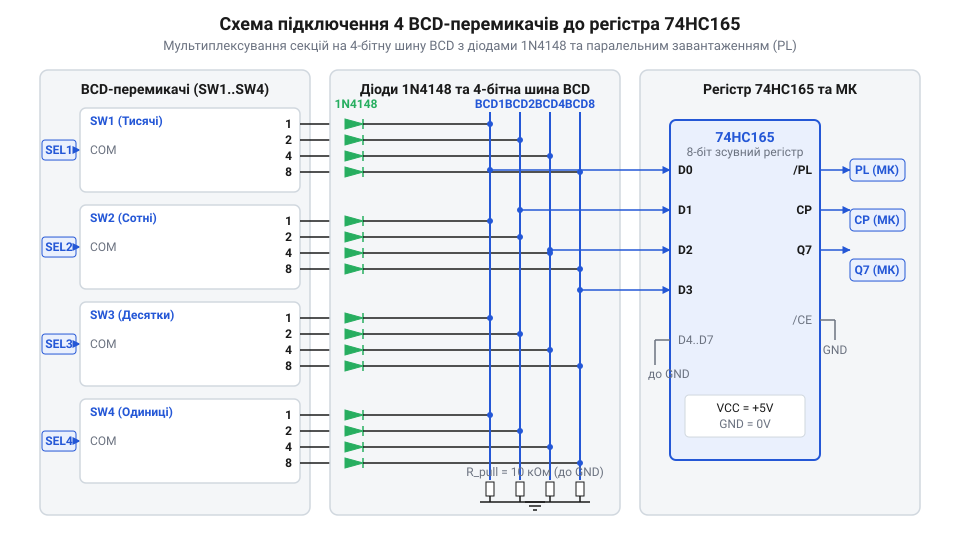
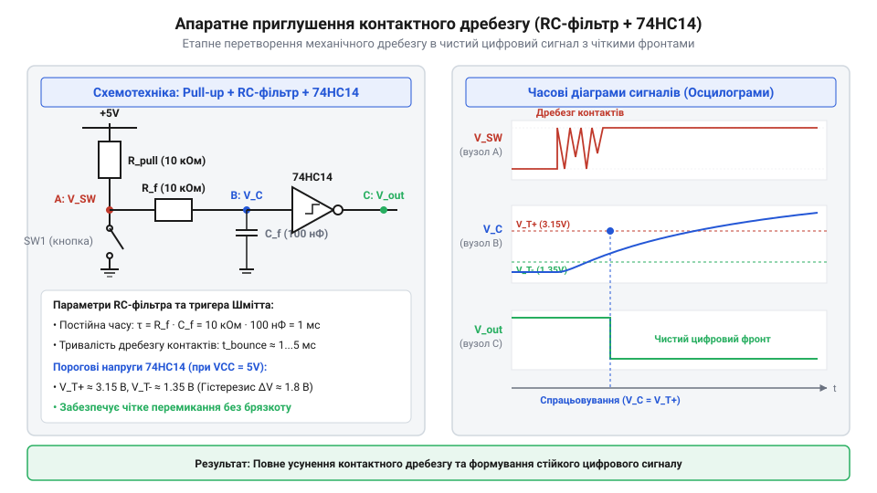

# Проєкт 4-розрядного блоку декадних перемикачів із шинним зсувним регістром та фільтрацією

<preknowlist>
- [DIP-перемикачі та джамперні блоки конфігурації](root:cat-hw-controls/dip-switches-and-configuration-blocks) — принципи двопозиційної комутації та підтягувальних резисторів
- [Матрична клавіатура 4×4 (тактильна)](root:cat-hw-controls/keypad-4x4-tactile) — концепція сканування контактних сіток та механічного дребезгу контактів
</preknowlist>

## Потреба введення уставок та проблема IO-ліній

У промислових шафах автоматики та панелях оператора часто виникає задача ручного введення числових параметрів — уставок температури, часу затримки, кількості циклів або лімітів тиску. Застосування сенсорних текстово-графічних дисплеїв у суворих умовах виробництва не завжди виправдане через їхню вразливість до пилу, вологи, механічних ударів та високу вартість. Простішим і надійнішим рішенням є декадні @@en|thumbwheel switch@@ (барабанні BCD-перемикачі), у яких кожна цифра від 0 до 9 наочно встановлюється обертанням дисків.

Кожна декадна секція барабанного перемикача має внутрішні ламелі, що формують 4-бітний двійково-десятковий код @@en|BCD@@ (від англ. @@en|Binary-Coded Decimal@@). Якщо на панелі необхідно встановити 4-розрядне число (від 0000 до 9999), пряме підключення чотирьох секцій вимагатиме 16 сигнальних ліній вводу-виводу мікроконтролера. Подібно до [DIP-перемикачів конфігурації](root:cat-hw-controls/dip-switches-and-configuration-blocks) та [матричних клавіатур](root:cat-hw-controls/keypad-4x4-tactile), таке виділення пінів швидко виснажує ресурси корпусу мікроконтролера.

Для подолання дефіциту виводів використовують паралельно-послідовні зсувні регістри @@en|74HC165@@ (від англ. @@en|Parallel-In Serial-Out Shift Register@@). Каскадування двох таких 8-бітних мікросхем дозволяє одночасно зафіксувати стан усіх 16 ліній BCD по одному короткому імпульсу завантаження @@en|Parallel Load@@ (PL), після чого висунути весь послідовний кадр у мікроконтролер всього по трьох цифрових лініях: @@en|PL@@, @@en|CLK@@ та @@en|DATA@@.

Під час подачі активного низького рівня на вхід @@en|Parallel Load@@ (PL) мікросхема 74HC165 миттєво фіксує стан усіх вхідних ліній у внутрішньому тригерному масиві. Для гарантованого защелкування тривалість цього імпульсу повинна перевищувати мінімальний час фіксації (щонайменше 20 наносекунд), а рівні на вхідних контактах мають залишатися стабільними. Після відновлення високого рівня на лінії PL регістр переходить у режим послідовного зсуву: за кожним наростаючим фронтом тактового сигналу @@en|CLK@@ біти по черзі висуваються на вихід @@en|Q7@@, що дає змогу мікроконтролеру послідовно зчитати всі 16 бітів 4-декадного BCD-коду за 16 тактових імпульсів.

Порівняльний аналіз часових затримок показує, що пряме опитування 16 ліній вводу-виводу здійснюється за один системний такт мікроконтролера (тривалість менше 0,1 мікросекунди), проте вимагає виділення 16 фізичних пінів. Натомість послідовне зчитування кадру з каскаду двох регістрів 74HC165 вимагає формування імпульсу защелкування PL та генерування 16 тактових сигналів CLK. Навіть при програмному стробуванні @@en|GPIO@@ з тактовою частотою близько 1 МГц (або апаратному зчитуванні по шині @@en|SPI@@) повний час зчитування 16 бітів BCD-коду становить лише 16...20 мікросекунд. Оскільки людина повертає диск барабанного перемикача з тривалістю понад 100 мілісекунд, мікросекундна затримка зсувного регістра є абсолютно невідчутною для системи й забезпечує суттєву економію 13 сигнальних ліній.

## Схемотехніка блоку та діодне розв'язування

При побудові 4-декадного модуля BCD-перемикачів виходи кожної секції об'єднують у спільну 4-бітну шину даних. Однак безпосереднє паралельне з'єднання контактних груп створює шляхи для протікання паразитних зворотних струмів (від англ. @@en|sneak paths@@ або @@en|ghosting@@). Якщо у двох декадах замкнено різні лінії (наприклад, у першій декаді замкнено біти 1 та 2, а у другій — біти 2 та 4), через спільні провідники струм з однієї лінії потрапляє на сусідню, формуючи хибні BCD-коди.

*Схемотехніка сполучення чотирьох BCD-перемикачів із шинним розв'язуванням діодами 1N4148 та паралельним завантаженням у зсувні регістри 74HC165.*

Щоб повністю усунути паразитний зворотний струм, у кожну сигнальну лінію BCD-виходу кожної декади послідовно вмикають розв'язувальні діоди @@en|1N4148@@. Діод пропускає струм лише у прямому напрямку — від виводу живлення або апаратного підтягування до замкненого контакту декади, блокуючи зворотний витік через сусідні секції.

Сигнали з розв'язувальних діодів надходять на паралельні входи D0...D7 мікросхем зсувних регістрів @@en|74HC165@@. Кожен 8-бітний регістр обслуговує дві 4-бітні BCD-декади. Входи підтягуються резисторами до шини живлення VCC або заземлення GND залежно від того, яка логіка комутації використовується — пряма (активний логічний 0 при замиканні на GND) чи комплементарна. Завдяки такій схемотехніці 4-розрядний блок декад зберігає завадостійкість навіть при одночасному механічному перемиканні декількох дисків.

Для вибору оптимального номіналу підтягувальних резисторів необхідно враховувати електричні параметри діодів @@en|1N4148@@ та вхідні пороги мікросхеми 74HC165. При прямому струмі порядку 0,4...1 мА прямий спад напруги на діоді @@en|1N4148@@ становить близько 0,6...0,7 В. Коли контакт перемикача замкнений на заземлення, напруга низького логічного рівня на паралельному вході регістра дорівнює спаду на діоді (близько 0,7 В), що з великим запасом не перевищує максимально допустимий поріг низького рівня @@en|74HC165@@ (до 1,35 В при напрузі живлення 5 В). При використанні резисторів номіналом 10 кОм струм через контакт становить (5 В - 0,7 В) / 10 кОм = 0,43 мА, що значно менше гранично допустимого прямого струму діода 1N4148 (до 200 мА), мінімізує енергоспоживання схеми та гарантує надійне зчитування логічних рівнів.

Окрему увагу при розрахунку запасу завадостійкості (від англ. @@en|noise margin@@) слід приділити температурному дрейфу прямого спаду напруги діода @@en|1N4148@@. Від'ємний температурний коефіцієнт прямої напруги p-n-переходу (близько -2 мВ/°C) спричиняє зростання спаду напруги на діоді при зниженні температури навколишнього середовища: при -40 °C пряма напруга @@en|V_F@@ при струмі 0,43 мА збільшується до 0,8...0,85 В. Оскільки ця напруга формує потенціал низького логічного рівня на входах @@en|74HC165@@, статичний запас завадостійкості за низьким рівнем за несприятливих температурних умов зменшується з (1,35 В - 0,7 В) = 0,65 В при +25 °C до (1,35 В - 0,85 В) = 0,5 В. Натомість при підвищенні температури до +85 °C пряма напруга діода знижується до 0,5 В (що розширює запас по логічному нулю), однак експоненціально зростає зворотний струм витоку (від англ. @@en|reverse leakage current@@) діодів запертих ліній (до кількох мікроампер). Завдяки відносно низькому опору підтягувальних резисторів 10 кОм спад напруги від струму витоку на відкритих входах не перевищує десятків мілівольт, що гарантує збереження високого логічного рівня та запобігає погіршенню завадостійкості у всьому промисловому діапазоні температур.

## Апаратне фільтрування та тригери Шмітта

При повертанні диска барабанного перемикача підпружинені ламелі ковзають по контактних доріжках друкованої плати. У момент комутації виникає механічний брязкіт контактів (від англ. @@en|contact bounce@@), під час якого сигнальний рівень хаотично перемикається між нулем і одиницею впродовж 2...10 мілісекунд. Як і при натисканні [тактильних кнопок](root:cat-hw-controls/tactile-buttons) чи спрацюванні [тумблерів](root:cat-hw-controls/toggle-switches-and-switch-guards), цей процес призводить до зчитування хибних BCD-кодів.

*Апаратний RC-фільтр низьких частот із тригером Шмітта 74HC14 для усунення контактного брязкоту та формуванням чистих цифрових фронтів.*

Для апаратного приглушення брязкоту в кожну сигнальну лінію перед входом зсувного регістра вмикають інтегрувальний @@en|RC-фільтр@@ низьких частот. Постійна часу RC-ланцюга обчислюється за формулою:

        τ = R · C
        = 10000 Ом · 100 · 10⁻⁹ Ф
        = 0.001 с [постійна часу 1 мс]

При виборі R = 10 кОм та C = 100 нФ постійна часу τ = 1 мс ефективно згладжує високочастотні імпульси брязкоту. Однак повільне заряджання конденсатора формує пологі фронти напруги, які викликають нестійку роботу та підвищене енергоспоживання стандартних входів @@en|CMOS@@. Для відновлення крутих прямокутних крутоспадаючих та крутозростаючих фронтів застосовують інвертуючий тригер Шмітта @@en|74HC14@@ (від англ. @@en|Schmitt Trigger Inverter@@). Завдяки гістерезису порогових напруг тригер Шмітта формує чіткі логічні рівні 0 та 1 без високочастотних коливань.

При напрузі живлення 5 В інвертуючий тригер Шмітта @@en|74HC14@@ характеризується верхнім порогом спрацьовування VT+ (близько 2,5 В) та нижнім порогом VT- (близько 1,9 В). Коли напруга на конденсаторі RC-фільтра зростає і досягає порогу VT+, вихід тригера стрибкоподібно змінює свій стан з логічної 1 на логічний 0. Зворотне перемикання у стан логічної 1 відбувається лише при зниженні вхідного сигналу до нижнього порогу VT-. Різниця між цими рівнями утворює зону гістерезису напруги (близько 0,6...0,9 В), завдяки якій будь-які залишкові коливання напруги пологого фронту в межах між VT- та VT+ повністю ігноруються, що гарантує відсутність хибних стробувальних фронтів на входах зсувного регістра.

Гранична частота зрізу (від англ. @@en|cutoff frequency@@) обчислюється за формулою f_c = 1 / (2 · π · R · C). Для обраних номіналів R = 10 кОм та C = 100 нФ частота зрізу становить близько 159 Гц, що забезпечує повне приглушення високочастотних завад брязкоту (типова частота яких становить 1...10 кГц). Оскільки максимальна швидкість ручного обертання диска оператором рідко перевищує 5...10 переключень розряду на секунду (5...10 Гц), смуга пропускання фільтра у 159 Гц з великим запасом перевищує частоту вхідного корисного сигналу та не створює затримок при швидкому ручному встановленні уставок.

## Драйвер фонового зчитування C/C++

Після апаратної стабілізації сигналів розробляють програмний драйвер для періодичного опитування регістра @@en|74HC165@@ без блокування основного циклу програми. Зчитування зручно виконувати у фоновій задачі @@en|FreeRTOS@@ або перериванні таймера з частотою 50...100 Гц (інтервал 10...20 мс).

Конфігураційні параметри та структура зберігання декодованих BCD-кадрів задаються у C-заголовку:

:::code proj-industrial-thumbwheel-bcd-panel-interface/c/main/thumbwheel_74hc165.h 18-38

Процес зчитування починається з генерації від'ємного імпульсу защелкування на лінії @@en|PL@@, після чого дані опитуються по шині @@en|SPI@@ або побітовим стробуванням лінії @@en|CLK@@. При розборі прийнятих тетрад виконується перевірка на невалідні міжконтактні транзитні коди (значення від 10 до 15), що виникають при знаходженні фіксатора між позиціями:

:::code proj-industrial-thumbwheel-bcd-panel-interface/c/main/thumbwheel_74hc165.c 76-132

У об'єктно-орієнтованому драйвері на C++ побітове виштовхування даних із каскаду та програмна мажоритарна фільтрація реалізуються методами класу:

Для безпечної передачі даних між фоновою задачею опитування та основними потоками додатка в операційній системі @@en|FreeRTOS@@ використовують потокобезпечну чергу (від англ. @@en|thread-safe queue@@). Задача зчитування з періодичністю 20 мс опитує каскад 74HC165, здійснює програмну фільтрацію і при виявленні підтвердженої зміни BCD-кадру відправляє результат у чергу через функцію @@en|xQueueSend@@. Головний цикл обробки очікує на надходження нових повідомлень у блокуючому стані за допомогою @@en|xQueueReceive@@, не витрачаючи кванти процесорного часу при незмінному стані перемикачів. Це повністю виключає гонитву даних (від англ. @@en|data race@@) при доступі до спільної змінної уставки та забезпечує асинхронне реагування на дії оператора.

Для додаткового захисту від імпульсних завад та брязкоту в програмному драйвері реалізовано алгоритм мажоритарної фільтрації (від англ. @@en|majority voting filter@@). Для кожної з BCD-тетрад зберігається послідовність із N останніх зчитаних вибірок (наприклад, N = 5 у кільцевому буфері raw_history). Під час кожного фонового кадтування драйвер підраховує частоту появи кожного коду від 0 до 9 в буфері. Значення вважається підтвердженим і записується у підсумковий результат лише у тому випадку, якщо воно набрало більше ніж 50% голосів у буфері (тобто мінімум 3 однакові вибірки з 5). Якщо жоден код не набрав більшості або в буфері присутні транзитні некоректні стани (10...15), драйвер утримує попереднє підтверджене значення уставки last_valid_value, що гарантує абсолютну стійкість до випадкових спотворень.

:::code proj-industrial-thumbwheel-bcd-panel-interface/cpp/Thumbwheel74HC165.cpp

Поєднання діодної розв'язки, апаратного RC-фільтра з тригером Шмітта та мажоритарного програмного драйвера гарантує безпомилкове введення уставок у промислових системах керування.
