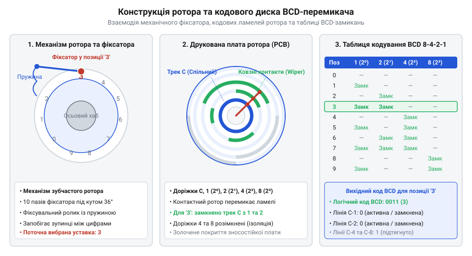
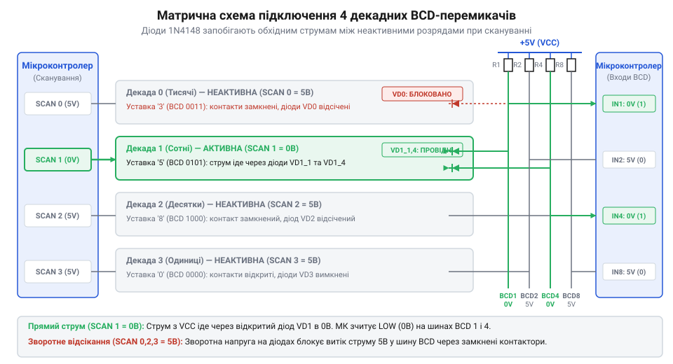
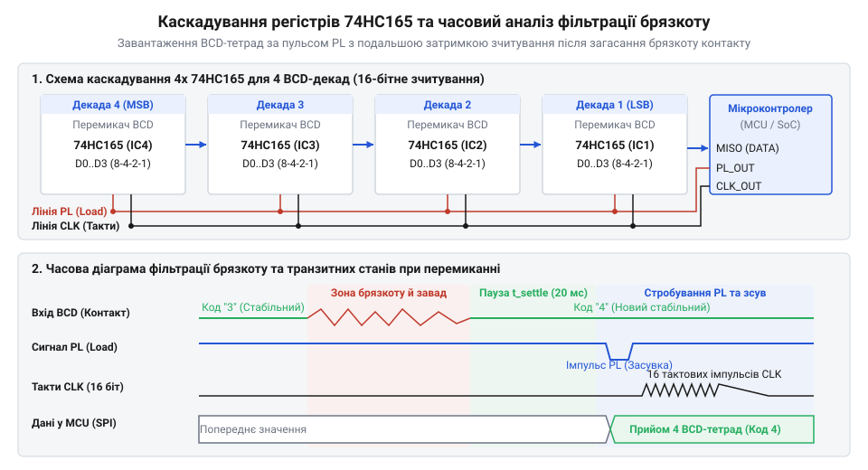

# Декадні барабанні перемикачі (Thumbwheel Switches)

<preknowlist>
- [DIP-перемикачі та джамперні блоки конфігурації](root:cat-hw-controls/dip-switches-and-configuration-blocks) — розуміння принципів двійкового та BCD кодування станів контактних груп
- [Матрична клавіатура 4×4 (мембранна)](root:cat-hw-controls/keypad-4x4-membrane) — розуміння принципів матричного сканування та придушення контактного брязкоту
</preknowlist>

## Проблема прямого числового вводу устави

У промислових системах автоматизації, дозаторах, таймерах та вимірювальних стендах оператору регулярно потрібно задавати точні багатозначні числові уставки — наприклад, кількість імпульсів заповнення, час витримки або технологічні межі. Застосування аналогових потенціометрів для цього завдання спричиняє температурний дрейф, чутливість до вібрацій та відсутність точної цифрової повторюваності. Використання [DIP-перемикачів та джамперних блоків](root:cat-hw-controls/dip-switches-and-configuration-blocks) вимагає від оператора розумового переведення десяткових чисел у двійкову систему, що в умовах реального виробництва призводить до частих людських помилок. Застосування повнорозмірних [матричних мембранних клавіатур](root:cat-hw-controls/keypad-4x4-membrane) чи сенсорних екранів вимагає постійного живлення, ускладнює прошивку мікроконтролера та виявляється ненадійним при роботі у грубих захисних рукавицях або при сильній цеховій загазованості й електромагнітних завадах. Конструктивно барабанні секції поділяються на класичні коліщаткові (англ. @@en|thumbwheel switch@@) та кнопочні (англ. @@en|push-button thumbwheel switch@@). Коліщаткові секції мають відкритий зубчастий обід барабана, зручний для швидкого прокручування пальцем одразу на кілька позицій поспіль при первинному налаштуванні, однак залишають ротор вразливим до випадкового торкання. Натомість кнопочні перемикачі повністю ховають ротор під лицьовою панеллю й оснащені двома окремими покроковими клавішами `+` та `-` із хроповим храповиком, який повертає кодовий диск строго на один крок за кожне натискання. Таке виконання гарантує чіткий тактильний відгук навіть через товсті захисні рукавиці, унеможливлює проскок декількох значень від вібрацій обладнання та повністю захищає уставку від випадкового збиття рукавом оператора у тісній шафі автоматики.

Оптимальним схемотехнічним розв'язком цієї проблеми є декадні барабанні перемикачі (від англ. @@en|thumbwheel switch@@ — барабанний перемикач, від *@@en|thumb@@* — великий палець та *@@en|wheel@@* — колесо). Це модульні електромеханічні пристрої ручного введення, які поєднують наочну візуальну індикацію набраної цифри з безпосереднім кодуванням її стану у вихідні логічні рівні. Кожна декадна секція містить поворотний барабан із виштампуваними десятковими цифрами від `0` до `9` на зовнішньому ободі та рельєфним зубчастим коліщатком для зручного перемикання пальцем.

Модульна конструкція дозволяє набирати довільну розрядність блоку: окремі декадні секції з'єднуються між собою за допомогою бокових засувок та торцевих накладних планок у єдину панельну каскадну збірку. На відміну від електронних дисплеїв, барабанний перемикач є повністю пасивним енергонезалежним елементом пам'яті. Набрана уставка зберігається механічно у знеструмленому стані обладнання й миттєво зчитується контролером одразу після подачі живлення без потреби у початковому калібруванні чи процедурах ініціалізації.

Історично декадні барабанні перемикачі з'явилися у 1950–1970-х роках як заміна масивних дискретних галетних та [кулачкових перемикачів](root:cat-hw-controls/rotary-cam-switches) у промислових лічильниках, лабораторних приладах та авіоніці. Вони дозволили кардинально зменшити габарити передніх панелей і спростити зчитування показань. Еволюція цих пристроїв пройшла шлях від механічних барабанів із дискретними дротовими контактами до компактних роторних друкованих плат із фотолітографічно нанесеними ламелями, що формують двійково-десяткові коди BCD, шістнадцятковий Hex та інверсні кодові комбінації. Завдяки повній пасивності та абсолютній імунності до радіочастотних завад барабанні секції залишаються затребуваними в екстремальних промислових умовах, де сенсорні та цифрові екрани виявляються ненадійними через високі електромагнітні наводки або вібрацію.

## Механіка ротора та кодування виходів

Внутрішня будова кожної декадної секції складається з чотирьох основних елементів: пластикового ізоляційного корпусу, поворотного роторного барабана, пружного фіксатора кроку (від англ. @@en|detent mechanism@@ — фіксатор кроку) та роторної друкованої плати з ковзними контактами (від англ. @@en|wiper contacts@@ — ковзні контакти). 

*Внутрішня конструкція роторного барабанного перемикача та топологія кодового диска для формування двійково-десяткового коду BCD.*

Фіксатор кроку побудований на базі листової пружини з профільованим штифтом, який заскочує у внутрішні пази храповика ротора. Це забезпечує суворо фіксоване позиціонування барабана у 10 дискретних положеннях (від `0` до `9`) з виразним механічним кліком, відсікаючи зупинку контактів у проміжних нестабільних станах. З боку друкованої плати на роторі закріплено бронзові або золочені пружинні ламелі, які при обертанні ковзають по фотолітографічних контактних доріжках статора.

Залежно від топології розведення контактних доріжок на друкованій платі перемикачі формують різні типи вихідних сигналів. Спільна лінія `C` (від англ. @@en|common line@@ — спільна лінія) подає потенціал (наприклад, `GND` або `V_CC`) на відповідні кодові виходи при замкненні ламелей. Для запобігання високоімпедансному плаваючому стану розімкнених розрядів у розширених роторних секціях застосовують додаткові зсувні перемикальні ламелі (від англ. @@en|shifting wiper contacts@@). Конструктивно вони виконані у вигляді спарованих зміщених пружних контактів, які ковзають по двокоординатній системі концентричних доріжок статора. У момент перемикання розряду активний контакт з'єднує сигнальний вивід із головною спільною лінією `C`, а при переході в неактивний стан зсувна ламель фізично переміщує цей же вивід на допоміжну внутрішню шину підтяжки. Така механічна двопозиційна комутація типу SPDT для кожного біта забезпечує суворо фіксовані активні логічні рівні (LOW та HIGH) на всіх виходах без плаваючого стану, що усуває потребу у зовнішніх дискретних підтягувальних резисторах і повністю захищає вхідні кола від високочастотних електромагнітних наводок.

1. **Десятковий код (1 з 10)** — містить 1 спільну лінію `C` та 10 вихідних ліній (позначених від `0` до `9`). При виборі певної цифри лінія `C` з'єднується лише з одним відповідним виходом. Схема проста для прямої релейної комутації, але вимагає 10 сигнальних провідників на одну декаду.
2. **Двійково-десятковий код (BCD 8-4-2-1)** — розшифровується як (від англ. @@en|Binary Coded Decimal@@, скорочено @@en|BCD@@). Містить 1 спільний провідник `C` та 4 кодові лінії вагових розрядів `1` (`2⁰`), `2` (`2¹`), `4` (`2²`) та `8` (`2³`). Комбінація замикань чотирьох виходів суворо відповідає 4-бітному двійковому еквіваленту набраної десяткової цифри (від `0000` для `0` до `1001` для `9`). Це зменшує кількість провідників від перемикача до контролера з 10 до 4 на кожну декаду.
3. **Комплементарний (інверсний) BCD-код** — виходи замкнені у дзеркальному (інверсному) порядку відносно прямого BCD. Якщо в прямому BCD для цифри `0` всі чотири виходи відкриті, то в інверсному вони замкнені на спільну лінію `C`, що зручно при підключенні до входів мікроконтролера з активним низьким рівнем.
4. **Шістнадцятковий код (Hexadecimal / 0–F)** — ротор має 16 фіксованих положень, а кодовий диск розведений для формування 4-бітних двійкових комбінацій від `0` (`0000`) до `15` (`1111` чи `F`).

Математичний зв'язок між позиційним значенням цифри та формуванням двійково-десяткових масивів, а також оцінку комбінаторної складності сканування детально розкрито у матеріалі про [математику кодування BCD та матричного сканування](root:cat-hw-controls/thumbwheel-switches/math-bcd-encoding-and-matrix-scanning.md). На відміну від [ротаційних кодових DIP-перемикачів](root:cat-hw-controls/rotary-dip-switches), які призначені для рідкісної внутрішньої конфігурації плат за допомогою викрутки, декадні барабанні секції оптимізовані для постійного оперативного введення даних із передньої панелі обладнання.

## Схемотехніка матричного опитування та розв'язка

Пряме підключення кожної кодової лінії багаторозрядного блоку до мікроконтролера вимагає значної кількості входів вводів-виводів. Для 4-розрядного блоку BCD-перемикачів пряме підключення потребує 16 дискретних ліній, а для 8-розрядного — 32 лінії, що перевищує обсяг периферії більшості мікроконтролерів. Для мінімізації виводів застосовують матричне сканування (від англ. @@en|matrix scanning@@ — матричне опитування).

При матричній схемі однакові кодові виходи (`1`, `2`, `4`, `8`) усіх декадних секцій об'єднуються у спільну 4-бітну шину даних, підключену до 4 вхідних пінів мікроконтролера з підтягувальними резисторами `R_pullup`. Спільні лінії `C` (Common) кожної декади підключаються до окремих виходів стробування (від англ. @@en|strobe lines@@) мікроконтролера. Мікроконтролер послідовно подає низький активний рівень `0` на спільну лінію однієї декади, зчитує 4-бітне BCD-значення з шини, після чого переходить до наступної декади.

*Принципова схема матричного опитування 4 декадних BCD-перемикачів з діодною розв'язкою 1N4148 та підтягувальними резисторами.*

Однак при паралельному об'єднанні кодових виходів виникає критична схемотехнічна проблема — зворотні паразиційні струми (від англ. @@en|sneak paths@@ — шляхи витоку струму). Якщо дві або більше декад мають замкнені контактні групи для однакових бітів, під час опитування однієї декади струм через замкнені контакти невибраних декад перетікає на шину, викликаючи хибне зчитування ("фантомні" кодові стани). Для усунення цього ефекту послідовно з кожним кодовим виходом кожної декади вмикають розв'язувальні кремнієві діоди (наприклад, `1N4148`). Діоди пропускають струм лише в одному напрямку від шини даних до стробованого виходу `C`, повністю відсікаючи зворотні кола шунтування.

Номінал підтягувальних резисторів `R_pullup` обирають із компромісу між завадостійкістю та енергоспоживанням. При напрузі живлення `V_CC = 5 В` занадто малий опір (наприклад, 1 кОм) призводить до невиправданого вихідного струму при замиканні контактів `I = 5 / 1000 = 5 мА` на кожен біт. Занадто великий опір (100 кОм) у поєднанні з паразитною ємністю кабельної траси `C_line` створює затримку наростання фронту `τ = R_pullup · C_line`, що уповільнює сканування. Типове обчислення постійної часу для шини з паразитною ємністю `C_line = 100 пФ` при `R_pullup = 10 кОм`:

τ = R_pullup · C_line
= 10000 · 100 × 10⁻¹²    [підстановка опору та ємності]
= 1 мкс                   [обчислена постійна часу наростання фронту]

Отримане значення `τ = 1 мкс` є достатнім для забезпечення високої частоти матричного опитування без викривлення логічних рівнів. Звичайний діапазон опорів `R_pullup` для промислових панелей становить від `4.7 кОм` до `10 кОм`.

При винесенні перемикальних блоків на віддалені панелі керування довгі джгути провідників зазнають впливу високочастотних електромагнітних завад (від англ. @@en|electromagnetic interference@@) та імпульсних наводок від силового обладнання. Для придушення наводок паралельно кожній кодовій лінії встановлюють шунтувальні керамічні конденсатори `C_filter`, які разом із підтягувальними резисторами `R_pullup` утворюють пасивний фільтр низьких частот (від англ. @@en|low-pass filter@@). Алгоритм вибору ємності `C_filter` базується на розрахунку сумарної постійної часу згладжування кола та обмеженнях на частоту матричного сканування:

Сумарна постійна часу `τ_total` визначається добутком опору підтяжки `R_pullup` та сумарної ємності, що складається з власної паразитної ємності кабелю `C_line` і шунтувального конденсатора `C_filter`. Для надійного зчитування сигналу під час стробувального імпульсу тривалістю `T_strobe` напруга на вході повинна досягти принаймні `95%` від рівня живлення `V_CC`, що вимагає виконання часової умови `T_strobe ≥ 3 · τ_total`. Гранична допустима ємність `C_filter` обчислюється шляхом покрокового вираження з часового співвідношення:

τ_total
= T_strobe ÷ 3                                         [умова досягнення 95% напруги V_CC за 3 постійні часу]

C_line + C_filter
= τ_total ÷ R_pullup                                    [вираження сумарної ємності кодової лінії]
= T_strobe ÷ (3 · R_pullup)                             [підстановка виразу для τ_total]

C_filter
= (T_strobe ÷ (3 · R_pullup)) - C_line                  [остаточне виведення граничної ємності фільтра]

Для промислової панелі з підтяжкою `R_pullup = 10 кОм`, паразитною ємністю джгута `C_line = 100 пФ` та інтервалом стробування `T_strobe = 1 мс` розрахунок дає граничну межу `C_filter ≤ 33.2 нФ`. Встановлення стандартного керамічного конденсатора ємністю `10 нФ` формує підсумкову постійну часу `τ_total ≈ 101 мкс`, яка у понад три рази менша за тривалість стробу `T_strobe`, що гарантує ефективне шунтування радіочастотних завад і імпульсних наводок без спотворення фронтів зчитування.

τ_total = R_pullup · (C_line + C_filter)

Для стабільного зчитування сигналу тривалість стробувального імпульсу `T_strobe` повинна задовольняти умову збереження логічного рівня:

T_strobe ≥ 3 · τ_total     [забезпечення наростання напруги до 95% від V_CC]

Звідси гранично допустима ємність шунтувального конденсатора визначається як:

C_filter = (T_strobe ÷ (3 · R_pullup)) - C_line

При параметрах промислової панелі `R_pullup = 10 кОм`, `C_line = 100 пФ` та інтервалі стробування `T_strobe = 1 мс` вибір ємності `C_filter = 10 нФ` дає `τ_total ≈ 101 мкс`, що у понад три рази менше за `T_strobe`, забезпечуючи ефективне придушення радіозавад без спотворення часової діаграми опитування.

## Зсувні регістри та програмна фільтрація

Коли кількість доступних ліній мікроконтролера обмежена лише кількома виводами, матричне опитування поступається місцем послідовній шині на базі паралельно-послідовних зсувних регістрів `74HC165` (від англ. @@en|shift register@@ — зсувний регістр). Кожна 8-бітна мікросхема `74HC165` дозволяє підключити 2 BCD-декади (по 4 біти на декаду) до своїх паралельних входів `D0`–`D7`. 

*Схема послідовного каскадування двох регістрів 74HC165 для зчитування 4 BCD-декад та часова діаграма програмної фільтрації транзитних кодів.*

Каскадування регістрів виконується з'єднанням послідовного виходу `Q7` першого регістра із послідовним входом `DS` наступного. Це дозволяє опитувати будь-яку кількість декадних барабанів (4, 8 чи більше) за допомогою всього лише 3 ліній мікроконтролера: `PL` (Parallel Load — фіксація паралельного кадру), `CLK` (Clock — тактування) та `DATA` (Serial Data Out — послідовні дані). При падінні сигналу на лінії `PL` у регістр одночасно защовкуються BCD-коди всіх перемикачів, після чого за тактовими імпульсами `CLK` бітовий потік послідовно висувається в мікроконтролер.

Механічні контакти барабанних секцій піддаються двом типам завад: механічному брязкоту (від англ. @@en|contact bounce@@ — брязкіт контактів) тривалістю 1–5 мс та транзитним міжконтактним станам (від англ. @@en|transit code states@@). При обертанні ротора між двома сусідніми цифрами (наприклад, при переході з `3` у `4`) рухома ламель тимчасово замикає або розмикає проміжні кодові доріжки. У результаті на виходах BCD можуть з'являтися некоректні 4-бітні тетради у діапазоні від `10` до `15` (`0xA`–`0xF`), які не є валідними двійково-десятковими числами.

Для забезпечення завадостійкого зчитування програмний драйвер мікроконтролера реалізує двоступеневий алгоритм фільтрації:

1. **BCD-валідація діапазону** — після розбору кадру на 4-бітні тетради кожна тетрада перевіряється на умову `nibble ≤ 9`. Якщо виявлено значення від `10` до `15`, кадр позначається як транзитний і відкидається, а прошивка утримує попереднє підтверджене значення устави.
2. **Мажоритарна завадостійка фільтрація (Debouncing)** — результати зчитування записуються у кільцевий буфер історії глибиною `N` замірів (наприклад, 5 замірів із інтервалом 5–10 мс). Нове значення устави підтверджується лише тоді, коли одна й та сама BCD-тетрада набере мажоритарну більшість голосів у буфері.

Проте при швидкому обертанні барабана пальцем через кілька розрядів поспіль (наприклад, при прокручуванні від цифри `1` до `6`) проміжні валідні BCD-коди `2`, `3`, `4` та `5` можуть затримуватися на доріжках протягом 5–10 мс. Цього часу достатньо для проходження стандартного мажоритарного фільтра, що загрожує помилковим спрацьовуванням виконавчих органів контролера на кожен проміжний крок. Для усунення цього ефекту програмний драйвер доповнюють таймером утримання (від англ. @@en|hold-off timer@@ — таймер витримування). При виявленні будь-якої зміни валідного BCD-коду драйвер не оновлює робочу змінну устави негайно, а перезапускає таймер витримування заданої тривалості `T_holdoff` (зазвичай 30–50 мс). Нова уставка вважається остаточно підтвердженою й передається у виконавчі алгоритми системи лише після того, як лічильник `T_holdoff` повністю вистече без жодних подальших перемикань коду. Якщо ж під час відліку таймера оператор продовжує обертати барабан і подає новий BCD-код, таймер скидається в нуль і починає відлік заново, що повністю відсікає проміжні валідні стани й гарантує фіксацію лише підсумкової цифри.

Коли оператор швидко прокручує барабан через кілька позицій поспіль (наприклад, з `1` до `7`), мажоритарний буфер ризикує накопичити проміжні валідні цифри (наприклад, `3` чи `5`), сприймаючи їх як остаточну уставку й викликаючи хибне спрацьовування виконавчої системи. Для обробки цього крайового випадку програмний драйвер доповнюють таймером утримання (від англ. @@en|hold-off timer@@ — таймер витримування): нове значення устави передається в робочу змінну лише після того, як BCD-код залишається незмінним протягом мінімального часу стабілізації (зазвичай 30–50 мс). Якщо ж під час опитування виявляється зміна валідного BCD-коду на інший валідний до завершення мажоритарного вікна, буфер історії негайно скидається, що запобігає «злипанню» проміжних значень і гарантує застосування лише остаточно вибраного числа.

Практичну реалізацію даного схемотехнічного рішення із покроковими схемами та кодом розкрито у матеріалі про [проєкт 4-розрядного блоку декадних перемикачів з зсувним регістром та фільтрацією](root:cat-hw-controls/thumbwheel-switches/proj-industrial-thumbwheel-bcd-panel-interface.md). Повний залізний та програмний довідник функцій C/C++ для роботи з цим інтерфейсом міститься в [API-довіднику сполучення BCD-перемикачів через 74HC165](root:cat-hw-controls/thumbwheel-switches/api-thumbwheel-hardware-and-74hc165-interface.md).
