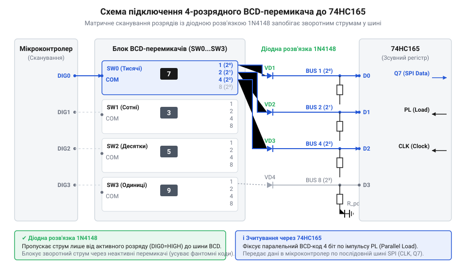
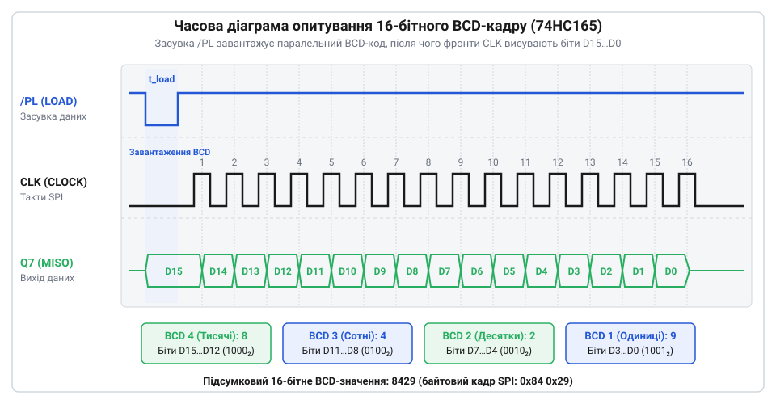

# Декадні барабанні перемикачі (Thumbwheel Switches)

<preknowlist>
- [DIP-перемикачі та джамперні блоки конфігурації](root:cat-hw-controls/dip-switches-and-configuration-blocks) — розуміння принципів двійкового та BCD кодування станів контактних груп
- [Матрична клавіатура 4×4 (мембранна)](root:cat-hw-controls/keypad-4x4-membrane) — розуміння принципів матричного сканування та придушення контактного брязкоту
</preknowlist>

## Архітектура та принципи BCD-введення

У промислових системах задання числових параметрів вимагає інтерфейсу, що зберігає уставку навіть при знеструмленні. @@en|Thumbwheel switches@@ (декадні барабанні перемикачі) вирішують це завдяки механічним роторним барабанам із цифрами від 0 до 9.

Пряме паралельне підключення кожної декади до мікроконтролера (@@en|microcontroller@@) потребує 4 вхідних пінів на один розряд двійково-десяткового коду (@@en|binary-coded decimal@@, BCD). Для 4-розрядного блоку це б вимагало 16 ліній. Для економії виводів розряди об'єднують у спільну BCD-шину, а паралельно-послідовні зсувні регістри 74HC165 фіксують стан усіх бітів і передають їх послідовним потоком, зменшуючи інтерфейс до 3 пінів: защелкування (PL), тактування (CLK) та дані (Q7).

Усередині кожного барабана роторна друкована плата (від англ. @@en|printed circuit board@@) та контактний диск (від англ. @@en|rotary disk@@ — роторний диск) перетворюють кутове положення диска на 4 вихідні лінії з ваговими коефіцієнтами 1, 2, 4, 8. Фізична відмінність між виконаннями перемикачів залежить від топології струмопровідних доріжок на роторному диску. У прямому виконанні з активним низьким рівнем (від англ. @@en|active-low logic@@ — пряма логіка низького рівня) спільну клему C підключають до спільної шини `GND`. Під час повороту барабана ковзні контакти замикають на `GND` ті вихідні лінії, вага яких формує поточну цифру (наприклад, лінії 1 і 2 для цифри 3), утворюючи рівень логічного нуля (`0 V DC`), тоді як незадіювані лінії залишаються підтягнутими до `VCC` через `R_pull`. У комплементарному виконанні (від англ. @@en|complementary logic@@ — комплементарна логіка, або @@en|active-high logic@@) малюнок струмопровідних доріжок інвертовано на рівні травлення плати: активні розряди залишають лінію розімкненою (рівень логічної одиниці `+5 V DC`), а неактивні контакти фізично замикаються на `GND`. Це дає змогу подавати інверсний BCD-код безпосередньо на мікроконтролерні входи із внутрішньою підтяжкою без використання додаткових інверторів. Як і [DIP-перемикачі](root:cat-hw-controls/dip-switches-and-configuration-blocks), барабанні модулі забезпечують стабільне механічне утримання вибраного стану без використання акумуляторних батарей.

## Схемотехніка шини та діодна розв'язка

Коли кілька модулів декадних перемикачів підключено до спільної 4-бітної BCD-шини, одночасне замикання контактів у різних декадах створює паразитні зворотні струми. Для їх блокування послідовно з кожною вихідною лінією BCD встановлюють розв'язувальні діоди 1N4148.

*Принципова схема підключення декадних перемикачів до BCD-шини з діодною розв'язкою 1N4148 та підтяжками R_pull.*

Кожен діод створює прямохідне падіння напруги близько 0.6–0.7 В. При розрахунку рівня логічного нуля на КМОН-входах це падіння додається до напруги насичення. Підтягувальні резистори `R_pull` (зазвичай 4.7–10 кОм) мають забезпечувати струм для відпривання діодів без зайвого споживання. Для довгих кабельних шлейфів із високою ємністю обирають менші номінали `R_pull` задля збереження крутості фронтів сигналів і високої завадостійкості.

## Алгоритм опитування та фільтрація брязкоту

Зчитування даних із каскаду зсувних регістрів відбувається у два етапи. Спочатку мікроконтролер формує короткий імпульс низького рівня на лінії PL (Parallel Load), защелкуючи поточний стан BCD-ліній у внутрішніх тригерах 74HC165. Далі через 16 тактових імпульсів CLK потік бітів зчитується через послідовний вихід даних.

*Часова діаграма сигналів PL, CLK та Data під час паралельного защелкування та послідовного зчитування BCD-кадру.*

Під час механічного обертання барабана між цифрами контакти розмикаються несинхронно, утворюючи транзитні невалідні BCD-коди (значення від 10 до 15). Програмний драйвер відфільтровує коди поза межами 0..9 і виконує цифрову фільтрацію брязкоту контактів. У промислових умовах застосовують мажоритарне голосування за кількома послідовними вибірками перед оновленням робочої устави.
