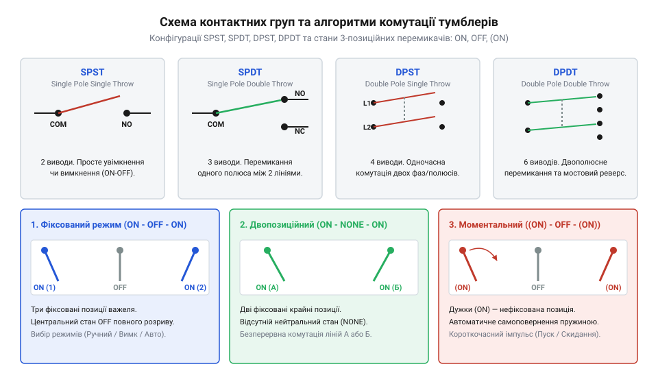
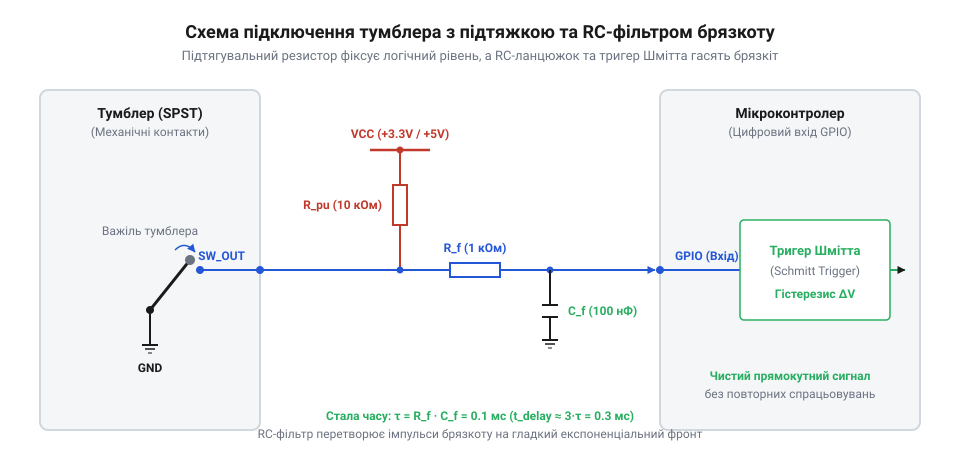

# Апаратний інтерфейс, схемотехніка підключення та панельні розміри тумблерів і захисних ковпачків

<preknowlist>
- [Тактильні кнопки з ковпачками](root:cat-hw-controls/tactile-buttons) — Принцип роботи механічних сухих контактів та базове явище брязкоту.
- [Кнопка аварійного стопу грибок та органи безпечного відключення (IEC 60947-5-5)](root:cat-hw-controls/estop-mushroom-button) — Засади захисту органів керування від випадкового спрацьовування та дублювання контактів.
</preknowlist>

## Ненадійні перемикання та випадкові спрацьовування

У системах керування обладнанням механічне зачеплення вимикача рукавом оператора чи випадковий поштовх під час вібрації може змінити стан вхідної лінії. Підпружинені сухі контакти, як-от [тактильні кнопки з ковпачками](root:cat-hw-controls/tactile-buttons), повертаються в початкове положення одразу після відпускання, тому вони не здатні зберігати стан механічно. Якщо ж у вузлі перемикання режимів застосувати незахищений вимикач без фіксатора положення, то оператор втрачає візуальне й тактильне підтвердження поточного стану приладу.

Для запобігання хибним спрацьовуванням та аварійній зупинці ліній (на відміну від прямої дії, яку забезпечують [органи безпечного відключення](root:cat-hw-controls/estop-mushroom-button)) використовують тумблер (від @@en|toggle switch@@) — електромеханічний перемикач із важелем, який має чітке пружинне дотискання та механічну фіксацію положення. Чіткий перехід між станами супроводжується відчутним клацанням, що унеможливлює зависання контактів у проміжному стані.

Внутрішній кінематичний вузол тумблера складається з рухомого важеля, що спирається на пружинний штовхач із підпружиненим кулачком (від @@en|spring-loaded plunger@@) та профільну напрямну. При зміщенні важеля оператором кулачок стискає внутрішню спіральну пружину, накопичуючи механічну енергію, поки важіль не долає кінематичну мертву точку (від @@en|dead center@@). Одразу після перетину мертвої точки стиснута пружина миттєво розпрямляється, штовхаючи кулачок по профілю коромисла і примусово перекидаючи рухомий контакт у протилежне фіксоване положення незалежно від швидкості руху руки оператора. На відміну від механізму з фіксацією положення, де кулачок западає у симетричну заглибину профілю і залишається там після зняття зусилля, моментальні тумблери з автоповерненням (від @@en|momentary toggle switch@@) мають асиметричну похилу напрямну: підпружинений штовхач постійно створює відновлювальний крутний момент, який миттєво повертає важіль у нейтральне положення, щойно оператор відпускає ручку.

## Контактні групи та трипозиційні алгоритми

Внутрішня контактна система тумблера складається з рухомого коромисла та нерухомих виводів, виведених на корпус. За кількістю незалежних електричних кіл, якими керує один важіль, та кількістю напрямків комутації тумблери поділяють на чотири базові конфігурації:
- @@en|SPST@@ (від @@en|Single Pole Single Throw@@) — один полюс (від @@en|pole@@) на один напрямок (від @@en|throw@@). Має два виводи і працює як звичайний вимикач «замкнено/розімкнено».
- @@en|SPDT@@ (від @@en|Single Pole Double Throw@@) — один полюс на два напрямки. Містить спільний вивід (від @@en|common@@) та два крайні контакти, перемикаючи лінію між двома навантаженнями.
- @@en|DPST@@ (від @@en|Double Pole Single Throw@@) — два незалежні полюси, які комутуються одночасно при зміщенні одного важеля. Використовується для одночасного розриву фази й нуля або плюс та мінус живлення.
- @@en|DPDT@@ (від @@en|Double Pole Double Throw@@) — два незалежні полюси, кожен із яких має по два напрямки перемикання. Класичним прикладом її застосування є схема реверсу полярності двигуна постійного струму: джерело живлення підключають до середніх виводів обох полюсів, а крайні контакти з'єднують хрест-навхрест додатковими перемичками. При перемиканні важеля з одного крайнього положення в інше напрямок струму крізь обмотку двигуна миттєво змінюється на протилежний, що змінює напрямок обертання вала без використання додаткових реле чи силових ключових транзисторів.

Для трипозиційних тумблерів важіль має середнє положення. Алгоритми комутації позначають стандартними послідовностями станів:
- @@en|ON-OFF-ON@@ — обидва крайні стани фіксовані, а середній стан розімкнений.
- @@en|ON-NONE-ON@@ — двопозиційний тумблер без середнього нейтрального стану.
- @@en|(ON)-OFF-(ON)@@ — середній стан розімкнений і фіксований, а крайні стани є імпульсними (позначені в дужках), тобто важіль самостійно повертається в нейтраль після відпускання.

*Класифікація контактних груп тумблерів за числом полюсів та напрямків разом із позначеннями фіксованих і моментальних станів.*

## Схемотехніка входу мікроконтролера та гасіння

При підключенні сухих контактів тумблера до цифрового входу (від @@en|GPIO@@) мікроконтролера контактна група комутує лінію на спільний провід (@@en|GND@@) або на шину живлення (@@en|VCC@@). Щоб запобігти виникненню плаваючого стану (від @@en|floating state@@), коли контакти розімкнені і вхід сприймає наводки, у коло вводять підтягувальний резистор @@en|pull-up@@ або @@en|pull-down@@ опором від `4.7 kΩ` до `10 kΩ`.

Під час змикання металевих контактних накладок під дією пружини виникає явище брязкоту (від @@en|contact bounce@@) — швидка серія мікроскопічних відскоків тривалістю від `1 ms` до `10 ms`. Для апаратного придушення брязкоту паралельно входу мікроконтролера підключають фільтруючий конденсатор, утворюючи пасивний @@en|RC-фільтр@@. Щоб розрядний струм конденсатора не пошкодив внутрішній вхідний каскад МК у момент короткого замикання тумблера на землю, послідовно між конденсатором та виводом входу встановлюють обмежувальний резистор `R2` опором від `100 Ω` до `1 kΩ`. Повільний експоненціальний фронт напруги з виходу RC-фільтра подається на цифровий вхід із тригером Шмітта (від @@en|Schmitt trigger@@), який має два рознесені пороги спрацьовування: верхній поріг увімкнення `V_T+` (зазвичай близько `0.7 · VCC`) та нижній поріг вимкнення `V_T-` (близько `0.3 · VCC`). Утворена зона гістерезису `ΔV = V_T+ - V_T-` гарантує, що незначні високочастотні наводки чи пульсації на плавному експоненціальному розряді конденсатора не викликають повторних перезапусків внутрішніх переривань МК.

Часова константа фільтра `τ` розраховується за формулою:

τ = R · C
= 10000 · 100 · 10⁻⁹      [при R = 10 kΩ, C = 100 nF]
= 0.001 s                 [1 ms часової константи]

Наявність тригера Шмітта (від @@en|Schmitt trigger@@) на вході мікроконтролера перетворює плавну напругу розряджання конденсатора на чіткий цифровий фронт без хибних повторних переривань.

*Схема підключення сухих контактів тумблера до цифрового входу МК із підтягувальним резистором R1, фільтруючим конденсатором C1 та захисним обмежувальним резистором R2.*

## Електричні режими та комутація навантажень

Паспортні значення максимально припустимої напруги та струму контактів суттєво відрізняються для кіл постійного (від @@en|direct current@@, DC) та змінного (від @@en|alternating current@@, AC) струму. У колах змінного струму синусоїдальна напруга проходить через нульове значення кожні 10 мс (при частоті 50 Гц), що сприяє природному згасанню дуги при розмиканні контактів.

У колах постійного струму електрична дуга не згасає самостійно, що спричиняє швидку ерозію і переношення металу між контактами. Через це допустима напруга DC для того самого тумблера зазвичай значно нижча за AC.

При комутації індуктивного навантаження (котушки реле, соленоїди, двигуни) у момент розмикання виникає сплеск високої напруги проти-ЕРС:

u_L = L · (di / dt)

Для захисту контактів від підгарання та зварювання при DC-комутації паралельно індуктивності встановлюють зворотний діод (від @@en|freewheeling diode@@), а в колах змінного струму застосовують варистор або паралельний @@en|RC-снабер@@ (від @@en|snubber@@). Ємність демпферного конденсатора `C_s` розраховують виходячи з умови повного поглинання магнітної енергії індуктивності `E_L = 0.5 · L · I²` без перевищення максимально припустимої напруги на контактах `U_max`: `C_s = (L · I²) / U_max²`. Опір резистора `R_s` обирають із розрахунку обмеження амплітуди струму розряджання конденсатора при наступному замиканні контактів тумблера: `R_s = U_max / I`. Правильний добір номіналів RC-снабера запобігає виникненню високовольтної дуги при розмиканні та обмежує кидок струму при вмиканні, продовжуючи механічний та електричний ресурс контактної групи.

u_L = L · (di / dt)

Для захисту контактів від підгарання та зварювання при DC-комутації паралельно індуктивності встановлюють зворотний діод (від @@en|freewheeling diode@@), а в колах змінного струму застосовують варистор або паралельний @@en|RC-снабер@@.

## Панельний монтаж та захисні ковпачки

Механічне кріплення тумблера на лицьовій панелі приладу здійснюється через нарізну втулку (від @@en|threaded bushing@@), яка просувається крізь круглий отвір панелі та фіксується затискною гайкою. Нарізні втулки мають стандартизовані діаметри, найпоширенішими з яких є `M6×0.75` для мініатюрних та `M12×0.75` для повнорозмірних тумблерів.

Щоб тумблер не провертався в отворі під час силового перемикання важеля, під затискну гайку встановлюють орієнтувальну шайбу (від @@en|keyway washer@@) з фіксуючим вусиком, який заходить у додатковий технологічний отвір або пазовий виріз на панелі. Геометричні креслення посадочного місця передбачають основний монтажний отвір діаметром `12.2⁺⁰ˑ² mm` (для різьбової втулки `M12×0.75`) або `6.2⁺⁰ˑ¹ mm` (для втулки `M6×0.75`), а також малий бічний отвір фіксатора діаметром `2.2⁺⁰ˑ¹ mm`, розташований на осьовій відстані `9.5 ± 0.1 mm` від центру основного отвору. Альтернативою бічному отвору є зрізана фаска (від @@en|D-shaped cutout@@) або прямокутний паз завширшки `3.1⁺⁰ˑ¹ mm` на кромці основного отвору. Суворе дотримання допусків панельного вирізу унеможливлює люфт орієнтувальної шайби і запобігає розхитуванню нарізного з'єднання під дією багаторазових механічних навантажень.

У відповідальних операторських пультах для унеможливлення випадкового зачеплення важеля застосовують захисні ковпачки типу Молі (від @@en|Mollie guard@@) або підпружинені відкидні кришки (від @@en|flip cover@@). Опускання підпружиненої кришки механічно повертає важіль тумблера в безпечне вимкнене положення та фізично блокує його перемикання до моменту навмисного підняття кришки оператором.
