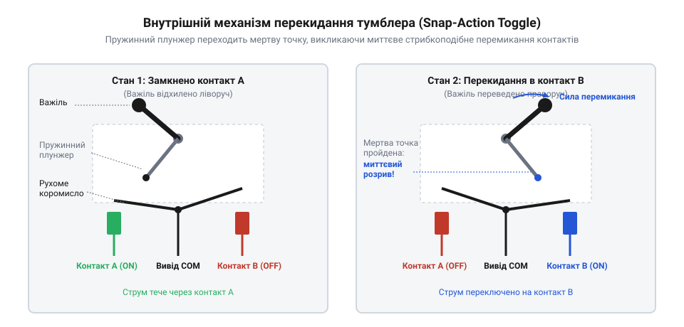
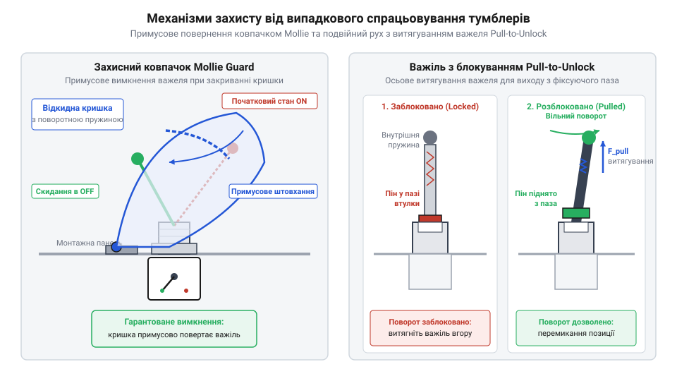

# Еволюція тумблерів, захисних ковпачків Mollie та важелів з блокуванням у відповідальних інтерфейсах

<preknowlist>
- [Кнопка аварійного стопу грибок та органи безпечного відключення (IEC 60947-5-5)](root:cat-hw-controls/estop-mushroom-button) — концепції механічного захисту та запобігання помилковому спрацьовуванню органів керування
</preknowlist>

## Проблема повільної комутації ножових рубильників

Наприкінці XIX та на початку XX століття розподіл електричної енергії та комутація високовольтних кіл здійснювалися за допомогою відкритих ножових рубильників (англ. *knife switch*, @@en|knife switch@@). Конструктивно такий пристрій являв собою мідне лезо, яке оператор вручну вводив у пружні контактні губки або витягував із них. Головна пастка цієї схеми полягала у прямому зв'язку між швидкістю руху руки людини та швидкістю розходження контактів.

Коли електричне коло розмикається повільно, висока напруга та індуктивність навантаження іонізують повітряний проміжок між контактами. У момент початкового розходження сухих контактів площа їхнього дотику стрімко звужується до кількох мікроскопічних виступів, через які протікає весь струм колу. Стрімке зростання щільності струму миттєво розігріває ці точки до температури кипіння міді, а висока напруженість електричного поля на мікроскопічній відстані викликає автоелектронну емісію та ударну іонізацію металевої пари й повітря. Це призводить до виникнення електричної дуги (англ. *electric arc*, @@en|electric arc@@) — стійкого каналу плазми, температура якого сягає тисяч градусів Цельсія. Тривале горіння дуги запускає термодинамічне руйнування контактних губок: локальний перегрів викликає миттєве плавлення та випаровування міді, утворюючи кратери й окисні плівки на робочих поверхнях. Зменшення ефективної площі контакту стрімко збільшує перехідний опір, що при наступних увімкненнях спричиняє додаткове розігрівання, термічне втомлення та остаточне зварювання чи механічне руйнування рубильника, створюючи високий ризик виникнення пожежі.

Окрім швидкого механічного зносу контактів, відкрита конструкція рубильників становила постійну небезпеку враження струмом для обслуговуючого персоналу. Невизначеність стану контактів при неповному витягуванні важеля вимагала розробки принципово нового комутаційного апарата, швидкість спрацьовування якого не залежала б від швидкості руху руки оператора. Пошук захисних рішень для запобігання помилковим чи небезпечним перемиканням згодом сформував загальні підходи до безпеки, описані в [концепціях органів аварійного відключення](root:cat-hw-controls/estop-mushroom-button).

## Винайдення підпружиненого механізму миттєвого перекидання

Розв'язанням проблеми повільного розмикання став розрахунок кінематичних схем із накопиченням механічної енергії. У 1916–1917 роках американський винахідник Вільям Ньютон патентує підпружинений механізм, у якому важіль керування зв'язаний із рухомим контактом через стиснуту спіральну пружину.

Коли оператор штовхає важіль тумблера, рухомий контакт залишається нерухомим на місці, а внутрішня пружина стискається, накопичуючи потенційну енергію. Під час руху важеля лінія дії сили пружини зміщується відносно осі обертання коромисла: до неї вектор пружинного зусилля створює притискний момент, який утримує контакт закритим. Геометричне розташування кінематичної мертвої точки визначається колінеарним вирівнюванням осі важеля, точки кріплення пружини та осі обертання коромисла в одну лінію, де кут між вектором сили та радіус-вектором коромисла стає нульовим. У цій точці стискання пружини досягає геометричного максимуму, а сила пружинного стиску розраховується за законом Гука F = k · (x₀ + Δx_max), де k — жорсткість пружини, x₀ — початковий натяг, а Δx_max — максимальне додаткове стиснення. У момент, коли механізм проходить кінематичну мертву точку (англ. *dead center*, @@en|dead center@@), вектор сили перетинає геометричну вісь обертання, плече моменту d = r · sin θ зменшується до нуля, після чого при найменшому кутовому відхиленні δθ миттєво змінює знак на протилежний. Накопичена потенційна енергія пружини E = ½ k (x₀ + Δx_max)² вивільняється у вигляді прискорювального обертального моменту M = F_max · r · sin(δθ), і рухомий контакт зі швидкістю у кілька метрів на секунду відлітає у протилежне фіксоване положення.

Цей механізм отримав назву механізму миттєвого перекидання (англ. *snap-action mechanism*, від латинського *mechanisma* — пристрій, @@en|snap-action mechanism@@) і поклав початок сучасному тумблеру (англ. *toggle switch*, від давньоанглійського *tumbian* — перевертатися, @@en|toggle switch@@). Висока швидкість розмикання контактів скоротила час існування електричної дуги до кількох мілісекунд, що усунуло ерозію металу та унеможливило зварювання контактних поверхонь.

*Кінематична схема підпружиненого механізму миттєвого перекидання у трьох фазах: початковий стан, перехід через мертву точку та швидкий стрибок контактів.*

Окрім електричної надійності, стрибковий механізм сформував виразний зворотний зв'язок — тактильну фіксацію (англ. *tactile feedback*, @@en|tactile feedback@@) та акустичне клацання. Оператор відчуває чіткий бар'єр опору та клацання в момент перекидання, що виключає невизначений проміжний стан. Цей механічний ефект різко відрізняється від м'якого ходу [тактильних кнопок](root:cat-hw-controls/tactile-buttons), забезпечуючи чітке фізичне підтвердження зміни стану системи.

## Авіаційні ковпачки Mollie та витяжне блокування

У період Другої світової війни та з початком Холодної війни стрімке ускладнення кабін бойових літаків створило нове джерело катастроф — людський фактор. Панелі керування винищувачів та бомбардувальників містили десятки щільно розташованих тумблерів. У тісному кабінному просторі, під час виконання маневрів із високими перевантаженнями або при роботі в товстих рукавицях пілоти випадково зачіпали сусідні важелі рукавом чи кисневим шлангом. Це призводило до помилкового вимкнення двигунів, скидання паливних баків або випускання шасі на недозволеній швидкості.

Для відвернення випадкових спрацьовувань авіаційні інженери створили спеціалізований механічний захист. Першим масовим рішенням став відкидний підпружинений ковпачок, відомий в авіаційній традиції як @@en|Mollie cover@@ або @@en|switch guard@@. Захисна кришка закриває важіль тумблера у безпечному положенні. Щоб переключити тумблер, пілот повинен свідомо підняти ковпачок пальцем і лише після цього відхилити важіль. Якщо ковпачок опустити назад, його внутрішній похилий шарнір примусово повертає важіль у вихідний стан.

Для найвідповідальніших кіл, де випадкове відкриття ковпачка також становило загрозу, було розроблено механізм витяжного блокування важеля — @@en|pull-to-unlock@@. Важіль такого тумблера має внутрішній підпружинений штифт, який заходить у фіксуючі пази різьбової втулки. Для зміни положення оператор повинен витягнути важіль уздовж його осі на кілька міліметрів, подолавши опір внутрішньої пружини, перевести його у новий паз і відпустити.

Окрім механічної перепони, авіаційні ковпачки отримали суворе колірне маркування для миттєвої візуальної орієнтації пілота в умовах високого психоемоційного навантаження. Яскраво-червоний колір застосовували для найкритичніших систем аварійного скидання паливних баків, пожежогасіння двигунів та примусового випускання шасі. Смугасте жовто-чорне забарвлення сигналізувало про підсистеми катапультування й бойового застосування озброєння, тоді як чорні або нейтральні металеві ковпачки захищали від випадкового зачіпання тумблери електромережі, радіонавігації та паливних насосів.

*Конструкція відкидного захисного ковпачка Mollie та тумблера з витяжним блокуванням важеля pull-to-unlock у відкритому та закритому положеннях.*

Поєднання механізмів миттєвого перекидання та фізичного блокування перетворило тумблер на еталонний орган керування для критичних інтерфейсів, де вартість помилкового перемикання вимірюється людськими життями.

## Розвінчання міфів та стандартизація MIL-DTL

Поширення захищених тумблерів в авіації обросло численними професійними легендами. Популярний авіаційний фольклор приписує назву ковпачків Mollie (англ. *Mollie cover*, @@en|Mollie cover@@) ім'ю дівчини одного з військових пілотів Другої світової війни. Проте архівні технічні документи заперечують цю версію: термін походить від номенклатурного маркування оригінальних поворотних пружинних захисних скоб та комерційних патентованих кришок компанії *Mollie Manufacturing Co.*, які постачалися для Повітряних сил США.

Масове виробництво комутаційної апаратури вимагало жорсткої уніфікації. У середині XX століття Міністерство оборони США розробило серію військових специфікацій, ключовими з яких стали стандарти MIL-DTL-3950 (важка серія для високих струмів) та MIL-DTL-83731 (мініатюрна серія). Ці стандарти суворо регламентували фізичні та електричні параметри тумблерів.

Військова стандартизація висунула три фундаментальні вимоги до конструкції. Перша — герметичність корпусу (англ. *hermetic sealing*, @@en|hermetic sealing@@) за допомогою силіконових ущільнювачів або металоскляних ізоляторів, що відсікають вологу та витримують перепади барометричного тиску до 90 кПа при падінні тиску до 11,6 кПа на висотах до 15 000 м за стандартом MIL-DTL-3950. Друга — стійкість до вібрацій у тестовому діапазоні частот від 10 до 2000 Гц при прискоренні до 15g, яка усуває брязкання контактів (англ. *contact chatter*, @@en|contact chatter@@) під дією аеродинамічного перевантаження. Третя — вибухозахищеність (англ. *explosion-proof*, @@en|explosion-proof@@), що унеможливлює вихід внутрішньої іскри назовні в атмосферу з парами авіаційного пального. Специфікації також зафіксували єдиний посадочний розмір різьби втулки `15/32-32 UNS`, який став загальносвітовим стандартом.

## Перехід авіаційного захисту в цивільну індустрію

У повоєнні десятиліття досвід побудови надійних авіаційних інтерфейсів був перенесений у цивільну інфраструктуру. Ковпачки @@en|switch guard@@ та тумблери із витяжним блокуванням @@en|pull-to-unlock@@ з'явилися на пультах керування пасажирських авіалайнерів, атомних електростанцій, залізничних локомотивів та важких морських суден.

Головна перевага фізичного заслону полягає у виключенні людського фактора (англ. *human error*, @@en|human error@@) без ускладнення електронної схеми. На відміну від програмних підтверджень, механічний захист не залежить від збоїв прошивки та забезпечує миттєву візуальну перевірку стану — піднята яскраво-червона кришка відразу привертає увагу оператора.

Вибір конкретного типу механічного захисту визначається рівнем відповідальності вузла:

Окрім типу кришки чи фіксатора важеля, у промисловій автоматиці принциповим є вибір кінематичної схеми комутації. Двопозиційні тумблери з двома фіксованими станами (англ. @@en|two-position toggle switch@@) застосовують для бінарної подачі живлення або увімкнення резервних ліній, де потрібна чітка візуальна індикація активного стану. Натомість трипозиційні тумблери з нейтральним центральним положенням (англ. @@en|three-position toggle switch@@) використовують для вибору режимів керування — наприклад, «Ручний–Вимкнено–Автоматичний» (англ. @@en|Hand-Off-Auto@@, HOA) чи змінення напрямку обертання приводу. Центральна фіксована позиція механічно виключає одночасну подачу протилежних команд і створює фізичний паузовий інтервал при перемиканні, що запобігає кидкам струму та міжфазним коротким замиканням у силових колах автоматики.

- Відкидний захисний ковпачок @@en|Mollie cover@@ обирають для кіл, які вимагають швидкого розблокування в екстреній ситуації, але повинні бути надійно захищені від випадкового зачіпання ліктем чи рукавом.
- Важіль @@en|pull-to-unlock@@ застосовують у критичних режимах, де відсутнє місце для відкидання ковпачка або де випадковий підйом кришки може мати катастрофічні наслідки.

За рівнем надійності механічні захисні ковпачки доповнюють загальні [принципи органів аварійного відключення](root:cat-hw-controls/estop-mushroom-button). Водночас на промислових пультах тумблери із захистом часто монтують поруч із [матричними тактильними клавіатурами](root:cat-hw-controls/keypad-4x4-tactile), де тумблери відповідають за силову комутацію живлення, а клавіатури — за цифровий ввід команд.
