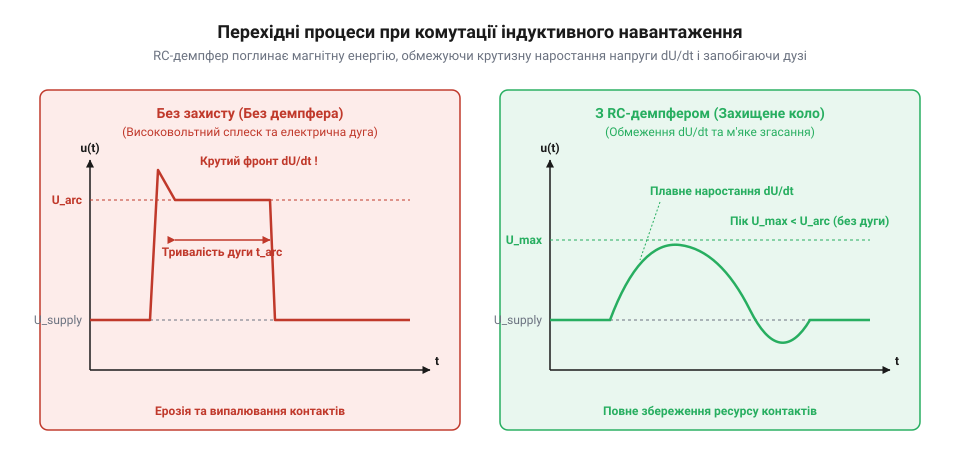

# Розрахунок дугогасіння, перехідних процесів та часових параметрів брязкоту контактів тумблерів

<preknowlist>
- [Тактильні кнопки з ковпачками](root:cat-hw-controls/tactile-buttons) — розуміння фізичної природи механічного брязкоту контактів під час комутації
- [Кнопка аварійного стопу грибок та органи безпечного відключення (IEC 60947-5-5)](root:cat-hw-controls/estop-mushroom-button) — концепції індуктивного навантаження та комутаційної зносостійкості контактних груп
</preknowlist>

## Проблема електричної дуги й брязкоту

Миттєве розмикання та замикання механічних контактів ручного @@en|toggle switch@@ (від англ. *toggle* — тумблер, важільна заскочка) супроводжується двома руйнівними явищами: високовольтним дуговим розрядом та механічним брязкотом. При вимкненні постійного струму в колах з індуктивним навантаженням струм прагне зберегти своє значення, що викликає сплеск перенапруги та іонізацію повітряного проміжку. Це призводить до утворення електричної дуги, яка випалює метал контактів і може викликати їх зварювання, як і в [органах аварійного відключення](root:cat-hw-controls/estop-mushroom-button). Додатково на початковій стадії замикання @@en|parasitic capacitance@@ (від лат. *parasitus* — паразитичний і *capacitas* — ємність) монтажних дротів та друкованих провідників `C_p`, заряджені до повної напруги живлення `U_0`, миттєво розряджаються через переходний опір контактної плями `R_c`. Оскільки опір мікроскопічного металевого контакту становить частки ома (порядку `0.01–0.1 Ом`), амплітуда пікового розрядного струму `I_peak ≈ U_0 / R_c` навіть при низьковольтному живленні `24 В` сягає сотень ампер протягом короткого інтервалу `t_discharge ≈ R_c · C_p`. Попри мізерну накопичену енергію `E_p = 0.5 · C_p · U_0²`, вона виділяється у наноскопічному об'ємі контактного виступу: величезна густина потужності `P = I_peak² · R_c` викликає миттєвий розігрів металу вище точки плавлення ще до закінчення первинного дотику. Це створює короткочасний пік струму високої амплітуди, який локально виплавляє поверхню, утворює рідкі містки й викликає ерозію або мікрозварювання контактів ще до завершення механічного відскоку. Водночас під час замкнення підпружинені контакти багаторазово соваються й відскокують один від одного, утворюючи серію фантомних імпульсів. Для надійної роботи цифрової та силової електроніки обидва перехідні процеси вимагають суворого математичного розрахунку.

## Енергія дуги та індуктивний процес

Коли через індуктивність навантаження `L` протікає постійний струм `I`, у магнітному полі накопичується енергія. При раптовому розмиканні контактів ця енергія вивільняється у вигляді сплеску напруги перехідного процесу.

Магнітна енергія індуктивності та напруга самоіндукції визначаються виразами:

```
E_L = 0.5 · L · I²           [накопичена магнітна енергія]
u_L = L · (di / dt)          [напруга самоіндукції на контактах]
```

Якщо напруга самоіндукції `u_L` перевищує пробійну напругу повітряного проміжку (близько `12`–`20 В`), а струм перевищує поріг утримання (близько `0.4 А`), між контактами спалахує електрична дуга. На основі спрощеної вольт-амперної характеристики дугового розряду зі спадом напруги на дузі `U_arc`, тривалість горіння дуги `t_arc` обчислюється з балансу магнітного потоку індуктивності:

    t_arc = L · I / (U_arc - U_supply)    [тривалість дугового розряду]

де `U_supply` — напруга джерела живлення, а `U_arc` — еквівалентна напруга плазмового шнура (типово `30`–`60 В`). При значеннях `L = 0.4 Гн`, `I = 2 А`, `U_supply = 24 В` та `U_arc = 40 В` тривалість розряду становить `t_arc = (0.4 · 2) / (40 - 24) = 0.05 с` (`50 мс`), упродовж яких розплавлений метал контактних поверхонь зазнає інтенсивної ерозії.

**Розрахунок енергії розряду для соленоїда:**
У колі з індуктивністю `L = 0.4 Гн` та струмом `I = 2 А` обчислимо енергію, яка розсіюється на контактах тумблера без захисту:

```
E_L = 0.5 · 0.4 · 2²
= 0.5 · 0.4 · 4              [піднесення струму до квадрата]
= 0.8 Дж                     [енергія дугового розряду]
```

Виділення енергії `0.8 Дж` у мікроскопічній точці контакту викликає локальне розплавлення і перенесення металу, знижуючи комутаційний ресурс пристрою.

Щоб точніше описати динаміку спадання струму дуги `i(t)` з урахуванням нелінійності плазмового проміжку, застосуємо другий закон Кірхгофа для контуру з джерелом живлення `U_supply`, індуктивністю `L`, опором навантаження `R` та нелінійним спадом напруги на дузі `u_arc(i)`. Висловимо похідну струму по часу `di / dt` через баланс напруг у контурі:

    L · (di / dt) + R · i(t) + u_arc(i) = U_supply
    di / dt = (U_supply - R · i(t) - u_arc(i)) / L     [рівняння динаміки струму дуги]

У нелінійній характеристиці @@en|arc voltage@@ (від англ. *arc* — дуга) спад напруги описується емпіричною моделлю Ейртон `u_arc(i) = U_a + (C_a / i(t))`, де `U_a` — порогова напруга катодного й анодного падінь, а `C_a` — коефіцієнт іонізаційного опору дугового стовпа. Підставивши цю залежність у диференціальне рівняння, дістаємо вираз для швидкості згасання розряду:

    di / dt = (U_supply - R · i(t) - U_a - C_a / i(t)) / L     [нелінійне рівняння загасання струму]

З отриманого рівняння видно, що при малих струмах доданок `C_a / i(t)` стрімко зростає, викликаючи лавиноподібне збільшення від'ємного значення `di / dt` та миттєвий @@en|chopping current@@ (від англ. *chop* — зрізати) — раптове гасіння дуги ще до повного вичерпання магнітної енергії.

## Розрахунок RC-демпферів та варисторів

Для придушення дугового розряду паралельно контактам або навантаженню підключають дугогасильний @@en|snubber@@ (від англ. *snub* — глушити) ланцюжок, що складається з послідовно з'єднаних резистора `R_s` та конденсатора `C_s`.


*RC-демпфер обмежує крутизну наростання напруги dU/dt і розсіює індуктивну енергію без утворення дуги.*

Конденсатор приймає на себе струм індуктивності в момент розмикання, обмежуючи швидкість наростання напруги `dU/dt`, а резистор обмежує розрядний струм конденсатора при наступному вмиканні тумблера. У колах змінного струму @@en|alternating current@@ (від англ. *alternating current* — змінний струм) на мережевій частоті `f = 50 Гц` підключений паралельно контактам демпфер залишається постійно під напругою у розімкненому стані тумблера. Конденсатор `C_s` створює реактивний опір @@en|capacitive reactance@@ (від лат. *reactivus* — протидіючий і *capacitas* — ємність) `X_C = 1 / (2 · π · f · C_s)`, через який протікає безперервний витік струму `I_leak` в обхід розімкнених контактів:

    X_C = 1 / (2 · π · f · C_s)                   [реактивний опір конденсатора]
    I_leak ≈ U_rms / X_C                          [амплітуда витоку струму]
    P_ac = I_leak² · R_s                          [постійна потужність розсіювання на резисторі]

При напрузі `U_rms = 230 В`, частоті `f = 50 Гц` та ємності `C_s = 100 нФ` реактивний опір становить `X_C ≈ 31.8 кОм`, що викликає витік струму `I_leak ≈ 7.2 мА` і створює на резисторі `R_s = 100 Ом` постійне теплове виділення `P_ac ≈ 5.2 мВт`. Якщо обрати ємність `C_s` занадто великою, витік струму `I_leak` може викликати фантомне світіння світлодіодних ламп чи утримання слабострумових реле у вимкненому стані, тому розрахунок демпфера під AC вимагає компромісу між гасінням дуги та допустимим витоком.

Параметри RC-демпфера розраховують за співвідношеннями:

Окрім вибору опору та ємності, обов'язковим є розрахунок електричної потужності розсіювання демпферного резистора `P_Rs`, яка залежить від частоти комутації `f_sw`. За один цикл вмикання та вимикання тумблера енергія, накопичена у конденсаторі `C_s`, повністю розсіюється на резисторі `R_s` у вигляді тепла:

    P_Rs = C_s · U_supply² · f_sw    [потужність розсіювання демпферного резистора]

При напрузі живлення `U_supply = 24 В`, ємності `C_s = 100 нФ` та частоті комутації `f_sw = 500 Гц` потужність становить `P_Rs = 100·10⁻⁹ · 24² · 500 = 0.0288 Вт` (`28.8 мВт`). Для забезпечення надійності номінальну потужність резистора обирають із дворазовим запасом (типово `0.125 Вт` або `0.25 Вт`), щоб уникнути його термічного перегріву при частих перемиканнях.

```
C_s = (L · I²) / U_max²       [мінімальна ємність конденсатора]
R_s = U_max / I               [опір демпферного резистора]
```

Альтернативним варіантом захисту є напівпровідниковий @@en|varistor@@ (від англ. *variable resistor* — змінний опір), який різко знижує свій опір при перевищенні порогової напруги, шунтуючи перенапругу та поглинаючи енергію розряду.

## Динаміка брязкоту та апаратний ФНЧ

При механічному замиканні тумблера контакти зазнають пружного удару, що описується математичною моделлю затухаючих коливань. Тривалість @@en|bounce@@ (від англ. *bounce* — відскок, брязкіт) коливань `t_bounce` становить від `1` до `10 мс`. Під час цього інтервалу логічний рівень хаотично змінюється між нулем і одиницею.

Для апаратного придушення завад застосовують RC-фільтр низьких частот (ФНЧ). Проте згладжування брязкоту перетворює крутий цифровий перепад на повільний експоненціальний фронт напруги. Якщо подати такий сигнал на звичайний цифровий вхід GPIO або аналоговий вхід ADC без гістерезису, вхідний каскад тривалий час перебуватиме в лінійній пороговій зоні перемикання, де найменший високочастотний шум викликає серію хаотичних хибних спрацьовувань. На відміну від нього, активний вхід з @@en|Schmitt trigger@@ (від англ. *Schmitt trigger*, на честь винахідника Отто Шмітта — компаратор із гістерезисом) має два розділених пороги спрацьовування: верхній V_T+ та нижній V_T-. Гістерезис гарантує, що незначні флуктуації напруги на повільному експоненціальному фронті не здатні змінити стан виходу назад до перетину протилежного порогу, що повністю усуває повторне тригерування. Затримка такого RC-фільтра визначається сталою часу:

```
τ = R · C                    [стала часу RC-ланцюжка]
t_delay = 3 · τ              [час досягнення 95% рівня напруги]
```

Для гарантованого подавлення [механічного брязкоту контактів](root:cat-hw-controls/tactile-buttons) тривалість затримки `t_delay` повинна перевищувати `t_bounce`.

**Розрахунок номіналів ФНЧ для брязкоту t_bounce = 5 мс:**

```
τ = t_bounce / 3
= 5 · 10⁻³ / 3               [визначення необхідної сталої часу]
≈ 1.67 мс                    [стала часу τ]

C = τ / R
= 1.67 · 10⁻³ / 10000        [визначення ємності при R = 10 кОм]
= 167 · 10⁻⁹ Ф
= 167 нФ                     [найближчий стандартний номінал 150-220 нФ]
```

Правильно розрахований RC-фільтр перетворює переривчасту серію імпульсів брязкоту на гладкий експоненціальний фронт напруги, безпечний для обробки мікроконтролером.
