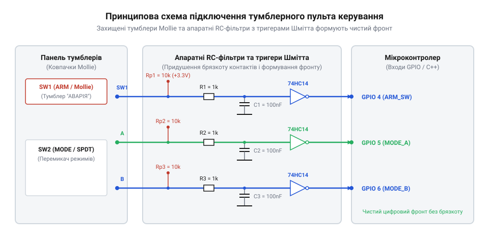

# Проєктування пульта керування з тумблерами, захисними ковпачками Mollie та апаратно-програмним обробленням введення

<preknowlist>
- [Тактильні кнопки з ковпачками](root:cat-hw-controls/tactile-buttons) — принципи механічного замикання контактів та походження брязкоту
- [Кнопка аварійного стопу грибок та органи безпечного відключення (IEC 60947-5-5)](root:cat-hw-controls/estop-mushroom-button) — концепції захисного екранування, фізичного блокування та безпечної комутації
</preknowlist>

## Завдання проєкту та вибір компонентів

У системах відповідального призначення — авіації, військовій техніці, важкому промисловому обладнанні — випадкове спрацьовування органу керування може спричинити катастрофічні наслідки. Для запобігання ненавмисному зачіпанню важелів рукавом чи інструментом застосовують два типи апаратного захисту: захисні відкидні ковпачки Mollie (англ. @@en|Mollie guard@@) та тумблери з важільно-заскочковим блокуванням (англ. @@en|pull-to-unlock toggle@@). Головна конструктивна відмінність ковпачків Mollie від звичайних захисних кришок полягає у наявності внутрішнього підпружиненого механізму примусового повернення важеля. Звичайна кришка працює як пасивний бар'єр, який просто накриває тумблер у його поточному стані й може закритися, залишивши коло увімкненим. Натомість кришка Mollie при опусканні діє як механічний штовхач: її внутрішній скошений шарнір під дією пружини фізично тисне на важіль, примусово скидаючи його з активного положення у вихідний безпечний стан (OFF) і блокуючи під ковпачком. На відміну від простих екранів, якими оснащують [тактильні кнопки з ковпачками](root:cat-hw-controls/tactile-buttons), такий кінематичний зв'язок гарантує, що закриття захисного ковпачка завжди супроводжується знеструмленням критичного кола.

Для побудови лабораторного пульта вибирають 3-позиційний тумблер SPDT/DPDT, захисний кришковий ковпачок Mollie з пружинним поверненням та мікроконтролер із цифровими входами. Ковпачок при закриванні фізично примушує важіль тумблера повернутися у безпечне вихідне положення (OFF) і блокує його до моменту навмисного підйому кришки оператором.

З огляду на електричну схему, 2-позиційний перемикач @@en|SPST@@ (від англ. @@en|single-pole single-throw@@, де @@en|pole@@ — полюс, @@en|throw@@ — напрямок) або @@en|SPDT@@ (англ. @@en|single-pole double-throw@@) потребує лише одного цифрового входу @@en|GPIO@@ мікроконтролера із зовнішнім або внутрішнім підтягувальним резистором (@@en|pull-up@@ до лінії живлення VCC). При розмиканні контакту пін отримує високий логічний рівень, а при замиканні на спільну шину @@en|GND@@ — низький. Натомість 3-позиційній схемі типу ON-OFF-ON чи двополюсному тумблерові @@en|DPDT@@ (англ. @@en|double-pole double-throw@@) одного входу недостатньо, оскільки нейтральне центральне положення OFF фізично розмикає обидві лінії й залишається невідрізненним від вимкненого тумблера SPST. Для повноцінного зчитування 3-позиційного органу задіяють два окремі піни GPIO з підтягувальними резисторами. У нейтральному стані OFF на обох входах підтримується високий рівень. Перемикання у крайній режим ON1 замикає першу лінію на GND, викликаючи низький рівень на першому піні при високому на другому, а режим ON2 замикає другу лінію, міняючи їхні сигнали місцями. Якщо ж апаратний обробник фіксує низький рівень на обох лініях одночасно, це вважається нештатним станом або замиканням дротів і відсікається на рівні логіки драйвера.

## Механічний монтаж та забійні шайби

Під час перемикання важких або пружинних тумблерів оператор прикладає значне обертальне зусилля. Якщо тумблер затиснути в звичайному круглому отворі панелі лише однією гайкою, з часом від вібрації та крутного моменту корпус неминуче провернеться, пошкодивши внутрішню розводку дротів. Щоб усунути це провертання, у промисловості застосовують стандартизовані монтажні отвори зі шпоночними пазами (зокрема за стандартом @@de|DIN 43805@@), де для типової різьбової втулки `Ø12.2 мм` фрезерують бічний прямокутний паз шириною `2.0 мм` і глибиною `2.5 мм`. У цей паз чітко заходить виступ орієнтувальної забійної шайби, перетворюючи обертальний момент на зсувне зусилля стінки металевої панелі та гарантуючи абсолютну кутову фіксацію корпусу перемикача. Механічний розрахунок вузла з'єднання базується на двох межах: допустимому моменті затягування різьби втулки та зсувній міцності зуба шайби. Для латуневої різьбової втулки M12×0.75 допустимий момент затягування гайки обмежується величиною `M_з = 1.8 N·m`, щоб запобігти зрізанню витків різьби чи деформації корпусу. При цьому піковий крутний момент перемикання важеля оператором `M_пер = 0.8 N·m` створює на зовнішньому зубі шайби (радіус плеча `R = 7.1 мм`) зсувне зусилля `F_зс = M_пер / R = 112.7 N`. Оскільки площа зрізу зуба шайби шириною `b = 2.0 мм` та товщиною `t = 0.8 мм` становить `A = 1.6 мм²`, виникаюче зсувне напруження `τ = F_зс / A = 70.4 MPa` не перевищує допустиму межу міцності сталевої шайби `[τ] = 120 MPa`, що повністю виключає як пластичний зминальний дефект пазу панелі, так і прокручування корпусу тумблера.

Для надійної фіксації корпусів використовують орієнтувальні забійні шайби з зубом (англ. @@en|locking tab washer@@). При монтажі отвір у металевій чи пластиковій панелі пульта свердлять із додатковим бічним пазом під зуб шайби. Внутрішній шпоночний виступ шайби заходить у поздовжній паз різьбової втулки тумблера, а зовнішній зуб фіксується в пазі панелі. Після цього гайку затягують динамометричним ключем, що повністю унеможливлює прокручування корпусу при розкритті ковпачка Mollie.

*Принципова схема підключення тумблерів пульта з захисними ковпачками Mollie та апаратними RC-фільтрами брязкоту до GPIO мікроконтролера.*

## Електричне підключення та апаратні фільтри

Перемикання механічних контактів тумблера супроводжується брязкотом (англ. @@en|contact bounce@@) тривалістю від 2 до 15 мілісекунд. У відповідальних пультах застосовують комбіновану апаратно-програмну фільтрацію, ключовою ланкою якої є тригер Шмітта (@@en|Schmitt trigger@@), наприклад мікросхема 74HC14. Для аналізу стабільності фільтрації розраховують верхній `V_T+` та нижній `V_T-` пороги спрацьовування гістерезису (@@en|hysteresis@@). За напруги живлення `V_CC = 5.0 В` для 74HC14 типовий верхній поріг становить `V_T+ ≈ 0.6 · V_CC = 3.0 В`, а нижній — `V_T- ≈ 0.3 · V_CC = 1.5 В`, що утворює ширину вікна гістерезису `V_H = V_T+ - V_T- = 1.5 В`. При підключенні RC-ланцюжка з постійною часу `τ = R · C` (наприклад, `R = 10 кОм`, `C = 100 нФ`, звідки `τ = 1 мс`) час наростання напруги заряду від нульового рівня до верхнього порогу обчислюють через логарифмічну залежність `t_+ = -τ · ln(1 - V_T+ / V_CC) = -1 мс · ln(0.4) ≈ 0.92 мс`. Відповідно, час розряду конденсатора до нижнього порогу дорівнює `t_- = -τ · ln(V_T- / V_CC) = -1 мс · ln(0.3) ≈ 1.20 мс`. Оскільки амплітуда високочастотного брязкоту під час розряду перебуває всередині мертвої зони гістерезису `V_H`, напруга на вході тригера не перетинає обидва пороги повторно, що повністю виключає логічний деребезг сигналу на виході 74HC14 і гарантує один чистий фронт для GPIO мікроконтролера. Окрім малосигнальних вхідних кіл, тумблери часто комутують силові індуктивні навантаження (котушки реле, соленоїди), де в момент розмикання виникає сплеск проти-ЕРС u_L = L · (di/dt), що запалює руйнівну електричну дугу. Для дугогасіння паралельно контактам встановлюють демпферний RC-снабер, номінали якого розраховують за умовами поглинання енергії індуктивності та обмеження струму замкнення. Ємність демпферного конденсатора обирають з умови C_s = (L · I²) / U_max², що для стандартних промислових реле дає номінал від `100 nF` до `470 nF` з робочою напругою вище пікового значення мережі. Послідовний резистор снабера обмежує кидок струму розряджання конденсатора через контакти при наступному увімкненні та розраховується як R_s = U_max / I_max, де типове значення становить від `47 Ω` до `120 Ω` (потужністю 1–2 Вт), що запобігає мікрозварюванню контактних накладок і продовжує ресурс тумблера.

Апаратна частина будується на основі низькочастотного RC-ланцюжка та тригера Шмітта. Конденсатор згладжує високочастотні сплески напруги, а тригер Шмітта із гістерезисом забезпечує круті та чіткі цифрові фронти сигналу без повторних хибних спрацьовувань для входу GPIO мікроконтролера.

## Програмне оброблення станів на C і C++

Програмне забезпечення реалізує додатковий шар програмної фільтрації за таймером та конечний автомат станів (@@en|FSM@@). Драйвер контролює як стан лінії самого тумблера, так і концевий мікроперемикач захисного ковпачка @@en|Mollie Guard@@. Якщо логіка фіксує зміну сигналу тумблера при закритому ковпачку, система реєструє спробу несанкціонованого доступу та блокує виконання критичних команд. Для підтвердження часових характеристик у системах реального часу на базі @@en|FreeRTOS@@ застосовують методику вимірювання затримок обробки переривань (@@en|ISR@@, від англ. @@en|interrupt service routine@@). Апаратний обробник `gpio_isr_handler()` під час спрацьовування фронту на лінії @@en|GPIO@@ зчитує мікросекундну позначку часу t_ISR функцією `esp_timer_get_time()` і зберігає її в структурі `toggle_switch_event_t`. Після відправки події в чергу функцією `xQueueSendFromISR()` задача `toggle_switch_task` при розблокуванні викликом `xQueueReceive()` вимірює момент обробки t_task та обчислює сумарну затримку передачі події та перемикання контексту Δt = t_task - t_ISR. Отримане значення в діапазоні 5–15 мкс підтверджує обробку в реальному часі, а його перевищення дозволяє вчасно виявити пріоритетні інверсії чи затримки диспетчеризації операційної системи.

Нижче наведено робочу реалізацію драйверів для середовищ ESP-IDF (C) та Arduino / C++:

:::tabs
:::code proj-panel-toggle-control-box/c/toggle_switch_types.h
:::code proj-panel-toggle-control-box/c/toggle_switch.h
:::code proj-panel-toggle-control-box/c/toggle_switch.c
:::code proj-panel-toggle-control-box/c/main.c
:::code proj-panel-toggle-control-box/cpp/GuardedToggleTypes.h
:::code proj-panel-toggle-control-box/cpp/GuardedToggleSwitch.h
:::code proj-panel-toggle-control-box/cpp/GuardedToggleSwitch.cpp
:::code proj-panel-toggle-control-box/cpp/main.cpp
:::
