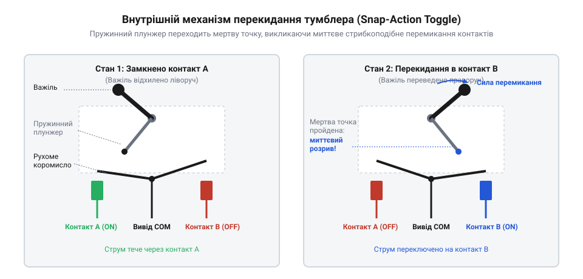
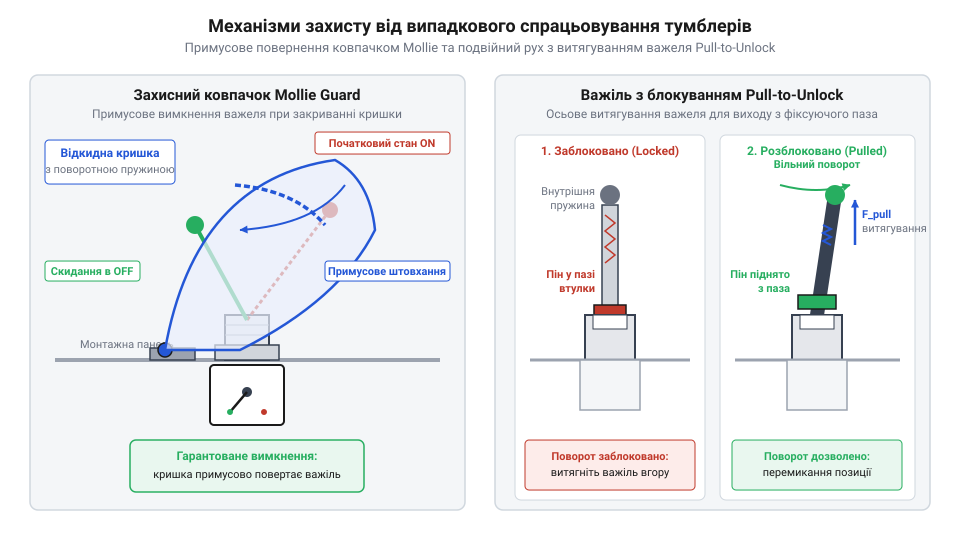
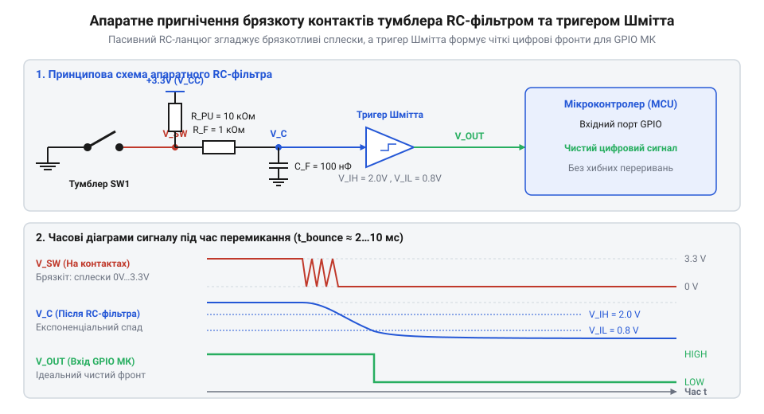

# Тумблери, захисні ковпачки Mollie та блокування важелів (Switch Guards)

<preknowlist>
- [Тактильні кнопки з ковпачками](root:cat-hw-controls/tactile-buttons) — Базові принципи механічного замикання й розмикання пружинних контактів та явище брязкоту в механічних перемикачах.
- [Кнопка аварійного стопу грибок та органи безпечного відключення (IEC 60947-5-5)](root:cat-hw-controls/estop-mushroom-button) — Концепція захисного аварійного знеструмлення та відмінність між примусовим розмиканням кола й фіксацією стану важеля тумблера.
</preknowlist>

## Чому випадковий дотик стає катастрофою

У промисловій автоматиці, авіації, військовій техніці та силових панелях керування випадкове перемикання органу введення має значно важчі наслідки, ніж у побутових приладах. Якщо на пульті керування оператор ненавмисно зачепить рукавом, інструментом чи кабелем незахищений орган комутації, це може спричинити негайне аварійне знеструмлення серводвигунів, скидання налаштувань польотного контролера чи помилковий запуск технологічного процесу.

Звичайні пружинні органи введення — такі як [Тактильні кнопки з ковпачками](root:cat-hw-controls/tactile-buttons) чи [Матрична клавіатура 4×4 мембранна](root:cat-hw-controls/keypad-4x4-membrane) — розраховані на постійну присутність пальця та миттєво повертаються у вихідний стан після відпускання. Вони не здатні фізично утримувати обраний силовий або сигнальний режим без постійної роботи електронних тригерів і прошивки. Крім того, легке зусилля натискання робить їх вкрай вразливими до випадкових поштовхів і вібрацій.

Різницю між цими підходами чітко видно на часовій діаграмі формування сигналу `V(t)` у часі: коли оператор натискає тактильну кнопку у момент `t₁` і відпускає у момент `t₂`, високий логічний рівень утримується лише протягом короткого інтервалу активної дії `[t₁, t₂]`, після чого напруга миттєво спадає до нуля. Натомість тумблер під час перемикання у момент `t₁` скачкоподібно змінює стан і фізично замикає лінію на потенціал `V_CC`, неперервно утримуючи постійний рівень `V(t) = V_CC` на невизначений термін аж до примусового ручного повернення важеля у момент `t₃`. Це забезпечує апаратне збереження обраного стану системи взагалі без витрат електроенергії на утримання та без залучення ресурсів мікроконтролера.

Натомість спеціалізовані органи безпечного вимкнення, як-от [Кнопка аварійного стопу грибок](root:cat-hw-controls/estop-mushroom-button), розроблені для швидкого екстреного удару долонею для негайного знеструмлення об'єкта. Проте для вибіркового та надійного керування окремими вузлами потрібен орган, який поєднує три властивості: чітку механічну фіксацію стану, виразний тактильний відгук та фізичний захист від помилкових перемикань.

Цю задачу вирішують тумблери (від нім. @@en|Taumler@@ — перекидач, той, хто хитається; англ. @@en|toggle switch@@) у поєднанні зі спеціальними механічними блокувальниками (англ. @@en|switch guard@@). Вони вимагають від оператора свідомого, двох-етапного зусилля для зміни стану кола і не дозволяють важільному перемикачу самовільно змінити позицію під дією вібрації чи випадкового зачіпання. Крім того, ергономічні вимоги до тумблерів передбачають чітко розраховане зусилля перемикання (англ. @@en|actuation force@@) важеля — зазвичай у діапазоні від `10` до `25` Н, що суттєво перевищує поріг спрацьовування звичайних кнопок (`1`–`3` Н). Таке нормоване значення зусилля разом із подовженим важелем створює відчутний момент сили для долання підпружиненого механізму миттєвої дії (англ. @@en|snap action@@). Це дозволяє оператору впевнено відчувати тактильний відгук та чітку фіксацію стану навіть під час роботи в товстих захисних чи авіаційних рукавицях, коли чутливість і дрібна моторика пальців значно приглушені шаром щільного матеріалу, унеможливлюючи як випадкові легкі торкання, так і помилки ідентифікації поточного положення контактів. Історичний шлях розвитку цих захисних інтерфейсів у військовій та цивільній авіації описує вставка [Еволюція тумблерів та захисних засобів](root:cat-hw-controls/toggle-switches-and-switch-guards/hist-toggle-switches-and-guards.md).

## Анатомія тумблера та механіка перекидання

Усередині тумблера розміщено електромеханічний вузол швидкого перекидання контактів (англ. @@en|snap-action mechanism@@). На відміну від найпростішого ножового рубильника, швидкість розмикання чи замикання контактів у тумблері абсолютно не залежить від того, наскільки повільно або швидко оператор пересуває зовнішній важіль.

Конструктивно тумблер складається з металевого або пластикового важеля, внутрішнього циліндричного штовхача зі стиснутою пружиною, рухомого контактного коромисла (містка) та фіксованих контактних клем. Коли оператор відхиляє важіль у межах повного кутового діапазону перехилу від `20°` до `30°`, штовхач ковзає по поверхні коромисла й поступово стискає внутрішню пружину із зусиллям від `5 Н` до `15 Н`. У момент перетину критичної точки рівноваги (англ. @@en|dead center@@ — мертва точка) накопичена енергія пружини миттєво вивільняється й з високою швидкістю перекидає рухомий контакт до протилежного фіксованого майданчика, забезпечуючи стабільне контактне натискання від `1.5 Н` до `3.0 Н`. Геометрично кут мертвої точки становить рівно половину повного ходу важеля: `θ_dead = 0.5 · θ_total`. Наприклад, для тумблера з повним кутом перехилу `θ_total = 24°` мертва точка досягається при `θ_dead = 12°`. Поки кут відхилення менший за мертву точку (`θ < 12°`), тангенціальна складова сили пружини створює повертальний момент, прагнучи притиснути коромисло назад у початковий стан. Щойно кут перехилення перевищує мертву точку на додатне значення `Δθ = θ - θ_dead > 0` (навіть на `0.1°`), напрямок вектора сили пружини зміщується відносно осі обертання коромисла, що викликає лавиноподібне прискорення й миттєве перекидання.

*Внутрішній підпружинений механізм тумблера (snap-action): при відхиленні важеля внутрішня пружина стискається і після проходження мертвої точки миттєво перекидає рухомий контакт, забезпечуючи швидке розмикання незалежно від швидкості руху руки.*

Миттєве перекидання має критичне значення для запобігання виникненню електричної дуги при розмиканні кіл під навантаженням. Якби контакти розходилися повільно, між ними виникав би стійкий іскровий розряд, що призвів би до обгоряння й зварювання матеріалу контактів. Фізичні та часові параметри дугогасіння й механічного брязкоту розраховує вставка [Розрахунок дугогасіння та брязкоту контактів](root:cat-hw-controls/toggle-switches-and-switch-guards/math-toggle-arc-and-bounce-dynamics.md).

За принципом утримання станів тумблери поділяють на два основні типи:

1. **Фіксовані (бістабільні):** важіль надійно затискається пружиною у крайніх положеннях (позначаються як `ON-OFF` або `ON-ON`) і залишається там до наступного впливу оператора.
2. **Моментальні (моностабільні):** важіль повертається у вихідне нейтральне положення одразу після того, як оператор знімає зусилля пальця. Стан моментального спрацьовування в позначеннях завжди беруть у дужки, наприклад `(ON)-OFF-(ON)`.

За конфігурацією внутрішніх контактних груп тумблери виготовляють у кількох стандартних виконаннях — від однополюсних `SPST` (англ. @@en|Single Pole Single Throw@@) та `SPDT` (англ. @@en|Single Pole Double Throw@@) до двополюсних `DPST` (англ. @@en|Double Pole Single Throw@@) та `DPDT` (англ. @@en|Double Pole Double Throw@@). Вибір між ними визначається вимогами до електробезпеки та схемотехніки живлення: якщо найпростіший `SPST`-перемикач розмикає лише один провідник, то для силових кіл принциповим є застосування `DPST`. При однополюсній комутації мережі зі змінним струмом або двополярного живлення існує ризик виникнення плаваючої нейтралі (англ. @@en|floating neutral@@) чи переполюсовки, коли розрив лише фазного або позитивного провідника залишає пристрій під небезпечним потенціалом відносно землі через нерозірвану нейтральну або спільну шину. Натомість тумблер конфігурації `DPST` одночасно розмикає обидва силові провідники (і фазу, і нуль або `+` та `-` джерела), забезпечуючи повну гальванічну ізоляцію (англ. @@en|galvanic isolation@@) обладнання від мережі живлення, що повністю усуває паразитичні струми витоку, виключає ураження оператора електричним струмом та захищає чутливу електронну схему при аварійному зсуві потенціалу нейтралі.

- `SPST` (англ. @@en|Single Pole Single Throw@@ — один полюс, один напрямок): найпростіший вимикач із двома клемами для розриву одного провідника.
- `SPDT` (англ. @@en|Single Pole Double Throw@@ — один полюс, два напрямки): перемикач із трьома клемами, який переключає один спільний вхід між двома виходами.
- `DPST` (англ. @@en|Double Pole Single Throw@@ — два полюси, один напрямок): двополюсний вимикач, що одночасно розмикає дві незалежні лінії (наприклад, фазу й нуль або плюс і мінус живлення).
- `DPDT` (англ. @@en|Double Pole Double Throw@@ — два полюси, два напрямки): два незалежні SPDT-перемикачі, що керуються одним спільним важелем.

Крім двопозиційних моделей, поширені трипозиційні тумблери `ON-OFF-ON`, у яких середнє положення важеля повністю розмикає всі контактні групи. Детальні схеми комутації та навантажувальні характеристики струму містить вставка [Апаратний інтерфейс тумблерів](root:cat-hw-controls/toggle-switches-and-switch-guards/api-toggle-switch-hardware.md). Для панелей, де замість важеля потрібні клавіші з підсвічуванням, застосовують [Клавішні перемикачі](root:cat-hw-controls/rocker-switches-and-power-toggle-panels), а для вибору з трьох і більше режимів використовують [Багатопозиційні галетні перемикачі](root:cat-hw-controls/rotary-selector-switches).

## Механічний захист ковпачками та витяжними важелями

Хоча механізм перекидання усуває неповне розмикання контактів, він не захищає важіль тумблера від випадкових механічних поштовхів ззовні. У відповідальних інтерфейсах для запобігання помилковому спрацьовуванню застосовують два типи апаратного захисту: відкидні захисні ковпачки (англ. @@en|switch guard@@ або ковпачки Mollie) та тумблери з важелями витяжного блокування (англ. @@en|pull-to-unlock@@).

*Механізми захисту тумблерів: відкидний ковпачок Mollie (ліворуч) при закриванні примусово повертає важіль у безпечний стан, а важіль типу pull-to-unlock (праворуч) вимагає витягування вздовж осі для зняття з фіксатора.*

Відкидний ковпачок Mollie являє собою підпружинену захисну кришку (зазвичай яскраво-червоного або жовтого кольору), яка встановлюється поверх різьбової втулки тумблера під підтискну гайку. Залежно від конфігурації тумблера застосовують двопозиційні або трипозиційні ковпачки із фіксуючими зрізами (англ. @@en|locking cutouts@@) та бічними пазами. У двопозиційних ковпачках внутрішній похилий профіль розрахований на перемикачі `OFF-ON`: закривання кришки тисне на важіль і примусово скидає його в нейтральний стан. У трипозиційних ковпачках для тумблерів `ON-OFF-ON` виконують симетричні фіксуючі зрізи, які під час опускання кришки примусово центрують і блокують важіль у середньому положенні `OFF`, або утримують його в обраній робочій позиції завдяки точно підгнаним зрізам у стінках ковпачка. Алгоритм роботи з ковпачком вимагає двох послідовних дій:

1. **Відкривання:** оператор має пальцем відкинути spring-loaded кришку вгору на кут більше 90 градусів.
2. **Перемикання:** після цього відкривається вільний доступ до важеля тумблера, і оператор може перевести його у робочий стан `ON`.

Головна безпекова властивість ковпачка Mollie полягає у його внутрішній геометрії: при закриванні кришки її внутрішня похила стінка фізично тисне на важіль тумблера й примусово повертає його у вихідне безпечне положення `OFF`. Це унеможливлює ситуацію, коли захисний ковпачок закрили, а тумблер під ним залишився увімкненим.

Для умов із високим рівнем вібрацій (військова авіація, спецтехніка, судна), де відкидний ковпачок може заважати щільному панельному монтажу, застосовують тумблери з важелями pull-to-unlock. Усередині різьбової втулки такого тумблера виконано профільні пази-фіксатори, а в самому важелі встановлено висувний штифт із потужною внутрішньою пружиною.

Щоб змінити стан тумблера pull-to-unlock, оператор повинен виконати наступні кроки:

1. Вхопити важіль і потягнути його зовні вздовж поздовжньої осі, стискаючи внутрішню пружину й виводячи штифт із зачеплення з пазом втулки.
2. Не послаблюючи тягового зусилля, повернути важіль у необхідне нове положення.
3. Відпустити важіль, після чого внутрішня пружина втисне штифт у новий паз фіксатора, жорстко заблокувавши важіль від будь-яких кутових зсувів.

Вибір між відкидними ковпачками Mollie та важелями pull-to-unlock залежить від умов експлуатації та вимог до швидкості доступу. Ковпачки Mollie ідеально підходять для ліній аварійного розмикання чи активації, де закривання кришки має автоматично скидати небезпечний режим, тоді як важелі pull-to-unlock застосовують там, де потрібно надійно зафіксувати тумблер у будь-якому з обраних робочих станів. Конкретний приклад розпайки та монтажу захищеного командного пульта розглядає вставка [Проєктування пульта керування з тумблерами](root:cat-hw-controls/toggle-switches-and-switch-guards/proj-panel-toggle-control-box.md).

## Електрична інтеграція та придушення завад

Підключення тумблерних перемикачів до цифрових входів мікроконтролера вимагає створення чітко визначених логічних рівнів. Оскільки у розімкненому стані контакт перемикача залишає коло розірваним, вхідний вивід опиняється у плаваючому стані (англ. *floating*), зчитуючи хаотичні наведення довкілля. Для фіксації потенціалу застосовують підтягувальні резистори: @@en|pull-up resistor@@ (від англ. *pull-up* — підтяжка вгору) підключає вхід до шини живлення `V_CC`, а @@en|pull-down resistor@@ (від англ. *pull-down* — підтяжка до землі) — до спільного проводу `GND`. З міркувань енергоефективності та завадозахищеності номінал підтяжки зазвичай обирають у діапазоні від `4.7 кОм` до `10 кОм`. У батарейних пристроях вибір номіналу підтяжки визначає тривалість автономної роботи. При напрузі живлення `V_CC = 3.3 В` і замкненому контакті тумблера через підтягувальний резистор протікає постійний струм витоку `I = V_CC / R`. Порівняльний розрахунок споживання для номіналів `10 кОм` та `100 кОм` показує суттєву різницю:

    I_10k = 3.3 / 10000 = 0.33 мА = 330 мкА    [струм при резисторі 10 кОм]
    I_100k = 3.3 / 100000 = 0.033 мА = 33 мкА  [струм при резисторі 100 кОм]

Збільшення номіналу до `100 кОм` зменшує статичне споживання струму в 10 разів (з `330 мкА` до `33 мкА`), що критично для збереження заряду акумулятора, хоча й дещо знижує завадостійкість лінії проти зовнішніх імпульсних наведень. Детальні варіанти [апаратного інтерфейсу та схемотехніки](root:cat-hw-controls/toggle-switches-and-switch-guards/api-toggle-switch-hardware.md) показують електричні параметри узгодження сигналів.

*Апаратне згладжування механічного брязкоту контактів тумблера за допомогою пасивного RC-ланцюжка та тригера Шмітта.*

Під час механічного переключення контакти зазнають серії пружних відскоків, викликаючи @@en|bounce@@ (від англ. *bounce* — відскок, брязкіт) тривалістю від `1 мс` до `10 мс`. Для усунення хаотичних хибних преривань у цифрових колах застосовують апаратне або програмне фільтрування. Апаратний захист складається з пасивного ФНЧ зі сталою часу `τ = R · C` та компаратора з гістерезисом — @@en|Schmitt trigger@@ (від англ. *Schmitt trigger*, на честь винахідника Отто Шмітта — компаратор із гістерезисом), який зрізає повільний експоненціальний фронт заряду конденсатора у чистий прямокутний цифровий перепад. Для вибору ємності `C_F` розраховують час розряду конденсатора через резистор `R_F` від живлення `V_CC` до нижнього порогу спрацювання тригера `V_IL` (типово `V_IL = 0.8 В`, `V_IH = 2.0 В` при `V_CC = 3.3 В`). Щоб брязкіт тривалістю `t_bounce` не викликав хибного перемикання, ємність добирають за умовою `V_C(t_bounce) ≥ V_IL`:

    V_C(t) = V_CC · exp(-t / (R_F · C_F))
    t_bounce / (R_F · C_F) = ln(V_CC / V_IL)                     [умова досягнення порогу V_IL]
    C_F = t_bounce / (R_F · ln(V_CC / V_IL))                     [розрахункова ємність]

Так, при `R_F = 1 кОм`, `V_CC = 3.3 В`, `V_IL = 0.8 В` і тривалості брязкоту `t_bounce = 5 мс` мінімальна ємність складає `C_F ≈ 0.005 / (1000 · ln(3.3 / 0.8)) ≈ 3.5 мкФ` (на практиці беруть стандартний номінал `4.7 мкФ` або збільшують `R_F` до `10 кОм` для зменшення ємності до `100 нФ`). Математичне виведення сталої часу фільтра висвітлює [розрахунок дугогасіння та брязкоту](root:cat-hw-controls/toggle-switches-and-switch-guards/math-toggle-arc-and-bounce-dynamics.md) у комутаційних колах.

Коли апаратний RC-фільтр відсутній, придушення брязкоту виконують програмно у прошивці мікроконтролера за допомогою таймерного опитування без затримки виконання.

:::tabs
:::code toggle-switches-and-switch-guards-d/c/esp-idf/init-switch.c

:::code toggle-switches-and-switch-guards-d/cpp/arduino/debouncedtoggle.cpp
:::

Практичні приклади реалізації та проєктування панелей деталізує [проєктування пульта керування](root:cat-hw-controls/toggle-switches-and-switch-guards/proj-panel-toggle-control-box.md) з використанням тумблерів і захисних засобів.

## Комутація DC-навантажень та монтажні пастки

Для захисту контактів застосовують комутаційне дугогасіння: паралельно індуктивному DC-навантаженню підключають захисний діод — @@en|flyback diode@@ (від англ. *flyback diode* — зворотний діод), який шунтує струм самоіндукції, а для змінного струму ставлять RC-демпфер або варистор. Вибір покриття контактів залежить від робочого струму: @@en|silver contacts@@ (від англ. *silver contacts* — срібні контакти) призначені для потужних кіл живлення, оскільки срібло стійке до дугового зносу, проте покривається тугоплавкою плівкою сульфіду срібла й вимагає струму комутації від `100 мА` для самоочищення. Механізм самоочищення полягає у тому, що при замиканні крім мінімального струму потрібна ще й мінімальна електрична напруга пробою оксидного шару (зазвичай від `12 В` до `24 В DC`): висока напруженість поля на мікроскопічних виступах руйнує діелектричну плівку сульфіду (явище @@en|fritting@@), утворюючи провідний металевий місток. Натомість при сухих мікрострумових сигналах (`3.3 В` або `5 В`) цієї напруги недостатньо для пробою, тому застосовують @@en|gold-plated contacts@@ (від англ. *gold-plated contacts* — золочені контакти), де інертне золоте покриття взагалі запобігає окисненню.

Для захисту контактів застосовують комутаційне дугогасіння: паралельно індуктивному DC-навантаженню підключають захисний діод — @@en|flyback diode@@ (від англ. *flyback diode* — зворотний діод), який шунтує струм самоіндукції, а для змінного струму ставлять RC-демпфер або варистор. Вибір покриття контактів залежить від робочого струму: @@en|silver contacts@@ (від англ. *silver contacts* — срібні контакти) призначені для потужних кіл живлення, оскільки срібло стійке до дугового зносу, проте окислюється й вимагає струму комутації від `100 мА` для самоочищення. Натомість @@en|gold-plated contacts@@ (від англ. *gold-plated contacts* — золочені контакти) застосовують у мікрострумових цифрових колах (до `100 мА`, `5 В`), де золоте покриття запобігає утворенню оксидної плівки й забезпечує надійний контакт.

Під час панельного монтажу тумблерів поширеною пасткою є прокручування корпусу перемикача в круглому отворі при затягуванні монтажної гайки, що розриває вивідні дроти. Для запобігання прокручуванню у панелі вирізають шпонковий паз, у який заходить @@en|keyway washer@@ (від англ. *keyway washer* — шпонкова шайба з зубом). Для монтажу на силових панелях також застосовують [клавішні перемикачі](root:cat-hw-controls/rocker-switches-and-power-toggle-panels), а для набору комбінацій сигналів у колах конфігурації — [багатопозиційні галетні перемикачі](root:cat-hw-controls/rotary-selector-switches) або [компактні DIP-перемикачі](root:cat-hw-controls/dip-switches-and-configuration-blocks) на друкованих платах.
