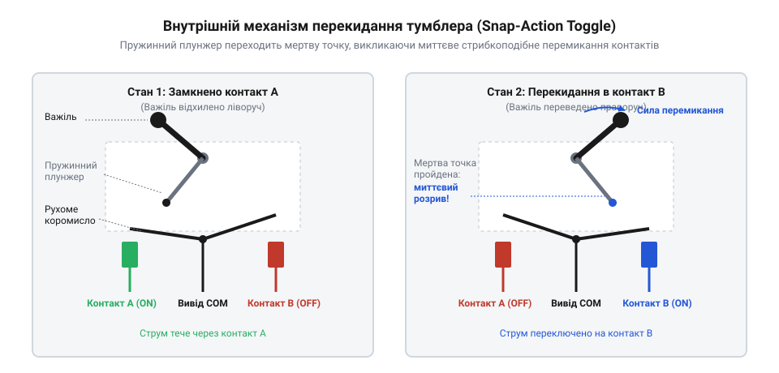
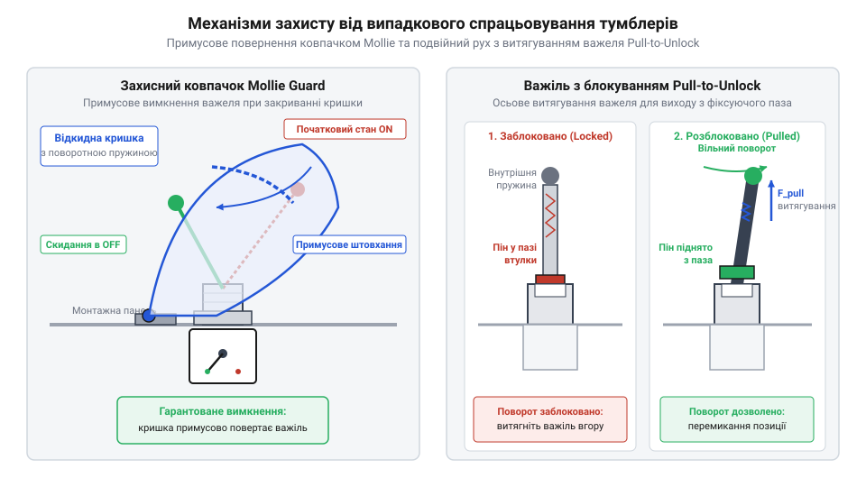
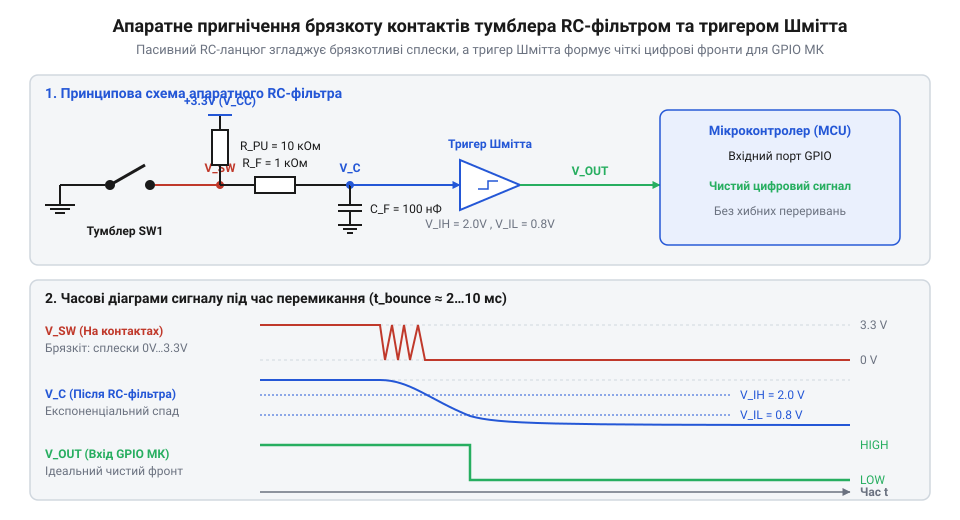

# Тумблери, захисні ковпачки Mollie та блокування важелів (Switch Guards)

<preknowlist>
- [Тактильні кнопки з ковпачками](root:cat-hw-controls/tactile-buttons) — Принципи механічного замикання й розмикання пружинних контактів та явище брязкоту.
- [Кнопка аварійного стопу грибок та органи безпечного відключення (IEC 60947-5-5)](root:cat-hw-controls/estop-mushroom-button) — Концепція захисного аварійного знеструмлення та відмінність між примусовим розмиканням кола й фіксацією стану важеля тумблера.
</preknowlist>

## Захист від випадкових спрацьовувань

У відповідальних панелях керування — авіації, спецтехніці чи силових промислових установках — випадковий дотик до органу введення загрожує несанкціонованим вимкненням живлення або аварійним запуском приводів. На відміну від ситуативних органів введення, як-от [Тактильні кнопки з ковпачками](root:cat-hw-controls/tactile-buttons), що вимагають постійного утримування пальцем і миттєво повертаються у початковий стан, важільний перемикач забезпечує апаратну фіксацію обраного режиму.

Цю задачу вирішують тумблери (від англ. @@en|tumbler@@ — перекидач; англ. @@en|toggle switch@@) у поєднанні з механічними блокувальниками (англ. @@en|switch guard@@). Внутрішнє підпружинення утримує важіль у заданому положенні без жодних витрат електроенергії чи залучення ресурсів прошивки. Нормоване зусилля спрацьовування (англ. @@en|actuation force@@) у межах від `10` до `25` Н вимагає від оператора свідомого руху, унеможливлюючи самовільну зміну стану від вібрації чи випадкового зачіпання рукавом. Для екстреного знеструмлення пульти також оснащують [Кнопка аварійного стопу грибок](root:cat-hw-controls/estop-mushroom-button), проте тумблер залишається основним органом вибіркової фіксації режимів.

## Механіка перекидання та конфігурації контактів

Усередині корпуса тумблера розміщено електромеханічний вузол миттєвого перекидання (англ. @@en|snap-action mechanism@@). Швидкість розмикання контактного містка в ньому не залежить від швидкості руху руки оператора: при відхиленні важеля внутрішній штовхач стискає пружину до досягнення точки рівноваги — мертва точка (англ. @@en|dead center@@). Щойно важіль долає цю точку, накопичена пружиною енергія миттєво перекидає рухомий контакт до фіксованого майданчика, запобігаючи утворенню руйнівної електричної дуги.

*Внутрішній підпружинений механізм тумблера (snap-action): при відхиленні важеля внутрішня пружина стискається і після проходження мертвої точки миттєво перекидає рухомий контакт, забезпечуючи швидке розмикання незалежно від швидкості руху руки.*

За будовою контактних груп перемикачі поділяють на однополюсні `SPST` (англ. @@en|Single Pole Single Throw@@) та `SPDT` (англ. @@en|Single Pole Double Throw@@), а також двополюсні `DPST` (англ. @@en|Double Pole Single Throw@@) та `DPDT` (англ. @@en|Double Pole Double Throw@@). Якщо `SPST` розмикає один провідник, то `DPST` одночасно розриває і фазу, і нуль (або `+` та `-` живлення), надаючи повну гальванічну ізоляцію (англ. @@en|galvanic isolation@@) від мережі. Трипозиційні моделі `ON-OFF-ON` у середній позиції повністю знеструмлюють обидва вихідні кола.

## Апаратний захист та електричне підключення

Для захисту від випадкового вмикання застосовують відкидні ковпачки Mollie (англ. @@en|Molly guard@@) або важелі витяжного блокування (англ. @@en|pull-to-unlock@@). Кришка Mollie при закриванні фізично тисне на важіль і примусово скидає його в безпечний стан `OFF`. Важіль pull-to-unlock вимагає попереднього витягування вздовж осі для зняття з фіксатора пазу втулки.

*Механізми захисту тумблерів: відкидний ковпачок Mollie (ліворуч) при закриванні примусово повертає важіль у безпечний стан, а важіль типу pull-to-unlock (праворуч) вимагає витягування вздовж осі для зняття з фіксатора.*

При підключенні тумблера до цифрового входу мікроконтролера застосовують підтягувальний резистор (англ. @@en|pull-up resistor@@) номіналом `4.7`–`10` кОм, який запобігає плаваючому стану розімкненої лінії. Для придушення механічного брязкоту (англ. @@en|bounce@@) тривалістю `1`–`10` мс використовують пасивний RC-ланцюжок та компаратор з гістерезисом — тригер Шмітта (англ. @@en|Schmitt trigger@@), який формує круті прямокутні фронти сигналу.

*Апаратне згладжування механічного брязкоту контактів тумблера за допомогою пасивного RC-ланцюжка та тригера Шмітта.*
