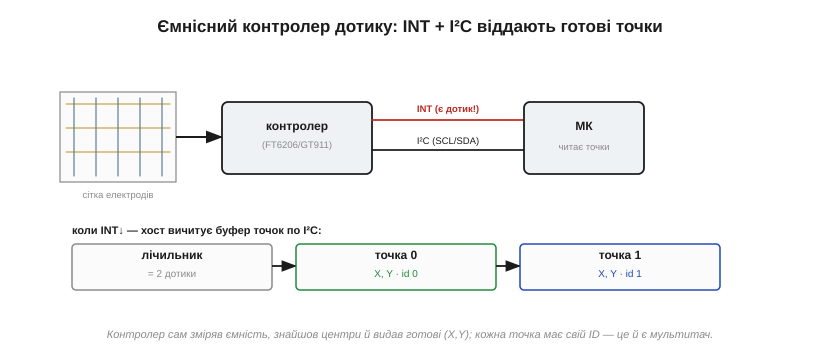

# Сенсорний контролер

<preknowlist>
- [TTP223 — сенсорний давач дотику](root:cat-hw-controls/ttp223-touch) — принцип фіксації зміни ємності від наближення пальця та відмінності між поодинокою кнопкою й матричною сенсорною панеллю.
</preknowlist>

## Чому дотиком керує окремий чип

Сучасні сенсорні екрани не мають механічних кнопок — замикання контакту замінює наближення пальця до прозорої сітки електродів з оксиду індію-олова (англ. @@en|indium tin oxide@@, ITO). На відміну від окремих давачів на кшталт [TTP223 — сенсорний давач дотику](root:cat-hw-controls/ttp223-touch), матричний ємнісний контролер дотику (англ. @@en|capacitive touch controller@@; приклади — FT6206 чи GT911) працює зі значно скромнішими величинами. Фонова ємність вузла сітки становить десятки пікофарад, тоді як наближення пальця змінює її лише на 1…10 фемтофарад (1 фФ = 10⁻¹⁵ Ф) — це тисячні частки відсотка.

Виявити таку мізерну зміну на тлі електромагнітних завад від матриці дисплея та джерела живлення вимагає високочастотного збудження, синхронного накопичення заряду та точного аналогово-цифрового перетворення. Головний мікроконтролер пристрою не має відповідних аналогових вузлів і витрачав би всі обчислювальні ресурси лише на опитування сітки. Тому всю первинну фізику вимірювання винесено у спеціалізований чип, посаджений безпосередньо на шлейф панелі.

## Як фемтофаради перетворюються на координати

Контролери вимірюють зміну ємності за двома основними схемами. У схемі власної ємності (англ. @@en|self-capacitance@@) чип міряє ємність кожного електрода відносно землі: палець відводить заряд, і загальна ємність зростає. Цей метод простий, але плутає проєкції при одночасному торканні кількох точок. У схемі взаємної ємності (англ. @@en|mutual-capacitance@@) поле створюється між горизонтальними передавачами та вертикальними приймачами, а палець перехоплює силові лінії, зменшуючи ємність у точці перетину. Саме взаємна ємність дає повноцінний мультитач (англ. @@en|multitouch@@), адже дозволяє опитувати кожен вузол перетину окремо та присвоювати кожному дотикові власний ідентифікатор.

Отримавши масив змін ємності, чип обчислює точки дотику як центр ваги (англ. @@en|centroid@@) сигналу. Оскільки палець накриває кілька сусідніх ліній сітки, математичне усереднення відгуків дозволяє визначити координати X та Y значно точніше за фізичний крок електродів. До хост-контролера надходять вже готові цілочисельні координати пікселів, а не сирі аналогові значення.

## Підключення та вибір адреси на старті

Для зв'язку з мікроконтролером ємнісний чип використовує шину @@en|I²C@@ (лінії SCL і SDA) та два додаткові виводи — переривання (англ. @@en|interrupt@@, INT) та скидання (англ. @@en|reset@@, RST). Живлення панелі зазвичай становить 3.3 В і має відповідати логічним рівням плати керування.

Особливістю багатьох контролерів (зокрема серії GT911) є вибір апаратної адреси @@en|I²C@@ у момент скидання. Пристрій зчитує логічні рівні на лініях INT та RST під час підняття сигналу скидання і фіксує відповідну адресу в пам'яті. Якщо прошивка мікроконтролера не витримує часових затримок або залишає вивід INT у плаваючому стані під час процедури скидання, чип зафіксує випадкову адресу і перестане відповідати на запити по шині.

## Зчитування точок по перериванню та пастки

*Схема опитування контролера: лінія INT повідомляє про наявність нових даних, після чого хост зчитує координати з регістрів по шині I²C.*

Щоб не витрачати ресурси процесора на постійне опитування, чип працює за подіями. Коли палець торкається скла, контролер виставляє низький рівень на лінії INT, сповіщаючи мікроконтролер про наявність даних. Зчитавши байт кількості дотиків та буфер координат по шині @@en|I²C@@, хост мусить скинути прапорець готовності в регістрі чипа, інакше той припинить надсилати нові сповіщення.

Під час розбору координат важливо пам'ятати про маскування прапорців. У багатьох протоколах (як-от FT6206) два старші біти старшого байта координати X містять код події (натискання або відпускання). Якщо їх не відсікти бітовою маскою `0x0F`, при відпусканні пальця координата раптово стрибне на край екрана. Також перед виведенням на графічний дисплей отримані координати (X, Y) часто потребують програмного дзеркалювання чи повороту осей для повного збігу з орієнтацією зображення.
