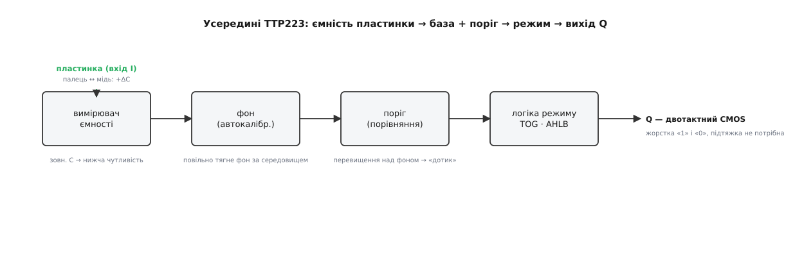
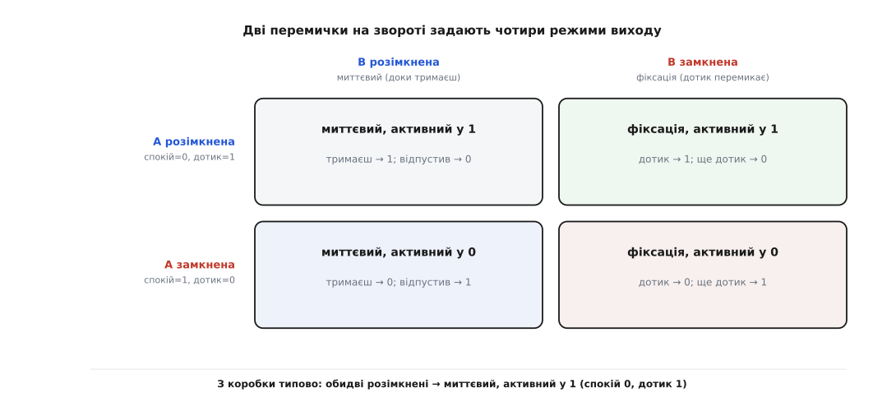
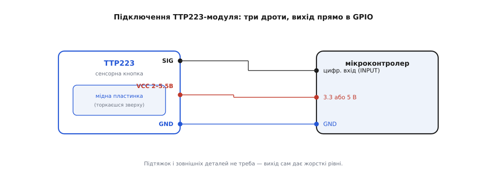

# TTP223 — сенсорний давач дотику

## Не тиск, а ємність пальця

Механічні кнопки мають контакти, які з часом окислюються, вигоряють і брязкають при натисканні, а сам корпус потребує отворів, крізь які всередину пристрою потрапляє пил та волога. Цю проблему розв'язує **сенсорний давач дотику** (англ. *@@en|touch sensor@@*). Він реагує не на силу натискання, а на електричну @@en|capacitance@@ (ємність).

Мідний квадратик під лаком виступає однією обкладкою конденсатора. Коли до нього наближається палець, провідна маса людського тіла додає власну ємність і змінює загальне електричне поле. Оскільки поле пронизує діелектрики, давач працює крізь непровідну панель зі скла, пластику чи дерева, дозволяючи робити повністю герметичні та гладкі інтерфейси.

## Внутрішній тракт та двотактний вихід

Зміна ємності від наближення пальця становить лише одиниці пікофарад. Усередині мікросхеми TTP223 сидить вимірювач ємності, поріг порівняння та вузол автокалібрування (англ. *@@en|auto-calibration@@*). Вузол фону постійно відстежує повільні зміни температури, вологості чи пилу та підлаштовує поріг спрацювання, запобігаючи хибним «залипанням» чи втраті чутливості.

Отриманий факт дотику формує вихідний сигнал на виводі Q. На відміну від давачів з відкритим колектором, TTP223 має вихід @@en|push-pull CMOS@@ (двотактний вихід), який сам активно тягне лінію як до одиниці, так і до нуля. Завдяки цьому сигнальний дріт підключеного мікроконтролера не потребує жодних зовнішніх підтягувальних резисторів.

*Вимірювач ємності оцінює заряд пластинки, а вузол фону підлаштовує поріг під довкілля. Двотактний вихід Q сам формує чіткі рівні без зовнішніх резисторів.*

## Чотири режими роботи перемичками модуля

Мікросхема TTP223 підтримує чотири комбінації роботи, які задаються фізично за допомогою двох перемичок A і B на звороті модуля.

Перемичка B (TOG) визначає характер натискання: у розімкненому стані працює @@en|momentary@@ (миттєвий режим), де вихід активний лише поки палець поруч з пластинкою, а в замкненому — режим @@en|toggle@@ (фіксація), у якому кожен дотик перемикає стан на протилежний. Перемичка A (AHLB) задає полярність: розімкнена дає активний високий рівень, а замкнена — активний низький. Режим фіксації дозволяє використовувати модуль як автономний вимикач навантаження навіть без мікроконтролера.

*Дві перемички дають чотири комбінації: розімкнена B задає миттєвий режим, замкнена — фіксацію; розімкнена A задає активну одиницю, замкнена — активний нуль.*

## Підключення до плати та код

Модуль TTP223 підключається до плати трьома дротами: лінії живлення @@en|VCC@@ (2.0–5.5 В) та землі @@en|GND@@, а також сигнальний вивід @@en|SIG@@. Напруга на виході @@en|SIG@@ завжди дорівнює напрузі живлення, тому давач живлять від тих самих вольтів, які використовує логіка мікроконтролера.

Оскільки вихід двотактний, у коді цифровий вхід @@en|GPIO@@ налаштовують у звичайний режим входу без внутрішніх підтяжок. У миттєвому режимі стан читають через один `digitalRead`. Якщо ж у коді потрібно рахувати окремі дотики, фіксують фронт переходу сигналу з нуля в одиницю, запам'ятовуючи попередній стан піна в циклі. Для складніших завдань керування мультисенсорними панелями застосовують виділений [сенсорний контролер](root:cat-hw-controls/touch-controller).

*Сигнальний дріт SIG заходить безпосередньо в цифровий вхід без підтяжок, а VCC та GND підключають до відповідних шин живлення плати.*

## Пастки автокалібрування та наведень

Використання TTP223 має кілька практичних особливостей, пов'язаних із фізикою ємнісного зондування. Автокалібрування сприймає будь-який тривалий стан як новий фон: якщо тримати палець на пластинці понад 100 секунд, давач скине вихід у спокійний стан. Крім того, під час увімкнення протягом 0.5 секунди проходить початкова стабілізація, тому торкатися пластинки в цей момент заборонено.

Якщо сенсорна пластинка реагує на завади чи близькі дроти, чутливість знижують припаюванням малого керамічного конденсатора (одиниці пікофарад) на спеціальне контактне місце. Для стабільної роботи схема повинна мати надійну спільну землю з усім пристроєм.
