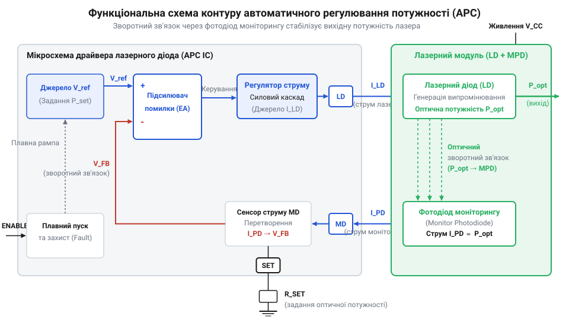
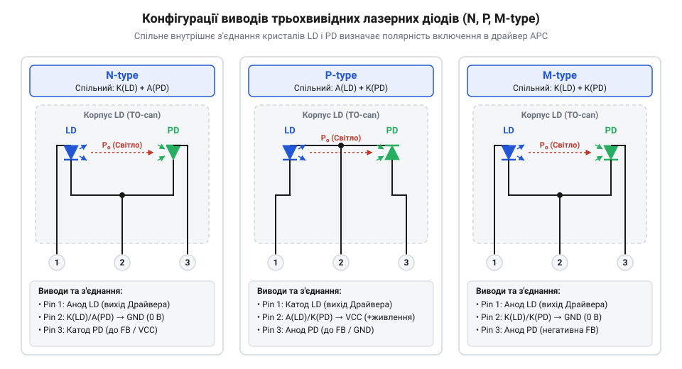

# Схемотехнічний та залізний інтерфейс мікросхем драйверів лазерних діодів APC

## Термічна нестабільність та потреба оптичного APC

Подача стабілізованого струму на @@en|лазерний діод@@ (від англійського @@en|LASER@@ — акронім від Light Amplification by Stimulated Emission of Radiation, та грецького @@grc|dis@@ — двічі й @@grc|hodos@@ — шлях) не гарантує постійної оптичної потужності випромінювання. Причин дві: швидкий самонагрів напівпровідникового кристала під час роботи та поступова деградація матеріалу з часом. Зі зростанням температури @@en|PN-переходу@@ зростає @@en|пороговий струм@@ (від англійського @@en|threshold current@@), необхідний для початку лазерної генерації, а @@en|диференціальна квантова ефективність@@ падає. Якщо @@en|струм накачки@@ (від англійського @@en|drive current@@) залишається нерухомим, вихідний оптичний потік стрімко зменшується аж до повного згасання генерації. Спроба ж вручну збільшити струм для компенсації нагріву створює ризик катастрофічного оптичного пошкодження дзеркал резонатора в момент охолодження пристрою.

Пряме керування струмом не спроможне врахувати ці динамічні зміни, оскільки воно вимірює електричні параметри кола, а не реальну випромінювану оптичну енергію. Щоб отримати достовірний сигнал про стан лазера, у спільний корпус із лазерним кристалом установлюють @@en|фотодіод моніторингу@@ (від грецького @@grc|phōs@@ — світло, @@grc|dis@@ — двічі й @@grc|hodos@@ — шлях), який уловлює частку оптичного потоку з тильного дзеркала резонатора. Оскільки згенерований фотодіодом @@en|фотострум@@ строго пропорційний оптичній потужності випромінювання, з'являється можливість побудувати замкнену систему керування.

Така структура називається @@en|автоматичним регулюванням потужності@@ (@@en|APC@@, від англійського @@en|Automatic Power Control@@). Система порівнює реальний фотострум із заданим опорним рівнем і в режимі реального часу коригує струм накачки лазерного діода. Якщо температура зростає, @@en|APC@@ збільшує струм накачки точно на величину, необхідну для утримання оптичної потужності на постійному рівні. Для практичної реалізації цього принципу потрібен спеціалізований схемотехнічний інтерфейс, здатний працювати з малими фотострумами та швидко реагувати на коливання температури. Для забезпечення довговічності випромінювача необхідний також грамотний [розрахунок систем охолодження](root:hw-components/laser-diode-thermal-management-heatsink) кристала, який розглядається в окремій темі.

Спеціалізована мікросхема драйвера @@en|APC@@ має одночасно виконувати два протилежні за масштабом завдання: вимірювати малий @@en|фотострум@@ @@en|зворотного зв'язку@@ рівнем у десятки мікроампер та керувати силовим @@en|струмом накачки@@ лазера до сотень міліампер. Прямий зв'язок між випромінюваною оптичною потужністю `P_OPT` та згенерованим фотострумом `I_MON` задає @@en|коефіцієнт чутливості@@ (від англійського @@en|responsivity@@, від латинського @@la|responsum@@ — відповідь) @@en|фотодіода моніторингу@@ `S_PD`, який показує величину фотоструму на кожен міліват випромінювання. Значення цього коефіцієнта визначає @@en|динамічні межі регулювання@@ (від англійського @@en|dynamic regulation limits@@) замкненого контуру. Нижню межу регулювання обмежують власний @@en|темновий струм@@ (від англійського @@en|dark current@@) фотодіода та шуми вимірювального підсилювача, нижче яких корисний сигнал втрачається в завадах. Верхню межу визначає електричне насичення вхідного каскаду драйвера або вихід фотодіода з лінійного режиму при великій потужності. Це висуває жорсткі вимоги до апаратного інтерфейсу мікросхеми. Він повинен надійно ізолювати високочутливий вхід вимірювання від сильних електричних завад силового вихідного каскаду. Крім того, інтерфейс має містити високостабільний елемент порівняння для відстеження відхилень оптичної потужності та узгоджувати свою внутрішню структуру з різними схемотехнічними конфігураціями виводів @@en|лазерного діода@@.

## Призначення виводів та контур зворотного зв'язку

Схемотехнічна інтеграція мікросхеми драйвера @@en|APC@@ базується на розподілі виводів на силову частину накачки та чутливий вимірювальний інтерфейс. Спеціалізований драйвер містить каскад підключення лазерного діода через виводи @@en|LDA@@ (від англійського @@en|Laser Diode Anode@@) та @@en|LDC@@ (від англійського @@en|Laser Diode Cathode@@), а також вхід зчитування фотоструму моніторингу через виводи @@en|MDA@@ (від англійського @@en|Monitor Diode Anode@@) та @@en|MDC@@ (від англійського @@en|Monitor Diode Cathode@@). Живлення схеми та силового ключа забезпечується через шину @@en|VCC@@ та спільний провідник @@en|GND@@.


*Структура внутрішнього підсилювача помилки та силового транзисторного ключа для безперервного вирівнювання оптичної потужності.*

Серцем контуру регулювання є внутрішній @@en|підсилювач помилки@@ (від англійського @@en|error amplifier@@). На один із його входів подається напруга, сформована протіканням фотоструму моніторингу через зовнішній опорний елемент, а на інший — внутрішня високостабільна опорна напруга. Якщо оптична потужність лазера знижується, фотострум через вивід @@en|MDA@@ або @@en|MDC@@ падає, створюючи різницю потенціалів на входах підсилювача помилки. Підсилений сигнал неузгодження керує внутрішнім регульованим струмовим джерелом або силовим транзистором, підвищуючи струм накачки через вивід @@en|LDA@@ або @@en|LDC@@ до відновлення рівноваги.

Для стабільної роботи петлі зворотного зв'язку критично важливо фізично розділити силові траси струму накачки та чутливі вимірювальні провідники фотодіода на друкованій платі. Протікання високого струму накачки через загальні паразитичні опори земляного провідника @@en|GND@@ викликає наведення падіння напруги на вимірювальний вхід, що спричиняє самозбудження та високочастотні коливання оптичної потужності.

## Узгодження схем з'єднання фотодіода й лазера

Виробники випускають трьохвивідні напівпровідникові корпуси (типу @@en|TO-CAN@@), у яких кристал лазерного діода та кристал фотодіода моніторингу вже з'єднані між собою всередині спільною точкою. Залежно від полярності внутрішніх @@en|PN-переходів@@ та того, який саме електрод виведено на спільну ніжку, розрізняють три основні конфігурації: @@en|N-type@@, @@en|P-type@@ та @@en|M-type@@.


*Конфігурації спільних анодів та катодів лазерного діода й фотодіода моніторингу для вибору полярності підключення.*

У конфігурації @@en|N-type@@ катод лазерного діода з'єднаний з анодом фотодіода моніторингу і виведений на спільний контакт. У конфігурації @@en|P-type@@ анод лазера з'єднаний з катодом фотодіода. У конфігурації @@en|M-type@@ спільним є контакт, що об'єднує катод лазера та катод фотодіода або анод лазера та анод фотодіода. Кожна з цих схем вимагає відповідного способу підключення до виводів мікросхеми @@en|LDA@@/@@en|LDC@@ та @@en|MDA@@/@@en|MDC@@.

Помилка у виборі схемотехнічного підключення змінює знак зворотного зв'язку з від'ємного на позитивний. Якщо полярність фотодіода переплутана, зростання оптичної потужності призводить не до зменшення струму накачки, а до його подальшого збільшення підсилювачем помилки. Силовий ключ миттєво насичується, подаючи максимальний струм на лазерний діод, що викликає його оптичну руйнацію за частки мікросекунди. Тому конфігурація драйвера мусить чітко відповідати призначеній схемі корпусу лазера.

## Сигнали керування та параметри плавного пуску

Окрім аналогового контуру регулювання потужності, схемотехнічний інтерфейс мікросхеми драйвера @@en|APC@@ включає дискретні входи керування та захисту. Вхід дозволу роботи @@en|Enable@@ служить для глобального увімкнення та вимкнення пристрою, а вхід модуляції @@en|Modulation@@ дозволяє здійснювати високочастотне або імпульсне перемикання лазерного променя. Для сповіщення зовнішнього мікроконтролера про аварійні ситуації призначений вихідний дискретний сигнал прапора помилки @@en|Fault@@.

Електричні рівні входів @@en|Enable@@ та @@en|Modulation@@ відповідають стандартам @@en|TTL@@ або @@en|CMOS@@, що забезпечує пряме узгодження з цифровими виходами систем керування. Під час подачі активного сигналу на вхід @@en|Enable@@ внутрішній контур не повинен подавати весь струм накачки стрибкоподібно. Різкий стрибок струму викликає короткочасне перерегулювання в оптичному контурі, при якому оптична потужність перевищує критичну межу катастрофічного руйнування дзеркал резонатора.

Для виключення таких сплесків у драйверах застосовують коло плавного пуску (від англійського @@en|Soft-Start@@). Процес обмежується швидкістю наростання опорної напруги підсилювача помилки в міру заряджання зовнішнього конденсатора плавного пуску. Час плавного пуску обирається таким чином, щоб контур @@en|APC@@ встигав відслідковувати випромінювання й плавно виводити лазер на робочий режим без утворення оптичних викидів. Сигнал @@en|Fault@@ активується при обриві фотодіода моніторингу або перевантаженні за струмом, блокуючи виходи драйвера. [Програмне опрацювання переривань](root:sf-devices/microcontroller-laser-driver-software-interface) та керування режимами подано у відповідному матеріалі.

## Розрахунок зовнішньої обв'язки та фільтрів живлення

Завершальним етапом проектиування залізного інтерфейсу є розрахунок номіналів дискретних компонентів обв'язки мікросхеми драйвера @@en|APC@@. Робоча оптична потужність лазера визначається струмом фотодіода моніторингу `I_MP`, який при цій потужності протікає через зовнішній задавальний резистор `R_SET`. Напруга на цьому резисторі порівнюється з внутрішньою опорною напругою мікросхеми `V_REF`.

Для обчислення необхідного опору задавального резистора `R_SET` використовується співвідношення, де внутрішня опорна напруга `V_REF` ділиться на необхідний струм моніторингу `I_MP`:

```
R_SET = V_REF ÷ I_MP
```

Отримане значення `R_SET` задає робочу точку контуру: чим більший опір резистора, тим менший фотострум `I_MP` потрібен для збалансування підсилювача помилки, що відповідає меншій оптичній потужності лазера.

Для забезпечення стійкості петлі зворотного зв'язку паралельно підсилювачу помилки або в коло плавного пуску підключається конденсатор корекції `C_SS`. Його ємність визначає час плавного пуску `t_SS` за наявності внутрішнього струму заряду `I_SS`:

```
t_SS = V_REF × C_SS ÷ I_SS
```

Особливі вимоги висуваються до чистоти шини живлення `VCC`. Високочастотні пульсації живлення та завади від комутації цифрових кіл безпосередньо модулюють струм накачки через паразитивні ємності силового ключа. Для придушення завад у шину живлення драйвера обов'язково інтегрують @@en|LC-фільтр@@ або @@en|RC-фільтр@@, який вибирається з урахуванням граничної частоти зрізу, нижчої за частоту пульсацій джерела живлення.
