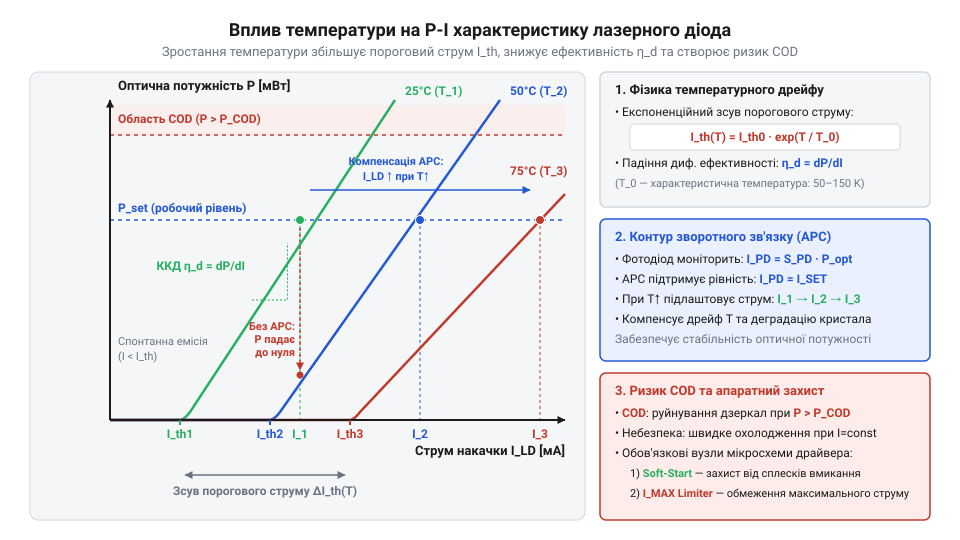
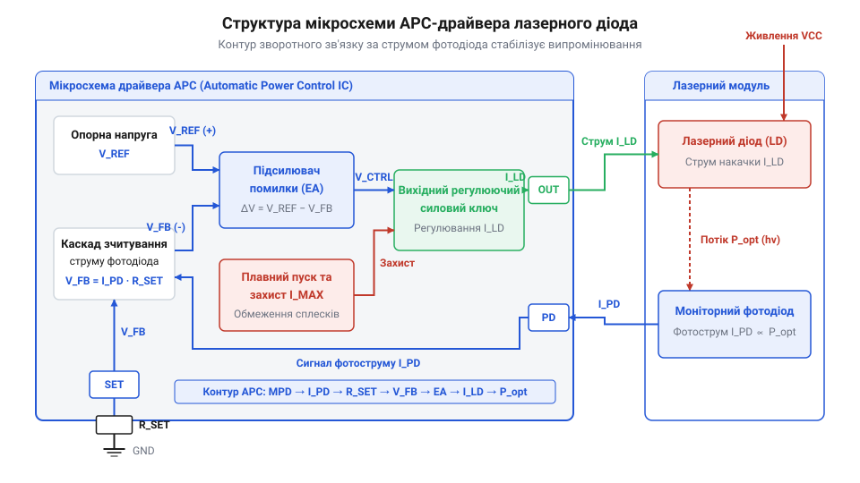
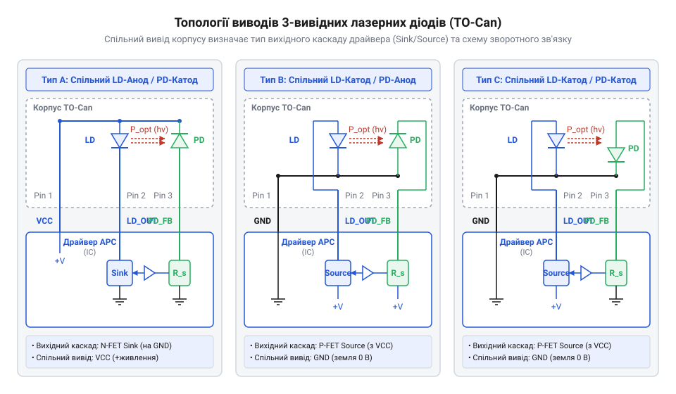
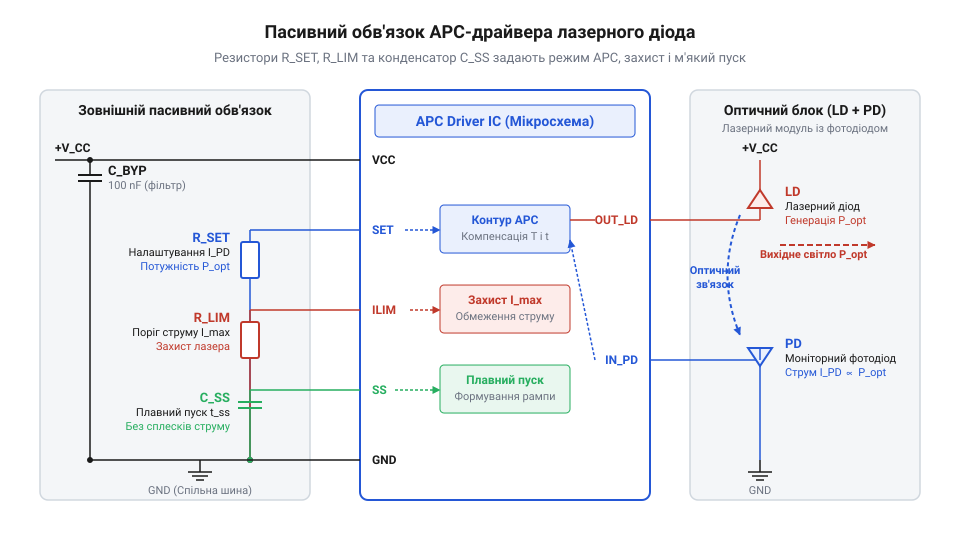
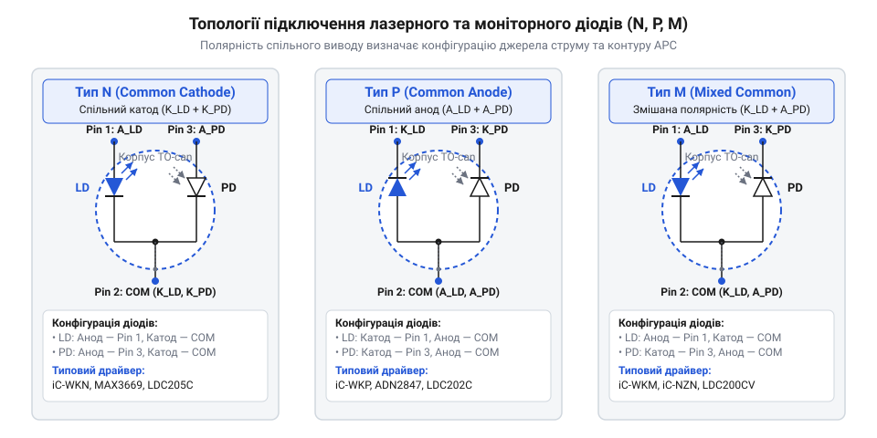
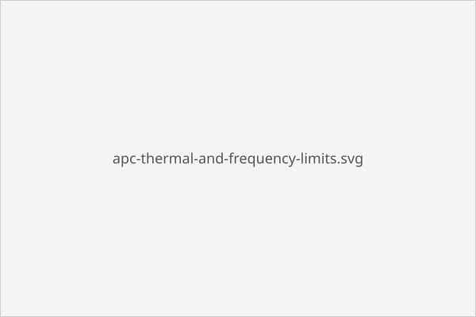

# Спеціалізовані мікросхеми драйверів лазерних діодів

## Небезпека прямого живлення лазерного діода

Підключення напівпровідникового @@en|лазерного діода@@ (від англ. @@en|laser@@ — абревіатура @@en|Light Amplification by Stimulated Emission of Radiation@@, підсилення світла за допомогою вимушеного випромінювання) безпосередньо до стандартного джерела напруги майже миттєво призводить до фізичного руйнування p-n переходу. На відміну від звичайних світлодіодів, @@en|ват-амперна характеристика@@ (@@en|ВАХ@@) лазера має чітко виражену нелінійність із пороговим характером. Досягнення значення, яке називається @@en|пороговий струм@@ (від англ. @@en|threshold current@@, @@en|threshold@@ — поріг), переводить кристал із режиму спонтанного люмінесцентного випромінювання у режим стимульованої генерації когерентного світла. У робочій області вище порогового струму диференційний опір кристала падає до часток ома, через що навіть мікроскопічна пульсація напруги живильної мережі амплітудою в кілька мілівольт викликає колосальний стрибок струму провідності.

Однак навіть застосування високостабілізованого джерела струму не вирішує проблему вразливості кристала через високу температурну чутливість напівпровідника. Під час роботи p-n перехід нагрівається внаслідок власного розсіювання потужності, а зміна температури активної області безпосередньо зсуває пороговий струм за експоненційним законом. У разі підвищення температури кристала пороговий струм зростає, що при фіксованому струмі живлення призводить до різкого падіння оптичної потужності аж до повного згасання генерації. Якщо ж температура довкілля знижується, пороговий струм зменшується, і той самий фіксований струм живлення викликає стрімкий стрибок оптичного потоку.


*Залежність оптичної потужності від струму живлення при різній температурі кристала; підвищення температури зміщує пороговий струм праворуч і зменшує оптичний вихід.*

Критична небезпека перевищення оптичної потужності полягає у явищі, яке має назву @@en|катастрофічне оптичне пошкодження@@ (від англ. @@en|Catastrophic Optical Damage@@, @@en|COD@@, @@en|damage@@ — пошкодження). При досягненні граничної густини випромінювання на дзеркальних гранях напівпровідникового резонатора відбувається локальне поглинання квантів світла з миттєвим розігрівом кристала. Процес має характер @@en|теплового розгону@@ (від англ. @@en|thermal runaway@@) і триває лічені наносекунди: грань кристала плавиться, резонатор руйнується, і діод навжди втрачає здатність до лазерної генерації, перетворюючись на тьмяний світлодіод. Додатковою загрозою є @@en|перехідний сплеск@@ (від англ. @@en|transient spike@@) струму під час ввімкнення живлення чи впливу електростатичного розряду, який здатний вивести кристал з ладу до того, як спрацює будь-який зовнішній програмний захист. Досліджуючи [фізику напівпровідникових лазерів](root:hw-components/semiconductor-laser-diodes-physics-and-specs), стає очевидно, що просте обмеження струму є недостатнім для тривалої експлуатації випромінювача.

Історично схемотехніка керування лазерними діодами пройшла шлях від найпростіших резистивних обмежувачів та дискретних транзисторних каскадів до високоінтегрованих мікросхем. Перші спроби застосування баластних резисторів або лінійних параметричних стабілізаторів струму демонстрували вкрай низьку надійність через низьку швидкість реакції на температурні коливання та сплески в мережі живлення. Це змусило розробників інтегрувати фотоприймальний елемент безпосередньо в один корпус із лазерним кристалом для постійного знімання показників випромінювання. З появою спеціалізованих монолітних кремнієвих драйверів вдалося поєднати аналоговий контур моніторингу випромінювання із високошвидкісними захисними каскадами. Сучасні драйвери інтегрують комплексні захисні механізми, включаючи схеми блокування за низької напруги, захист від статики, [вузли плавного пуску](root:cat-hw-drivers/laser-diode-soft-start-protection) та апаратне обмеження максимуму струму.

Неможливість прямого живлення лазера від стандартних джерел напруги або струму обумовлює жорстку вимогу: система керування повинна мати неперервний оптичний зворотний зв'язок та апаратне придушення перехідних процесів. Для підтримки стабільної оптичної потужності без використання громіздких [систем термоелектричного охолодження](root:cat-hw-drivers/peltier-tec-laser-thermal-stabilization) застосовують спеціалізовані мікросхеми драйверів із внутрішнім контуром автоматичного регулювання.

Ця стрибкоподібна зміна електричних властивостей обумовлена квантово-механічними процесами в активній області p-n переходу: коли @@en|інжекційний струм@@ (від англ. @@en|injection current@@, @@en|injection@@ — упорскування) сягає порогового значення, у напівпровіднику виникає @@en|інверсія населеностей@@ (від англ. @@en|population inversion@@). @@en|population inversion@@, @@en|inversion@@ — перевертання) — стан, за якого кількість збуджених електронів перевищує кількість носіїв на основному енергетичному рівні. Нижче цього порогу носії рекомбінують спонтанно, випромінюючи хаотичні фотони, а напруга на переході зростає разом зі струмом. Проте після досягнення порогової густини світлове поле в оптичному резонаторі запускає каскадне @@en|стимульоване випромінювання@@ (від англ. @@en|stimulated emission@@), через що швидкість рекомбінації зростає експоненційно і кожна нова пара носіїв миттєво перетворюється на фотон. У результаті концентрація носіїв в активній зоні вирівнюється й затискається на одному рівні — відбувається @@en|фіксація порогової густини носіїв@@ (від англ. @@en|threshold carrier density pinning@@). @@en|carrier density pinning@@, @@en|pinning@@ — закріплення), через що внутрішнє падіння напруги на p-n переході перестає зростати. Оскільки напруга на переході стабілізується, власний @@en|диференційний опір@@ (від англ. @@en|differential resistance@@, @@en|resistance@@ — опір) p-n переходу падає майже до нуля, залишаючи лише мізерний опір контактів та об'єму напівпровідника, що й пояснює надзвичайну вразливість лазера до найдрібніших пульсацій живлення, чию [фізику напівпровідникових лазерів](root:hw-components/semiconductor-laser-diodes-physics-and-specs) необхідно враховувати під час розробки драйверів.

Понад пороговим значенням лінійна залежність між випромінюваною потужністю та струмом визначається коефіцієнтом, який називають @@en|диференційна оптична ефективність@@ (від англ. @@en|differential optical efficiency@@, або @@en|slope efficiency@@). @@en|slope efficiency@@, @@en|slope@@ — нахил, @@en|efficiency@@ — ефективність). Цей параметр показує приріст оптичного потоку на кожен міліампер додаткового струму провідності. Під час нагрівання напівпровідника зростає частка безвипромінювальних процесів рекомбінації носіїв, через що диференційна ефективність знижується і кут нахилу характеристики падає. У результаті для підтримки заданої оптичної потужності потрібен значно більший @@en|інжекційний струм@@, ніж за кімнатної температури. До того ж тривала експлуатація викликає поступове накопичення дефектів у кристалі, тобто відбувається @@en|деградація кристала@@ (від англ. @@en|crystal degradation@@). @@en|degradation@@ — зниження якості), яка одночасно підвищує @@en|пороговий струм@@ і зменшує диференційну ефективність. Через таке подвійне дрейфування параметрів джерело фіксованого струму не здатне забезпечити стабільність світлового потоку, що робить неминучим прямий моніторинг випромінювання, який реалізує внутрішній [моніторний фотодіод](root:hw-sensing/monitor-photodiodes-optical-feedback) у складі лазерного модуля.

## Архітектура мікросхеми та контур APC

Для компенсації температурного дрейфу та оптичної деградації напівпровідникового кристала спеціалізовані драйвери реалізують замкнений контур, відомий як @@en|автоматичне регулювання потужності@@ або @@en|APC@@ (від англ. @@en|Automatic Power Control@@, @@en|control@@ — керування). Основою побудови системи є вбудований у корпус лазера @@en|моніторний фотодіод@@ (від англ. @@en|monitor photodiode@@), оптично зв'язаний із задньою гранню лазерного кристала. Під дією випромінювання фотодіод генерує фотострум `I_{mpd}`, який прямо пропорційний оптичній потужності `P_{opt}`:

```
I_{mpd} = S_{pd} × P_{opt}
```

де `S_{pd}` — токова чутливість фотодіода (в А/Вт), а `P_{opt}` — вихідний оптичний потік лазера. Цей фотострум слугує сигналом зворотного зв'язку для аналогових каскадів мікросхеми.

Внутрішньосхемна структура аналогового драйвера APC складається з трьох ключових вузлів: внутрішнього @@en|джерела опорної напруги@@ (від англ. @@en|voltage reference@@, @@en|reference@@ — орієнтир), @@en|підсилювача помилки@@ (від англ. @@en|error amplifier@@, @@en|amplifier@@ — підсилювач) та вихідного регулюючого транзистора. Джерело опорної напруги формує прецизійну потенційну мітку `V_{ref}` із мінімальним температурним дрейфом. Підсилювач помилки порівнює опорний рівень із напругою зворотного зв'язку `V_{fb}`, утвореною проходженням фотоструму `I_{mpd}` через зовнішній налаштувальний резистор `R_{set}`. Схемотехнічно @@en|підсилювач помилки@@ реалізують на основі диференціального каскаду з високим коефіцієнтом підсилення, де на точність утримання фотоструму прямо впливає власний @@en|зсув напруги@@ (від англ. @@en|offset voltage@@, @@en|offset@@ — зсув) між його входами. Ця неідеальність, позначена як `V_{os}`, додається до опорного рівня, через що умова балансу на вимірювальному виводі змінюється на `V_{fb} = V_{ref} ± V_{os}`. У результаті фактичний фотострум становить `I_{mpd} = (V_{ref} ± V_{os}) ÷ R_{set}`, що викликає систематичну похибку установки оптичної потужності лазера. До того ж температурний дрейф напруги зсуву `ΔV_{os} ÷ ΔT` створює додаткове паразитне відхилення оптичного потоку при розігріві кристала драйвера, погіршуючи термостабільність всієї системи. Для запобігання самозбудженню контуру в схемотехніку підсилювача інтегрують вузол, яким реалізується @@en|частотна компенсація@@ (від англ. @@en|frequency compensation@@, @@en|compensation@@ — зрівноваження). Оскільки ємність моніторного фотодіода та інерційність вихідного ключа вносять додаткові фазові затримки на високих частотах, високий коефіцієнт підсилення в замкненому колі зворотного зв'язку може призвести до автоколивань або перерегулювання. Компенсаційний конденсатор формує домінуючий полюс амплітудно-частотної характеристики, який обмежує смугу пропускання @@en|підсилювача помилки@@ та забезпечує необхідний запас за фазою. Це пригнічує високочастотні шуми й унеможливлює небезпечні сплески вихідного струму під час швидких змін навантаження.


*Внутрішньосхемна структура аналогового драйвера APC із вихідним регулюючим транзистором та підсилювачем помилки у контурі зворотного зв'язку.*

У сталому режимі підсилювач помилки утримує потенціал на своєму вимірювальному виводі рівним `V_{ref}` шляхом впливу на затвор або базу вихідного регулюючого ключа. Розрахунок встановившогося значення оптичної потужності описується послідовністю співвідношень:

```
I_{mpd} = V_{ref} ÷ R_{set}
P_{opt} = I_{mpd} ÷ S_{pd}          [підстановка струму фотодіода]
= V_{ref} ÷ (S_{pd} × R_{set})     [підсумкова оптична потужність]
```

З отриманої рівності видно, що оптична потужність випромінювання визначається виключно опорною напругою мікросхеми, параметрами фотодіода та опором зовнішнього резистора `R_{set}`. Якщо внаслідок нагрівання кристала оптичний вихід зменшується, струм моніторного фотодіода `I_{mpd}` знижується, викликаючи падіння напруги `V_{fb}`. Підсилювач помилки миттєво реагує на розбаланс і збільшує струм провідності лазерного діода `I_{ld}`, повертаючи оптичну потужність до заданої точки. Докладний [розрахунок пасивного обв'язку](root:cat-hw-drivers/driver-apc-laser-controller/math-apc-feedback-loop-calculation.md) дозволяє обчислити значення номіналів для заданого випромінювача.


*Конфігурації підключення спільних виводів лазерного та моніторного діодів для сумісності з каскадами підсилювача помилки.*

Схемотехнічна реалізація підключення зворотного зв'язку залежить від внутрішньої топології корпусів лазерних діодів. На практиці поширені три основні конфігурації виводів: N-тип (спільний анод лазера та катод фотодіода), P-тип (спільний катод лазера та анод фотодіода) та M-тип із повністю ізольованими діодами. Спеціалізована мікросхема повинна узгоджуватися з відповідною топологією виводів, щоб вхідні каскади підсилювача помилки отримували правильну полярність фотоструму. Правильна [схемотехніка інтерфейсу драйвера](root:cat-hw-drivers/driver-apc-laser-controller/api-apc-laser-driver-hardware-interface.md) гарантує стабільну роботу контуру без паразитної генерації чи інверсії зворотного зв'язку.


*Схема зовнішнього пасивного обв'язку драйвера APC для налаштування оптичної потужності, порогу обмеження струму та часу плавного пуску.*

Окрім аналогового контуру регулювання потужності, внутрішньосхемна архітектура мікросхеми містить додаткові блоки захисту. Вузли обмеження максимального струму вимикають або обмежують вихідний ключ при обриві кола [оптичного зворотного зв'язку](root:hw-sensing/monitor-photodiodes-optical-feedback), а ємність плавного пуску задає час наростання струму живлення підثناء подачі напруги. На відміну від [високошвидкісних імпульсних драйверів](root:cat-hw-drivers/high-speed-pulsed-laser-drivers), орієнтованих на гігабітну модуляцію даних, аналоговий драйвер APC оптимізовано для безперервного підтримання стабільної потужності. Провівши [проєктування практичного модуля](root:cat-hw-drivers/driver-apc-laser-controller/proj-apc-laser-diode-driver-module.md), інженер отримує надійний блок керування для промислових і вимірювальних застосувань.

## Узгодження топології лазерного й моніторного діодів

Більшість напівпровідникових лазерних випромінювачів малого та середнього діапазону потужностей випускають у герметичних металевих корпусах (англ. @@en|TO-can@@), які містять дві окремі напівпровідникові структури: лазерний діод та моніторний фотодіод. Оскільки корпус має лише три зовнішні виводи замість чотирьох, два з чотирьох електродів кристалів об'єднують усередині корпусу на один спільний контакт, який зазвичай електрично з'єднаний із металевою основою. Таке вимушене конструктивне об'єднання створює жорстке обмеження: струм накачки випромінювача й фотострум зворотного зв'язку мають протікати у визначених напрямках відносно спільної точки. Якщо полярність вихідного каскаду мікросхеми або вхідного підсилювача зворотного зв'язку не відповідає внутрішній топології корпусу, фотодіод опиниться у прямому зміщенні або контур не зможе формувати необхідну напругу зміщення, що призведе до розриву регулювання й миттєвого виходу лазера з ладу.

Для аналізу [ват-амперної характеристики випромінювача](root:hw-components/semiconductor-laser-diodes-physics-and-specs) слід зважати на трьохвивідні конфігурації, які стандартизовано ділять на три основні типи: @@en|N-type@@, @@en|P-type@@ та @@en|M-type@@.


*Співвідношення спільних виводів лазерного та моніторного діодів визначає вимоги до полярності вихідних каскадів драйвера APC.*

У конфігурації @@en|N-type@@ спільним виводом є катод лазерного діода та анод моніторного фотодіода. Цей вивід зазвичай підключають до загальної шини заземлення, що спрощує монтаж металевого корпусу на заземлений радіатор без застосування ізолюючих прокладок. Анод лазера живиться від вихідного каскаду драйвера, який працює як джерело струму верхнього плеча, а катод фотодіода подає фотострум у вхідний вузол мікросхеми. Режим роботи [внутрішнього моніторного фотодіода](root:hw-sensing/monitor-photodiodes-optical-feedback) забезпечує генерацію фотоструму, пропорційного випроміненій оптичній потужності, який витікає з вхідного каскаду підсилювача помилки.

У конфігурації @@en|P-type@@ спільним виводом слугує анод лазера та катод фотодіода. Спільну точку підключають до позитивної шини живлення, а регулюючий транзистор драйвера вмикають у нижнє плече між катодом лазера та землею. При цьому анод фотодіода з'єднують із входом підсилювача зворотного зв'язку, куди втікає фотострум.

Конфігурація @@en|M-type@@ має спільний катод для обох діодів або спільний анод для обох діодів. У варіанті зі спільним катодом катод лазера та катод фотодіода об'єднані на заземленому виводі, що вимагає від драйвера здатності знімати зворотний фотострум із позитивно зміщеного анода фотодіода при одночасному керуванні анодом лазера.

Вибір відповідної мікросхеми керування визначається сумісністю її вихідного каскаду й вимірювального підсилювача з топологією кристала. Помилка у виборі полярності призводить до того, що підсилювач помилки сприймає відсутність фотоструму потрібного напрямку як відсутність випромінювання і виводить регулюючий транзистор у насичення, спалюючи лазерний кристал. Під час розведення друкованої плати [схемотехнічний інтерфейс драйвера](root:cat-hw-drivers/driver-apc-laser-controller/api-apc-laser-driver-hardware-interface.md) визначає конкретні виводи для підключення анода й катода діодної пари, а для розрахунку передавального коефіцієнта [контуру зворотного зв'язку](root:cat-hw-drivers/driver-apc-laser-controller/math-apc-feedback-loop-calculation.md) враховують чутливість моніторного фотодіода в амперах на ват.

Окрім полярності підключення, на високочастотну стійкість контуру регулювання суттєво впливають паразитна індуктивність виводів та ємність корпуса @@en|TO-can@@ відносно заземленого радіатора. Оскільки спільний вивід слугує загальним провідником для силового струму накачки та мікроамперного струму зворотного зв'язку, стрімка зміна струму `dI/dt` створює на індуктивності цього виводу імпульсне падіння напруги. Цей імпульс динамічно зміщує потенціал спільної точки, спотворюючи вимірюваний сигнал на вході підсилювача помилки. У поєднанні з паразитною ємністю кристала ця індуктивність утворює додатковий високочастотний полюс у передавальній функції контуру, що знижує запас стійкості за фазою та призводить до високочастотного самозбудження й небезпечних сплесків оптичної потужності. Для збереження стабільності регулювання в режимах високої швидкодії, які реалізують [високошвидкісні імпульсні драйвери](root:cat-hw-drivers/high-speed-pulsed-laser-drivers), спільний вивід з'єднують із землею плати провідником мінімальної довжини та шунтують вхід фотодіодного підсилювача демпфувальним ланцюгом.

## Вузли захисту від перехідних сплесків

Напівпровідниковий лазерний кристал має надзвичайно малий об'єм активної області й низьку теплову інерційність, тому навіть короткочасне перевищення граничного струму тривалістю у декілька наносекунд викликає необоротне руйнування дзеркальних граней кристала через катастрофічне оптичне пошкодження (англ. @@en|catastrophic optical damage@@, COD). Головним джерелом таких критичних струмових кидків є перехідні процеси під час подачі живлення, просідання напруги джерела або механічний обрив кола зворотного зв'язку моніторного фотодіода. Для запобігання деградації кристала аналогові мікросхеми драйверів (англ. @@en|APC@@) оснащують чотирма обов'язковими апаратними вузлами захисту.

Першим рубежем захисту є система плавного пуску (англ. @@en|soft start@@). У момент увімкнення живлення напруга на шині швидко зростає, а підсилювач помилки через власну затримку прагне відкрити регулюючий транзистор на максимум, оскільки оптична потужність ще дорівнює нулю. Вузол плавного пуску містить внутрішнє джерело струму та інтегруючий конденсатор, які формують повільно зростаючу опорну напругу. Струм лазера наростає за лінійним або експоненційним законом протягом кількох мілісекунд, даючи змогу контуру оптичного зворотного зв'язку плавно увійти у режим стабілізації без виникнення викидів струму.


*Вбудовані затримки плавного пуску та апаратна відсічка струму блокують перехідні сплески і запобігають руйнуванню кристала.*

Другим вузлом є апаратний обмежувач граничного струму (англ. @@en|current limit@@). Якщо оптичний шлях між лазером і фотодіодом перекривається або фотодіод втрачає чутливість, контур зворотного зв'язку намагається компенсувати падіння фотоструму нескінченним збільшенням струму накачки. Апаратний обмежувач працює незалежно від підсилювача помилки, вимірюючи спад напруги на низькоомному шунті в колі лазера. Як тільки струм досягає заданого порогу `I_MAX`, надшвидкісний аналоговий компаратор відкриває шунтувальний каскад, який скидає заряд із затвора регулюючого транзистора й утримує струм на безпечному рівні. Ключовою характеристикою цього вузла є час спрацьовування, який у спеціалізованих драйверах становить одиниці чи десятки наносекунд. У разі виникнення короткого замикання у колі навантаження швидкість наростання струму `dI/dt` обмежується лише паразитною індуктивністю провідників і внутрішнім опором джерела. Якщо швидкодія шунтувального каскаду виявиться нижчою за швидкість наростання струму при короткому замиканні, затримка відсічки навіть у 50–100 нс спричинить амплітудний сплеск вище критичної межі, викликаючи руйнування кристала раніше, ніж захист встигне стабілізувати режим.

Третім вузлом є захист від обриву фотодіода (англ. @@en|open-loop protection@@). У разі втрати контакту у виводі фотодіода вхідний струм підсилювача падає до нуля. Спеціалізований компаратор фіксує відсутність фотоструму при наявності струму накачки лазера вище порогового значення `I_TH` і тригерно вимикає вихідний каскад драйвера з фіксацією стану помилки.

Четвертим вузлом є схема блокування при зниженні напруги живлення (англ. @@en|undervoltage lockout@@, UVLO). Під час вимикання живлення або глибоких просідань напруги внутрішні опорні джерела втрачають точність раніше за силовий транзистор, що може спричинити неконтрольований сплеск струму. Вузол UVLO утримує вихідний транзистор у закритому стані доти, доки напруга живлення не досягне мінімального робочого рівня, і миттєво знеструмлює лазер при її падінні нижче порогу.

При випробуванні зібраного пристрою [трасування вихідних кіл](root:cat-hw-drivers/driver-apc-laser-controller/proj-apc-laser-diode-driver-module.md) та вибір захисних компонентів гарантують відсутність дзвінок у колі живлення. Якщо значна зміна температури змінює пороговий струм, задіюють [модулі Пельтьє та термостабілізацію](root:cat-hw-drivers/peltier-tec-laser-thermal-stabilization) для зменшення теплового навантаження на кристал. У високочастотних системах, де застосовують [високошвидкісні драйвери лазерів](root:cat-hw-drivers/high-speed-pulsed-laser-drivers), захисні кола проектують із мінімальною паразитною ємністю для збереження фронтів імпульсів.

## Розрахунок зовнішнього налаштувального пасивного обв'язку

Неправильний розрахунок зовнішніх елементів керування призводить або до недостатнього випромінювання лазера, або до миттєвого руйнування кристала через перевищення допустимого струму. Паспортні дані лазерного випромінювача містять значення порогового струму, оптичної ефективності та струму моніторного фотодіода, проте сам @@en|аналоговий драйвер@@ (від англ. @@en|driver@@ — керуючий пристрій) не має вбудованих знань про ці параметри. Він орієнтується виключно на внутрішні опорні напруги та струми, тому підлаштування під конкретний напівпровідниковий прилад здійснюють за допомогою зовнішніх резисторів і конденсаторів.

Налаштування оптичної потужності базується на порівнянні напруги зі зворотного зв'язку з внутрішнім джерелом опорної напруги. Коли випромінювач генерує світло, [дискретний моніторний фотодіод](root:hw-sensing/monitor-photodiodes-optical-feedback) (від грец. @@el|φῶς@@ — світло та англ. @@en|diode@@) створює струм, пропорційний оптичній потужності. Цей струм протікає через зовнішній резистор налаштування потужності, створюючи спад напруги на вхідному виводі @@en|підсилювача помилки@@ (від англ. @@en|error amplifier@@).

Перед обчисленням резистора налаштування потужності позначимо вихідні величини:
- `V_ref` — внутрішня опорна напруга підсилювача помилки мікросхеми (у вольтах, В);
- `P_opt` — цільова оптична випромінювана потужність лазера (у міліватах, мВт);
- `S_pd` — фоточутливість моніторного фотодіода при робочій довжині хвилі (у міліамперах на міліват, мА/мВт);
- `I_pd` — струм моніторного фотодіода при заданій оптичній потужності (у міліамперах, мА);
- `R_set` — опір зовнішнього резистора налаштування оптичної потужності (у омах, Ом).

Значення струму моніторного фотодіода обчислюють як добуток фоточутливості на цільову потужність, а необхідний опір резистора отримують діленням опорної напруги на цей струм:

```
I_pd
= S_pd × P_opt            [струм моніторного фотодіода від оптичної потужності]

R_set
= V_ref ÷ I_pd            [умова балансу підсилювача помилки]
```

Отриманий вираз показує, що більша фоточутливість моніторного фотодіода потребує меншого опору резистора для досягнення тієї самої напруги порівняння. Для глибокого аналізу передавальної функції та динамічної стійкості контуру скористайтеся [математичним моделюванням контуру APC](root:cat-hw-drivers/driver-apc-laser-controller/math-apc-feedback-loop-calculation.md).


*Підключення пасивних елементів до виводів мікросхеми драйвера для налаштування оптичної потужності, межі струму та плавного пуску.*

Другим критичним елементом є @@en|обмежувач струму@@ (від англ. @@en|current limit@@ — межа струму), який запобігає перевантаженню випромінювача при втраті оптичного зв'язку або деградації фотодіода. Робочий струм лазера складається з порогового струму та приросту струму для створення заданої потужності. Позначимо величини струмового захисту та параметри нагріву:
- `I_th` — пороговий струм генерації лазера (у міліамперах, мА);
- `η_slope` — дифференційна оптична ефективність кристала (у міліватах на міліампер, мВт/мА);
- `I_op` — розрахований робочий струм лазера (у міліамперах, мА);
- `I_lim` — поріг спрацьовування апаратного обмежувача струму (у міліамперах, мА);
- `V_ilim_ref` — опорна напруга вузла струмового обмеження мікросхеми (у вольтах, В);
- `R_ilim` — опір зовнішнього резистора задання межі струму (у омах, Ом);
- `P_d` — електрична @@en|розсіювана потужність@@ (від англ. @@en|power dissipation@@ — розсіювання потужності) на резисторі задання межі струму (у міліватах, мВт);
- `TCR` — @@en|температурний коефіцієнт опору@@ (від англ. @@en|temperature coefficient of resistance@@ — температурний коефіцієнт опору, скорочено @@en|ТКО@@, у ppm/°C);
- `ΔT` — підвищення температури резистора внаслідок самонагріву й довкілля (у градусах Цельсія, °C).

Протікання струму через резистор `R_ilim` викликає його електричний нагрів. Розсіювану потужність `P_d` обчислюють за формулою:

```
P_d
= (V_ilim_ref)² ÷ R_ilim    [розсіювана електрична потужність на резисторі задання межі]
```

Виділення потужності `P_d` зумовлює @@en|самонагрів@@ (від англ. @@en|self-heating@@ — самостійне нагрівання) елемента, піднімаючи його температуру на `ΔT`. Зміна температури призводить до дрейфу опору `ΔR_ilim = R_ilim × TCR × 10⁻⁶ × ΔT`. При позитивному `TCR` опір `R_ilim` зростає, що зменшує фактичний поріг обмеження `I_lim = V_ilim_ref ÷ R_ilim`. Якщо поріг `I_lim` зміщується донизу й досягає робочого струму `I_op`, драйвер безпідставно обмежує випромінювання та порушує режим роботи лазера. При негативному `TCR` опір зменшується, поріг захисту `I_lim` зсувається вбік небезпечно високих струмів, позбавляючи кристал захисту від катастрофічного оптичного пошкодження. Щоб уникнути температурного дрейфу порогу, номінальну потужність резистора `R_ilim` обирають із запасом у 2–3 рази щодо розрахованої `P_d`, а сам компонент обирають із низьким значенням `TCR` (не гірше ±50 ppm/°C).

Робочий струм та поріг обмеження обчислюють за формулами, де поріг обирають із запасом 20% від робочого струму:

```
I_op
= I_th + (P_opt ÷ η_slope) [робочий струм лазерного діода]

I_lim
= I_op × 1.20              [додавання 20% запасу для запобігання хибним спрацьовуванням]

R_ilim
= V_ilim_ref ÷ I_lim       [опір резистора задання граничного струму]
```

Отримане значення `R_ilim` гарантує, що навіть при обриві кола фотодіода струм регулюючого транзистора не перевищить безпечного значення `I_lim`.

Третій пасивний елемент — конденсатор системи @@en|плавного пуску@@ (від англ. @@en|soft start@@ — м'який запуск), який забезпечує поступове наростання струму живлення при включенні. Для розрахунку ємності визначимо такі параметри:
- `I_ss` — внутрішній фіксований струм заряду конденсатора (у мікроамперах, мкА);
- `t_ss` — бажана тривалість наростання напруги керування (у мілісекундах, мс);
- `C_ss` — ємність конденсатора плавного пуску (у нанофарадах, нФ).

Ємність конденсатора обчислюють зі співвідношення заряду сталим струмом:

```
C_ss
= (I_ss × t_ss) ÷ V_ref   [ємність конденсатора плавного пуску]
```

Зміна ємності пропорційно змінює час виходу лазера на номінальну потужність, блокуючи кидки струму під час перехідних процесів у джерелі живлення.

**Розрахунок пасивного обв'язку для лазерного діода з потужністю 5 мВт**

Умови розрахунку:
- Лазерний діод має пороговий струм `I_th = 20 мА`, дифференційну ефективність `η_slope = 0.5 мВт/мА` та фоточутливість моніторного фотодіода `S_pd = 0.1 мА/мВт`, що відповідає стандарту, коли аналізують [фізику та характеристики лазера](root:hw-components/semiconductor-laser-diodes-physics-and-specs).
- Драйвер має внутрішню опорну напругу `V_ref = 1.20 В`, опорну напругу обмежувача струму `V_ilim_ref = 1.20 В` та струм заряду плавного пуску `I_ss = 10 мкА`. Потрібно встановити потужність `P_opt = 5 мВт`, поріг струмового захисту з запасом 20% та тривалість пуску `t_ss = 10 мс`.

Обчислення номіналів пасивних компонентів:

```
I_pd
= 0.1 мА/мВт × 5 мВт
= 0.5 мА                  [струм моніторного фотодіода]

R_set
= 1.20 В ÷ 0.0005 А
= 2400 Ом                [номінал резистора задання потужності 2.4 кОм]

I_op
= 20 мА + (5 мВт ÷ 0.5 мВт/мА)
= 30 мА                  [робочий струм лазера]

I_lim
= 30 мА × 1.20
= 36 мА                  [поріг спрацьовування струмового обмеження]

R_ilim
= 1.20 В ÷ 0.036 А
= 33.33 Ом               [найближчий стандартний номінал резистора 33 Ом]

C_ss
= (10⁻⁵ А × 0.010 с) ÷ 1.20 В
= 83.3 × 10⁻⁹ Ф
= 83.3 нФ                [стандартний номінал конденсатора 82 нФ]
```

Розрахований обв'язок забезпечує стабільну оптичну потужність 5 мВт, відсікає струм при досягненні 36 мА та розганяє випромінювач протягом 10 мс. Практичний вигляд зібраного каскаду та трасування плати висвітлено у [проєктуванні модуля драйвера](root:cat-hw-drivers/driver-apc-laser-controller/proj-apc-laser-diode-driver-module.md).

При округленні розрахованих значень до стандартних номінальних рядів виникає відхилення параметрів через технологічний @@en|допуск опору@@ (від англ. @@en|resistance tolerance@@). @@en|tolerance@@ — припуск). Використання звичайного резистора з допуском 5% у колі `R_set` спричиняє пряму похибку оптичної потужності лазера на ті ж 5%. Тому резистор `R_set` обирають із точного ряду E96 з допуском 1% або 0.1% для запобігання початковому зсуву випромінювання. Конденсатор плавного пуску `C_ss` вимагає керамічного діелектрика типу C0G або X7R. Високий @@en|струм витоку@@ (від англ. @@en|leakage current@@ — витік струму) у звичайних конденсаторах паразитно шунтує малий струм заряду `I_ss` і викривляє розрахований час запуску. У прецизійних вимірювальних системах пасивне налаштування драйвера доповнюють зовнішньою активною термостабілізацією, застосовуючи [термоелектричні охолоджувачі Пельтьє](root:cat-hw-drivers/peltier-tec-laser-thermal-stabilization) для збереження постійності оптичних параметрів кристала.

## Межі застосування та тепловий режим

Навіть точний розрахунок пасивного обв'язку не здатен компенсувати фізичні обмеження аналогових мікросхем керування лазерними діодами. Збільшення вихідного струму або підвищення напруги живлення викликає значне тепловиділення на внутрішньому регулюючому транзисторі драйвера, оскільки він працює в лінійному режимі.

Параметри теплового режиму визначаються електричною потужністю, яка перетворюється на тепло всередині корпусу мікросхеми. Позначимо теплові величини:
- `V_cc` — напруга живлення мікросхеми драйвера (у вольтах, В);
- `V_laser` — прямий спад напруги на p-n переході лазерного діода (у вольтах, В);
- `I_op` — робочий струм лазерного діода (у міліамперах, мА);
- `P_loss` — потужність втрат, що розсіюється на регулюючому транзисторі (у ватах, Вт);
- `R_thJA` — тепловий опір кристала відносно навколишнього середовища (у градусах Цельсія на ват, °C/Вт);
- `T_a` — температура навколишнього середовища (у градусах Цельсія, °C);
- `T_j` — температура напівпровідникового кристала мікросхеми (у градусах Цельсія, °C).

Потужність розсіювання та температуру кристала розраховують за формулами лінійного регулятора:

```
P_loss
= (V_cc - V_laser) × I_op [потужність теплових втрат на транзисторі]

T_j
= T_a + (P_loss × R_thJA) [температура кристала мікросхеми драйвера]
```

Якщо температура кристала `T_j` перевищує максимально припустиме значення (зазвичай 125–150 °C), вбудований захист повністю вимикає вихідний струм. Проте аналогова мікросхема драйвера оптимізована для стабілізації струму, а не для стабілізації температури самого лазера. При підвищених вимогах до стабільності довжини хвилі випромінювання (яка дрейфує приблизно на 0.1 нм/°C) та при роботі з потужними кристалами понад 100 мВт аналогового контуру @@en|автоматичного регулювання потужності@@ (від англ. @@en|automatic power control@@, або @@en|APC@@) стає недостатньо: необхідне додаткове [термоелектричне охолодження Пельтьє](root:cat-hw-drivers/peltier-tec-laser-thermal-stabilization) (від грец. @@el|θερμός@@ — теплий та англ. @@en|electric@@).


*Залежність максимальної потужності розсіювання від температури та спад коефіцієнта посилення контуру зворотного зв'язку на високих частотах.*

Другим обмеженням аналогових мікросхем @@en|APC@@ є смуга пропускання та стійкість контуру зворотного зв'язку. Власна [паразитна ємність моніторного фотодіода](root:hw-sensing/monitor-photodiodes-optical-feedback) та розподілена ємність довгої лінії зв'язку формують додатковий полюс на амплітудно-частотній характеристиці системи. Цей полюс створює фазове запізнення сигналу зворотного зв'язку на високих частотах. Коли коефіцієнт посилення розімкненого контуру спадає до `0 дБ`, додатковий зсув фази зменшує @@en|запас фази@@ (від англ. @@en|phase margin@@) падає нижче безпечного рівня `45°`, це відповідно знижує @@en|запас амплітуди@@ (від англ. @@en|gain margin@@). Втрата запасу стійкості призводить до викидів струму, перехідних коливань або навіть автоколивань випромінювання. Щоб запобігти самозбудженню, внутрішні корегуючі конденсатори підсилювача помилки примусово обмежують смугу пропускання контуру @@en|APC@@ частотами від сотень кілогерц до кількох мегагерц. Через це аналоговий контур @@en|APC@@ не здатен відслідковувати оптичну потужність під час високочастотної модуляції в гігабітному діапазоні. Для швидкої передачі даних застосовують [високошвидкісні імпульсні драйвери](root:cat-hw-drivers/high-speed-pulsed-laser-drivers), де модулюючий струм підмішується через швидкісний ключ, а контур @@en|APC@@ регулює лише постійний струм зсуву.

Третім обмеженням є відсутність гнучкості та телеметрії: фіксовані аналогові пороги не дозволяють адаптивно змінювати параметри під час експлуатації або зчитувати інформацію про деградацію кристала. При проєктуванні складних оптичних систем призначення виводів і схемотехнічні обмеження уточнюють за допомогою [залізного інтерфейсу драйверів APC](root:cat-hw-drivers/driver-apc-laser-controller/api-apc-laser-driver-hardware-interface.md).
