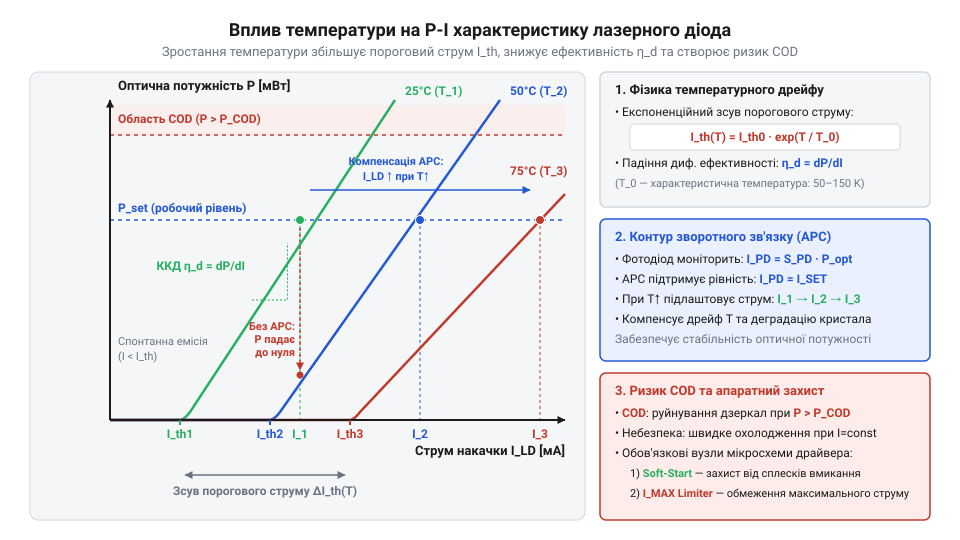
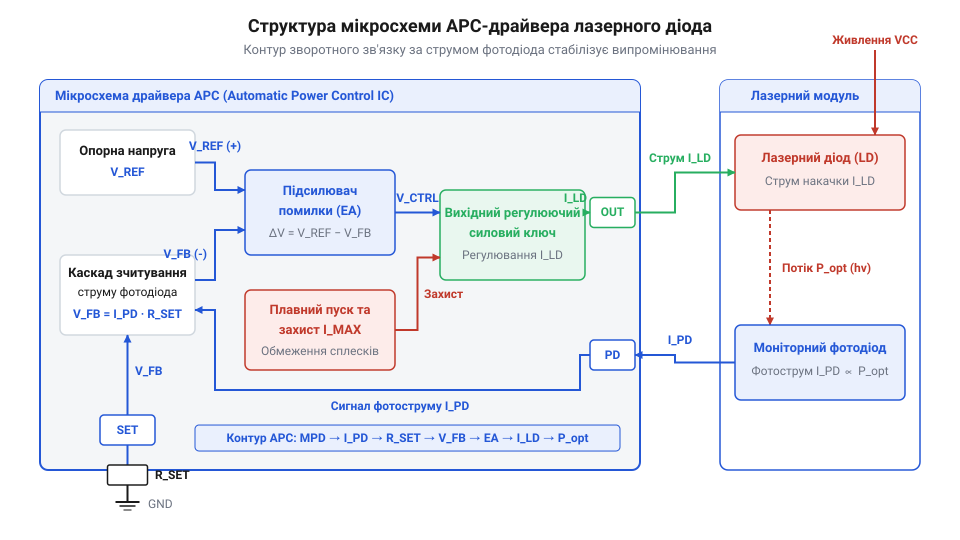
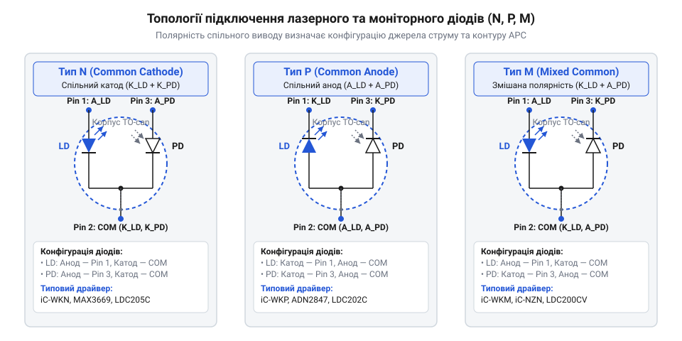
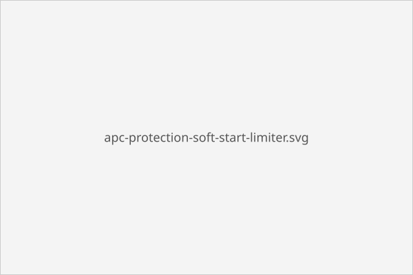
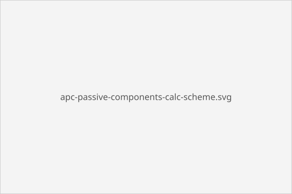

# Спеціалізовані мікросхеми драйверів лазерних діодів

<preknowlist>
- [Фізика та характеристики напівпровідникових лазерних діодів](root:hw-components/semiconductor-laser-diodes-physics-and-specs) — нелінійність ват-амперної характеристики, пороговий струм і ризик катастрофічного оптичного пошкодження
- [Моніторні фотодіоди та оптичний зворотний зв'язок](root:hw-sensing/monitor-photodiodes-optical-feedback) — принцип вимірювання оптичної потужності та генерації фотоструму
</preknowlist>

## Небезпека прямого живлення лазерного діода

Пряме живлення [напівпровідникових лазерних діодів](root:hw-components/semiconductor-laser-diodes-physics-and-specs) від джерела фіксованої напруги чи струму швидко призводить до физичного руйнування кристала. Причина криється у ват-амперній характеристиці: генерація світла починається лише після досягнення порогового струму `I_th`, після чого оптична потужність зростає експоненційно стрімко. Під час нагрівання @@en|p-n перехід@@ зменшує квантову ефективність, а пороговий струм зміщується вбік більших значень. За фіксованого живлення спроба компенсувати втрату випромінювання або випадковий перехідний сплеск викликає локальне перегрівання граней резонатора. Це спричиняє катастрофічне оптичне пошкодження — @@en|COD@@ (англ. @@en|Catastrophic Optical Damage@@, від @@en|catastrophic@@ — катастрофічний, @@en|optical@@ — оптичний, @@en|damage@@ — пошкодження), коли дзеркальні грані кристала плавляться від надвисокої густини фотонів.


*Температурне зростання порогового струму лазера та ризик виходу в зону катастрофічного оптичного пошкодження COD.*

## Архітектура мікросхеми та контур APC

Для захисту від термічного саморуйнування застосовують спеціалізований аналоговий контур автоматичного регулювання потужності — @@en|APC@@ (англ. @@en|Automatic Power Control@@, від @@en|automatic@@ — автоматичний, @@en|power@@ — потужність, @@en|control@@ — керування). Усередині корпусу випромінювача розміщено [моніторний фотодіод](root:hw-sensing/monitor-photodiodes-optical-feedback), який вловлює частину світлового потоку й ґенерує пропорційний фотострум `I_MON`. Підсилювач помилки у мікросхемі драйвера порівнює спад напруги від `I_MON` на вимірювальному резисторі з внутрішньою опорною напругою `V_REF`. Якщо кристал нагрівається чи деградує, оптичний потік падає, фотострум зменшується, і контур @@en|APC@@ автоматично збільшує струм накачки, підтримуючи стабільне випромінювання.


*Принцип роботи контуру APC з підсилювачем помилки та порівнянням фотоструму з опорною напругою.*

## Узгодження топології виводів діодного модуля

Конструктивно лазерний діод і моніторний фотодіод поєднуються у трививідному корпусі за однією з трьох топологій: @@en|N-тип@@ (спільний катод лазера й анод фотодіода), @@en|P-тип@@ (спільний анод лазера й катод фотодіода) або @@en|M-тип@@ (спільний анод лазера й анод фотодіода). Конфігурація спільного виводу визначає, який регулюючий транзистор використовується у драйвері та в якому напрямку тече фотострум. Помилка у підключенні розриває зворотний зв'язок, через що підсилювач помилки виводить струм накачки на максимум і спалює кристал. Крім того, паразитна індуктивність спільного провідника викликає перехресні наводки між силовим струмом та чутливим фотострумом, створюючи ризик автоколивань контуру.


*Конфігурації спільних виводів у корпусах лазерних діодів та відповідна полярність керування.*

## Вузли захисту від перехідних сплесків

Для запобігання відмовам аналогові драйвери містять чотири апаратні блоки захисту. Плавний пуск поволі нарощує струм під час увімкнення живлення, ліквідовуючи кидки напруги. Схема блокування при зниженій напрузі — @@en|UVLO@@ (англ. @@en|Under-Voltage Lockout@@, від @@en|under-voltage@@ — знижена напруга, @@en|lockout@@ — блокування) — утримує драйвер вимкненим до досягнення стабільного живлення. Апаратний обмежувач граничного струму працює з наносекундною швидкодією, відсікаючи імпульсні перевантаження до досягнення межі @@en|COD@@. Захист від обриву фотодіода миттєво знеструмлює лазер, якщо лінія зворотного зв'язку пошкоджена, що виключає неконтрольований розгін потужності.


*Часова діаграма спрацьовування плавного пуску, UVLO та наносекундного обмежувача струму.*

## Розрахунок пасивного обв'язку та обмеження

Режим роботи драйвера задається пасивним обв'язком. Резистор налаштування потужності `R_SET` розраховують через чутливість фотодіода `S_PD` (у А/Вт) та цільову оптичну потужність `P_OPT`:

```
I_MON = P_OPT × S_PD
R_SET = V_REF ÷ I_MON     [закон Ома для опорної напруги]
```

Резистор обмеження `R_LIMIT` задає граничний струм `I_MAX` із запасом 15–20% понад робочий струм `I_OP`, а конденсатор `C_SS` визначає тривалість плавного пуску `t_SS`. За розрахунку враховують тепловий опір корпусу драйвера, аби розсіювана потужність `P_D = (V_CC - V_LD) × I_OP` не перегрівала мікросхему. Оскільки аналоговий контур @@en|APC@@ має обмежену смугу пропускання (десятки кілогерц), для високочастотного перемикання додають [імпульсне керування](root:cat-hw-drivers/high-speed-pulsed-laser-drivers) поверх базового струму.


*Розміщення резисторів налаштування потужності R_SET, межі струму R_LIMIT та конденсатора C_SS.*
