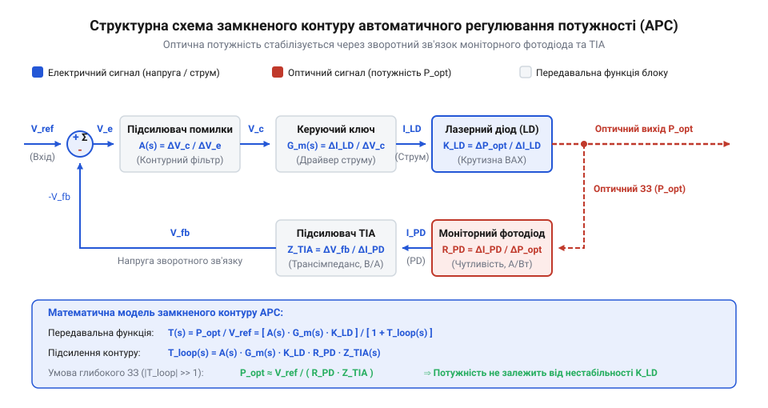
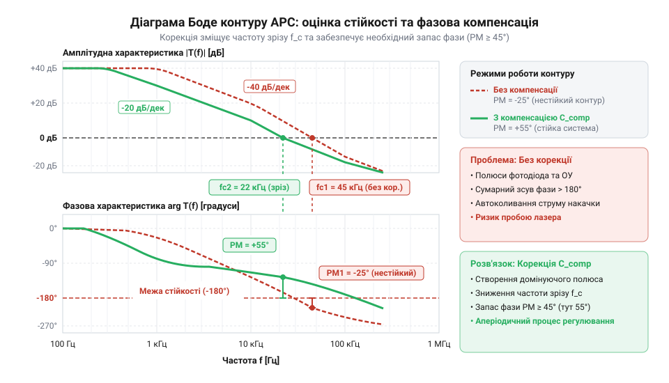

# Математичне моделювання контуру зворотного зв'язку APC та розрахунок пасивного обв'язку

## Дрейф оптичної потужності без APC

Подача стабільного фіксованого @@en|струму накачки@@ (від англ. @@en|pump current@@) на @@en|лазерний діод@@ не гарантує постійності його випромінювання. Напівпровідниковий гетероструктурний кристал перетворює електричну енергію в оптичне випромінювання лише після досягнення межі, яку визначає @@en|пороговий струм@@ (від англ. @@en|threshold current@@, `I_th`). Понад цією межею вихідна оптична потужність `P_opt` зростає пропорційно до збільшення струму з коефіцієнтом, який називається @@en|диференціальна крутизна@@ (від латин. *differentia* — різниця). @@en|differentia@@ — різниця, англ. @@en|slope efficiency@@, `K_LD`).

Під час тривалої роботи кристал лазера розігрівається через власне тепловиділення та коливання температури довкілля. Для [термоелектричного охолодження](root:hw-components/laser-diode-thermal-stabilization) застосовують зовнішні модулі, проте в самому напівпровіднику зростання температури активної зони призводить до експоненційного збільшення порогового струму та падіння диференціальної крутизни внаслідок посилення безвипромінювальної рекомбінації носіїв заряду. Якщо струм накачки зафіксований пасивним джерелом, підвищення температури зміщує порогову точку праворуч: різниця між робочим та пороговим струмом зменшується, що викликає глибокий @@en|тепловий дрейф@@ (від англ. @@en|thermal drift@@) та різке згасання оптичного потоку аж до повної втрати лазерної генерації.

Зворотна ситуація виникає при охолодженні пристрою. Зниження температури зменшує пороговий струм `I_th` та підвищує крутизну `K_LD`. За постійного струму накачки оптична потужність стрибкоподібно зростає. Перевищення гранично допустимої густини фотонів на вихідному дзеркалі резонатора спричиняє @@en|катастрофічний оптичний пробій@@ (від англ. @@en|catastrophic optical damage@@). @@en|Catastrophic Optical Damage@@, COD). Цей процес незворотно руйнує грань кристала за лічені наносекунди.

Окрім температурного чинника, пороговий струм зростає впродовж експлуатації через природну деградацію кристала та утворення дислокацій. Для підтримки стабільної потужності необхідно безперервно відстежувати оптичне випромінювання та динамічно коригувати @@en|струм накачки@@. Цю задачу вирішує замкнена система — @@en|автоматичне регулювання потужності@@ (від англ. @@en|automatic power control@@). @@en|Automatic Power Control@@, APC). Первинним датчиком у такій системі слугує вбудований у корпус лазера @@en|моніторний фотодіод@@ (від англ. @@en|monitor photodiode@@). @@en|Monitor Photodiode@@, MPD). Він розміщений безпосередньо за @@en|задньою гранню@@ (від англ. @@en|back facet@@). напівпровідникового кристала, утворюючи прямий @@en|оптичний зв'язок@@ (від англ. @@en|optical coupling@@) із внутрішнім оптичним резонатором. Через заднє дзеркало виходить мала фіксована частка випромінювання, яку фотодіод перетворює на вимірювальний @@en|фотострум@@ (від англ. @@en|photocurrent@@, `I_MPD`). У робочих режимах лазера типові величини цього струму становлять від 50 мкА до 2 мА, забезпечуючи точну пропорційність вихідній оптичній потужності.

Отриманий @@en|фотострум@@ `I_MPD` протікає через вимірювальний резистор, утворюючи напругу зворотного зв'язку для порівняння із заданим значенням @@en|опорної напруги@@ (від латинського *referre* — зіставляти). @@en|refero@@ — відносити, англ. @@en|reference voltage@@, `V_ref`). Будь-яка різниця між напругами формує @@en|сигнал похибки@@ (від англ. @@en|error signal@@), який змушує керувальний каскад динамічно коригувати @@en|струм накачки@@. Так діє @@en|від'ємний зворотний зв'язок@@ (від англ. @@en|negative feedback@@): нагрівання чи деградація кристала змушують схему збільшувати струм для збереження `P_opt`, а охолодження — миттєво зменшувати його для запобігання оптичному пробою. Ця безперервна автокомпенсація забезпечує стабільність випромінювання, формуючи вимогу до побудови замкненого контуру регулювання.

## Математична модель елементів контуру регулювання

Побудова математичної моделі контуру APC базується на описі передавальних характеристик окремих послідовних ланок у режимі малого сигналу. Сигнал керування проходить шлях від вхідної напруги уставки до вихідного оптичного потоку і повертається у вигляді напруги зворотного зв'язку.

Першим елементом є @@en|лазерний діод@@. У лінійній області понад порогом генерації зв'язок між приростом струму накачки `ΔI_op` та приростом вихідної оптичної потужності `ΔP_opt` визначає дифпідсилення лазера:

```
K_LD
= ΔP_opt / ΔI_op                                  [визначення крутизни ВАХ лазера]
```

Значення `K_LD` вимірюється у ватах на ампер (W/A) і характеризує ефективність перетворення електричного струму у світло.

Другим елементом є @@en|моніторний фотодіод@@, який приймає випромінювання із задньої грані кристала або відщеплену частину основного променя. Співвідношення між згенерованим фотострумом `I_mon` та вихідною потужністю `P_opt` описується чутливістю `S_MON`:

```
S_MON
= I_mon / P_opt                                   [визначення чутливості фотодіода]
```

Параметр `S_MON` вимірюється в амперах на ват (A/W) або мікроамперах на міліват (μA/mW).

Третьою ланкою є @@en|трансімпедансний підсилювач@@ (від англ. @@en|transimpedance amplifier@@, TIA) або вимірювальний резистор `R_mon`, який перетворює фотострум `I_mon` на напругу зворотного зв'язку `V_fb = I_mon × R_mon`. Для складних високочастотних схем застосовують спеціальне [проектування трансімпедансних підсилювачів](root:hw-analog/transimpedance-amplifier-design), але в базовому APC-контурі ця функція виконується вимірювальним резистором та підсилювачем помилки.

Сигнал `V_fb` надходить на інвертуючий вхід підсилювача помилки на основі @@en|операційного підсилювача@@. Підсилювач порівнює `V_fb` з опорною напругою уставки `V_ref`, формуючи напругу неузгодження `V_err = V_ref - V_fb`. Отриманий сигнал підсилюється підсилювачем з коефіцієнтом `A_v(s)` і керує каскадом джерела струму з @@en|крутизною перетворення@@ (від англ. @@en|transconductance@@, `G_m = ΔI_op / ΔV_err` [A/V]). Фізично цей керувальний каскад реалізують на силовому транзисторі із струмовимірювальним резистором `R_sense` у витоковому чи емітерному колі, де крутизна за наявності негативного зворотного зв'язку задається співвідношенням `G_m ≈ 1 / R_sense`. Однак реальний транзисторний каскад має скінченний @@en|вихідний опір@@ `r_out`, який підключається паралельно до динамічного опору лазерного діода `r_d`. При зміні падіння напруги на кристалі чи коливанні живлення скінченний опір `r_out` створює дільник струму між джерелом і лазером, знижуючи реальну крутизну перетворення до `G_m_eff = G_m × r_out / (r_out + r_d)` та погіршуючи здатність контуру пригнічувати зовнішні дрейфи.


*Структурна схема замкненого контуру APC з вказанням передавальних функцій лазерного діода, фотодіода, трансімпедансного підсилювача та керуючого ключа.*

Передавальна функція @@en|розімкненого контуру@@ (від англ. @@en|open-loop gain@@) `T(s)` отримується множенням коефіцієнтів передачі всіх ланок, об'єднаних у петлю зворотного зв'язку:

```
T(s)
= A_v(s) × G_m × K_LD × S_MON × R_mon               [добуток коефіцієнтів передачі ланок]
```

Отриманий @@en|коефіцієнт підсилення контуру@@ `T(s)` показує загальний коефіцієнт передачі сигналу від напруги неузгодження `V_err` до напруги зворотного зв'язку `V_fb` при розімкненій петлі.

## Передавальна функція та стаціонарний режим

Для виведення передавальної функції, яку має @@en|замкнений контур@@ (від англ. @@en|closed loop@@), підставимо значення напруги неузгодження `V_err = V_ref - V_fb` у рівняння вихідного сигналу розімкненої системи. 

Для визначення вихідної напруги зворотного зв'язку `V_fb` підставимо значення напруги неузгодження у рівняння розімкненого контуру:

```
V_fb
= T(s) × (V_ref - V_fb)                          [підстановка V_err у рівняння розімкненого контуру]
= T(s) × V_ref - T(s) × V_fb                      [розкриття дужок]
```

Згрупувавши доданки з `V_fb` у лівій частині, виводимо співвідношення між напругою зворотного зв'язку та напругою уставки:

```
V_fb × (1 + T(s))
= T(s) × V_ref                                    [перенесення T(s) × V_fb у ліву частину]
= V_fb / V_ref = T(s) / (1 + T(s))                [ділення обох частин на V_ref × (1 + T(s))]
```

Оскільки вихідна оптична потужність пов'язана з напругою зворотного зв'язку співвідношенням `P_opt = V_fb / (S_MON × R_mon)`, передавальна функція замкненого контуру `H_closed(s)` від напруги уставки до оптичної потужності визначається виразом:

```
H_closed(s)
= P_opt / V_ref                                   [визначення передавальної функції]
= (1 / (S_MON × R_mon)) × (T(s) / (1 + T(s)))     [заміна V_fb через P_opt]
```

У стаціонарному режимі на постійному струмі частота `s = 0`, а коефіцієнт підсилення розімкненого контуру `T(0)` досягає значення `T_0`. Співвідношення між реальною оптичною потужністю та її ідеальним значенням обчислюється так:

```
P_opt
= (V_ref / (S_MON × R_mon)) × (T_0 / (1 + T_0))   [значення H_closed на постійному струмі]
= P_opt_ideal × (1 - 1 / (1 + T_0))                [розклад дробу T_0 / (1 + T_0)]
```

При великому коефіцієнті підсилення в режимі постійного струму (`T_0 >> 1`) співвідношення `T_0 / (1 + T_0)` прямує до 1. У результаті оптична потужність стає майже незалежною від крутизни лазера `K_LD` та її температурного дрейфу: `P_opt ≈ V_ref / (S_MON × R_mon)`.

@@en|Статична похибка@@ (від англ. @@en|steady-state error@@). @@en|static error@@, `e_st`) показує відносне відхилення встановленої оптичної потужності від заданої:

```
e_st
= (P_opt_ideal - P_opt) / P_opt_ideal             [визначення відносної похибки]
= 1 / (1 + T_0)                                    [підстановка виразу P_opt]
```

Для забезпечення статичної похибки менше 0.1% підсилення розімкненого контуру на постійному струмі `T_0` має перевищувати 1000 (60 dB). А динамічна стійкість та відсутність автоколивань досягається через [коригування фазової компенсації](root:hw-analog/opamp-stability).

Розрахунок елементів, які складають @@en|пасивний обв'язок@@ (від англ. @@en|passive circuitry@@). @@en|passive components@@), виконується у два кроки. Спочатку визначається струмознімальний резистор `R_mon`, який встановлює робочу оптичну потужність. Потім обчислюється обмежувальний резистор `R_lim`, який захищає лазерний діод від перевантаження струмом у разі обриву кола зворотного зв'язку.

**Приклад розрахунку пасивного обв'язку APC**
Нехай необхідно встановити оптичну потужність `P_target = 5 mW`. Чутливість фотодіода `S_MON = 0.2 mA/mW` (0.2 A/W), напруга уставки `V_ref = 2.0 V`.

```
I_mon
= S_MON × P_target                                 [обчислення фотоструму моніторного фотодіода]
= 0.2 × 5                                         [підстановка чутливості 0.2 mA/mW та потужності 5 mW]
= 1.0 mA                                           [значення фотоструму]

R_mon
= V_ref / I_mon                                   [рівність напруги зворотного зв'язку та уставки]
= 2.0 / 0.001                                     [підстановка напруги 2.0 V та струму 1.0 mA]
= 2000 Ω                                          [номінал резистора 2 kΩ]
```

Для захисту лазера з максимально допустимим струмом `I_max_safe = 80 mA` при живленні `V_CC = 5.0 V`, падінні на діоді `V_LD = 2.2 V` та напрузі насичення ключа `V_sat = 0.3 V` обчислимо опір обмежувального резистора `R_lim`:

```
R_lim
= (V_CC - V_LD - V_sat) / I_max_safe               [закон Ома для кола живлення]
= (5.0 - 2.2 - 0.3) / 0.080                        [підстановка напруг та граничного струму]
= 2.5 / 0.080                                     [падіння напруги на обмежувальному резисторі]
= 31.25 Ω                                         [мінімально допустимий опір]
```

Обираємо найближчий більший номінал із стандартного ряду E24 — `33 Ω`. Це гарантує, що навіть при виході з ладу підсилювача чи фотодіода струм накачки не перевищить безпечного значення `80 mA` (фактичний максимум обмежиться на рівні `(5.0 - 2.2 - 0.3) / 33 = 75.8 mA`). Проте такий вибір вимагає перевірки @@en|потужності розсіювання@@ (від англ. @@en|power dissipation@@). резистора та його впливу на @@en|запас напруги живлення@@ (від англ. @@en|headroom@@). @@en|voltage headroom@@). При протіканні граничного струму `75.8 mA` на резисторі розсіюється потужність `P_Rlim = I^2 × R_lim = (0.0758 A)^2 × 33 Ω = 0.19 W` (а для безпечної межі `80 mA` — `0.21 W`). Звичайний SMD-резистор типорозміру 0603 із допустимою потужністю `0.1 W` в такому режимі перегріється й згорить, тому необхідно застосовувати корпус типорозміру не менше 1206 (на `0.25 W`). Водночас додаткове падіння напруги на `R_lim` зменшує напругу на колекторі регулювального транзистора: при `75.8 mA` падіння `V_Rlim = 2.5 V` залишає транзистору лише `V_CE = 5.0 - 2.2 - 2.5 = 0.3 V`. Це ставить транзистор на межу насичення, звужуючи динамічний діапазон регулювання та унеможливлюючи компенсацію температурного зростання прямої напруги лазера `V_LD` чи просідання напруги живлення `V_CC`.

## Оцінка стійкості контуру APC

Розрахований статичний режим та вибрані пасивні елементи дільників гарантують точність у стаціонарному стані, проте після увімкнення живлення замість стабільного оптичного випромінювання лазерний діод може увійти в режим високочастотної модуляції, перегрітися й зазнати катастрофічного руйнування. Причина такої поведінки полягає в прихованому фазовому запізненні, яке виникає у розімкненому контурі автоматичного регулювання. `@@en|моніторний фотодіод@@` (від грецького *φῶς* — світло) має власний p-n перехід із `@@en|паразитна ємність@@` (від латинського *capacitas* — місткість) `C_pd`. Разом із опором зворотного зв'язку `R_f` ця ємність утворює небажаний `@@en|полюс передавальної функції@@` (від грецького *πόλος* — вісь, полюс) на частоті:

```
f_p1 = 1 ÷ (2 × π × R_f × C_pd)
```

Кожен такий полюс зменшує коефіцієнт підсилення зі швидкістю -20 dB на декаду та додає фазове запізнення до -90°. Операційний підсилювач контуру вже має власний низькочастотний `@@en|домінуючий полюс@@` (від латинського *dominans* — пануючий), який дає початковий спад -20 dB на декаду. Коли частота сигналу зростає до значення `f_p1`, полюс фотодіодного каскаду накладається на домінуючий полюс підсилювача. Ця взаємодія двох полюсів збільшує крутизну спаду амплітудно-частотної характеристики до -40 dB на декаду, а сумарне фазове запізнення стрімко наближається до -180°. Окрім цього, операційний підсилювач має свої [внутрішні полюси підсилювача](root:hw-analog/opamp-stability), які на високих частотах створюють додатковий `@@en|фазовий зсув@@` (від грецького *φάσις* — поява, вигляд).

Якщо на деякій частоті сумарне фазове запізнення розімкненого контуру досягає -180°, від'ємний зворотний зв'язок перетворюється на додатний. Якщо при цьому модуль підсилення розімкненого контуру `|W_open(jω)| ≥ 1` (або 0 dB), у системі виникають самозбуджувальні `@@en|автоколивання@@`.

Для формальної оцінки стабільності застосовують `@@en|критерій Найквіста-Боде@@` (від імен науковців @@en|Harry Nyquist@@ та @@en|Hendrik Wade Bode@@). На логарифмічній амплітудно-частотній характеристиці визначають частоту, на якій підсилення падає до одиниці (0 dB) — це `@@en|частота зрізу@@` `f_c`. Різниця між фазою контуру на цій частоті та критичним значенням -180° називається `@@en|запас фази@@` (від латинського *margo* — межа, край):

```
Δφ = 180° + arg(W_open(j × 2 × π × f_c))
```

Якщо `@@en|запас фази@@` становить `Δφ < 45°`, перехідний процес контуру APC супроводжується тривалими дзвінкими коливаннями та викидами струму накачки, що смертельно небезпечно для напівпровідникового кристала лазера.

Поряд із фазовим параметром оцінюють `@@en|запас підсилення@@` (від латинського *margo* — межа, край) `L_m`. Цей параметр вимірює ослаблення підсилення на частоті `f_180`, де сумарне фазове запізнення досягає межі -180°. Стабільна робота контуру APC вимагає дотримання норми `L_m ≥ 10 dB`. Якщо через вплив `C_pd` додатковий полюс `f_p1` розташований нижче за `@@en|частота зрізу@@` `f_c`, фаза перетинає критичне значення до падіння підсилення нижче 0 dB, роблячи систему схильною до самозбудження.

## Розрахунок ланцюгів фазової компенсації

Для усунення ризику високочастотних автоколивань і забезпечення стійкої роботи контуру необхідна `@@en|фазова компенсація@@` (від латинського *compensatio* — зрівноваження). Вона корегує амплітудно-частотну та фазово-частотну характеристики розімкненого кола так, щоб на частоті зрізу `@@en|запас фази@@` становив `Δφ ≥ 45°`.

Найпростішим і найефективнішим методом є паралельне підключення компенсувального конденсатора `C_f` до резистора зворотного зв'язку `R_f` у [каскаді трансімпедансного підсилювача](root:hw-analog/transimpedance-amplifier-design). Ця ємність вводить `@@en|нуль передавальної функції@@` `f_z`, який створює фазове випередження для компенсації спаду фази:

```
f_z = 1 ÷ (2 × π × R_f × C_f)
```

Водночас взаємодія ємності `C_f` із паразитною ємністю моніторного фотодіода `C_pd` та опором `R_f` формує другий `@@en|полюс передавальної функції@@` `f_p` на вищій частоті:

```
f_p = (C_pd + C_f) ÷ (2 × π × R_f × C_pd × C_f)
```

Цей полюс обмежує зростання коефіцієнта підсилення шуму. За такого узгодження полюсів і нулів підсумкова `@@en|смуга пропускання@@` замкненого контуру `f_cl` визначається співвідношенням між `@@en|добуток підсилення на смугу@@` `GBW` підсилювача, опором `R_f` та ємністю `C_pd`:

```
f_cl = √(GBW ÷ (2 × π × R_f × C_pd))
```

```
f_z = 1 ÷ (2 × π × R_f × C_f)
```

Завдяки цьому на високих частотах нахил АЧХ у точці перетину 0 dB зменшується з небезпечних -40 dB/декаду до стабільних -20 dB/декаду, піднімаючи ФЧХ у критичній зоні.


*Частотні характеристики контуру автоматичного регулювання потужності до та після додавання компенсувальної ємності.*

Оптимальне значення ємності компенсації `C_f` розраховують виходячи з умови забезпечення `@@en|запас фази@@` `Δφ ≈ 45°...60°` без надмірного обмеження смуги пропускання. Якщо відома `@@en|паразитна ємність@@` фотодіода `C_pd` та `@@en|добуток підсилення на смугу@@` (англійською @@en|gain-bandwidth product@@) підсилювача `GBW`, то потрібна ємність зворотного зв'язку становить:

```
C_f = √(C_pd ÷ (2 × π × R_f × GBW))
```

Розглянемо практичний обрахунок параметрів компенсації.

**Умова:** Моніторний фотодіод має паразитну ємність `C_pd = 100 pF`, резистор трансімпедансу `R_f = 10 kΩ`, а операційний підсилювач має `GBW = 10 MHz` (`10⁷ Hz`).

```
C_f = √(100 × 10⁻¹² ÷ (2 × 3.14159 × 10000 × 10⁷))      [формула компенсаційної ємності]
    = √(100 × 10⁻¹² ÷ 6.28318 × 10¹¹)                    [обчислення знаменника]
    = √(1.59155 × 10⁻²³)                                 [ділення під коренем]
    = √(15.9155 × 10⁻²⁴)                                 [зручний вид для кореня]
    ≈ 3.99 × 10⁻¹² F ≈ 4 pF                              [добування квадратного кореня]
```

Встановлення керамічного конденсатора номіналом `4 pF` паралельно `R_f` формує потрібний `@@en|нуль передавальної функції@@`, збільшуючи `@@en|запас фази@@` до 58°. Це повністю усуває високочастотні `@@en|автоколивання@@` і гарантує стабільну роботу системи APC під час будь-яких стрибків оптичного навантаження.
