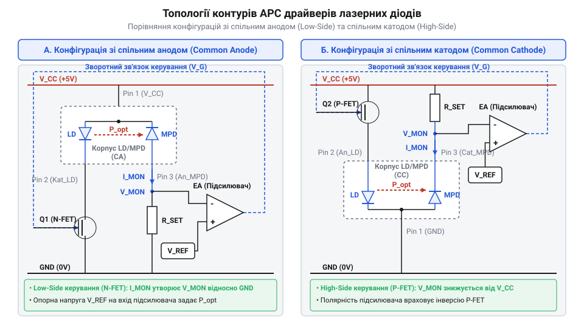
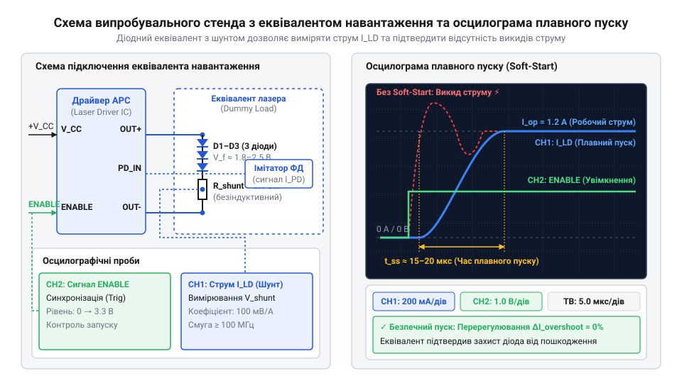

# Проєктування та практичне випробування модуля драйвера лазерного діода з замкненим контуром APC

## Термодрейф та ризики руйнування діода

Лазерний діод (англ. @@en|laser diode@@) — це напівпровідниковий p-n перехід (англ. @@en|p-n junction@@), який випромінює когерентне світло при досягненні порогового струму накачки `I_th`. На відміну від звичайного світлодіода, ват-амперна характеристика лазера має гострий перелом: до досягнення струму `I_th` кристал працює в режимі спонтанного випромінювання із низьким ККД, а після перевищення `I_th` вихідна оптична потужність `P_out` зростає лінійно з високою крутизною, яка визначається диференційною ефективністю `dP/dI`.

Параметри напівпровідникового кристала критично залежать від температури `T_j` робочого переходу. При нагріванні звужується заборонена зона та зростає безвипромінювальна рекомбінація носіїв заряду, через що пороговий струм зростає за експоненційним законом:

```
I_th(T) = I_0 × exp(T / T_0)
```

де `T_0` — характеристична температура напівпровідникового матеріалу. Одночасно зі зростанням `I_th` зменшується диференційна ефективність `dP/dI`.

Якщо заживити лазерний діод від звичайного генератора стабільного струму (англ. @@en|constant current driver@@), будь-яке підвищення температури навколишнього середовища чи самонагрів кристала призведе до зсуву порогового струму праворуч. У результаті фактична оптична потужність `P_out` стрімко впаде або лазерна генерація взагалі зірветься.

Ще небезпечнішим є зворотний процес — охолодження модуля. Якщо струм накачки зафіксований на рівні, розрахованому для високої температури, то при зниженні температури пороговий струм `I_th` різко зменшується. Увесь надлишковий струм перетворюється на оптичне випромінювання, що викликає стрибкоподібне зростання потужності `P_out`. Перевищення максимально припустимої густини оптичного потоку на вихідному дзеркалі кристала викликає [катастрофічне оптичне руйнування](root:hw-components/laser-diode-cod-failure) — катастрофічне оптичне пошкодження (англ. @@en|Catastrophic Optical Damage@@, @@en|COD@@). Пошкоджене дзеркало назавжди втрачає відбивну здатність, перетворюючи лазерний діод на тьмяний світлодіод.

Оскільки пряме вимірювання температури кристала за допомогою зовнішніх датчиків має високу теплову інерцію і не здатне відстежити миттєві оптичні стрибки, пряме керування струмом є непридатним для надійних систем. Єдиним розв'язком є побудова замкненого контуру автоматичного регулювання потужності (англ. @@en|Automatic Power Control@@, @@en|APC@@), який безперервно вимірює фактичний оптичний потік за допомогою вбудованого моніторного фотодіода (англ. @@en|monitor photodiode@@) та динамічно коригує струм накачки.

Такий фотодіод розміщують безпосередньо за задньою дзеркальною гранню кристала лазерного діода всередині того самого герметичного корпуса. Невеликий відсоток випромінювання, що виходить через заднє дзеркало, потрапляє на чутливу площадку фотодіода й викликає зворотний фотострум (англ. @@en|photocurrent@@, від грец. *phōs* — світло), який є строго пропорційним вихідній оптичній потужності `P_out`. Отриманий струм слугує безінерційним сигналом для контуру з негативним зворотним зв'язком (англ. @@en|negative feedback@@). Якщо внаслідок нагрівання оптичне випромінювання спадає, фотострум миттєво зменшується, змушуючи регулятор пропорційно збільшувати струм накачки `I_pump` для підтримки заданого рівня. Якщо ж при охолодженні випромінювання стрибкоподібно зростає, підвищений фотострум змушує систему негайно знизити струм накачки, захищаючи кристал від перевищення оптичного порогу та виходу в режим @@en|COD@@.

## Топологія контуру APC та принципова схема

У більшості промислових 3-вивідних корпусів лазерних діодів кристал лазера та моніторний фотодіод об'єднані в єдиний вузол зі спільним виводом. Залежно від полярності включення напівпровідникових структур розрізняють дві основні конфігурації: зі спільним анодом (англ. @@en|Common Anode@@) та зі спільним катодом (англ. @@en|Common Cathode@@).

У схемі зі спільним анодом анод лазерного діода та катод моніторного фотодіода з'єднані з позитивною шиною живлення `V_CC`. Струм накачки лазера регулюється силовим N-канальним польовим транзистором (англ. @@en|MOSFET@@), увімкненим у нижнє плече. Зворотний фотострум моніторного фотодіода `I_pd`, що пропорційний оптичній потужності `P_out`, протікає через вимірювальний резистор `R_sense` на землю, створюючи напругу відгуку:

```
V_pd = I_pd × R_sense
```


*Схематичні топології контурів APC для лазерних та моніторних фотодіодів у конфігураціях зі спільним анодом і катодом.*

У конфігурації зі спільним катодом спільна точка підключена до заземлення. Це вимагає використання P-канального транзистора у верхньому плечі або схем з інверсією сигналів зворотного зв'язку.

Основою аналогового контуру @@en|APC@@ є підсилювач помилки (англ. @@en|error amplifier@@) на базі прецизійного операційного підсилювача. На його інвертуючий вхід подається напруга зворотного зв'язку `V_pd`, а на неінвертуючий — стабільна опорна напруга `V_ref` від джерела прецизійної опорної напруги. Підсилювач помилки автоматично підтримує баланс: якщо через нагрів оптична потужність спадає, напруга `V_pd` зменшується відносно `V_ref`. Вихідна напруга підсилювача привідкриває силовий транзистор, збільшуючи струм накачки до відновлення рівності `V_pd = V_ref`.

При подачі живлення незаряджені конденсатори в колі зворотного зв'язку могут викликати тимчасовий розрив контуру, через що підсилювач помилки повністю відкриє силове плече та подасть максимальний струм накачки ще до появи оптичного відгуку. Для усунення цього ризику в принципову схему вбудовують вузол плавного пуску (англ. @@en|soft-start@@). У цифро-аналогових системах м'який запуск реалізують покроковим підйомом уставного значення ЦАП під постійним контролем струму моніторного фотодіода.

Нижче наведено програмну реалізацію контуру @@en|APC@@ та плавної подачі струму на мовах C та C++ з використанням захисних перевірок:

:::tabs
@tab C
:::code proj-apc-laser-diode-driver-module/c/apc_laser_controller.c 108-132
@tab C++
:::code proj-apc-laser-diode-driver-module/cpp/ApcLaserController.cpp 64-78
:::

Аналогово-цифровий алгоритм покроково нарощує вихідний сигнал керування силовим ключем, перевіряючи показання АЦП моніторного фотодіода на кожному кроці, що унеможливлює кидки струму та оптичний пробій кристала.

## Трасування друкованої плати та тепловідведення

Навіть ідеально спроєктована принципова схема може стати причиною виходу лазерного діода з ладу через нехтування законами високочастотного трасування друкованої плати. Ключовим апаратно-топологічним ворогом лазерного кристала є паразитна індуктивність (англ. @@en|parasitic inductance@@) провідників струмового контуру накачки.

При імпульсному ввімкненні, вимкненні або спрацьовуванні схеми плавного пуску швидка зміна струму `dI/dt` на індуктивності траси `L_trace` наводить вихідний індуктивний викид напруги:

```
V_spike = L_trace × (dI/dt)
```

При швидкості наростання струму 1 А за 10 нс паразитна індуктивність провідника довжиною всього 10 мм (`L_trace ≈ 10 нГн`) генерує імпульсну напругу амплітудою 1 В. Оскільки зворотно-зміщений лазерний p-n перехід має низьку порогову напругу пробою (для багатьох лазерних діодів `V_reverse_max` становить лише 2 В), такий індуктивний викид миттєво руйнує кристал.

Для мінімізації паразитної індуктивності розводка плати повинна мінімізувати площу силової струмової петлі, утвореної керамічними розв'язувальними конденсаторами, лазерним діодом та силовим транзистором. Керамічні конденсатори з низьким еквівалентним послідовним опором (англ. @@en|Equivalent Series Resistance@@, @@en|ESR@@) та індуктивністю (типорозмірів SMD `0402` або `0603` ємністю 100 нФ паралельно з 10 мкФ) слід розміщувати безпосередньо біля виводів лазера.

Сигнальні провідники фотоструму від моніторного фотодіода до підсилювача помилки мають високий імпеданс і надзвичайно чутливі до електромагнітних наводок (англ. @@en|Electromagnetic Interference@@, @@en|EMI@@). Їх трасують короткими лініями мінімальної ширини над суцільним полігоном заземлення (англ. @@en|ground plane@@), захищаючи охоронними провідниками (англ. @@en|guard ring@@).

Тепловий розрахунок друкованої плати визначає довговічність лазерного модуля. Теплова потужність, яка розсіюється на корпусі діода, обчислюється як різниця між споживаною електричною потужністю та випромінюваною оптичною потужністю:

```
P_th = (V_forward × I_pump) - P_out
```

Для ефективного відведення тепла під площадкою кріплення корпусу діода проєктують мідні теплові полігони (англ. @@en|thermal copper pour@@), з'єднані з внутрішніми та нижніми шарами плати за допомогою масиву теплопровідних перехідних отворів (англ. @@en|thermal vias@@). У потужних модулях друкована плата монтується на зовнішній алюмінієвий радіатор або [активні термоелектричні модулі](root:cat-hw-drivers/peltier-tec-laser-thermal-stabilization) для термостабілізації.

## Безпечний запуск на еквіваленті навантаження

Пряме подання живлення на коштовний @@en|laser diode@@ (від @@en|laser diode@@ — лазерний напівпровідниковий діод) під час першого включення змонтованої друкованої плати драйвера є найкоротшим шляхом до руйнування p-n переходу. Будь-яка помилка в номіналах елементів контуру зворотного зв’язку, нестійкість підсилювача помилки чи короткочасне перерегулювання струму створюють індуктивний викид напруги `V_spike`, що викликає незворотне @@en|Catastrophic Optical Damage@@ (від @@en|Catastrophic Optical Damage@@ — катастрофічне оптичне пошкодження граней кристала, @@en|COD@@). Для уникнення ризику первинне налагодження здійснюють на діодному еквіваленті навантаження (від @@en|dummy load@@ — макетне або штучне навантаження).

Еквівалент збирають із кількох послідовно з’єднаних кремнієвих діодів Шотткі чи імпульсних діодів, увімкнених послідовно з низькоіндуктивним безіндуктивним шунтом `R_sense` номіналом 0.1–1 Ом. Вольт-амперна характеристика ланцюжка з 3–4 діодів формує пряме падіння напруги `V_f` у межах 1.8–2.5 В, що імітує поріг відкривання лазера, але витримує короткочасні струмові перевантаження без руйнування. Джерело зворотного зв’язку моніторного фотодіода для конфігурацій @@en|Common Anode@@ (від @@en|Common Anode@@ — спільний анод) або @@en|Common Cathode@@ (від @@en|Common Cathode@@ — спільний катод) імітують додатковим вихідним регульованим джерелом струму чи фотооптопарою.


*Підключення аналогового модуля драйвера до діодного еквівалента навантаження з шунтом і джерелом імітації фотоструму та осцилограма плавного пуску без індуктивних викидів.*

Методика випробування передбачає підключення осцилографа паралельно шунту `R_sense` для відстеження амплітуди струму накачки. Під час подачі сигналу активації `Enable` контур @@en|soft-start@@ (від @@en|soft-start@@ — плавний запуск) повинен нарощувати струм монотонно, без викидів чи високочастотної генерації.

:::code proj-apc-laser-diode-driver-module/c/apc_laser_controller.c 97-136
:::code proj-apc-laser-diode-driver-module/cpp/ApcLaserController.cpp 55-81
:::code proj-apc-laser-diode-driver-module/c/main.c 74-83
:::code proj-apc-laser-diode-driver-module/cpp/main.cpp 46-56

У коді програмно-апаратна реалізація плавного пуску покроково збільшує значення ЦАП до цільового рівня, контролюючи відгук АЦП на кожному кроці для миттєвого відключення живлення в разі перевищення безпечного порогу.

Після досягнення цільового рівня фотоструму алгоритм переводить систему зі стану плавного пуску @@en|soft-start@@ у режим безперервного автоматичного регулювання потужності, де вмикається пропорційно-інтегральний контур. Саме на цьому етапі випробування на еквіваленті навантаження @@en|dummy load@@ вимірюють відсутність перерегулювання струму накачки за осцилограмою на шунті `R_sense`. Якщо коефіцієнти регулятора підібрано некоректно, на межі переходу виникає перехідне коливання або викид струму, який на реальному лазерному діоді @@en|laser diode@@ спричинив би оптичний пробій кристала @@en|Catastrophic Optical Damage@@. Лише переконавшись у монотонному встановленні робочої точки без автоколивань та з безпечним часом реакції на штучне обривання фотоструму, еквівалент замінюють реальним напівпровідниковим лазером.

## Вимірювання та калібрування оптичної стабільності

Після підтвердження осцилографом відсутності перерегулювання на еквіваленті навантаження здійснюють перехід до роботи з реальним лазерним діодом. Головне завдання на цьому етапі — калібрування контуру @@en|Automatic Power Control@@ (від @@en|Automatic Power Control@@ — автоматичне регулювання потужності, @@en|APC@@) та вимірювання коефіцієнта стабілізації оптичного випромінювання `P_out` при зміні температури чи напруги живлення.

Моніторний фотодіод генерує струм зворотного зв’язку `I_pd`, який прямо пропорційний випромінюваній оптичній потужності. Ця залежність визначається параметром спектральної чутливості (від @@en|responsivity@@ — фоточутливість, `S_mpd`):

    I_pd = P_out × S_mpd            [струм моніторного фотодіода]

Виміряти фактичну випромінювану потужність `P_out` дозволяє калібрований вимірювач оптичної потужності (від @@en|optical power meter@@ — оптичний ватметр). Підлаштовуючи підсилення у вузлі перетворення фотоструму в напругу `V_pd = I_pd × R_sense`, виставляють необхідний рівень потужності лазера. Докладніше про будову фотометричних сфер, принципи калібрування та методи вимірювання абсолютної випромінюваної потужності читайте у матеріалі про [вимірювачі оптичної потужності лазерного випромінювання](root:cat-hw-instruments/optical-power-meter).

Оцінку температурної стабільності виконують при зміні температури корпуса. Підвищення температури зміщує пороговий струм генерації `I_th` убік більших значень, але замкнений контур @@en|APC@@ автоматично збільшує струм накачки для утримання сталої потужності. Відносну оптичну стабільність `S_rel` визначають через середньоквадратичне відхилення потужності `σ` від середнього значення `P_mean`:

    S_rel = 100% - (σ / P_mean × 100%) [відносна стабільність випромінювання]

:::code proj-apc-laser-diode-driver-module/c/apc_laser_controller.c 138-183
:::code proj-apc-laser-diode-driver-module/cpp/ApcLaserController.cpp 95-128
:::code proj-apc-laser-diode-driver-module/cpp/ApcLaserController.cpp 220-252
:::code proj-apc-laser-diode-driver-module/c/main.c 84-100
:::code proj-apc-laser-diode-driver-module/cpp/main.cpp 57-70

Програмний контур регулятора постійно коригує струм накачки через ПІ-алгоритм та обчислює накопичувальне середнє значення й стабільність випромінювання в ковзному вікні вимірювань.
