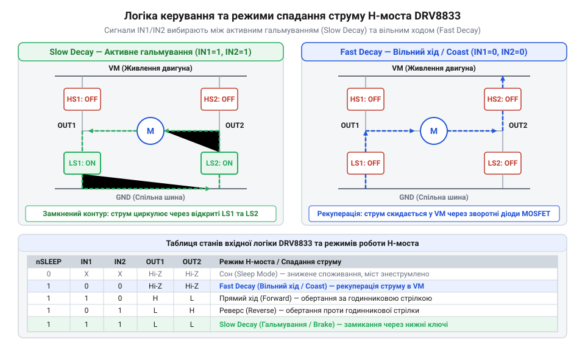
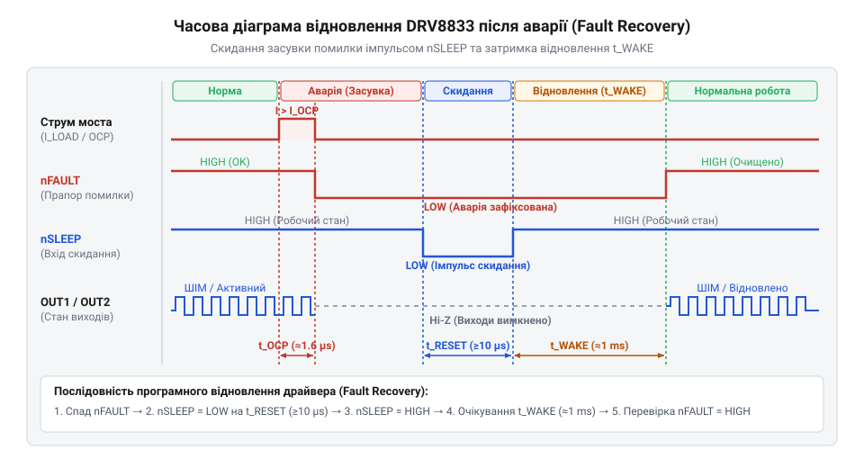

# Програмний інтерфейс драйвера DRV8833 для мікроконтролерів

<preknowlist>
- [CJMCU MC33886 — драйвер моторів (5A H-міст)](root:cat-hw-drivers/mc33886-driver) — базові принципи функціонування силового H-моста та комутації індуктивних навантажень
</preknowlist>

## Неконтрольований вибіг та перегрів мотора

Коли @@en|microcontroller@@ (англ. *microcontroller*, від грец. *mikros* — малий та ср.-лат. *controllare* — перевіряти) намагається зупинити електродвигун або змінити напрямок його обертання звичайним перемиканням логічних рівнів на виходах @@en|GPIO@@, індуктивність обмоток протидіє миттєвій зміні струму. Нагромаджена в магнітному полі енергія генерує @@en|back EMF@@ (англ. *back electromotive force*, від лат. *electrum* — бурштин та *movens* — рушійний) — зворотну ЕРС. Цей високовольтний сплеск створює пробійний струм, який загрожує випалити вихідні каскади мікроконтролера або спричинити збій апаратної частини. Спроба перемикати ключі без часової затримки спричиняє @@en|shoot-through current@@ — наскрізний струм через одночасно відкриті верхній та нижній транзистори одного плеча, що викликає стрімкий розігрів кристала.

Щоб уникнути пошкодження системних кіл, керування навантаженням довіряють спеціалізованому силовому каскаду — @@en|driver@@ (англ. *driver*, від давньоангл. *drīfan* — керувати, гнати). *driver*, від *drive* — вести, керувати). Силовий інтегральний @@en|driver@@ @@en|DRV8833@@ бере на себе комутацію струмів обмоток та захист від сплесків напруги. Проте сам по собі силовий міст лише виконує команди керування. Якщо мікроконтролер подає некоректні комбінації сигналів під час сповільнення чи реверсу, мотор або продовжує неконтрольоване обертання за інерцією, або викликає аварійне вимкнення силових ключів через перегрів. Використовуючи [базові принципи функціонування силового H-моста](root:cat-hw-drivers/mc33886-driver), необхідно формалізувати алгоритм керування вхідними лініями, щоб гарантувати безпечне розсіювання реактивної енергії обмоток.

Шлях проходження розрядного струму обмотки після зняття керуючої напруги повністю залежить від стану ключів силового моста. Якщо повністю вимкнути всі силові транзистори, накопичена індуктивна енергія скидається через вбудовані діоди назад у шину живлення, забезпечуючи швидке згасання струму, але залишаючи ротор вільно обертатися за інерцією. Якщо ж замкнути обмотку через два нижні або два верхні ключі, індуктивний струм продовжує циркулювати всередині замкненого контуру, перетворюючи кінетичну енергію обертання на тепло й реалізуючи активне електродинамічне гальмування. Без формалізованого програмного розділення цих двох режимів @@en|microcontroller@@ не може передбачувано зупиняти двигун, ризикуючи спричинити аварійне вимкнення силового каскаду @@en|DRV8833@@ через перегрів або сплеск напруги. Саме тому програмний інтерфейс має явно керувати шляхами розсіювання індуктивного струму під час будь-якої зміни стану навантаження.

## Логіка керування вхідними сигналами H-моста

Двоканальний @@en|driver@@ @@en|DRV8833@@ містить два незалежні силові містки @@en|H-bridge@@ (англ. *H-bridge*, через візуальну схожість схеми з літерою H). Кожен канал керується двома вхідними лініями: `IN1` і `IN2` для першого моста, та `IN3` і `IN4` для другого. Усі силові ключі виконано на N-канальних польових транзисторах @@en|N-channel MOSFET@@, що зменшує опір відкритого каналу та тепловиділення, але вимагає відмикання верхніх ключів напругою, вищою за напругу живлення мотора `VM`. Для цього мікросхема містить внутрішню схему підкачки заряду @@en|charge pump@@ (англ. *charge pump*, від англ. *charge* — заряд та *pump* — помпа), яка генерує підвищену напругу керування затворами верхніх плечей. Для моніторингу й обмеження струму обмоток витоки нижніх ключів кожного моста виведено на окремі лінії `ISEN` (`AISEN` та `BISEN`, від англ. *current sense*, де `I` — позначення струму), які з'єднуються з землею через зовнішні струмознімальні резистори. Окрім вхідних ліній каналів, драйвер має спільну лінію управління енергозбереженням `nSLEEP`. Коли на лінію `nSLEEP` подано низький логічний рівень (`0`), внутрішня помпа заряду та всі силові ключі примусово вимикаються, а споживання струму мікросхемою знижується до мінімуму. driver@@ @@en | DRV8833@@ містить два незалежні силові містки | Докладніше про розрахунок струмознімальних резисторів AISEN та розводку друкованої плати дивіться у матеріалі про [фізичну топологію та апаратне обв'язування DRV8833](root:cat-hw-drivers/drv8833-motor-driver/api-drv8833-hardware-interface.md).

У робочому режимі, коли `nSLEEP = 1`, логічний стан парних входів `IN1` та `IN2` повністю визначає стан вихідних ключів і режим струморозпаду в обмотках мотора:

- `IN1 = 0, IN2 = 0` — стан високого імпедансу @@en|Hi-Z@@ (англ. *high impedance*, від лат. *impedire* — перешкоджати). Усі транзистори силового містку закриті. Струм індуктивності змушений протікати через зворотні діоди назад у джерело живлення. Це забезпечує режим швидкого згасання струму @@en|Fast Decay@@ (англ. *fast decay*, від лат. *decadere* — упадне згасання), при якому мотор вільно обертається за інерцією (режим вибігу).
- `IN1 = 1, IN2 = 0` — прямохід. Відкриті верхній ключ одного плеча та нижній ключ протилежного плеча. Струм тече через мотор у прямому напрямку.
- `IN1 = 0, IN2 = 1` — реверс. Відкрита протилежна пара транзисторів, напрямок струму змінюється на зворотний.
- `IN1 = 1, IN2 = 1` — активне гальмування. Відкриті обидва нижні транзистори містка, закорочуючи обмотку мотора на землю. Накопичена енергія циркулює всередині замкненого контуру низьких ключів. Це створює режим повільного згасання струму @@en|Slow Decay@@ (англ. *slow decay*, від пізньолат. *decadere* — упадне згасання). *slow decay*), який швидко та м'яко зупиняє вал двигуна.

*Конфігурація керуючих сигналів H-моста DRV8833 та відповідні шляхи згасання струму обмотки мотора у режимах активного гальмування та вільного ходу.*

## Конфігурація ШІМ та режимів згасання

Регулювання швидкості обертання двигуна реалізується шляхом подачі сигналу @@en|PWM@@ (англ. *pulse-width modulation*, від *pulse* — імпульс, *width* — ширина та *modulate* — розміряти) на керуючі входи драйвера. Змінюючи коефіцієнт заповнення імпульсів @@en|duty cycle@@ (англ. *duty cycle*, від *duty* — служба та *cycle* — коло), програміст варіює середнє значення напруги, прикладеної до обмотки мотора. Однак при апаратній генерації комплементарного ШІМ @@en|complementary PWM@@ (англ. *complementary PWM*, від лат. *complementum* — доповнення). *complementary*, від *complement* — доповнювати) виникає небезпека короткого замикання шини живлення через одночасне відкриття верхнього та нижнього ключів H-моста. Через те що силові транзистори вимикаються повільніше, ніж вмикаються, під час зміни логічних рівнів виникає короткочасний наскрізний струм. Щоб запобігти цьому, в апаратній периферії таймера мікроконтролера налаштовується примусова затримка перемикання — мертвий час @@en|dead time@@ (англ. *dead time*, від *dead* — мертвий та *time* — час). Мінімальна тривалість цієї затримки `t_dead` обчислюється на основі часу вимикання ключів `t_off`, часу їхнього вмикання `t_on` та необхідного запасу надійності `t_margin`:

        t_dead
        = t_off - t_on + t_margin      [урахування асиметрії часу перемикання транзисторів]

З отриманого виразу видно, що затримка `t_dead` компенсує різницю швидкостей вимикання та вмикання силових транзисторів. Завдяки правильно розрахованому мертвому часу @@en|dead time@@ апаратний модуль таймера гарантує паузу між вимкненням одного силового ключа й увімкненням протилежного, виключаючи появу наскрізних струмів під час комутації.

Залежно від комбінації логічних рівнів під час пауз між імпульсами @@en|PWM@@, драйвер працює в одному з двох режимів регулювання:

- **Режим згасання @@en|Slow Decay@@:** Один із входів (наприклад, `IN1`) утримується у постійному високому рівні (`1`), а на другий вхід (`IN2`) подається інвертований сигнал @@en|PWM@@. Під час активної фази імпульсу (`IN2 = 0`) струм прискорює мотор. Під час паузи (`IN2 = 1`) обидва входи опиняються у стані `1`, замикаючи обмотку через нижні ключі. Струм згасає повільно, індукційні пульсації мінімізуються, а регулювання швидкості стає лінійним та передбачуваним.
- **Режим згасання @@en|Fast Decay@@:** Один із входів утримується в низькому рівні (`0`), а на другий подається прямий сигнал @@en|PWM@@. Під час паузи обидва входи переходять у `0`, переводячи виходи містка в @@en|Hi-Z@@. Енергія обмотки скидається в шину живлення через зливні діоди, що пришвидшує спад струму.

Для запобігання появі акустичного шуму та забезпечення стабільної роботи силового каскаду частота периферії @@en|PWM@@ мікроконтролера зазвичай обирається в межах від 20 кГц до 50 кГц.

## Програмний інтерфейс керування двигунами

Формалізація керування моторами вимагає створення зручного @@en|software API@@ (англ. *application programming interface*). Програмний шар повинен приховувати прямі маніпуляції реєстрами МК, надаючи високорівневі функції для роботи з колекторним мотором @@en|DC motor@@ (англ. *direct current motor*). або кроковим двигуном @@en|stepper motor@@ (англ. *stepper motor*, від давньоангл. *stæppe* — крок). *stepper motor*, від *step* — крок).

Для керування колекторним мотором @@en|DC motor@@ API реалізує процедури встановлення швидкості із заданням напрямку та вибором режиму гальмування. Для біполярного крокового двигуна @@en|stepper motor@@ використовуються обидва силові канали `A` та `B`, а програма генерує послідовну зміну фаз на входах `IN1`–`IN4`.

Приклад опису структури даних та функцій API мовами C та C++ наведено у вкладках нижче:

:::tabs
:::code api-drv8833-driver-software-api/c/esp-idf/snippet-1.c
:::code api-drv8833-driver-software-api/cpp/arduino/motordecay.cpp
:::

Передане у функцію `setSpeed` від'ємне значення задає зворотний напрямок обертання, а значення від `0` до `255` визначає @@en|duty cycle@@ для генератора @@en|PWM@@.

## Обробка прапора nFAULT та відновлення

Для захисту від пошкодження @@en|driver@@ @@en|DRV8833@@ оснащено відкритою сигнальною лінією `nFAULT` (англ. *fault*, від лат. *fallere* — обманювати, хибити). У нормальному стані лінія підтягнута зовнішнім резистором до високого рівня. Спрацьовування будь-якої із систем захисту — струмового перевантаження @@en|overcurrent protection@@, теплового перегріву кристала @@en|thermal shutdown@@ або просідання напруги живлення @@en|undervoltage lockout@@ — змушує драйвер примусово притягнути `nFAULT` до землі (`0`).

Мікроконтролер налаштовує вхідний вивід @@en|GPIO@@ на обробку зовнішнього переривання за спадним фронтом. Обробник переривань @@en|interrupt handler@@ (англ. *interrupt handler*, від лат. *interruptus* — перерваний) повинен негайно зняти сигнал @@en|PWM@@ з усіх входів, зупинити генерацію імпульсів та зафіксувати стан аварії у системному журналі.

Драйвер DRV8833 не утримує лінію `nFAULT` у низькому рівні після усунення причини аварії, а відновлює її стан автоматично. Для відновлення роботи драйвера @@en|microcontroller@@ не повинен подавати імпульс на лінію `nSLEEP`, оскільки DRV8833 відновлює роботу автоматично після усунення несправності.

*На часовій діаграмі зображено спад сигнальної лінії nFAULT при виникненні аварії та послідовність імпульсів на лінії nSLEEP для скидання засувки помилки.*
