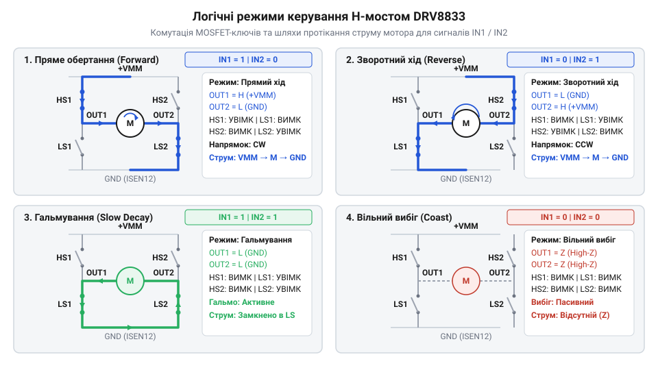
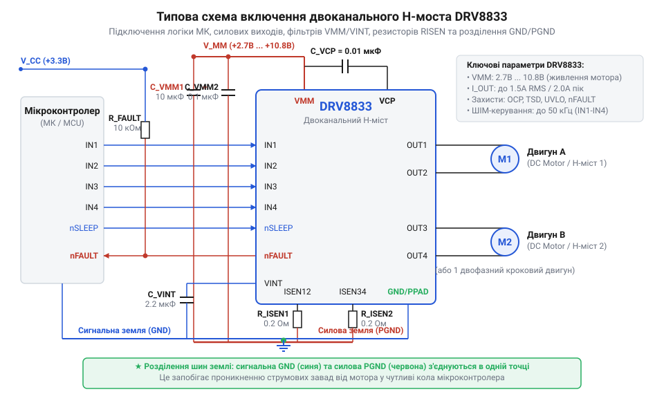

# Залізний інтерфейс та схемотехнічна довідка DRV8833

## Небезпека сквозних струмів індуктивного навантаження

Пряме підключення індуктивного навантаження (наприклад, котушки колекторного мотора) до дискретних транзисторів створює дві смертельні загрози для силової електроніки. По-перше, під час комутації плечей виникає ризик, що верхній і нижній транзистори однієї стійки будуть відкриті одночасно. Це викликає @@en|наскрізний струм@@ (від англ. *shoot-through* — струм прямого короткого замикання джерела живлення на землю через два транзистори), який за лічені мікросекунди виводить ключі з ладу. По-друге, індуктивність обмотки опирається миттєвій зміні струму: у момент розмикання ключів вона генерує зворотну еРС самоіндукції, випускаючи високовольтний спалах напруги, який пробиває напівпровідникові переходи.

Виходи мікроконтролера видають лише слабкострумові логічні сигнали й абсолютно не пристосовані до комутації реактивних струмів у кілька ампер. Спроба побудувати безпечний дискретний @@en|H-міст@@ (від англ. *H-bridge* — H-подібна топологія з чотирьох силових ключів) вимагає складного апаратного контролю часових затримок між перемиканнями транзисторів — так званого @@en|dead-time@@ (від англ. *dead time* — мертвий час захисного інтервалу), а також встановлення зовнішніх зустрічно-паралельних діодів.

Інтегрована мікросхема @@en|DRV8833@@ від компанії @@en|Texas Instruments@@ повністю вирішує ці проблеми на кристалі. Вона містить два незалежні @@en|H-міст@@ на @@en|MOSFET@@-транзисторах (від англ. *metal-oxide-semiconductor field-effect transistor*, польовий транзистор із ізольованим затвором) з низьким опором каналу, вбудовані зворотно-паралельні діоди для скидання індуктивного струму та апаратну логіку генерації затримок @@en|dead-time@@. Це перетворює @@en|DRV8833@@ на готовий монолітний драйвер для безпечного двонаправленого керування двома моторами постійного струму або одним кроковим мотором.

## Призначення виводів та силові параметри

Апаратний інтерфейс @@en|DRV8833@@ чітко розділений на силову частину комутації та логічну частину керування. Силове живлення подається на виводи @@en|VM@@ (робочий діапазон від 2.7 В до 10.8 В). Саме від напруги @@en|VMM@@ живляться вбудовані силові транзистори, що комутують струм у навантаження через виходи @@en|OUT1@@, @@en|OUT2@@ (перший @@en|H-міст@@) та @@en|OUT3@@, @@en|OUT4@@ (другий @@en|H-міст@@). Кожен міст здатний довготривало віддавати в навантаження струм до 1.5 А (RMS) при належному тепловідведенні, або до 2.0 А у короткочасних піках. Для більших струмів застосовують рішення з [потужнішими H-мостами](root:cat-hw-drivers/mc33886-driver), проте в компактній робототехніці параметри @@en|DRV8833@@ є оптимальним балансом.

Керувальні входи @@en|IN1@@, @@en|IN2@@, @@en|IN3@@, @@en|IN4@@ сприймають логічні рівні 3.3 В та 5 В від керуючого мікроконтролера. Порогова напруга логічної одиниці на входах становить близько 2.0 В, що забезпечує повну сумісність із сучасними низьковольтними контролерами.

Виводи @@en|ISEN12@@ та @@en|ISEN34@@ є нижніми точками силових мостів. Вони підключаються до землі через зовнішні вимірювальні резистори для зняття сигналу струму обмоток. Внутрішній лінійний регулятор формує допоміжну напругу на виводі @@en|VINT@@, яка використовується виключно для внутрішніх потреб схеми керування затворами.

## Режими керування та логіка моста

Комбінація логічних рівнів на входах @@en|IN1@@ та @@en|IN2@@ безпосередньо задає стан силових транзисторів першого моста (аналогічно @@en|IN3@@ та @@en|IN4@@ керують другим мостом). Подача логічної одиниці на один із входів та нуля на інший відкриває відповідну діагональ @@en|H-міст@@, змушуючи мотор обертатися в прямому або реверсному напрямку.


*Внутрішні силові MOSFET-ключі H-моста та шляхи протікання струму під час прямого обертання, реверсу, гальмування й затухання.*

Логіка роботи моста підпорядковується стандартній таблиці станів:

- **IN1 = 0, IN2 = 0**: стан високого імпедансу (виходи @@en|OUT1@@ і @@en|OUT2@@ відключені). Струм мотора згасає через вбудовані діоди в режимі швидкого спаду (@@en|fast decay@@ — від англ. *fast decay*, режим швидкого розсіювання енергії у джерело живлення), мотор обертається за інерцією.
- **IN1 = 1, IN2 = 0**: пряме обертання (@@en|OUT1@@ підключено до @@en|VMM@@, @@en|OUT2@@ — до землі).
- **IN1 = 0, IN2 = 1**: реверсне обертання (@@en|OUT1@@ підключено до землі, @@en|OUT2@@ — до @@en|VMM@@).
- **IN1 = 1, IN2 = 1**: активне гальмування (обидва виходи @@en|OUT1@@ і @@en|OUT2@@ замкнені на землю через нижні транзистори). Індуктивний струм циркулює у замкненому контурі моста в режимі повільного спаду (@@en|slow decay@@ — від англ. *slow decay*, режим повільного затухання струму з виникненням гальмівного моменту).

Регулювання швидкості здійснюється подачею сигналу @@en|ШІМ@@ (від англ. *pulse-width modulation*, широтно-імпульсна модуляція). Перемикання між режимом ходу та активним гальмуванням (з використанням @@en|slow decay@@) забезпечує лінійнішу регулювальну характеристику швидкості, ніж перемикання у режим вільного ходу. Внутрішня схема затримки @@en|dead-time@@ гарантує захисну паузу близько 450 нс під час кожної зміни напрямку струму.

## Вимірювання та внутрішнє обмеження струму

Під час пуску мотора або заклинювання його ротора струм через обмотки може зрости у кілька разів вище номінального, що загрожує перегрівом кристала драйвера та просіданням живлення. @@en|DRV8833@@ має вбудований аналоговий компаратор обмеження струму, який порівнює спад напруги на зовнішньому резисторі @@en|R_ISEN@@ із фіксованим внутрішнім пороговим значенням V_TRIP = 0.2 V.

Вимірювальний резистор підключається між виводом @@en|ISEN12@@ (або @@en|ISEN34@@) та загальним проводом схеми. Струм обмеження розраховується за формулою:

```
V_TRIP = 0.2 V
I_LIMIT = V_TRIP ÷ R_ISEN      [формула розрахунку граничного струму]
R_ISEN = V_TRIP ÷ I_LIMIT      [формула вибору токознімального резистора]
```

**Приклад розрахунку резистора R_ISEN для граничного струму 1.0 А:**

```
I_LIMIT = 1.0 A
R_ISEN = 0.33 V ÷ 1.0 A       [підстановка цільового струму]
       = 0.33 Ω               [необхідний опір резистора]
P_RISEN = (1.0 A)² × 0.33 Ω   [розрахунок теплової потужності]
        = 0.33 W              [мінімальна потужність розсіювання]
```

Коли струм обмотки досягає порогового значення I_LIMIT, напруга на @@en|AISEN@@ (чи @@en|BISEN@@) досягає 200 мВ. Компаратор негайно відключає силові ключі на фіксований час близько 20 мкс (механізм струмового чопера з фіксованим часом вимкнення). Після закінчення цієї паузи міст знову вмикається. Якщо вимірювання струму не потрібне, виводи @@en|ISEN12@@ та @@en|ISEN34@@ необхідно з'єднати безпосередньо з землею.

## Спеціальні сигнали захисту та сплячий режим

Для запобігання пошкодженню драйвера в нештатних ситуаціях @@en|DRV8833@@ оснащено трьома апаратними захисними механізмами:

- **Захист від струмового перевантаження (@@en|OCP@@)** (від англ. *over-current protection* — захист від струмового перевантаження): реагує на пряме коротке замикання виходів на @@en|VMM@@, землю або між собою. При перевищенні критичного струму понад 2 А силові ключі аварійно вимикаються.
- **Тепловий захист (@@en|TSD@@)** (від англ. *thermal shutdown* — теплове аварійне вимкнення): знеструмлює виходи при досягненні температури кристала близько 160 °C.
- **Блокування за низької напруги (@@en|UVLO@@)** (від англ. *under-voltage lockout* — блокування за низької напруги): відключає міст, якщо силова напруга @@en|VMM@@ падає нижче 2.5 В, захищаючи ключі від роботи у ненасиченому режимі.

При спрацьовуванні будь-якого з цих захистів драйвер переводить виходи у стан високого імпедансу та притискає до землі вивід аварійного сигналу @@en|nFAULT@@. Вивід @@en|nFAULT@@ має конфігурацію відкритий стік (від англ. *open-drain*, каскад з відкритим стоком), тому вимагає зовнішнього підтягувального резистора номіналом 10 кОм до логічного живлення 3.3 В або 5 В. Після усунення причини аварії драйвер автоматично повертається до нормальної роботи, а лінія @@en|nFAULT@@ піднімається у високий рівень.

Вивід @@en|nSLEEP@@ керує енергозбереженням: при подачі логічного нуля драйвер переходить у режим глибокого сну з мікроамперним споживанням струму. При цьому знеструмлюється внутрішній регулятор @@en|VINT@@, а силові ключі розмикаються. Для активної роботи на вивід @@en|nSLEEP@@ має подаватися логічна одиниця.

## Схемотехнічна обв'язка та трасування плати

Стабільність роботи @@en|DRV8833@@ в умовах високочастотної комутації індуктивних навантажень залежить від правильності схемотехнічного обв'язування та розведення друкованої плати.


*На принциповій схемі зображено DRV8833 із фільтрувальними конденсаторами VMM/VINT, струмовимірювальними резисторами RISEN та підтяжкою nFAULT.*

Обов'язковими елементами обв'язки є фільтрувальні конденсатори. На шину силового живлення @@en|VM@@ встановлюють комбінацію з електролітичного або танталового конденсатора ємністю 10–100 мкФ (для згладжування пульсацій і поглинання зворотних кидків струму) та керамічного конденсатора 0.1 мкФ безпосередньо біля виводів чипа. Для внутрішнього регулятора @@en|VINT@@ обов'язково встановлюється керамічний конденсатор ємністю 2.2 мкФ між виводом @@en|VINT@@ та землею.

При трасуванні друкованої плати необхідно розділяти силові та сигнальні провідники заземлення. Силовий струм від резисторів @@en|R_ISEN@@ та фільтра @@en|VMM@@ має повертатися до джерела живлення окремим широким треком, не перетинаючись із сигнальним заземленням мікроконтролера.

Мікросхема випускається у корпусах @@en|TSSOP-16@@ та @@en|QFN-16@@ із металевою тепловідвідною підкладкою @@en|PowerPAD@@ (від англ. *PowerPAD* — відкритий тепловідвідний майданчик). *power pad* — металізований тепловідвідний майданчик на корпусі). Підкладку @@en|PowerPAD@@ слід обов'язково припаювати до мідного полігону заземлення верхнього шару плати та з'єднувати з внутрішніми шарами за допомогою сітки з 4–9 перехідних отворів для ефективного відведення тепла від напівпровідникового кристала.
