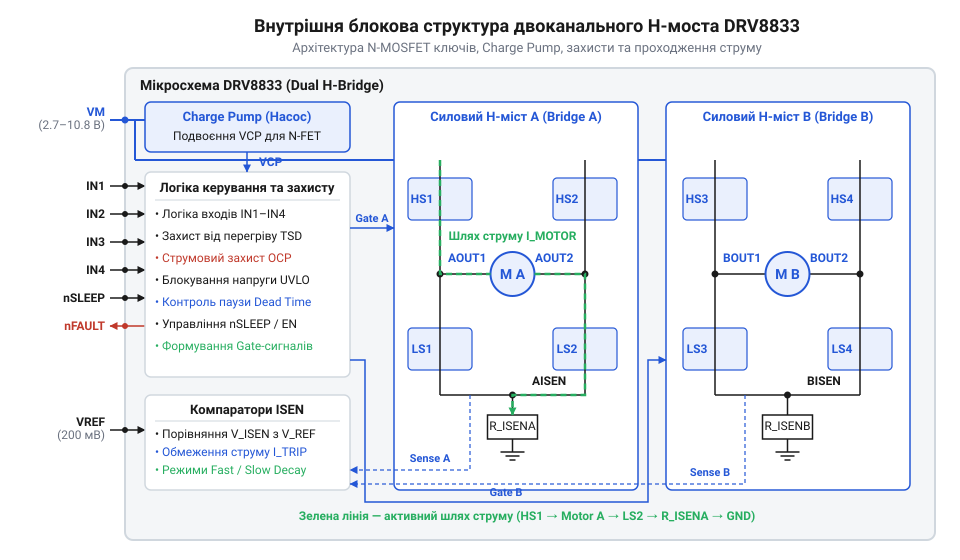
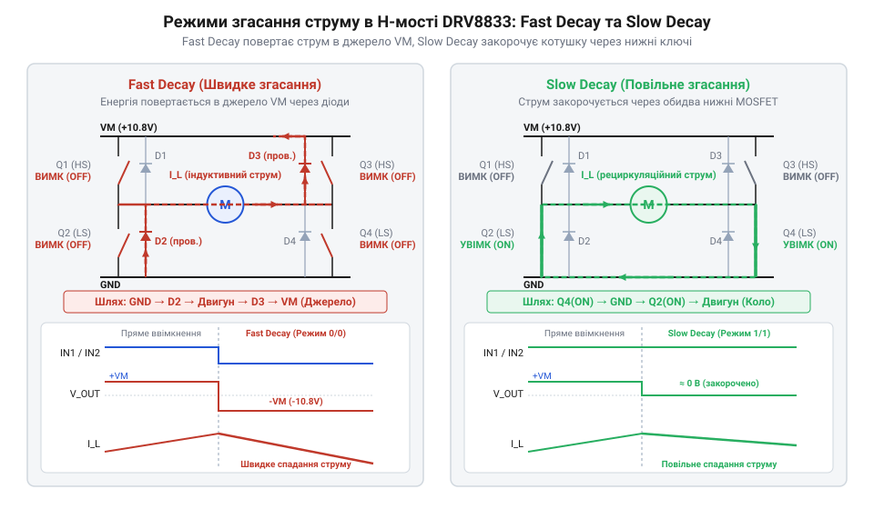
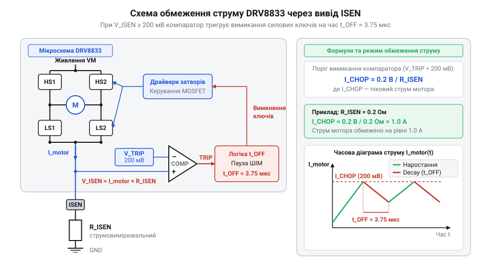
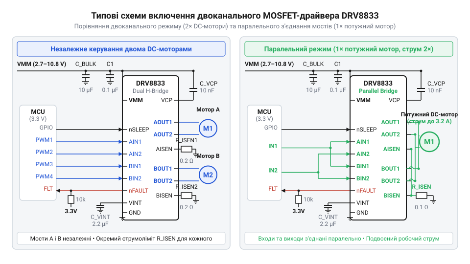

# Двоканальний MOSFET-драйвер DRV8833

<preknowlist>
- [CJMCU MC33886 — драйвер моторів (5A H-міст)](root:cat-hw-drivers/mc33886-driver) — базові принципи побудови H-моста, керування напрямком обертання DC-моторів та захисту силових ключів від зворотної ЕРС індуктивного навантаження
</preknowlist>

## Проблема комутації низьковольтних моторів

Коли автономний пристрій або мобільний робот працює від одного літієвого акумулятора на 3.7 В чи трьох батарейок AA, кожен вольт напруги стає критичним ресурсом. Ззвичайний колекторний мотор постійного струму вимагає зміни полярності живлення для реверсу, що традиційно вирішують за допомогою @@en|H-моста@@ (англ. @@en|H-bridge@@, від форми схеми, що нагадує літеру H). Проте спроба керувати мотором у низьковольтній системі за допомогою класичних мостових схем на біполярних транзисторах призводить до раптового збою: мотор не розвиває потрібного моменту або взагалі відмовляється обертатися. Причина полягає у фізиці насичення силових ключів, де застаріла компонентна база знеструмлює навантаження ще до того, як струм дійде до обмоток.

У класичних біполярних транзисторах @@en|BJT@@ (англ. @@en|Bipolar Junction Transistor@@, біполярний транзистор) у стані насичення між колектором та емітером завжди залишається залишкова напруга `V_CE(sat)`. Оскільки струм через мотор проходить послідовно через один верхній та один нижній ключ @@en|H-моста@@, загальні втрати напруги складаються з обох падінь. Для популярних драйверів попереднього покоління, як-от [мостових драйверів MC33886](root:cat-hw-drivers/mc33886-driver) або класичних мікросхем L298N, падіння напруги на силових ключах сягає від 1.5 В до 2.5 В залежно від струму.

Розрахуємо напругу на обмотках мотора при живленні від літієвого акумулятора:

```
V_motor = V_bat - (V_CE(top) + V_CE(bot))
        = 3.7 В - (0.9 В + 0.9 В)            [віднімаємо падіння на верхньому та нижньому BJT]
        = 1.9 В                               [залишкова напруга на моторі]
```

Втрата майже 50% вхідної напруги означає пропорційне падіння пускового моменту та обертів двигунів. Понад те, виділена на ключах потужність перетворюється на паразитне тепло: при струмі 1 А драйвер розсіює 1.8 Вт енергії у закритому корпусі, що вимагає масивних радіаторів та швидко розряджає акумулятор.

Історично ці обмеження тривалий час стримували розвиток малогабаритної робототехніки та портативної електроніки. Класичні біполярні інтегровані мости розроблялися під промислові стандарти живлення 12–24 В, де втрата 2 В не була катастрофічною. Проте з поширенням 3.3-вольтової мікроконтролерної логіки та однобалансних Li-Ion акумуляторів виникла гостра потреба змінити напівпровідникову топологію. Перехід від біполярних транзисторів до польових ключів @@en|MOSFET@@ (англ. @@en|Metal-Oxide-Semiconductor Field-Effect Transistor@@, транзистор зі структурою метал-оксид-напівпровідник) дозволив відмовитися від фіксованого падіння напруги насичення. Замість сталої величини `V_CE(sat)` відкритий канал @@en|MOSFET@@ поводиться як чистий опір `R_DS(on)`, падіння напруги на якому прямо пропорційне струму `I · R_DS(on)`. Розробка низьковольтних @@en|MOSFET@@-чипів серії @@en|DRV8833@@ від компанії @@en|Texas Instruments@@ стала технологічним відповідником цієї потреби, розширивши робочий діапазон силового живлення вниз до 2.7 В та відкривши шлях до створення надкомпактних автономних систем.

Використання комплементарних чи повністю N-канальних ключових структур із опором каналу у сотні міліом радикально змінює енергетику комутації. Якщо сумарний опір верхнього й нижнього ключів становить `0.36 Ом`, то при струмі 1 А падіння напруги складе лише `0.36 В` проти `1.8 В` у біполярному аналогу. Це залишає на моторі понад 90% напруги джерела живлення й усуває проблему критичного нагріву. Однак при розрахунку силового режиму важливо враховувати фізику напівпровідникового каналу: опір відкритого транзистора `R_DS(on)` не є суворо сталою величиною й зростає при підвищенні температури кристала. Під дією протікання струму кристал нагрівається, що підсилює теплові коливання його ґратки й збільшує розсіювання носіїв заряду. Це зменшує рухливість електронів у каналі й зумовлює позитивний температурний коефіцієнт опору: при розігріві ключів до межевих `+125 °C` значення `R_DS(on)` може зрости на 30–50% порівняно зі станом при `+25 °C`. Таке збільшення опору призводить до додаткового падіння напруги та більшого виділення тепла під тривалим високим навантаженням. Крім того, реалізація суцільно N-канального моста у низьковольтному чипі постає перед новою фізичною перешкодою — потребою відчиняти верхні транзистори при напрузі живлення, близькій до мінімального порогу. Щоб зрозуміти, як розробники вирішили цю задачу, необхідно розібрати внутрішньоструктурні [топології H-мостів](root:hw-motion/h-bridge) та будову силових каскадів.

Саме завдяки розв'язанню проблеми керування затворами N-каналу в одному кремнієвому кристалі чип @@en|DRV8833@@ поєднує два автономні @@en|H-мости@@ із силовим живильним діапазоном від 2.7 В до 10.8 В. Це дозволяє в єдиному корпусі керувати або двома незалежними колекторними двигунами з робочим струмом до 1.5 А на канал, або одним двофазним кроковим мотором. Будучи яскравим представником ширшої [родини мостових драйверів](root:cat-hw-drivers/drv88xx-motor-drivers-family), мікросхема вирішує не лише задачу мінімізації статичних втрат, а й забезпечує комплексний апаратний захист силових кіл від короткого замикання, перегріву та просідання напруги живлення. Осягнення цих переваг підводить до детального аналізу внутрішньої будови силових каскадів чипа.

## Внутрішня архітектура силових каскадів DRV8833

Мікросхема @@en|DRV8833@@ містить два незалежні @@en|H-мости@@, кожен з яких здатний віддавати в навантаження довготривалий струм до 1.5 А (або до 2 А у піку) в діапазоні напруг від 2.7 В до 10.8 В. Всі вісім силових ключів двох мостів виконані на N-канальних @@en|MOSFET@@ транзисторах. Вибір N-канальних транзисторів для верхніх і нижніх плечей моста зумовлений їхньою вищою рухливістю носіїв заряду (електронів) порівняно з P-канальними транзисторами: при тих самих фізичних розмірах кристала N-MOSFET має значно нижчий питомий опір відкритого каналу `R_DS(on)`.

Увімкнення нижнього N-MOSFET (нижнє плече) не викликає складнощів: його витік (англ. @@en|Source@@) підключений до землі GND, тому для повного відкриття ключа достатньо подати на затвор (англ. @@en|Gate@@) стандартну логічну напругу керування `V_logic`, яка перевищує порогову напругу `V_GS(th)`. Проте для верхнього N-MOSFET витік підключений до вихідної точки моста (OUT1 або OUT2). Коли верхній транзистор відкривається, напруга на його витоці піднімається майже до повного рівня силового живлення `V_VM`. Щоб утримати N-MOSFET у повністю відкритому стані з мінімальним опором `R_DS(on)`, напруга на його затворі має перевищувати напругу на витоці на величину відмикання `V_GS`:

```
V_Gate = V_VM + V_GS
```

Якщо силове живлення `V_VM` становить лише 2.7 В, сформувати такий потенціал із зовнішньої шини неможливо. Для розв'язання цієї проблеми в @@en|DRV8833@@ інтегровано внутрішню схему @@en|підкачування заряду@@ (англ. @@en|Charge Pump@@). Це імпульсний генератор з ємнісним помножувачем напруги, який безперервно генерує внутрішнє підвищене живлення, що перевищує `V_VM` на 5–6 В. Завдяки цьому драйвер стабільно відчиняє затвори верхніх N-MOSFET ключів навіть при роботі від майже розрядженого літієвого акумулятора. Однак ця схема активна лише у робочому стані чипа: у режимі сну при низькому рівні на виводі `nSLEEP` генератор вимикається для економії енергії. Після подачі логічної одиниці на `nSLEEP` підкачування заряду потребує скінченного часу виходу на робочий режим (англ. @@en|Wake-up Time@@, `t_WAKE`), який зазвичай становить до 1 мс. Упродовж цього інтервалу внутрішні ємності накопичують необхідний затворний потенціал; якщо подати керуючі імпульси на входи IN1–IN4 до завершення `t_WAKE`, верхні N-MOSFET ключі не зможуть повністю відкритися через недостатню напругу на затворах, що спричинить тимчасове зростання опору `R_DS(on)` та додаткові теплові втрати.

Загальна блокова схема внутрішніх каскадів, що об'єднує керуючу логіку, підкачування заряду та силові ключі, зображена нижче.


*Внутрішньоструктурне влаштування двох H-мостів DRV8833: схема Charge Pump генерує підвищену напругу затворів для N-MOSFET ключів верхнього плеча.*

Керування кожним із двох мостів здійснюється за допомогою двох логічних входів (IN1 і IN2 для моста A, IN3 і IN4 для моста B). Внутрішня логіка чипа перетворює рівні входів у протифазні сигнали керування затворами чотирьох N-MOSFET транзисторів одного @@en|H-моста@@, виключаючи наскрізні струми (англ. виключаючи наскрізні струми (англ. @@en|Shoot-Through Current@@) за допомогою вбудованого часового запізнення (англ. @@en|Dead Time@@).

Розглянемо чотири базові стани силових ключів моста A залежно від сигналів IN1 та IN2:

1. **Пряме обертання (IN1 = 1, IN2 = 0):** Логіка драйвера відкриває верхній N-MOSFET плеча 1 та нижній N-MOSFET плеча 2. Струм протікає за шляхом: силова шина `V_VM` → верхній ключ 1 → вивід OUT1 → обмотка мотора → вивід OUT2 → нижній ключ 2 → вимірювальний резистор ISEN → заземлення GND.
2. **Зворотне обертання (IN1 = 0, IN2 = 1):** Відкриваються верхній N-MOSFET плеча 2 та нижній N-MOSFET плеча 1. Струм змінює напрямок: `V_VM` → верхній ключ 2 → OUT2 → обмотка мотора → OUT1 → нижній ключ 1 → ISEN → GND.
3. **Швидке гальмування / Повільне згасання (IN1 = 1, IN2 = 1):** Логіка замикає обидва нижні N-MOSFET транзистори на землю (або обидва верхні на `V_VM`), закорочуючи виводи мотора між собою. Накопичена в індуктивності обмоток ЕРС самоіндукції замкнена в контурі моста, спричиняючи швидке дисипативне гальмування ротора.
4. **Вільний хід / Вимкнено (IN1 = 0, IN2 = 0 або nSLEEP = 0):** Всі силові ключі переходять у високоімпедансний стан (Hi-Z). Струм обмоток рециркулює через вбудовані зворотні діоди MOSFET у шину живлення, а мотор вільно обертається до зупинки за інерцією.

Детальний схемотехнічний опис контактів чипа, включаючи виводи систем захисту та розводку підкладки @@en|PowerPAD@@, містить [залізний інтерфейс чипа](root:cat-hw-drivers/drv8833-motor-driver/api-drv8833-hardware-interface.md). Така топологія ключів створює вичерпну базу для розуміння динамічних режимів комутації ШІМ-сигналів та процесів рециркуляції струму в обмотках.

## Фізика згасання струму та ШІМ-регулювання

Широтно-імпульсна модуляція @@en|PWM@@ (від англ. @@en|pulse@@ — імпульс, @@en|width@@ — ширина, @@en|modulation@@ — регулювання; ШІМ) дає змогу регулювати швидкість обертання двигунів без енергетичних втрат на лінійне гасіння напруги. Проте під час регулювання швидкості виникає фізичний бар'єр, зумовлений природою мотора як індуктивного навантаження. Обмотка двигуна володіє власною індуктивністю, яка опирається раптовій зміні струму. Коли силові ключі @@en|H-моста@@ розмикаються в паузі ШІМ-сигналу, нагромаджена в магнітному полі обмотки енергія вимагає продовження струму в тому ж напрямку. Якщо не надати струму замкненого шляху, виникає сплеск зворотної електрорушійної сили (ЕРС самоіндукції), здатний пробити напівпровідникові переходи транзисторів. Спосіб, у який мікросхема @@en|DRV8833@@ забезпечує цей шлях у паузах між активними імпульсами, визначає режим згасання струму (англ. @@en|decay mode@@, від англ. @@en|decay@@ — згасання).

Існує два базові методи комутації індуктивного струму рециркуляції у паузах ШІМ: швидке згасання @@en|Fast Decay@@ (англ. швидке згасання @@en|Fast Decay@@ (англ. @@en|Fast Decay@@) та повільне згасання @@en|Slow Decay@@ (англ. @@en|Slow Decay@@).

У режимі @@en|Fast Decay@@ під час паузи ШІМ обома вхідними сигналами (IN1 = 0, IN2 = 0) або розмиканням активних ключів усі силові N-MOSFET транзистори плеча переходять у закритий стан. ЕРС самоіндукції індуктивності створює на виводах мотора напругу, яка перевищує силове живлення `V_VM` на величину прямого падіння на вбудованих паразитних діодах N-MOSFET ключів. Струм змушений протікати проти напруги джерела живлення: через нижній паразитний діод протилежного плеча, обмотку мотора та верхній паразитний діод назад у шину `V_VM`. Оскільки до обмотки прикладена повна протилежна напруга живлення, струм падає дуже стрімко. Магнітна енергія індуктивності повертається (рекуперується) у накопичувальні конденсатори шини живлення.

У режимі @@en|Slow Decay@@ під час паузи ШІМ обидва нижні N-MOSFET транзистори утримуються у відкритому стані (IN1 = 1, IN2 = 1). Виводи мотора виявляються замкненими між собою через низькоомний контур нижніх ключів та земляну шину. Вся ЕРС самоіндукції прикладається до внутрішнього опору обмоток та відчинених каналів `R_DS(on)`. Оскільки зовнішня протилежна напруга відсутня, струм згасає повільно, а накопичена енергія розсіюється у вигляді тепла на опорі активних елементів.

Фізична різниця у шляхах струму рециркуляції та відповідних діаграмах струму наведена на схемі нижче.


*Шляхи проходження індуктивного струму в H-мості: при Fast Decay струм повертається у джерело живлення, а при Slow Decay рециркулює через замкнений нижній контур.*

Вибір режиму згасання безпосередньо впливає на пульсації струму, плавність ходу мотора та його механічний момент. При однаковій частоті та коефіцієнті заповнення ШІМ режим @@en|Slow Decay@@ забезпечує значно менші амплітудні пульсації струму, вищий середній струм в обмотках і більший крутний момент на низьких обертах. Натомість режим @@en|Fast Decay@@ забезпечує швидшу динамічну відповідь на зміну управи та вищу точність у системах позиціонування крокових моторів. Для глибокого аналізу комутаційних процесів розроблено [фізико-математичну модель процесів згасання](root:cat-hw-drivers/drv8833-motor-driver/math-hbridge-decay-physics.md) струму.

Практична реалізація ШІМ-регулювання в @@en|DRV8833@@ залежить від комбінації логічних сигналів на входах IN1 та IN2, проте ефективність комутації обмежена верхньою межею частоти модуляції. Для запобігання виникненню наскрізного струму @@en|shoot-through current@@ драйвер примусово витримує апаратний мертвий час @@en|dead time@@ (тривалістю близько 450 нс) між вимкненням одного силового ключа та відкриттям протилежного, а внутрішня схема зсуву рівнів додає затримку розповсюдження сигналів (англ. @@en|propagation delay@@, від англ. @@en|propagate@@ — поширювати, @@en|delay@@ — затримка; затримка розповсюдження). При підвищенні частоти ШІМ понад рекомендовані 20–50 кГц тривалість технологічних затримок стає співрозмірною з періодом самого імпульсу, що спотворює реальний коефіцієнт заповнення (англ. @@en|duty cycle@@, від англ. @@en|duty@@ — робочий, @@en|cycle@@ — цикл; коефіцієнт заповнення), спричиняє нелінійність керування на малих заповненнях та збільшує динамічні втрати на перемикання (англ. @@en|switching losses@@, від англ. @@en|switch@@ — перемикати, @@en|loss@@ — втрата; втрати на перемикання) і нагрів кристала. З огляду на ці обмеження в лінійному діапазоні частот застосовують два ключові режими комутації вхідних сигналів:

1. **Регулювання з повільним згасанням (Slow Decay PWM):** На один із входів (наприклад, IN1) подається постійна логічна одиниця `1`, а на другий (IN2) — інвертований сигнал ШІМ. У фазі активного імпульсу (IN1 = 1, IN2 = 0) мотор прискорюється. У паузі (IN1 = 1, IN2 = 1) драйвер переходить у стан активного гальмування та повільного згасання струму.
2. **Регулювання зі швидким згасанням (Fast Decay PWM):** Один із входів утримується в логічному нулі `0` (наприклад, IN2 = 0), а на другий (IN1) подається прямий сигнал ШІМ. У фазі імпульсу (IN1 = 1, IN2 = 0) відбувається розгін. У паузі (IN1 = 0, IN2 = 0) виходи моста переходять у високоімпедансний стан @@en|Hi-Z@@ (від англ. @@en|High-Impedance@@ — високий опір; високоімпедансний стан), спричиняючи швидке повернення струму через діоди.

Систематизований вибір режимів керування для програмної реалізації наведений у описі [програмним інтерфейсом драйвера](root:cat-hw-drivers/drv8833-motor-driver/api-drv8833-driver-software-api.md). Детальне порівняння комутаційних топологій висвітлюють [режими згасання струму](root:hw-motion/h-bridge-decay-modes). Зрозумівши динаміку струму, можна перейти до системи його вимірювання та обмеження.

Практична поведінка струму під час комутації залежить від співвідношення між періодом модуляції та електричною сталою часу обмотки (англ. @@en|electrical time constant@@, τ = L/R). @@en|time constant@@, від англ. @@en|time@@ — час, @@en|constant@@ — стала; стала часу) `L / R`. При низькому активному опорі обмотки струм під час активного імпульсу швидко досягає великих значень. Коли мотор зупиняється під навантаженням, проти-ЕРС падає до нуля, і струм обмежується лише власним опором мідного провідника. У такій ситуації сама лише зміна коефіцієнта заповнення @@en|PWM@@ не гарантує захисту ключів від перевантаження. Оскільки струм через нижні N-MOSFET транзистори @@en|H-моста@@ стікає у спільну силову шину заземлення, у цей контур вмикають вимірювальний опір. Це дає змогу застосувати [вимірювання струму шунтами](root:hw-sensing/shunt-current-sensing) для апаратного обмеження пікових навантажень драйвера @@en|DRV8833@@.

## Обмеження струму та захист DRV8833

Під час пуску колекторного мотора або при випадковому заклинюванні ротора обмотки не створюють проти-ЕРС, і струм у колі обмежується лише їхнім власним активним опором. Цей пусковий струм (струм короткого замикання) може у 5–10 разів перевищувати номінальний робочий струм, створюючи загрозу перегріву двигуна, просідання напруги батареї чи руйнування ключів H-моста. Мікросхема @@en|DRV8833@@ вирішує цю проблему завдяки інтегрованій аналоговій системі автоматичного обмеження (зрізання) пікового струму за допомогою вимірювальних резисторів-шунтів.

Принцип роботи системи струмообмеження базується на відстеженні падіння напруги на зовнішніх резисторах, підключених між виводами `ISEN12` (для моста A), `ISEN34` (для моста B) та загальною землею GND. Струм, що протікає через мотор та відкритий нижній N-MOSFET ключ, обов'язково проходить через відповідний вимірювальний резистор `R_ISEN`.

Всередині чипа @@en|DRV8833@@ виводи `ISEN` підключені до позитивних входів аналогових компараторів. На негативний вхід кожного компаратора подається внутрішня стабілізована опорна напруга `V_TRIP = 200 мВ` (`0.2 В`).

Електрична схема вузла струмообмеження наведена нижче.


*Схема обмеження пікового струму: вимірювальний резистор R_ISEN створює падіння напруги, яке порівнюється з опорними 200 мВ внутрішнього компаратора.*

Коли струм в обмотці мотора `I_motor` зростає до рівня, при якому падіння напруги на шунті сягає 200 мВ, компаратор спрацьовує. Граничний струм зрізання `I_TRIP` обчислюється за формулою:

```
I_TRIP = V_TRIP / R_ISEN
       = 0.2 В / R_ISEN          [ділимо опорну напругу компаратора 200 мВ на опір шунта]
```

Пригнічення надлишкового струму відбувається шляхом автоматичного вимкнення моста на фіксований проміжок часу `t_OFF ≈ 3.75 мкс`. Упродовж цього часу драйвер примусово переводить H-міст у режим @@en|Slow Decay@@, замикаючи струм рециркуляції через нижні ключі. Після закінчення `t_OFF` H-міст відновлює звичайну роботу під керуванням входів IN1/IN2. Якщо струм знову перевищує `I_TRIP`, цикл переривання повторюється.

Розрахуємо номінал вимірювального резистора для обмеження струму на рівні `1.2 А`:

```
R_ISEN = V_TRIP / I_TRIP
       = 0.2 В / 1.2 А           [підставляємо опорну напругу та потрібний струм зрізання]
       = 0.167 Ом                [значення опору шунта]
```

Якщо функція регулювання струму не потрібна, виводи `ISEN12` та `ISEN34` підключають безпосередньо до землі GND, що усуває потребу в зовнішніх вимірювальних колах. Однак при встановленні вимірювальних шунтів R_ISEN виникає фізичний ефект, здатний порушити роботу системи: високочастотна комутація ключів H-моста створює високу швидкість зміни струму dI/dt, яка на @@en|паразитній індуктивності@@ (від лат. @@la|parasitus@@ — утриманець та @@la|inductio@@ — наведення) доріжок друкованої плати та власній індуктивності резистора наводить імпульсні сплески напруги V = L · dI/dt. @@en|parasitus@@ — утриманець та @@en|inductio@@ — наведення) доріжок друкованої плати та власній індуктивності резистора наводить імпульсні сплески напруги `V = L · dI/dt`. Якщо такий короткочасний сплеск напруги перевищує внутрішню опорну напругу `V_TRIP = 200 мВ` навіть протягом кількох наносекунд, аналоговий компаратор чипа @@en|DRV8833@@ спрацьовує хибно, примусово переводячи мікросхему в режим @@en|Slow Decay@@ на час `t_OFF ≈ 3.75 мкс` ще до того, як реальний струм обмотки мотора досягне граничного значення `I_TRIP`. Для запобігання хибним спрацьовуванням вивід `ISEN` захищають від високочастотних завад шляхом встановлення низькочастотного @@en|RC-фільтра@@ (від англ. @@en|resistor-capacitor filter@@). @@en|RC filter@@, де R — опір, C — ємність; наприклад, резистор `100 Ом` послідовно з входом компаратора та конденсатор `1 нФ` на землю), а також мінімізують довжину силових доріжок шунта й використовують низькоіндуктивні SMD-резистори. Фізичні особливості добору потужності та матеріалу шунтів розглядають [вимірювальні резистори-шунти](root:hw-sensing/shunt-current-sensing). Точний математичний апарат розрахунку теплових втрат містить [розрахунок обмеження струму](root:cat-hw-drivers/drv8833-motor-driver/math-drv8833-current-limiting-and-thermal-calc.md).

Окрім плавного зрізання струму за допомогою `ISEN`, в @@en|DRV8833@@ інтегровано три рівні аварійного апаратного захисту:

1. **Захист від перевантаження по струму (OCP, від англ. @@en|Overcurrent Protection@@ — захист від надструму):** Незалежно від резисторів `ISEN`, кожен N-MOSFET транзистор має індивідуальний датчик струму. Якщо на виході виникає коротке замикання (OUT на GND, OUT на VMM або між OUT1 та OUT2) зі струмом понад `I_OCP ≈ 2.0...2.7 А`, драйвер миттєво вимикає всі ключі моста на аварійну паузу `t_RETRY ≈ 1.6 мс` та притискає вивід `nFAULT` до землі.
2. **Тепловий захист (TSD, від англ. @@en|Thermal Shutdown@@ — теплове вимкнення):** Датчик температури кристала стежить за нагрівом мікросхеми. При досягненні критичної температури `T_JSD ≈ 160 °C` силові каскади вимикаються, а вивід `nFAULT` активується (LOW). Після охолодження кристала нижче `145 °C` (гістерезис `15 °C`) робота відновлюється автоматично.
3. **Захист від зниження напруги (UVLO, від англ. @@en|Undervoltage Lockout@@ — блокування при зниженні напруги):** Якщо напруга живлення `V_VM` падає нижче `2.3...2.5 В`, схема @@en|Charge Pump@@ не може гарантувати повне відкриття верхніх N-MOSFET ключів. Драйвер примусово вимикає всі ключі для запобігання їхньому робочому режиму в лінійній області з високим опором та підвищеним нагрівом.

Сигнальний вивід `nFAULT` (від англ. @@en|fault@@ — дефект, помилка, з префіксом @@en|n@@ — активний низький рівень) виконано за схемою з відкритим колектором (стоком). В нормальному стані він перебуває у високоімпедансному стані та потребує зовнішнього підтягуючого резистора (наприклад, `10 кОм`) до шини логічного живлення. Падіння напруги на `nFAULT` до логічного нуля сповіщає мікроконтролер про виникнення аварійної ситуації (OCP, TSD або UVLO).

Гнучкість схемотехніки @@en|DRV8833@@ дозволяє використовувати його як для незалежного керування двома моторами, так і в паралельному включенні мостів для подвоєння робочого струму. Схеми типових застосувань зображені нижче.


*Варіанти схемного підключення DRV8833: двоканальний режим для незалежних DC-моторів та паралельне об'єднання каналів для роботи з підвищеним струмом.*

Схематичне проєктування плат розкрито у прикладах: [модуль керування двома колекторними моторами](root:cat-hw-drivers/drv8833-motor-driver/proj-drv8833-dual-dc-motor-controller.md) та [драйвер двофазного крокового мотора](root:cat-hw-drivers/drv8833-motor-driver/proj-drv8833-bipolar-stepper-driver.md).

## Конфігурація навантажень та особливості плати

Пряме підключення силових навантажень вимагає узгодження схемотехніки виходів із характеристиками споживача струму. Інтегрований драйвер @@en|DRV8833@@ містить два незалежні містки, що дозволяє реалізовувати гнучкі топології живлення. У базовій конфігурації кожен місток працює автономно: входи `IN1`/`IN2` керують силовою парою `OUT1`/`OUT2`, а `IN3`/`IN4` — виходами `OUT3`/`OUT4`. Така схема слугує стандартним рішенням [для керування двома колекторними моторами](root:cat-hw-drivers/drv8833-motor-driver/proj-drv8833-dual-dc-motor-controller.md) у мобільній робототехніці, де кожне колесо вимагає незалежного регулювання швидкості та напрямку обертання за допомогою сигналів @@en|PWM@@.

Коли ж завдання вимагає точного позиціонування вала без використання зворотного зв'язку, ті самі два H-містки переконфігуровуються під живлення двофазного індуктивного навантаження. Під час [підключення біполярного крокового мотора](root:cat-hw-drivers/drv8833-motor-driver/proj-drv8833-bipolar-stepper-driver.md) (від латинського *bi-* — два, та *polus* — полюс) @@la|bipolar@@ перша обмотка статора підключається до виходів `OUT1`/`OUT2`, а друга — до `OUT3`/`OUT4`. Послідовна зміна полярності напруги на обмотках у повнокроковому або напівкроковому режимі створює обертове магнітне поле. Оскільки струм в обмотках обмежується вбудованими компараторами чипа, драйвер утримує заданий момент позиціонування без ризику перегріву обмоток навіть під час повної зупинки ротора.

Для керування потужнішими двигунами, що споживають понад 1,5 А у пікових режимах, два канали чипа об'єднують у спаралелений режим (від грецького *parallelos* — що йде поруч) @@grc|parallel mode@@. Входи `IN1` з'єднують із `IN3`, `IN2` із `IN4`, а силові виходи `OUT1` об'єднують із `OUT3`, а `OUT2` із `OUT4`. Сигнальні вимірювальні виводи `ISEN12` та `ISEN34` також з'єднуються паралельно до спільного вимірювального шунта. У цій конфігурації @@en|DRV8833@@ формує одну з найбільш ефективних [топологій керування індуктивним навантаженням](root:hw-motion/h-bridge), адже результуючий опір відкритих каналів @@en|R_DS(on)@@ зменшується вдвічі. Це знижує статичні теплові втрати й дозволяє подавати у навантаження довготривалий струм до 2 А та комутувати пікові імпульси до 3 А без ризику асиметрії завдяки ідентичності параметрів @@en|MOSFET@@ ключів на єдиному кристалі.

Проте навіть найкраще збалансовані силові ключі втрачають надійність, якщо силова шина живлення @@en|VMM@@ зазнає імпульсних просідань чи високочастотних сплесків. У момент комутації ключів та під час режиму @@en|Fast Decay@@ індуктивний струм двигуна скидається назад у джерело живлення, що породжує різкі стрибки напруги через рекуперацію (від латинського *recuperatio* — повернення) @@la|recuperation@@ накопиченої енергії. Якщо джерело живлення має високий індуктивний опір підвідних дротів або не здатне поглинати зворотний струм, вся магнітна енергія `E_L`, накопичена в індуктивності обмотки `L` при піковому струмі `I`, переходить у блокувальну ємність `C` шини @@en|VMM@@. Це викликає зростання напруги живлення від номінального значення `V_MM` до граничного пікового рівня `V_peak` з відповідним приростом ємкісної енергії `E_C`. Зрівнюючи ці енергії, отримують мінімальну ємність `C_min`, необхідну для утримання сплеску напруги в безпечних межах:

        E_L   = 0.5 · L · I²                    [магнітна енергія індуктивності]
        E_C   = 0.5 · C · (V_peak² - V_MM²)     [приріст енергії у блокувальній ємності]
        C_min = (L · I²) ÷ (V_peak² - V_MM²)  [умова балансу рекуперованої енергії]

Ця формула показує, що необхідна блокувальна ємність прямо пропорційна індуктивності обмотки `L` та квадрату струму `I`, і обернено пропорційна різниці квадратів пікової `V_peak` та номінальної `V_MM` напруг. Якщо реальна ємність шини менша за розраховане значення `C_min`, піковий стрибок напруги перевищить критичну межу 12 В для чипа @@en|DRV8833@@, що призведе до електричного пробою силових ключів @@en|MOSFET@@ або аварійного вимкнення чипа. Для приглушення високочастотних завад безпосередньо біля виводів живлення чипа встановлюють керамічний блокувальний конденсатор (від англійського *decoupling capacitor*, де *de-* — розв'язка, та *couple* — з'єднувати) @@en|decoupling capacitor@@ ємністю 0,1 мкФ з низьким еквівалентним послідовним опором @@en|ESR@@. Паралельно йому на шині @@en|VMM@@ розміщують об'ємний електролітичний конденсатор ємністю від 10 до 100 мкФ, що обирається з запасом відносно розрахованого значення `C_min` для поглинання низькочастотних пульсацій і сплесків рекуперації. Внутрішній регулятор напруги @@en|VINT@@, що живить внутрішню логіку чипа, також вимагає власного керамічного конденсатора ємністю 0,1 мкФ до шини заземлення @@en|GND@@.


*Принципова схема спаралелювання каналів DRV8833 та розміщення блокувальних конденсаторів C_VMM і C_VINT: паралельне з'єднання подвоює допустимий струм навантаження, а розміщення керамічних та електролітичних конденсаторів біля виводів живлення ефективно пригнічує високочастотні та низькочастотні сплески напруги.*

Останнім критичним аспектом надійності є грамотне тепловідведення від корпусу чипа. Нижній шар корпусу @@en|DRV8833@@ містить відкритий металевий майданчик @@en|PowerPAD@@, який під час монтажу обов'язково припаюється до мідного полігону заземлення на друкованій платі (англ. *Printed Circuit Board*, @@en|PCB@@). Безпосередньо під майданчиком розміщують масив із декількох наскрізних теплових отворів (від англійського *thermal via*, де *thermal* — тепловий, та *via* — шлях) @@en|thermal via@@, які скидають тепловий потік на внутрішні та нижні шари міді. Якщо знехтувати якісним паянням @@en|PowerPAD@@, внутрішній захист від перегріву @@en|TSD@@ вимикатиме виходи при мінімальному навантаженні. Повний [розрахунок теплового режиму чипа](root:cat-hw-drivers/drv8833-motor-driver/math-drv8833-current-limiting-and-thermal-calc.md) дає змогу точно визначити допустимий струм без перевищення критичної температури кристала. Для завершення проєктування силового модуля вивчається [апаратна розводка виводів чипа](root:cat-hw-drivers/drv8833-motor-driver/api-drv8833-hardware-interface.md), а керування з боку мікроконтролера реалізується через [спеціалізований програмний інтерфейс](root:cat-hw-drivers/drv8833-motor-driver/api-drv8833-driver-software-api.md).

Окрім теплового режиму, надійність силового модуля залежить від захисту сигнальних кіл від високочастотних завад, що виникають під час комутації великих струмів. Коли силові ключі @@en|MOSFET@@ швидко перемикають індуктивне навантаження, імпульсні струми рекуперації та проходження через вимірювальні резистори створюють падіння напруги на паразитичній індуктивності й опорі силових провідників. Якщо силова та сигнальна шини заземлення об'єднані хаотично, це імпульсне зміщення опорного потенціалу викликає збої логіки керування або хибні спрацьовування внутрішніх компараторів. Для запобігання завадам силове заземлення (від англійського *power ground*, де *power* — сила, та *ground* — земля) @@en|power ground@@ розводять окремою широкою шиною й з'єднують із сигнальним заземленням @@en|signal ground@@ лише в єдиній точці біля фільтрувальних конденсаторів за схемою зіркоподібного з'єднання (від англійського *star grounding*, де *star* — зірка, та *grounding* — заземлення) @@en|star grounding@@. Такий системний підхід до розміщення компонентів і розведення провідників гарантує стійкість системи до завад, завершуючи алгоритм проєктування плати для чипа @@en|DRV8833@@ у складі [огляду суміжних мостових драйверів](root:cat-hw-drivers/drv88xx-motor-drivers-family) та спрощує інтеграцію [топології вимірювальних шунтів](root:hw-sensing/shunt-current-sensing) у власні силові розробки. Детальні практики вибору фільтрувальних конденсаторів та розділення силової й сигнальної земель розглядає [схемотехніка живлення та розводка силовими шинами](root:hw-pcb/power-integrity).
