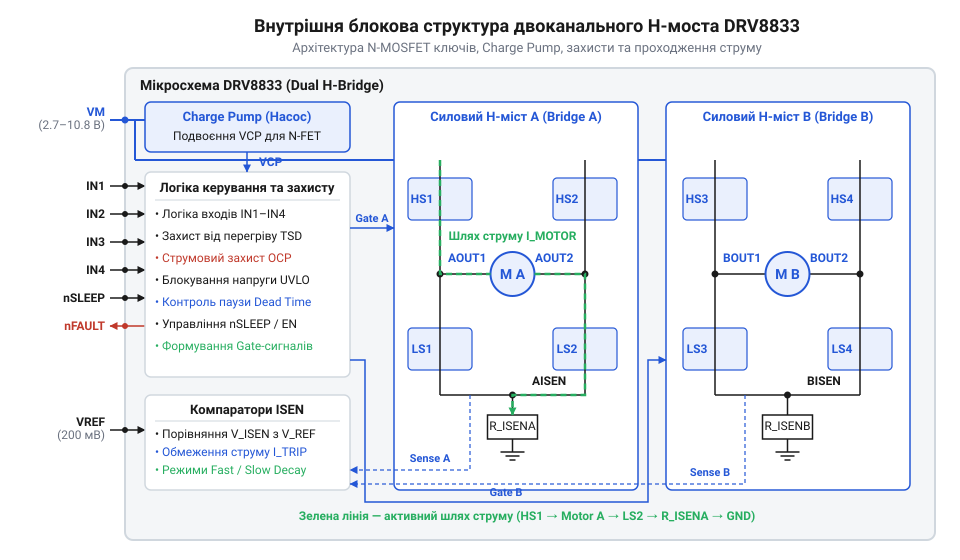
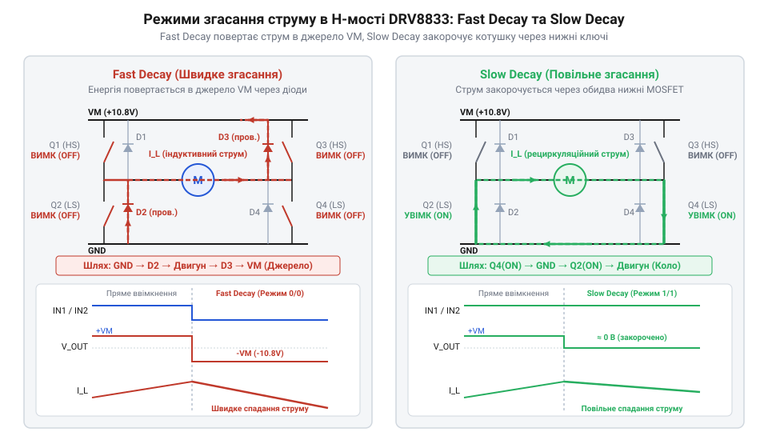
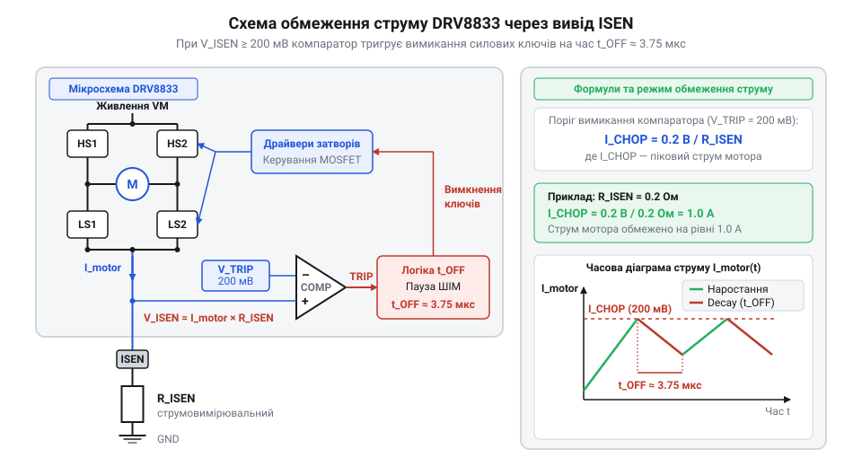
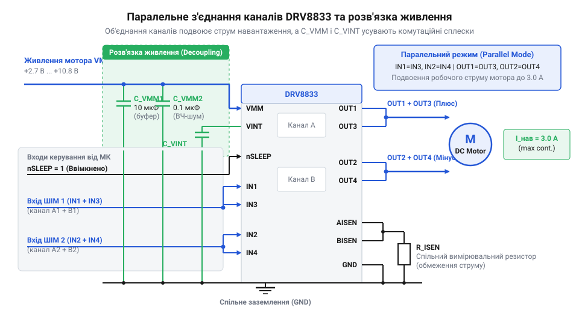

# Двоканальний MOSFET-драйвер DRV8833

<preknowlist>
- [CJMCU MC33886 — драйвер моторів (5A H-міст)](root:cat-hw-drivers/mc33886-driver) — базові принципи побудови H-моста, керування напрямком обертання DC-моторів та захисту силових ключів від зворотної ЕРС індуктивного навантаження
</preknowlist>

## Проблема комутації низьковольтних моторів

У низьковольтних пристроях із живленням від 2.7 В класичні @@en|H-мости@@ (англ. *H-bridge*, через H-подібну форму ключів) на біполярних транзисторах створюють високі втрати. На їхніх переходах виникає фіксоване @@en|падіння напруги насичення@@ `V_CE(sat)` близько 1–2 В. При напрузі живлення 3 В двигун отримує лише третину енергії, а решта виділяється у вигляді тепла, як це розбиралося у [біполярних драйверах моторів](root:cat-hw-drivers/mc33886-driver).

Двоканальний драйвер @@en|DRV8833@@ розв'язує цю проблему використанням ключових @@en|MOSFET@@-транзисторів (англ. *Metal-Oxide-Semiconductor Field-Effect Transistor*, польовий транзистор з ізольованим затвором). Втрати на відчиненому каналі визначаються опором `R_DS(on)` (близько 0.36 Ом на міст). Падіння напруги лінійно залежить від струму `V = I × R_DS(on)`, що зберігає високий @@en|ККД@@ при низьких напругах.

Для зниження опору втрат усі ключі чипа виконані N-канальними. Щоб відчинити верхній N-канал, напруга на його затворі має перевищувати напругу живлення мотора `VMM`. DRV8833 містить внутрішню схему помпування заряду — @@en|Charge Pump@@ (англ. *charge pump*, схема підкачування заряду), яка генерує необхідний потенціал вище за `VMM`. Докладніше про принцип роботи та розрахунок генераторів підвищеної напруги для керування верхніми N-канальними ключами читайте у матеріалі про [схеми підкачування заряду Charge Pump](root:hw-power/charge-pump-circuit).

*Внутрішньоструктурне влаштування DRV8833 із генератором підкачування заряду для керування верхніми N-канальними ключами.*

## Режими згасання струму та ШІМ

Регулювання швидкості та моменту двигуна виконується методом @@en|широтно-імпульсної модуляції@@ (@@en|ШІМ@@). Завдяки індуктивності обмоток струм у мотурі не може зникнути миттєво і під час пауз ШІМ потребує шляху для рециркуляції.

У режимі @@en|Fast Decay@@ (англ. *fast decay*, швидке згасання) обидва ключі активного плеча вимикаються, і струм повертається у джерело живлення через зворотно увімкнені діоди. Це швидко знижує струм, але викликає високі пульсації та зменшує середній крутний момент. У режимі @@en|Slow Decay@@ (англ. *slow decay*, повільне згасання) один із ключів лишається відчиненим, замикаючи обмотку накоротко через нижню або верхню шину. Струм спадає повільно, забезпечуючи рівномірніше обертання.

Логіка входів `IN1`–`IN4` задає стан ключів моста. При перемиканні між верхнім і нижнім транзистором одного плеча виникає ризик їх одночасного відкриття — @@en|наскрізний струм@@ (англ. *shoot-through current*). Внутрішній таймер DRV8833 автоматично витримує @@en|мертвий час@@ (англ. *dead time*, пауза перемикання), затримуючи вмикання нового ключа до повного закриття попереднього.

*Траєкторії струму рециркуляції індуктивного навантаження в режимах швидкого та повільного згасання.*

## Апаратне обмеження струму та захист

Пускові струми й заклинювання ротора створюють небезпечні пікові навантаження. Для обмеження струму між виводом `ISEN` та землею вмикають низькоомний вимірювальний @@en|шунт ISEN@@ (англ. *current sense resistor*). Внутрішній @@en|компаратор@@ (лат. *comparare*, порівнювати) зіставляє падіння напруги на шунті з опорною напругою `V_ref = 200 мВ`.

Граничний струм `I_lim` обчислюють за законом Ома:

V_ISEN = I_lim × R_ISEN
= 0.2 В              [при досягненні порогової напруги V_ref]
I_lim = 0.2 В ÷ R_ISEN

Наприклад, для `I_lim = 1 А` необхідний шунт `R_ISEN = 0.2 В ÷ 1 А = 0.2 Ом`. При досягненні порога чип переводить міст у Slow Decay на 20 мкс. Щоб запобігти хибним спрацьовуванням від імпульсних сплесків, паралельно шунту додають @@en|RC-фільтр@@.

Аварійні режими контролюються системами захисту: від надструму @@en|OCP@@ (англ. *Overcurrent Protection*), перегріву @@en|TSD@@ (англ. *Thermal Shutdown*) та просідання живлення @@en|UVLO@@ (англ. *Undervoltage Lockout*). При збої вихід з відкритим стоком @@en|nFAULT@@ підтягується до логічного нуля.

*Принцип роботи внутрішнього компаратора обмеження струму за падінням напруги на вимірювальному шунті.*

## Топології підключення та вимоги плати

Два H-мости DRV8833 дозволяють керувати двома незалежними DC-моторами або одним двофазним кроковим мотором. Для роботи з потужнішими моторами канали можна спаралелити, з'єднавши входи `IN1` з `IN3` та `IN2` з `IN4`, а виходи `OUT1` з `OUT3` та `OUT2` з `OUT4`, що подвоює робочий струм до 3 А.

Під час гальмування мотор повертає індуктивну енергію в шину живлення `VMM`. Для поглинання сплесків напруги безпосередньо біля виводів живлення встановлюють керамічний конденсатор `0.1 мкФ` та електролітичний ємністю не менше `10 мкФ`.

Для відведення тепла металевий майданчик @@en|PowerPAD@@ (англ. *PowerPAD*) на череві корпусу припаюють до мідного полігону плати через теплові отвори. Силову землю `PGND` та сигнальну `GND` розводять окремими провідниками і з'єднують в одній точці біля фільтруючого конденсатора.

*Схема об'єднання мостів DRV8833 для збільшення струму та розведення блокувальних ємностей живлення.*
