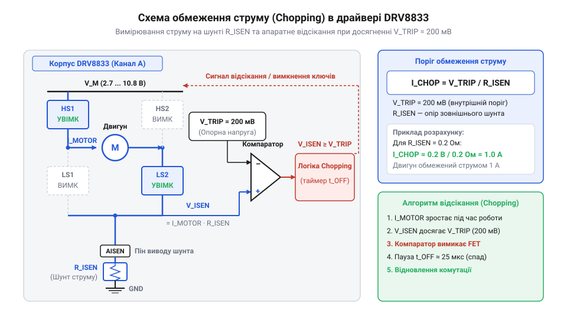

# Розрахунок обмеження струму та теплового режиму DRV8833

<preknowlist>
- [CJMCU MC33886 — драйвер моторів (5A H-міст)](root:cat-hw-drivers/mc33886-driver) — Базові принципи побудови H-моста та комутації індуктивного навантаження.
</preknowlist>

## Чому драйвер згоряє без розрахунку

Під час підключення індуктивного навантаження — колекторного двигуна постійного струму — стан стаціонарного обертання кардинально відрізняється від моменту пуску чи механічного блокування ротора. Коли ротор нерухомий, електромотор не генерує зворотну електрорушійну силу (@@en|back EMF@@, від англ. @@en|electromotive force@@, корінь: @@en|force@@ — сила). Струм обмотки в цей момент обмежений виключно власним активним опором дроту обмотки `R_motor` та опором відкритих каналів моп-транзисторів (@@en|MOSFET@@, від англ. @@en|Metal-Oxide-Semiconductor Field-Effect Transistor@@).

Пусковий струм (@@en|inrush current@@) або струм короткого замикання при заклинюванні ротора (@@en|stall current@@) обчислюється за базовим співвідношенням струму й напруги живлення `V_M`:

```
I_stall = V_M ÷ R_motor       [закон Ома для нерухомого ротора]
```

Цей струм може в 5–10 разів перевищувати номінальне робоче значення. Якщо через інтегральний подвійний мостовий драйвер (@@en|H-bridge@@, корінь: @@en|bridge@@ — міст) DRV8833 тривало протікає такий надмірний струм, на його внутрішніх ключах виділяється пікова теплова потужність. Це спричиняє просідання напруги живлення (@@en|brown-out reset@@), аварійне скидання мікроконтролера або швидкий тепловий пробій напівпровідникового кристала (@@en|die@@). Для комутації значно потужніших навантажень застосовують [потужні силові мости](root:cat-hw-drivers/mc33886-driver), проте в компактному DRV8833 запобігання аваріям покладається на вбудовану систему регулювання струму відсіканням (@@en|current chopping@@, від англ. @@en|chop@@ — відсікати). Без точного математичного розрахунку порогу відсікання та теплових втрат схема або постійно вимикається через перегрів, або виходить з ладу при першому ж навантаженні.

Теплова потужність, що виділяється на внутрішніх ключах моста, зростає пропорційно квадрату струму через їхній власний опір. Якщо цей струм нічим не обмежений, Джоулеве тепло (@@en|Joule heating@@) за частки мілісекунди розігріває кристал до граничних температур. Механізм відсікання дає змогу зрізати амплітуду пускового струму до безпечного рівня, перетворюючи безупинний розігрів на послідовність коротких імпульсів. Однак будь-яке обмеження є компромісом: надто низький поріг відсікання позбавить мотор необхідного обертового моменту, а надто високий — спричинить перегрів кристала під час ШІМ-комутації. Саме тому проектування драйвера вимагає математичного узгодження двох величин: номіналу струмовимірювального шунта для задання межі відсікання та сумарного теплового опору системи для утримання температури напівпровідника в допустимих межах.

Під час розгону ротора його провідні обмотки перетинають силові лінії стаціонарного магнітного поля статора. За законом електромагнітної індукції (@@en|electromagnetic induction@@) цей відносний рух збуджує в обмотці власний електричний потенціал, спрямований протилежно до напруги живлення `V_M`. Ця протидіюча напруга — @@en|back EMF@@ `E_b` — зростає прямо пропорційно кутовій швидкості (@@en|angular velocity@@) обертання `ω`. У результаті результуюче падіння напруги на активному опорі обмотки зменшується до різниці `V_M - E_b`. Коли двигун виходить на розрахункові оберти у стаціонарному режимі (@@en|steady state@@), амплітуда @@en|back EMF@@ наближається до напруги джерела, а робочий струм спадає до значно нижчого значення:

```
I_steady = (V_M - E_b) ÷ R_motor       [струм обмотки у стаціонарному режимі]
```

Завдяки цьому критичні струмові перевантаження й піковий розігрів кристала DRV8833 виникають виключно на нульових обертах (`ω = 0`), коли `E_b = 0` і струм обмежений лише величиною `I_stall`, тоді як під час постійного обертання наведення проти-ЕРС природним чином захищає драйвер від надмірного тепловиділення.

## Розрахунок номіналу струмовимірювального шунта RISEN

Автоматичне обмеження струму в DRV8833 працює шляхом безперервного вимірювання спаду напруги на зовнішньому шунті (@@en|current sense resistor@@) `R_ISEN`, який підключається між виводом низьковольтного плеча ISEN (AISEN для першого моста або BISEN для другого) та загальною шиною заземлення. Внутрішній порівнювач (@@en|comparator@@, від англ. @@en|compare@@, корінь: @@en|compare@@ — порівнювати) зіставляє цю напругу з фіксованим внутрішнім опорним рівнем `V_TRIP = 0.2 В` (або `200 мВ`).

Коли струм обмотки досягає порогового значення `I_CHOP`, напруга на виводі ISEN дорівнює опорній напрузі `V_TRIP`. У цей момент компаратор перемикає силові ключі H-моста в режим повільного загасання струму (@@en|slow decay@@) на фіксований час близько 20 мкс, після чого цикл повторюється.

Виведемо математичну залежність опору струмовимірювального шунта `R_ISEN` від заданого порогу обмеження струму `I_CHOP`:

```
V_ISEN = I_CHOP × R_ISEN      [закон Ома на вимірювальному шунті]
V_TRIP = V_ISEN               [умова спрацьовування внутрішнього компаратора]
R_ISEN = V_TRIP ÷ I_CHOP      [вираження необхідного опору шунта]
```

З отриманого виразу видно, що опір шунта зворотно пропорційний бажаному пороговому струму. Для вибору компонента необхідно також розрахувати електричну потужність розсіювання `P_ISEN`, яка перетворюється на тепло на цьому резисторі:

```
P_ISEN = I_CHOP² × R_ISEN     [потужність теплових втрат на шунті]
= V_TRIP × I_CHOP             [підстановка порогової напруги]
```


*Підключення зовнішнього шунта RISEN до виводу ISEN та внутрішній порівнювач напруги з опорним джерелом VTRIP.*

Практичний вибір номіналу зручно розглянути на числовому прикладі.

**Розрахунок шунта для обмеження струму на рівні 1.0 А:**
```
R_ISEN = 0.2 ÷ 1.0            [підстановка V_TRIP = 0.2 В та I_CHOP = 1.0 А]
= 0.2 Ом                      [необхідний опір струмовимірювального шунта]

P_ISEN = 0.2 × 1.0            [підстановка V_TRIP = 0.2 В та I_CHOP = 1.0 А]
= 0.2 Вт                      [мінімальна розсіювана потужність]
```

За результатами обраховунку визначають стандартний SMD-резистор номіналом `0.2 Ом` із номінальною потужністю `0.25 Вт` або `0.5 Вт` для забезпечення необхідного запасу за температурою. Якщо опір шунта виявиться завищеним, двигун не зможе розвинути потрібний крутний момент; при заниженому опорі виникає ризик перевантаження внутрішніх моп-транзисторів (@@en|MOSFET@@). Для поглибленого вивчення поведінки індуктивного струму під час відсікання можна звернутися до матеріалу про [режими загасання струму H-моста](root:cat-hw-drivers/drv8833-motor-driver/math-hbridge-decay-physics.md).

## Обчислення статичних та динамічних втрат

Під час роботи DRV8833 електрична енергія перетворюється на теплову всередині корпусу через два основні фізичні механізми: стаціонарну провідність відкритих каналів ключових транзисторів та комутаційні процеси під час імпульсної модуляції (@@en|PWM@@, від англ. @@en|Pulse-Width Modulation@@).

Статичні втрати потужності (@@en|conduction losses@@) `P_stat` виникають через наявність ненульового опору відчиненого каналу `R_DS(on)`. Оскільки струм через H-міст завжди проходить послідовно через один верхній транзистор High-Side та один нижній транзистор Low-Side, сумарний опір шляху протікання струму становить `R_DS(on)_total = R_DS(on)_HS + R_DS(on)_LS`. За кімнатної температури для DRV8833 це значення становить близько `0.36 Ом`.

Виведемо статичну потужність втрат `P_stat` для двох активних H-мостів при середньоквадратичному струмі навантаження `I_RMS`:

```
P_stat1 = I_RMS² × R_DS(on)_total    [статичні втрати одного H-моста]
P_stat = 2 × I_RMS² × R_DS(on)_total [сумарні статичні втрати двох каналів]
```

Отриманий вираз показує квадратичну залежність статичного нагріву від робочого струму. 

Динамічні втрати потужності (@@en|switching losses@@) `P_dyn` зумовлені тим, що перемикання моп-транзисторів відбувається за скінченний час фронту наростання `t_r` та спаду `t_f`. Протягом цього інтервалу на транзисторі одночасно присутні висока напруга живлення `V_M` та струм навантаження `I_RMS`.

Виведемо динамічну потужність для двох мостів при частоті модуляції `f_PWM`:

```
P_dyn = 2 × V_M × I_RMS × (t_r + t_f) × f_PWM   [динамічні втрати комутації двох мостів]
```

Сумарна теплова потужність `P_loss`, що виділяється в мікросхемі, додає також власне споживання внутрішньої електронної схеми керування `P_elem = V_M × I_VM` (де `I_VM ≈ 3 мА`):

```
P_loss = P_stat + P_dyn + P_elem      [баланс сумарної теплової потужності]
```

**Обчислення сумарного тепловиділення для V_M = 8.0 В, I_RMS = 0.8 А, f_PWM = 50000 Гц (50 кГц), R_DS(on)_total = 0.4 Ом, t_r + t_f = 100 нс (10⁻⁷ с):**
```
P_stat = 2 × 0.8² × 0.4              [обчислення статичної потужності двох каналів]
= 0.512 Вт                           [статичні втрати провідності]

P_dyn = 2 × 8.0 × 0.8 × 10⁻⁷ × 50000 [обчислення динамічної потужності двох каналів]
= 0.064 Вт                           [динамічні втрати комутації]

P_elem = 8.0 × 0.003                  [власне споживання DRV8833]
= 0.024 Вт                           [втрати схеми керування]

P_loss = 0.512 + 0.064 + 0.024        [сумування всіх компонент втрат]
= 0.600 Вт                           [повна теплова потужність]
```

Обчислення демонструє, що на частотах модуляції до 50 кГц основними є статичні втрати `P_stat`. Проте зі зростанням частоти ШІМ частка динамічних втрат `P_dyn` лінійно збільшується.

## Моделювання температури кристала та термозахист

Виділена всередині напівпровідникового кристала (@@en|semiconductor junction@@) теплова потужність `P_loss` підвищує його температуру `T_J` (від англ. @@en|junction temperature@@, корінь: @@en|junction@@ — перехід) відносно температури навколишнього повітря `T_A`. Здатність конструкції корпусу та друкованої плати розсіювати тепло описується тепловим опором кристалик–довкілля (@@en|thermal resistance@@) `θ_JA`, який вимірюється в °C/Вт.

Виведемо стаціонарну температуру кристала `T_J` через тепловий опір та розсіювану потужність:

```
ΔT = P_loss × θ_JA            [підйом температури кристала над довкіллям]
T_J = T_A + ΔT                [абсолютна температура напівпровідникового переходу]
T_J = T_A + P_loss × θ_JA     [підстановка температурного перепаду]
```

З формули видно, що температура кристала зростає лінійно зі збільшенням теплової потужності та теплового опору. Вбудована схема теплового вимкнення (@@en|thermal shutdown@@) `T_SD` аварійно знеструмлює виходи DRV8833 при досягненні критичної температури `160 °C`. Щоб запобігти спрацьовуванню захисту та деградації напівпровідника, робоча температура `T_J` повинна залишатися нижче гранично припустимої межі `125 °C`.

Значення `θ_JA` суттєво залежить від умов охолодження. Для корпусу TSSOP-16 із металевою площадкою PowerPAD за наявності мідного полігону заземлення опір становить близько `45 °C/Вт`. Без додаткового тепловідводу на платі опір може перевищувати `120 °C/Вт`. Деталі розрахунку площі міді висвітлені у матеріалі про [проектування мідних полігонів для охолодження](root:hw-pcb/thermal-resistance-pcb).

**Моделювання температури кристала при P_loss = 0.6 Вт, T_A = 30 °C та θ_JA = 45 °C/Вт:**
```
ΔT = 0.6 × 45                 [обчислення підйому температури]
= 27 °C                       [перевищення температури кристала]

T_J = 30 + 27                 [обчислення підсумкової температури]
= 57 °C                       [стаціонарна температура кристала]
```

Отримане значення `57 °C` забезпечує значний температурний запас до порогу аварійного спрацьовавання `T_SD = 160 °C`, що гарантує надійну тривалу експлуатацію драйвера DRV8833.
