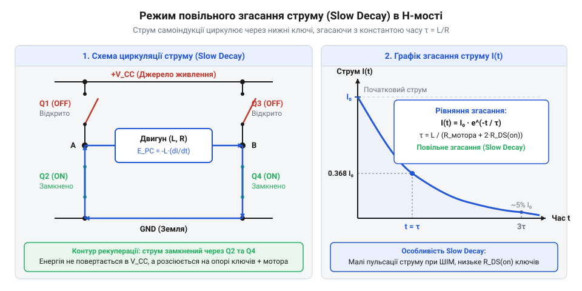
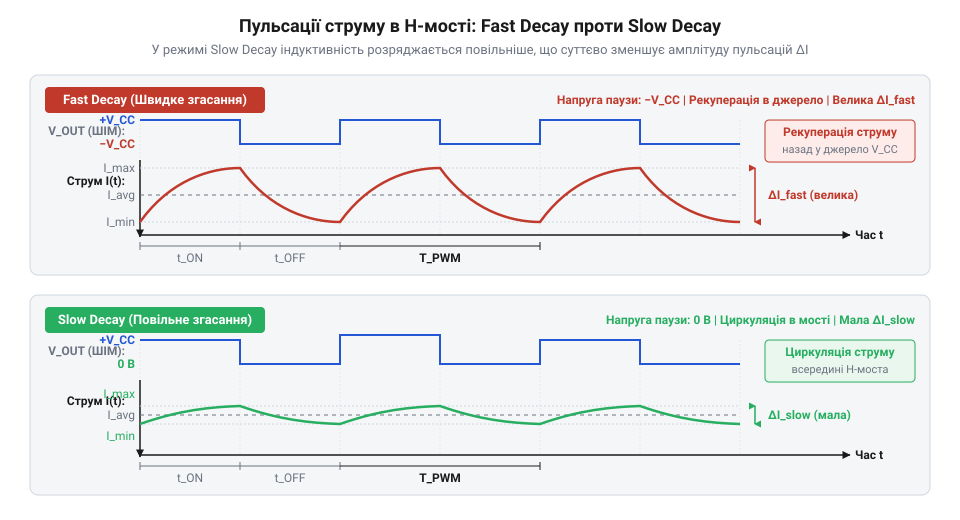

# Фізико-математична модель процесів Fast та Slow Decay в H-мості

<preknowlist>
- [CJMCU MC33886 — драйвер моторів (5A H-міст)](root:cat-hw-drivers/mc33886-driver) — принципова схема ключового моста та будова силових польових транзисторів драйвера
</preknowlist>

## Проблема комутації індуктивності в H-мості

Коли обмотка електричного мотора підключається до джерела живлення через @@en|H-міст@@ (від англ. @@en|H-bridge@@), ключі схеми почергово замикають і розмикають силове коло. У момент увімкнення транзисторів струм протікає через обмотку, утворюючи магнітне поле. На відміну від чисто активного опору, індуктивність (від лат. *inductio* — наведення, англ. @@en|inductance@@) обмотки накопичує енергію в цьому полі.

Енергія магнітного поля підпорядковується співвідношенню:

```
W_L = (1/2) × L × i²
```

де `W_L` — накопичена енергія у джоулях, `L` — @@en|індуктивність@@ обмотки у генрі, а `i` — поточне значення струму в амперах.

Якщо ключі @@en|H-моста@@ розімкнути миттєво, струм в обмотці не може припинитися за один момент, адже накопичена енергія `W_L` не здатна зникнути безслідно. Швидкість зміни струму `di/dt` набуває великого за модулем від'ємного значення. За законом електромагнітної індукції Фарадея на кінцях обмотки виникає напруга самоіндукції (від лат. *inductio*, англ. @@en|self-induction@@):

```
u_L = L × (di/dt)
```

За відсутності спеціального шляху для протікання струму ця напруга `u_L` спрямована протилежно до початкової сили й досягає сотень або тисяч вольт. Такий високовольтний сплеск додається до напруги живлення і прикладається до закритих напівпровідникових ключів. Це призводить до електромагнітного @@en|пробою@@ (англ. @@en|breakdown@@) p-n переходів або каналів силових транзисторів, як-от в інтегральному [драйвері двигунів MC33886](root:cat-hw-drivers/mc33886-driver).

Під час широтно-імпульсної модуляції (скорочено @@en|ШІМ@@, від англ. @@en|PWM@@) ключі перемикаються з частотою в тисячі герц. У кожній фазі вимкнення енергія магнітного поля має безпечно вивільнятися, не викликаючи руйнівних сплесків напруги. Тому виникає задача створення керованого контуру для спаду струму самоіндукції під час вимкненого стану @@en|ШІМ@@.

Фізична небезпека високовольтних сплесків визначається будовою самих силових транзисторів моста (англ. @@en|MOSFET@@). Усередині кожного напівпровідникового ключа через технологічні особливості структури кристала існує паразитний @@en|зворотний діод@@ (від грец. *di-* — два та *hodos* — шлях, англ. @@en|body diode@@). Під час перемикання ключів керувальна схема витримує паузу — @@en|мертвий час@@ (від англ. @@en|dead time@@), упродовж якого всі транзистори вимкнені для запобігання короткому замиканню джерела живлення. Оскільки струм в індуктивності не може припинитися миттєво, а канали транзисторів закриті, потенціал вузла обмотки за частки мікросекунди різко стрибає за межі напруги живлення. Цей швидкий стрибок утворює початковий сплеск напруги, який вимушено зміщує паразитні @@en|зворотні діоди@@ протилежних ключів у прямому напрямку й відкриває їх ще до вмикання активного контуру згасання. Якщо ж після розмикання ключів струм індуктивності не отримує безпечного шляху або сплеск перевищує межу стійкості p-n переходу закритого транзистора, напруга зростає далі. Сильне електричне поле прискорює носії заряду до кінетичної енергії, достатньої для ударної іонізації та вибивання нових електрон-діркових пар. Це викликає @@en|лавинний пробій@@ (від фр. *avalanche* — лавина, англ. @@en|avalanche breakdown@@), під час якого струм вимушено протікає крізь закритий транзистор при максимальній напрузі, швидко перетворюючи накопичену магнітну енергію на тепло в обмеженому об'ємі кристала. Якщо ця енергія перевищує гранично припустиму величину, транзистор теплово руйнується. Водночас за наявності належного керування саме @@en|зворотні діоди@@ протилежних ключів відкриваються під час @@en|мертвого часу@@ у прямому напрямку, обмежуючи початковий сплеск на рівні падіння напруги на діоді та створюючи безпечні шляхи для циркуляції або рекуперації струму самоіндукції.

Залежно від стану ключів у пасивній фазі @@en|ШІМ@@, керований @@en|H-міст@@ спрямовує струм самоіндукції двома принципово різними шляхами. У разі замикання обмотки через два нижні або два верхні ключі струм закорочено у локальному контурі, де накопичена магнітна енергія повільно розсіюється на активному опорі обмотки. У разі повного розмикання силових транзисторів струм протікає проти напруги джерела живлення, швидко повертаючи накопичену енергію назад у силове коло. Саме цей вибір топології розрядного контуру під час вимкненого стану @@en|ШІМ@@ визначає швидкість спаду струму та амплітуду його пульсацій в обмотках двигуна.

## Фізика та математика Slow Decay

Одним із способів безпечного гасіння струму самоіндукції є режим повільного згасання — @@en|Slow Decay@@ (від англ. @@en|Slow Decay@@). У цьому режимі під час фази вимкнення @@en|ШІМ@@ обидва нижні або обидва верхні транзистори @@en|H-моста@@ залишаються замкненими, закорочуючи виводи обмотки між собою.


*Контур циркуляції струму самоіндукції через замкнені нижні ключі H-моста та експоненціальне згасання струму з часовою константою τ.*

Після замикання обмотки накоротко зовнішнє джерело живлення відключається від контуру, а рушійною силою струму стає напруга самоіндукції `u_L`. У цьому режимі струм може циркулювати через відкриті канали транзисторів під час синхронного @@en|Slow Decay@@ або через їхні внутрішні зворотні діоди при пасивному згасанні. Відкритий канал транзистора має дуже малий активний опір `R_ds(on)`, тому втрати потужності на ньому пропорційні квадрату струму `i² × R_ds(on)`. Натомість зворотний діод створює майже сталий спад напруги `V_F`, через що втрати потужності зростають лінійно від струму `i × V_F`. При робочих струмах навантаження протікання через діоди спричиняє значно більше виділення тепла на кристалі драйвера. Примусове відкривання транзисторів (синхронне згасання, від англ. @@en|synchronous decay@@ — узгоджене згасання) мінімізує втрати й знижує теплове навантаження. Описуючи електричний стан замкненого контуру при синхронному згасанні за другим законом Кірхгофа, дістаємо суму напруг на @@en|індуктивності@@ `L` та активному опорі `R`:

```
u_L + u_R = 0
```

де `R` — сумарний активний опір контуру, що складається з опору обмотки та опору відкритих каналів транзисторів `R_ds(on)`.

Підставивши вираз для напруги самоіндукції `u_L = L × (di/dt)` та закон Ома для опору `u_R = R × i`, отримуємо однорідне диференціальне рівняння першого порядку:

```
L × (di/dt) + R × i = 0
```

Розв'яжемо це рівняння методом відокремлення змінних:

```
L × (di/dt) = -R × i                   [перенесення спаду напруги R×i у праву частину]
(1/i) × di = -(R/L) × dt               [ділення на i та L, множення на dt]
∫ (1/i) di = ∫ -(R/L) dt               [інтегрування лівої та правої частин]
ln(i) = -(R/L) × t + C                 [знаходження первісних значень]
i(t) = I₀ × e⁻⁽ᴿᐟᴸ⁾ᵗ                   [потенціювання з врахуванням i(0) = I₀]
```

Здобутий експоненціальний розв'язок показує, що струм `i(t)` спадає від початкового значення `I₀` за експоненціальним законом. Швидкість згасання визначає @@en|часова константа@@ (англ. @@en|time constant@@) `τ`, яка дорівнює відношенню @@en|індуктивності@@ до опору:

```
τ = L / R
```

Виразивши розв'язок через `τ`, отримуємо підсумкову формулу спаду струму:

```
i(t) = I₀ × e⁻ᵗᐟᵀ
```

За час `t = τ` струм в обмотці зменшується в `e ≈ 2.718` раза, тобто становить приблизно `36.8%` від початкового значення `I₀`. За час `t = 3τ` струм падає до `5%`, а за `t = 5τ` — практично до нуля.

Вся енергія магнітного поля `W_L`, накопичена в обмотці, під час @@en|Slow Decay@@ поступово перетворюється на теплову енергію на активному опорі `R` за законом Джоуля-Ленца з миттєвою потужністю втрат `P_loss(t) = i(t)² × R`. Щоб обчислити повну теплову енергію `E_heat` та довести її тотожність початковій енергії поля, проінтегруємо миттєву потужність `P_loss(t)` за часом `t` від моменту комутації `t = 0` до нескінченності `t = ∞`:

```
E_heat = ∫₀^∞ P_loss(t) dt                                [інтеграл миттєвої потужності втрат за часом]
       = ∫₀^∞ (I₀ × e⁻ᵗᐟᵀ)² × R dt                         [підстановка експоненціального спаду струму i(t)]
       = I₀² × R × ∫₀^∞ e⁻²ᵗᐟᵀ dt                          [винесення сталих величин за знак інтеграла]
       = I₀² × R × [- (τ / 2) × e⁻²ᵗᐟᵀ]₀^∞                 [знаходження первісної для показникової функції]
       = I₀² × R × (0 - (- τ / 2))                        [обчислення визначеного інтеграла на межах від 0 до ∞]
       = I₀² × R × (τ / 2)                                 [спрощення алгебраїчного виразу]
       = I₀² × R × (L / (2 × R))                           [підстановка значення часової константи τ = L / R]
       = (1/2) × L × I₀²                                   [скорочення активного опору R]
```

Отриманий результат `E_heat = (1/2) × L × I₀²` тотожно дорівнює початковій енергії магнітного поля `W_L`, накопиченій в @@en|індуктивності@@ `L` перед початком згасання. Це математично доводить, що під час @@en|Slow Decay@@ вся накопичена в обмотці енергія повністю переходить у теплову енергію розсіювання на опорі `R`, а не повертається назад у джерело живлення.

```
P_loss(t) = i(t)² × R
```

Оскільки контур замкнений накоротко і протидіюча напруга створюється лише малим спадом на опорі `R`, струм спадає відносно повільно. Це мінімізує пульсації струму під час високочастотного @@en|ШІМ@@-керування, але продовжує час зняття моменту з ротора двигуна, що важливо враховувати під час проектування [систем керування моторами](root:hw-motion/dc-motor-control-systems).

## Математична модель режиму Fast Decay

Коли силові транзистори @@en|H-міст@@ (англ. @@en|H-bridge@@) вимикаються для припинення подачі струму в мотор, збережена в @@en|індуктивність@@ (лат. *inductio* — введення) обмотки енергія не може зникнути миттєво. Якщо при @@en|Slow Decay@@ струм замкнено всередині моста і він повільно згасає під дією власного активного опору, то в режимі @@en|Fast Decay@@ (англ. *fast* — швидкий, *decay* — згасання) ключі моста перемикаються так, що до обмотки прикладається повна напруга живлення `V_cc` у протилежному напрямку. Цей процес примусово й швидко гасить струм, повертаючи енергію магнітного поля назад у джерело живлення.

Для аналізу перехідного процесу складемо рівняння за другим законом Кірхгофа для замкненого контуру, що містить @@en|індуктивність@@ обмотки `L`, її внутрішній активний опір `R` та протилежно увімкнене джерело живлення `-V_cc`. ЕРС самоіндукції `L · (di/dt)` та падіння напруги `R · i` протидіють прикладеній напрузі:

```
L · (di/dt) + R · i(t) = -V_cc
```

Це неоднорідне диференціальне рівняння першого порядку. Його розв'язок шукаємо як суму загального розв'язку однорідного рівняння `i_h(t)` та часткового розв'язку неоднорідного рівняння `i_p(t)`.

Складемо покрокове знаходження струму `i(t)` за умови, що в момент перемикання `t = 0` початковий струм дорівнював `I_0`:

```
i(t) = i_h(t) + i_p(t)
= C · e⁻ᵗᐟᵀ - V_cc / R                     [загальний розв'язок, де τ = L/R]
= (I_0 + V_cc / R) · e⁻ᵗᐟᵀ - V_cc / R       [знаходження C з початкової умови i(0) = I_0]
= I_0 · e⁻ᵗᐟᵀ - (V_cc / R) · (1 - e⁻ᵗᐟᵀ)    [згруповано доданки для фізичного аналізу]
```

У знайденому виразі @@en|часова константа@@ `τ = L/R` визначає власний темп згасання, а другий доданок описує примусове «витискання» струму протилежною напругою `V_cc`.

Знайдемо момент часу `t_off`, коли струм в обмотці досягає нуля `i(t_off) = 0`. Прирівнявши розв'язок до нуля й застосувавши логарифмування, отримуємо:

```
0 = (I_0 + V_cc / R) · e⁻ᵗᵒᶠᶠᐟᵀ - V_cc / R
e⁻ᵗᵒᶠᶠᐟᵀ = (V_cc / R) / (I_0 + V_cc / R)    [поділено на (I_0 + V_cc / R)]
t_off = τ · ln(1 + (I_0 · R) / V_cc)       [прологарифмовано й виражено t_off]
```

Для малих активних опорів обмотки, коли `I_0 · R << V_cc`, скористаємося наближенням `ln(1 + x) ≈ x`. Тоді час повного спаду струму становить `t_off ≈ L · I_0 / V_cc`. Спад струму відбувається майже лінійно з постійною крутизною `-V_cc / L`. Для порівняння, при @@en|Slow Decay@@ струм згасає за експонентою `i(t) = I_0 · e⁻ᵗᐟᵀ` під нульовою напругою, і процес триває `3...5 τ`. Режим @@en|Fast Decay@@ зупиняє струм у кілька разів швидше за рахунок примусового гальмування протилежним потенціалом.

Згасання струму супроводжується передачею накопиченої енергії `W_L = (1/2) · L · I_0²`. Частина енергії виділяється у вигляді тепла на опорі `R` з миттєвою потужністю `P_R(t) = R · i²(t)`, а решта повертається в джерело живлення — відбувається @@en|рекуперація@@ (лат. *recuperatio* — отримання знову) з потужністю `P_recup(t) = V_cc · i(t)`. Цей процес рекуперації триває лише до моменту `t_off`, коли струм спадає до нуля `i(t_off) = 0` і накопичена енергія магнітного поля повністю вичерпується. Якщо силові ключі моста залишаються замкненими в стані @@en|Fast Decay@@ і після `t_off`, прикладена напруга `-V_cc` починає проганяти струм у протилежному напрямку (`i(t) < 0`). Таке запізнення з вимкненням ключів створює зворотний струм, який генерує небажаний гальмівний момент та спричиняє додатковий тепловий розігрів силових транзисторів. Якщо мотор обертається, у його обмотці додатково наводиться [проти-ЕРС рухомого ротора](root:ph-electromagnetism/back-emf) `E_emf`, яка спрямована проти робочого струму й додається до зворотної напруги живлення. Рівняння контуру набуває вигляду `L · (di/dt) + R · i(t) = -(V_cc + E_emf)`, звідки струм спадає за законом `i(t) = (I_0 + (V_cc + E_emf) / R) · e⁻ᵗᐟᵀ - (V_cc + E_emf) / R`. Точний момент обнулення струму зміщується до `t_off = τ · ln(1 + (I_0 · R) / (V_cc + E_emf))`, що при малому опорі `I_0 · R << V_cc + E_emf` дає наближення `t_off ≈ L · I_0 / (V_cc + E_emf)`. Додатковий потенціал `E_emf` збільшує ефективну витискальну напругу до `V_cc + E_emf`, тому в рухомому моторі струм згасає швидше, а час `t_off` зменшується порівняно з нерухомим станом. Детальний опис силових кіл драйвера та втрат на ключах наведено в огляді [MC33886 з H-мостом](root:cat-hw-drivers/mc33886-driver).

## Пульсації струму при ШІМ керуванні

Під час керування мотором за допомогою @@en|ШІМ@@ (широтно-імпульсна модуляція, англ. @@en|PWM@@ — *Pulse-Width Modulation*) з періодом `T_pwm = 1 / f` та @@en|коефіцієнт заповнення@@ `D` (англ. @@en|duty cycle@@) обмотка послідовно підключається до джерела живлення на час `t_on = D · T_pwm` та переводиться в режим згасання на час `t_off = (1 - D) · T_pwm`. В усталеному режимі струм не встигає зрости до максимуму чи впасти до нуля, а коливається між мінімальним `I_min` та максимальним `I_max` значеннями. Різниця `ΔI = I_max - I_min` визначає @@en|пульсація струму@@ (англ. @@en|current ripple@@), яка спричиняє додатковий нагрів мотора та акустичний шум.

Розглянемо спочатку режим @@en|Slow Decay@@. На інтервалі `t_on` струм зростає під напругою `V_cc` з диференціальним рівнянням `L · (di/dt) = V_cc - R · i`. На інтервалі `t_off` обмотка замкнена накоротко, і струм спадає під нульовою напругою `L · (di/dt) = -R · i`. Оскільки частота комутації `f` зазвичай висока, період `T_pwm` значно менший за часову константу `τ = L/R`. Це дозволяє апроксимувати експоненціальні ділянки прямими лініями з постійною похідною. В усталеному режимі середня напруга на індуктивності за період дорівнює нулю, бо струм на початку й наприкінці періоду збігається. Через це середній спад напруги на активному опорі `I_avg · R` дорівнює середній прикладеній напрузі `V_avg`. Протягом часу `t_on` до обмотки прикладено `V_cc`, а протягом `t_off` — нуль, тому середня напруга становить `V_avg = (V_cc · D · T_pwm + 0 · (1 - D) · T_pwm) / T_pwm = D · V_cc`. Це обґрунтовує підстановку `I_avg · R ≈ D · V_cc`. Тоді наближений розрахунок амплітуди пульсацій `ΔI_slow` виконується так:

```
ΔI_slow = (di/dt)_on · t_on
= ((V_cc - I_avg · R) / L) · D · T_pwm     [замінено похідну та t_on]
= ((V_cc - D · V_cc) / L) · D · (1 / f)    [підставлено I_avg · R ≈ D · V_cc та T_pwm = 1/f]
= (V_cc / (L · f)) · D · (1 - D)           [винесено спільні множники]
```

Максимальне значення пульсації в режимі @@en|Slow Decay@@ досягається при `D = 0.5` і дорівнює `ΔI_slow_max = V_cc / (4 · L · f)`.

У режимі @@en|Fast Decay@@ на інтервалі `t_off` до обмотки прикладається протилежна напруга `-V_cc`. Похідна спаду струму стає набагато крутішою: `(di/dt)_off ≈ (-V_cc - I_avg · R) / L`. В усталеному режимі середня напруга на обмотці становить `V_avg = (2·D - 1) · V_cc`. Знайдемо амплітуду пульсацій `ΔI_fast`:

```
ΔI_fast = (di/dt)_on · t_on
= ((V_cc - (2·D - 1) · V_cc) / L) · D · T_pwm   [підставлено I_avg · R ≈ (2·D - 1) · V_cc]
= ((2 · (1 - D) · V_cc) / L) · D · (1 / f)      [спрощено вираз у дужках]
= (2 · V_cc / (L · f)) · D · (1 / f)            [перегруповано множники]
```

Порівнюючи отримані формули, бачимо строге співвідношення: `ΔI_fast = 2 · ΔI_slow`. Амплітуда пульсацій струму в режимі @@en|Fast Decay@@ рівно вдвічі більша за пульсацію при @@en|Slow Decay@@ за однакових параметрів `V_cc`, `L`, `f` та `D`.


*Часові графіки пульсацій струму I(t) при ШІМ-керуванні для режимів Fast Decay та Slow Decay при однаковій частоті.*

Збільшення пульсацій `ΔI` в режимі @@en|Fast Decay@@ призводить до зростання високочастотних втрат у сталі магнітопроводу та підвищення тепловиділення в обмотках. Тому для мінімізації пульсацій при дрібнокроковому або плавній комутації віддають перевагу @@en|Slow Decay@@. Однак @@en|Fast Decay@@ критично необхідний при швидкому зменшенні заданого струму, оскільки він дозволяє обмотці швидко скинути енергію. Щоб зменшити `ΔI` у режимі @@en|Fast Decay@@ до рівня @@en|Slow Decay@@, частоту ШІМ `f` доводиться подвоювати, що збільшує динамічні втрати на перемикання транзисторів @@en|H-міст@@.

Щоб математично обґрунтувати подвійну амплітуду пульсацій у режимі @@en|Fast Decay@@, виведемо вираз для середньої напруги `V_avg` на обмотці протягом одного періоду ШІМ `T_pwm`. На інтервалі `t_on = D · T_pwm` джерело прикладає напругу `+V_cc`, а під час паузи `t_off = (1 - D) · T_pwm` обмотка піддається дії зворотної напруги `-V_cc`. Усереднюючи напругу за повний цикл комутації, отримуємо покрокове виведення:

```
V_avg = (V_cc · t_on + (-V_cc) · t_off) / T_pwm
= (V_cc · D · T_pwm - V_cc · (1 - D) · T_pwm) / T_pwm   [підставлено t_on = D · T_pwm та t_off = (1 - D) · T_pwm]
= V_cc · (D - (1 - D))                                [скорочено період T_pwm та винесено V_cc]
= (2 · D - 1) · V_cc                                  [зведено подібні доданки у дужках]
```

Отримана залежність показує, що при `D = 0.5` середня напруга дорівнює нулю, а при `D < 0.5` вона стає від'ємною, забезпечуючи високу швидкість спаду струму `(di/dt)_off ≈ (-V_cc - I_avg · R) / L`.

Для подолання компромісу між високими пульсаціями @@en|Fast Decay@@ та повільною реакцією @@en|Slow Decay@@ застосовують @@en|змішане згасання@@ (англ. @@en|Mixed Decay@@, від лат. *mixtus* — змішаний). У цьому режимі інтервал вимкнення `t_off` розбивається на дві фази: першу частину часу `t_fast` обмотка перебуває під зворотною напругою `-V_cc` для стрімкого скидання струму, а залишок часу `t_slow = t_off - t_fast` замкнена накоротко в режимі @@en|Slow Decay@@ під нульовою напругою. Математичні засади цього підходу полягають у регулюванні еквівалентної середньої напруги на інтервалі спаду `V_off = -V_cc · (t_fast / t_off)`, що дозволяє гнучко змінювати підсумкову похідну `(di/dt)_off = (V_off - I_avg · R) / L`. Завдяки цьому струм обмотки встигає спадати за спадним фронтом опорного сигналу без виникнення спотворень, а амплітуда пульсацій `ΔI` залишається близькою до рівня @@en|Slow Decay@@, мінімізуючи втрати в сталі та нагрів двигуна.
