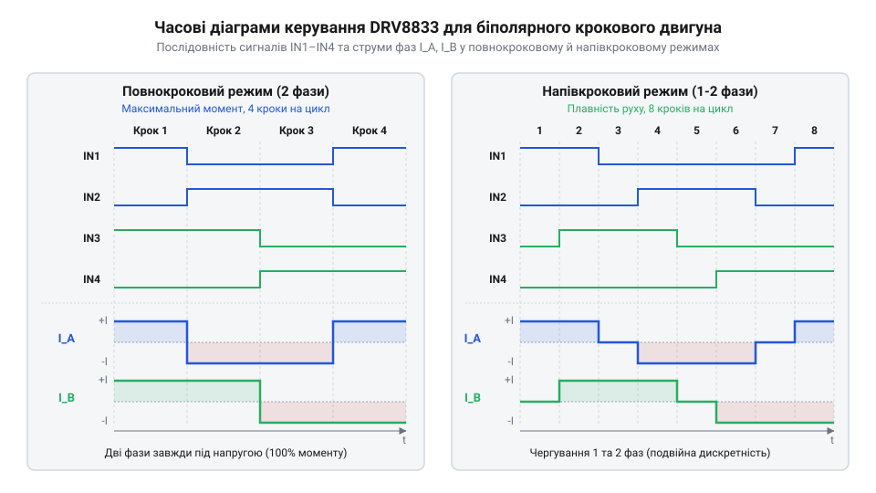

# Драйвер двофазного крокового мотора на базі DRV8833

<preknowlist>
- [CJMCU MC33886 — драйвер моторів (5A H-міст)](root:cat-hw-drivers/mc33886-driver) — принцип роботи поодинокого H-моста та захисту від індуктивних викидів струму
</preknowlist>

## Проблема двополярного керування обмотками двигуна

Керування біполярним кроковим мотором (від латинського *bi-* — два та *polus* — полюс) потребує почергової зміни напрямку струму в його двох незалежних індуктивних обмотках — фазі A та фазі B. Магнітне поле, створене струмом фаз, примушує ротор (від латинського *rotare* — обертатися) повертатися на фіксований кут. Пряме підключення обмоток двигуна до цифрових виходів мікроконтролера є неможливим через фізичні обмеження силових ключів та природу індуктивності (від латинського *inductio* — наведення).

По-перше, звичайний порт `@@en|GPIO@@` здатний віддавати струм лише до `10–20 мА`, тоді як навіть малопотужні крокові двигуни споживають від `300 мА` до `1 А` на фазу. По-друге, виходи мікроконтролера не можуть самостійно змінювати полярність приєднання котушки без ризику короткого замикання силових ліній. По-третє, під час вимикання струму в обмотці виникає індуктивний викид `@@en|ЕРС самоіндукції@@`, який створює високовольтний сплеск протилежної полярності. Цей сплеск пробиває внутрішні p-n переходи транзисторів мікроконтролера й виводить вихідний каскад з ладу.

Для безпечного керування потрібен спеціалізований силовий @@en|драйвер@@ (від англійського *drive* — керувати), який містить два двонапрямлені H-мости з вбудованими зворотними діодами для зрізання напругових сплесків. Кожен H-міст складається з чотирьох силових ключів — двох верхніх, підключених до шини живлення, і двох нижніх, з'єднаних із землею, що утворюють дві вертикальні стійки навколо двовивідної обмотки двигуна. Оскільки однополярне джерело живлення не може змінювати напрямок напруги на котушці, реверс струму реалізують почерговим відкриттям протилежних діагоналей: відкриття верхнього лівого та нижнього правого ключів подає потенціал живлення на перший вивід і заземлює другий, спрямовуючи струм в одному напрямку, а перемикання на протилежну діагональну пару дзеркально змінює полярність напруги на обмотці. Цей перерозподіл струму зміщує вектор магнітного поля статора й змушує ротор повернутися на один крок. При цьому одночасне відкриття верхнього та нижнього ключів в одній вертикальній стійці є неприпустимим: воно створює @@en|скрізний струм@@ (від англійського *shoot-through current*) накоротко між живленням і землею, який за частки мікросекунди перегріває та пробиває напівпровідникові кристали транзисторів. Окрім зміни полярності, комбінація станів ключів визначає режим зупинки. Замикання обох виводів обмотки на землю через два відкриті нижні (або на живлення через два верхні) ключі переводить міст у стан @@en|активного гальмування@@. У режимі гальмування струм індуктивності продовжує циркулювати в низькоомному замкненому контурі через котушку та відкриті канали транзисторів, а обертання ротора за інерцією наводить у котушці проти-ЕРС, яка за законом Ленца створює протилежний гальмівний електромагнітний момент і стрімко зупиняє вал, розсіюючи енергію у вигляді тепла на опорі обмотки й ключів. Якщо ж повністю розімкнути всі чотири ключі, вихідний каскад переходить у стан високого імпедансу `@@en|Hi-Z@@` (від англійського *high impedance* — високий опір): струм індуктивності змушено відкриває вбудовані зворотні діоди й скидається назад у шину живлення, залишаючи ротор у режимі @@en|вільного вибігу@@. Скидання енергії під час @@en|вільного вибігу@@ не створює гальмівного моменту й дає роторові вільно обертатися за інерцією, проте викликає короткочасні напругові сплески на лінії живлення, що вимагає її фільтрації. На відміну від схем, де застосовують [одиничний силовий H-міст](root:cat-hw-drivers/mc33886-driver) для звичайного колекторного мотора, біполярний кроковий двигун вимагає синхронного узгодженого перемикання двох таких мостів зі схемою обмеження струму.

## Структура та режим знеструмлення DRV8833

Мікросхема `@@en|DRV8833@@` об'єднує в одному корпусі два незалежні силові H-мости на N-канальних `@@en|MOSFET@@` транзисторах, призначені для робочих напруг живлення `VM` від `2.7 В` до `10.8 В` зі струмом до `1.5 А` на канал. Керування фазою A здійснюється через логічні входи `IN1` та `IN2` (виходи `OUT1` і `OUT2`), а фазою B — через входи `IN3` та `IN4` (виходи `OUT3` і `OUT4`). Для переведення драйвера в режим ультранизького енергоспоживання передбачено вивід `@@en|nSLEEP@@`: підключення його до низького рівня вимикає внутрішній генератор підкачки заряду та силові ключі, знижуючи струм споживання до мікроамперів.

Під час керування кроковим мотором критично важливо правильно вибирати режим знеструмлення обмоток (`@@en|current decay@@`) у паузах між імпульсами ШІМ або під час обмеження струму. У мікросхемі `@@en|DRV8833@@` стан кожного з двох H-мостів регулюється незалежно парами логічних входів: `IN1` та `IN2` керують виходами `OUT1` і `OUT2` для фази A, а `IN3` та `IN4` — виходами `OUT3` і `OUT4` для фази B. Коли фаза знаходиться в активному стані, прямий напрямок струму задається комбінацією `1` і `0` (`IN1 = 1`, `IN2 = 0` для фази A та `IN3 = 1`, `IN4 = 0` для фази B), а зворотний — комбінацією `0` і `1` (`IN1 = 0`, `IN2 = 1` та `IN3 = 0`, `IN4 = 1`). У паузах керування режим повільного гасіння (`@@en|slow decay@@`) активується подачею високого логічного рівня на обидва входи відповідної фази: комбінація `IN1 = 1, IN2 = 1` для фази A або `IN3 = 1, IN4 = 1` для фази B замикає обмотку через два відкриті нижні N-канальні транзистори на землю. Натомість режим швидкого гасіння (`@@en|fast decay@@`) вимагає подачі низького рівня на обидва входи: комбінація `IN1 = 0, IN2 = 0` для фази A або `IN3 = 0, IN4 = 0` для фази B повністю вимикає силові `@@en|MOSFET@@` ключі моста, змушуючи струм самоіндукції скидатися в джерело живлення через зворотно увімкнені діоди. Отже, вибір комбінації `(1, 1)` чи `(0, 0)` на парах входів `IN1`/`IN2` та `IN3`/`IN4` однозначно визначає режим знеструмлення відповідної фази мотора. Загалом у мікросхемі `@@en|DRV8833@@` реалізовано два основні режими гасіння струму:

1. Режим повільного гасіння (`@@en|slow decay@@`): після розмикання активного силового ключа обидва нижні (або обидва верхні) транзистори H-моста відкриваються, замикаючи обмотку мотора в замкнений контур. Струм самоіндукції циркулює через малий опір відкритих каналів транзисторів, спадаючи повільно. Це забезпечує високу середню силу струму в обмотці, менші пульсації та високий утримувальний крутний момент.

2. Режим швидкого гасіння (`@@en|fast decay@@`): усі силові транзистори моста закриваються, і струм обмотки скидається назад у джерело живлення через вбудовані паразитні діоди транзисторів протилежної полярності. Струм швидко спадає до нуля, що необхідно для швидкого реверсування або роботи на високих швидкостях обертання, проте це супроводжується більшими пульсаціями струму.

## Розрахунок струмоограничувальних резисторів ISEN

Обмотки крокових моторів мають малий активний опір (від кількох Ом до десятків Ом). У статичному стані ротора зворотна ЕРС відсутня, тому подача повної напруги живлення `VM` призвела б до протікання надмірного струму, перегріву обмоток та термічного руйнування драйвера. Для запобігання цьому `@@en|DRV8833@@` має вбудовану систему апаратного обмеження струму.

Виводи `AISEN` та `BISEN` з'єднують витоки нижніх N-канальних транзисторів мостів A і B із землею через зовнішні вимірювальні резистори `R_ISEN`. Внутрішній компаратор драйвера порівнює спад напруги на резисторі `R_ISEN` з опорною напругою `V_isense`, яка для `@@en|DRV8833@@` становить `0.2 В`. Коли струм в обмотці досягає порогу обмеження `I_trip`, спад напруги на `R_ISEN` перевищує `0.2 В`, і драйвер автоматично відключає силові ключі на фіксований час (близько `20 мкс`), обмежуючи струм.

Для розрахунку необхідного номіналу вимірювального резистора `R_ISEN` визначаємо величину опору з фіксованої опорної напруги `V_isense` та бажаного граничного струму обмотки `I_trip`:

```
R_ISEN
= V_isense / I_trip      [законом Ома]
= 0.2 / 0.5             [підстановка параметрів]
= 0.4 Ом                 [обчислення номіналу]
```

Отримане значення `0.4 Ом` визначає поріг обмеження струму фази на рівні `0.5 А`. Найближчий стандартний номінал резистора з ряду E24 становить `0.47 Ом`, що встановить граничний струм на рівні близько `0.425 А`.

Для вибору корпусного виконання резистора обчислюємо максимальну потужність розсіювання `P_ISEN` на резисторі `R_ISEN` при граничному струмі `I_trip`:

```
P_ISEN
= I_trip² × R_ISEN       [законом Джоуля-Ленца]
= (0.5)² × 0.4           [підстановка параметрів]
= 0.1 Вт                 [обчислення потужності]
```

Оскільки розрахована потужність становить `0.1 Вт`, для надійного теплового режиму слід вибирати SMD-резистор типорозміру 0805 або 1206 із номінальною потужністю не менше `0.25 Вт`.

## Алгоритми повнокрокового та напівкрокового керування

Обертання ротора крокового двигуна забезпечується подачею послідовності імпульсів на логічні входи `IN1`–`IN4`. Залежно від комбінації активних фаз розрізняють повнокроковий та напівкроковий режими керування.

У повнокроковому режимі з одночасною запиткою двох фаз (`@@en|two-phase full-step@@`) на обидві обмотки A і B постійно подається напруга відповідної полярності. Схема перемикання складається з чотирьох тактів: `A+B+` -> `A-B+` -> `A-B-` -> `A+B-`. Цей режим дає максимальний утримувальний крутний момент (більший у `1.41` раза за однофазний режим) та високу швидкість розгону, проте споживає найбільше енергії та викликає помітну вібрацію ротора на низьких швидкостях.

Напівкроковий режим (`@@en|half-step@@`) поєднує стани з однією та двома запитаними обмотками, подвоюючи роздільну здатність мотора (8 тактів на цикл): `A+` -> `A+B+` -> `B+` -> `A-B+` -> `A-` -> `A-B-` -> `B-` -> `A+B-`. 


*Часова діаграма перемикання входів DRV8833 для реалізації повнокрокового та напівкрокового алгоритмів руху ротора.*

Напівкроковий режим забезпечує значно плавніший хід ротора, знижує механічний резонанс та шум під час руху, що робить його оптимальним вибором для більшості позиційних систем малої потужності.

## Схемотехнічна інтеграція та програмний алгоритм

При проектуванні друкованої плати драйвера на базі `@@en|DRV8833@@` необхідно розділяти силову земляну шину (`@@en|PGND@@`) та сигнальну землю мікроконтролера (`@@en|GND@@`). Поруч із виводом живлення мотора `VM` слід встановити електролітичний конденсатор ємністю `10–47 мкФ` для компенсації кидків струму під час комутації обмоток та керамічний конденсатор `0.1 мкФ` для придушення високочастотних завад.

Нижче наведено практичну реалізацію алгоритму напівкрокового керування мотором з використанням масиву станів входів `IN1`–`IN4`:

:::tabs
:::code proj-drv8833-bipolar-stepper-driver/cpp/arduino/setup.cpp
:::code proj-drv8833-bipolar-stepper-driver/c/esp-idf/stepper-init.c
:::
