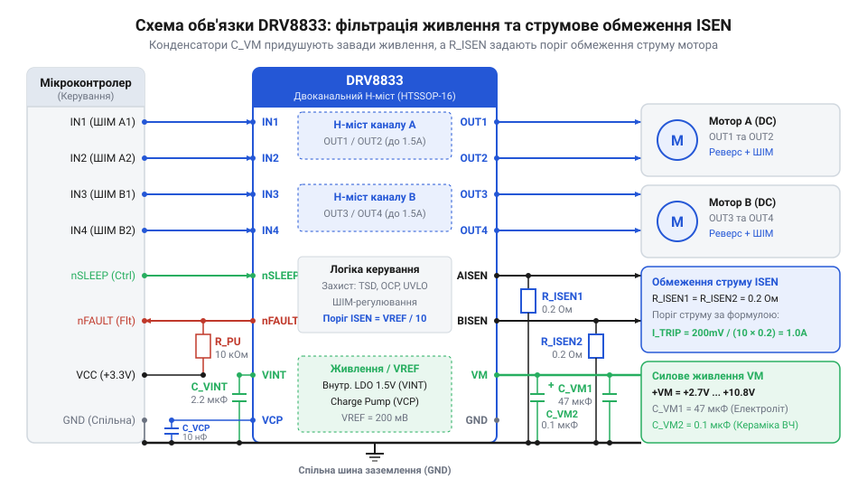
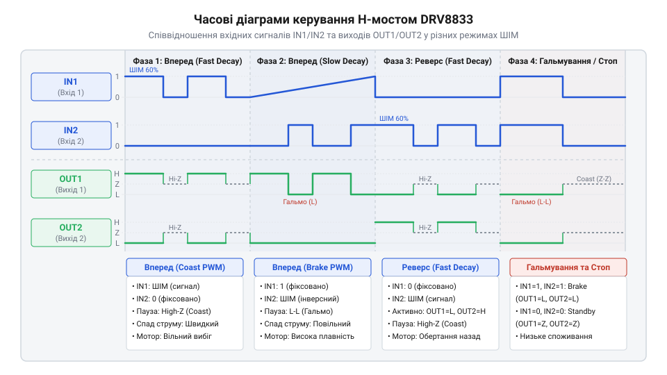

# Практичний модуль керування двома колекторними моторами на DRV8833

<preknowlist>
- [CJMCU MC33886 — драйвер моторів (5A H-міст)](root:cat-hw-drivers/mc33886-driver) — принципи функціонування H-мостової схеми, логіка перемикання силових ключів та керування за допомогою ШІМ
</preknowlist>

## Проблема прямого керування двома моторами

Спроба підключити @@en|колекторний мотор@@ (англ. @@en|Brushed DC motor@@, через наявність механічного колекторно-щіткового вузла) безпосередньо до виводу @@en|мікроконтролера@@ (грец. @@el|mikros@@ + англ. @@en|controller@@, малий контролер в одній мікросхемі) призводить до негайної аварії. Логічні виходи сучасних @@en|мікроконтролерів@@ розраховані на керування слабострумовими сигналами з граничним струмом до 20 мА. Натомість навіть малопотужний @@en|колекторний мотор@@ під час пуску або заклинювання ротора споживає від 1 до 3 А. Спроба прокачати такий струм через напівпровідникову структуру виводу викликає падіння напруги живлення ядра, перезавантаження @@en|мікроконтролера@@ або тепловий пробій вихідних транзисторів.

Друга фундаментальна загроза полягає в індуктивній природі обмоток двигуна. Обмотка ротора є індуктивністю. У момент різкого розмикання кола перемикання накопичена в магнітному полі енергія породжує сплеск протинапруги — @@en|ЕРС самоіндукції@@ (латин. @@la|electromotrix@@ + @@la|inductio@@, наведення електрорушійної сили при зміні струму). Цей амплітудний викид у десятки або сотні вольт прикладається до виводу @@en|мікроконтролера@@ у зворотному напрямку та миттєво руйнує p-n переходи силіцію.

Крім того, один вивід @@en|мікроконтролера@@ здатен лише формувати високий або низький логічний рівень відносно спільної землі, що дозволяє обертати мотор тільки в один бік. Для зміни напрямку обертання напрямок струму в обмотці потрібно змінити на протилежний. Для цього потрібна схемна топологія @@en|H-міст@@ (англ. @@en|H-bridge@@, через схожість силового каскаду з літерою H), яка складається з чотирьох керованих силових ключів.

Отже, для безпечного керування двома моторами потрібен силовий двоканальний драйвер. На відміну від потужного [одноканального силового драйвера](root:cat-hw-drivers/mc33886-driver) @@en|MC33886@@, призначеного для одного важкого мотора, для компактних робототехнічних платформ оптимальним є двоканальний чип @@en|DRV8833@@. Він інтегрує два незалежні силові H-мости з вбудованими захисними діодами для зрізання викидів @@en|ЕРС самоіндукції@@.

Окрім безпечного перемикання напрямку обертання та гасіння високовольтних викидів, мобільна робототехнічна платформа вимагає високої енергоефективності силових ключів. Застосування застарілих біполярних транзисторів викликає значне падіння напруги на відкритих переходах, що призводить до марного нагрівання корпусу та швидкого розряджання акумулятора. Чип @@en|DRV8833@@ вирішує цю проблему завдяки використанню ключів на @@en|MOSFET-транзисторах@@ (англ. @@en|MOSFET@@, від @@en|metal-oxide-semiconductor field-effect transistor@@, польовий транзистор зі структурою метал-оксид-напівпровідник) із низьким опором відкритого каналу. Таке рішення забезпечує стабільну роботу від низьковольтного батарейного живлення в межах від 2.7 до 10.8 В та дозволяє керувати струмом до 1.5 А на кожен канал без застосування масивних радіаторів. Крім того, драйвер повністю узгоджує низьковольтні логічні сигнали @@en|мікроконтролера@@ з потужними вихідними каскадами, утворюючи надійну ланку між цифровою системою та механічними приводами.

## Схемотехніка обв'язки драйвера DRV8833

Мікросхема @@en|DRV8833@@ містить два H-мости на силових @@en|MOSFET@@-ключах (англ. @@en|Metal-Oxide-Semiconductor Field-Effect Transistor@@) із низьким опором відкритого каналу. Драйвер працює від силової шини живлення мотора `VM` у діапазоні від 2.7 до 10.8 В і забезпечує довготривалий струм до 1.5 А на кожен канал. Проте надійна робота силового каскаду вимагає правильної зовнішньої схемотехнічної обв'язки.

Під час комутації силових ключів із частотою @@en|ШІМ@@ (широтно-імпульсна модуляція, англ. @@en|Pulse-Width Modulation@@, PWM) у колі живлення `VM` виникають високочастотні пульсації та кидки струму. Ключі @@en|MOSFET@@ перемикаються за наносекунди, через що струм змінюється з високою швидкістю `di/dt`. Будь-які провідники друкованої плати та підвідні дроти володіють @@en|паразитною індуктивністю@@ (англ. @@en|parasitic inductance@@, від лат. @@la|inductio@@ — наведення) `L_trace`. На цій індуктивності під час стрибкоподібного перемикання виникає сплеск проти-ЕРС самоіндукції `ΔV = L_trace × (di/dt)`. Для придушення цих завад і захисту силових елементів використовують комбінацію двох типів конденсаторів. @@en|Розв'язувальний конденсатор@@ (англ. @@en|decoupling capacitor@@) великої ємності — електролітичний або танталовий `C_bulk` ємністю від 10 до 47 мкФ — встановлюють поруч із чипом для компенсації просідання напруги під час пуску моторів. Оскільки `C_bulk` має значну власну індуктивність обкладок і виводів, він не здатен миттєво віддавати струм під час швидких перехідних процесів. Тому паралельно йому підключають високошвидкісний керамічний @@en|розв'язувальний конденсатор@@ `C_decoup` номіналом 0.1 мкФ (100 нФ) безпосередньо між виводами `VM` та `GND` для фільтрації високочастотних завад. Обов'язковою вимогою є розміщення `C_decoup` мінімально близько до силових ніжок мікросхеми. Довгі провідники між конденсатором та виводами `VM` і `GND` додають паразитної індуктивності у високочастотний контур, що нівелює розв'язку та знову призводить до сплесків напруги. Для стабілізації внутрішнього логічного джерела напруги 3.3 В вивід `VINT` шунтують керамічним конденсатором ємністю 2.2 мкФ.

Для захисту моторів та силових ключів @@en|DRV8833@@ має вбудовану схему обмеження струму. Струм кожного мотора протікає через зовнішній @@en|струмовимірювальний резистор@@ (англ. @@en|current sense resistor@@) `R_ISEN`, увімкнений між виводом `AISEN` (або `BISEN`) та землею `GND`. Драйвер порівнює напругу падіння `V_ISEN` на цьому резисторі з опорним пороговим значенням `V_ISEN = 0.2 В`. Коли струм досягає граничного рівня `I_TRIP`, драйвер тимчасово вимикає ключі на 3.75 мкс.

Рівняння струмового обмеження визначає граничний струм `I_TRIP`:

```
I_TRIP = V_ISEN / R_ISEN
       = 0.2 / R_ISEN           [закон Ома для входу струмового обмеження]
```

Звідси розраховуємо необхідний опір струмовиммірювального резистора:

```
R_ISEN = V_ISEN / I_TRIP
       = 0.2 / I_TRIP           [визначення необхідного опору]
```

**Розрахунок номіналу `R_ISEN` для обмеження струму мотора на рівні 1.0 А:**

```
V_ISEN = 0.2 В
I_TRIP = 1.0 А
R_ISEN = 0.2 / 1.0
       = 0.2 Ом                [обчислення опору резистора]

P_R = I_TRIP² × R_ISEN
    = 1.0² × 0.2
    = 0.2 Вт                   [обчислення розсіюваної потужності]
```

Оскільки розсіювана потужність на резисторі становить 0.2 Вт, обираємо безіндуктивний SMD-резистор типорозміру 1206 із номінальною потужністю 0.25 Вт чи більше. Якщо функція струмового обмеження не потрібна, виводи `AISEN` та `BISEN` підключають напряму до `GND`.


*Принципова схема зовнішньої обв'язки драйвера DRV8833 з розв'язувальними конденсаторами та струмовиммірювальними резисторами.*

## Підключення логіки керування до мікроконтролера

Керування двома каналами драйвера @@en|DRV8833@@ здійснюється за допомогою чотирьох цифрових входів `IN1`, `IN2` (канал A) та `IN3`, `IN4` (канал B). Входи внутрішньо сумісні з логічними рівнями 3.3 В та 5 В, що дозволяє підключати їх до будь-якого @@en|мікроконтролера@@.

Стан виходів H-моста визначається комбінацією сигналів на відповідних входах:

1. `IN1 = 0`, `IN2 = 0` — **`@@en|вільний вибіг@@`** (Coast / High-Z). Усі силові @@en|MOSFET@@-ключі закриті, виходи знаходяться у високоімпедансному стані, і мотор вільно обертається за інерцією.
2. `IN1 = 1`, `IN2 = 0` (або `IN1` = @@en|ШІМ@@, `IN2` = 0) — **прямий хід** (Forward). Струм тече від `OUT1` до `OUT2`. Регулювання швидкості забезпечується подачею @@en|ШІМ@@-сигналу на вхід `IN1`.
3. `IN1 = 0`, `IN2 = 1` (або `IN1` = 0, `IN2` = @@en|ШІМ@@) — **реверс** (Reverse). Струм змінює напрямок і тече від `OUT2` до `OUT1`. Швидкість регулюється коефіцієнтом заповнення @@en|ШІМ@@ на вході `IN2`.
4. `IN1 = 1`, `IN2 = 1` — **`@@en|активне гальмування@@`** (Brake / Low-Z). Обидва нижні @@en|MOSFET@@-ключі замикаються на `GND`, закорочуючи обмотку мотора. Згенерована мотором проти-ЕРС викликає швидку електродинамічну зупинку.

Крім входів керування напрямком, драйвер має службові лінії:
- `nSLEEP` (активний низький): переводить чип у режим глибокого сну із споживанням менше 1 мкА при `nSLEEP = 0`. Для постійної роботи вивід підтягують до живлення логіки, або підключають до GPIO @@en|мікроконтролера@@ для програмного енергозбереження.
- `nFAULT` (відкритий колектор): аварійний вихід. У нормальному стані тримається у HIGH через зовнішній підтягувальний резистор 10 кОм до логічного живлення. При спрацьовуванні захисту від перевантаження за струмом (OCP), перегріву (TSD) або зниження напруги (UVLO) драйвер притискає лінію `nFAULT` до земли (`LOW`). Її підключають до виводу переривання @@en|мікроконтролера@@ для миттєвої реакції на аварію.


*Часові діаграми ШІМ-сигналів керування для режимів розгону, реверсу, гальмування та вільного вибігу.*

Формування режимів та контроль станів реалізується програмним забезпеченням драйвера:

:::code proj-drv8833-dual-dc-motor-controller/c/drv8833.h 27-35
:::code proj-drv8833-dual-dc-motor-controller/c/drv8833.c 73-108
:::code proj-drv8833-dual-dc-motor-controller/cpp/Drv8833.cpp 165-187

## Програмне керування ШІМ-сигналами моторів

Для незалежного регулювання швидкості й орієнтації обертання двох колекторних моторів мікроконтролер формує сигнальні імпульси на чотирьох входах `IN1`–`IN4` драйвера DRV8833. Регулювання швидкості базується на широтно-імпульсній модуляції (@@en|Pulse-Width Modulation@@, PWM; від англійського *pulse-width modulation* — широтно-імпульсна модуляція). Оскільки силовий міст мікросхеми перемикається між станами проводження та блокування зі частотою таймера, середня напруга на обмотці мотора змінюється пропорційно коефіцієнту заповнення (@@en|duty cycle@@).

Логічна схема керування кожним мотором вимагає двох силових каналів таймера або комбінації ШІМ із цифровим виходом загального призначення (@@en|General-Purpose Input/Output@@, GPIO; від англійського *general-purpose input/output* — вхід/вихід загального призначення). Для руху вперед напрямок задають подачею ШІМ-сигналу на `IN1` при логічному нулі (`LOW`) на `IN2`. Для реверсу ШІМ подають на `IN2`, а `IN1` притягують до землі. Швидку зупинку реалізують у режимі активного електродинамічного гальмування (@@en|active braking@@), подаючи високий рівень (`100%` заповнення ШІМ) на обидва входи одночасно — це відкриває два нижні N-канальні MOSFET-ключі H-моста й закорочує обмотку мотора через землю. Режим вільного вибігу (@@en|coasting@@) відключає всі ключі виставлянням нуля на обох входах. При виборі частоти ШІМ для імпульсного керування враховують механічні та акустичні властивості обмоток: якщо частота комутації лежить у звуковому діапазоні від 1 до 10 кГц, періодичні електромагнітні зусилля в осерді створюють виразний акустичний шум (@@en|switching noise@@). Щоб усунути дратівливий писк, частоту ШІМ `f_pwm` обирають вище межі чутності людського вуха — зазвичай у межах від 20 до 50 кГц (що відповідає максимальному робочому діапазону DRV8833). Однак надмірне підвищення частоти збільшує комутаційні втрати (@@en|switching losses@@) на затворах силових ключів через перезаряд паразитних ємностей. Налаштування апаратного таймера мікроконтролера виконують вибором попереднього дільника (@@en|prescaler@@; від англійського *prescaler* — попередній дільник частоти) `PSC` та регістра автоперезавантаження (@@en|auto-reload register@@; від англійського *auto-reload register* — регістр автоперезавантаження) `ARR`, які ділять внутрішню тактову частоту `f_clk`. Розрахунок підсумкової частоти `f_pwm` із тактової частоти `f_clk` 84 МГц при дільникові `PSC` рівному 3 та періодові `ARR` рівному 1049 ілюструє таке покрокове обчислення:

```
f_pwm
= 84 000 000 / ((3 + 1) × (1049 + 1))    [ділення тактової частоти на коефіцієнти]
= 84 000 000 / (4 × 1050)                [додавання одиниці до регістрів]
= 84 000 000 / 4200                      [перемноження системних дільників]
= 20 000                                 [підсумкова частота ШІМ у герцах]
```

Отримана частота 20 кГц переносить комутаційні коливання в ультразвукову область, забезпечуючи безшумну роботу приводу при збереженні 1050 дискретних ступенів регулювання коефіцієнта заповнення.

Окрім керування рухом, програмний драйвер повинен обробляти апаратний сигнал помилки `nFAULT` та запобігати аварійним ситуаціям при втраті зв'язку. Лінія `nFAULT` виконана за схемою з відкритим колектором (@@en|open collector@@) і переходить у низький рівень при спрацьовуванні захисту від перевантаження за струмом, перегріву чи зниження напруги живлення. Для захисту приводу в програмі реалізують таймер безпеки (@@en|watchdog timer@@): якщо верхній рівень керування не оновлює команду впродовж заданого таймауту, драйвер примусово вимикає ШІМ і зупиняє мотори.

:::tabs
@tab C
:::code proj-drv8833-dual-dc-motor-controller/c/drv8833.h
:::code proj-drv8833-dual-dc-motor-controller/c/drv8833.c
:::code proj-drv8833-dual-dc-motor-controller/c/main.c
@tab C++
:::code proj-drv8833-dual-dc-motor-controller/cpp/Drv8833.hpp
:::code proj-drv8833-dual-dc-motor-controller/cpp/Drv8833.cpp
:::code proj-drv8833-dual-dc-motor-controller/cpp/main.cpp
:::

## Складання стенда та випробування під навантаженням

Після розробки схемотехніки та прошивки силова плата підключається до випробувального стенда. До складу стенда входять мікроконтролер, модуль на базі DRV8833, два колекторні DC-мотори та лабораторне джерело живлення (ЛДЖ) із можливістю обмеження струму. Перед першим увімкненням обмежувач струму ЛДЖ виставляють на рівні `0.5 А` при силовій напрузі `VM = 6 В`, щоб запобігти пошкодженню силових транзисторів у разі монтажного замикання.

Випробування розпочинають із перевірки режиму холостого ходу (@@en|no-load test@@). Вимірювач струму джерела повинен фіксувати лише базове споживання чипа та малий струм холостого ходу моторів. Почергово подаючи команди руху вперед і назад із заповненням ШІМ від 20% до 100%, контролюють плавність зміни обертів та відсутність перегріву корпусу драйвера.

Наступний етап — випробування під навантаженням (@@en|load testing@@) та перевірка обмеження струму. При підключенні струмовимірювальних резисторів `ISEN` внутрішня схема DRV8833 порівнює спад напруги на них із опорним порогом `V_ISEN = 200 мВ`. При механічному гальмуванні вала мотора струм зростає до порогу `I_CHOP = V_ISEN / R_ISEN`, після чого драйвер переходить у режим циклічного обмеження струму (@@en|current chopping@@). Якщо ж виникає коротке замикання або струм перевищує поріг спрацьовування захисту від перевантаження за струмом (@@en|Overcurrent Protection@@, OCP; понад `2.7 А`), чип миттєво вимикає H-міст і перетягує лінію `nFAULT` у низький стан. Програма мікроконтролера фіксує це переривання, припиняє генерацію ШІМ та сигналізує про аварійний стан приводу.
