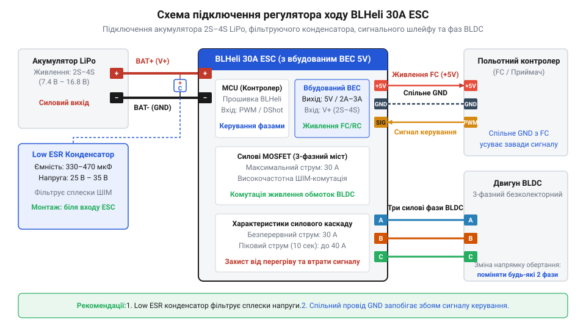
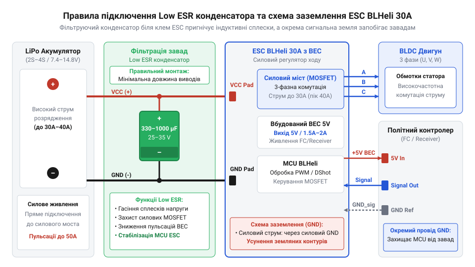

# Залізний інтерфейс, розпіновка та схемотехніка підключення ESC BLHeli 30A з BEC

## Наслідки помилок комутації силового регулятора

Швидке керування високонавантаженими силовими колами супроводжується різкими стрибками струму. У системах з безколекторними моторами силовий регулятор ходу (англ. @@en|Electronic Speed Controller@@, @@en|ESC@@ — електронний регулятор швидкості) @@en|BLHeli 30A@@ комутує струми до `30 A` на частотах десятки кілогерц. При швидкому розгоні або різкій зміні обертів двигуна споживання струму зростає на порядки за часточки мікросекунди. За відсутності грамотно побудованого електричного інтерфейсу та збалансованого розведення кіл такі імпульсні навантаження створюють потужні електромагнітні завади й критичні просідання напруги.

Паразитні індуктивності дротів живлення реагують на високі швидкості наростання струму виникненням ЕРС самоіндукції. Сплески напруги під час закриття симетричних силових ключів (англ. @@en|Metal-Oxide-Semiconductor Field-Effect Transistor@@, @@en|MOSFET@@ — польовий транзистор з ізольованим затвором) можуть удвічі перевищувати напругу силового акумулятора. Одночасно з цим у момент пуску двигуна внутрішній опір джерела живлення викликає короткочасне зниження напруги на системній шині. Подібне просідання спричиняє раптове перезавантаження (англ. @@en|brownout reset@@ — скидання через зниження напруги) мікроконтролера, з якого побудовано [польотний контролер](root:hw-power/flight-controller-power-architecture), що призводить до повної втрати керованості апаратом.

Найбільш підступною проблемою неправильної комутації є виникнення блукаючих струмів у колах заземлення (англ. @@en|ground bounce@@ — підскок потенціалу землі). Якщо силова земля двигуна та сигнальне заземлення керуючої плати об'єднані в довільній точці або утворюють замкнений струмовий контур, кілоамперні імпульсите повернення струму через опір спільного провідника створюють різницю потенціалів між нульовими шинами. Для логічних входів контролера це виглядає як зміщення опорного рівня напруги. У результаті спотворюються сигнальні імпульси керування, виникають фантомні команди, а високовольтні наводки здатні фізично випалити чутливі @@en|GPIO@@-порти мікроконтролера. Запобігання цим явищам вимагає чіткого дотримання правил підключення силових провідників, фаз та сигнального шлейфу.

## Підключення силового живлення та фаз двигуна

Силове коло регулятора @@en|BLHeli 30A@@ розраховане на тривалу передачу струму до `30 A` при напрузі джерела живлення від `7.4 V` до `16.8 V`, що відповідає підключенню `2S`–`4S` літій-полімерних акумуляторів (англ. @@en|Lithium Polymer@@, @@en|LiPo@@). Силові вхідні провідники регулятора позначені маркуванням полярності: червоний дріт підключається до позитивної клеми акумулятора (`+ VCC`), а чорний — до негативного полюса (`- GND`). Регулятор не має вбудованого захисту від переполюсовки, тому зворотне підключення акумулятора призводить до миттєвого пробою захисних діодів і силових транзисторів @@en|MOSFET@@.

Вибір перерізу дротів силової лінії критично впливає на надійність і втрати енергії. Для робочих струмів `30 A` застосовують гнучкі багатожильні мідні дроти в силіконовій ізоляції стандарту `16 AWG` (площа перерізу близько `1.3 mm²`) або `14 AWG` (`2.1 mm²`). Менший переріз провідників збільшує їхній активний опір `R`, що викликає додаткове падіння напруги `ΔU = I × R` та небезпечний нагрів ізоляції під час пікових навантажень. Довжину силових дротів між акумулятором і регулятором роблять мінімально можливою для зниження паразитної індуктивності лінії.

Комутація безколекторного двигуна (англ. @@en|Brushless Direct Current@@, @@en|BLDC@@) здійснюється через три силові фазні виводи регулятора, які зазвичай позначаються як `A`, `B`, `C` або `U`, `V`, `W`. Три силіконові дроти одинакового перерізу з'єднують безпосередньо з трьома статорними обмотками мотора. Оскільки комутація [безколекторного двигуна](root:hw-motion/bldc-commutation) виконується шляхом послідовного формування обертового магнітного поля трьохфазним мостом, напрямок обертання ротора залежить від фазування дротів.

Зміна напрямку обертання вала (за годинниковою стрілкою чи проти) досягається дзеркальною перестановкою місцями будь-яких двох із трьох фазних провідників (наприклад, фази `A` та `B`). Для створення надійного контакту силові та фазні з'єднання виконують паянням із застосуванням якісного припою та закривають термоусаджувальними трубками.

Подовження фазних провідників між регулятором і двигуном пропорційно збільшує їхню паразитну індуктивність `L` та міжфазну ємність `C`. Під час високочастотної комутації ключів стрімка зміна струму `di/dt` в індуктивності дротів провокує амплітудні викиди напруги, а утворений паразитний `LC`-контур викликає високочастотні коливальні сплески. Ці імпульсні перенапруження підвищують ризик пробою силових транзисторів @@en|MOSFET@@ та наводять електромагнітні завади у чутливих сигнальних лініях. Для мінімізації комутаційних викидів фазні дроти роблять максимально короткими та прокладають без паралельного скручування. Якщо мотор потребує оперативного від'єднання, замість прямого паяння застосовують силові циліндричні роз'єми (англ. @@en|bullet connectors@@, від @@en|bullet@@ — куля) діаметром `3.5 mm` або `4.0 mm`. Якісні підпружинені контакти таких роз'ємів забезпечують низький перехідний опір і запобігають небезпечному перегріву з'єднання при робочих струмах до `30 A`.

## Сигнальний шлейф та вбудований модуль BEC

Керування роботою регулятора та живлення бортової електроніки реалізується через слабкострумовий сигнальний шлейф. У регуляторі @@en|BLHeli 30A@@ цей шлейф складається з трьох провідників: сигнальної лінії керування, окремого сигнального заземлення та виводу вбудованого модуля живлення (англ. @@en|Battery Eliminator Circuit@@, @@en|BEC@@ — схема усунення окремого акумулятора).

Сигнальний дріт (білого або жовтого кольору) передає від контролера команди задання швидкості. Регулятор підтримує аналоговий протокол [широтно-імпульсної модуляції](root:hw-analog/pwm) (англ. @@en|Pulse-Width Modulation@@, @@en|PWM@@) з тривалістю імпульсів від `1000 μs` до `2000 μs`, а також швидкісні цифрові [протоколи сімейства DShot](root:com-devices/dshot-protocol) (@@en|DShot150@@, @@en|DShot300@@, @@en|DShot600@@). Сигнальний дріт заземлення (чорного або коричневого кольору) підключається до опорної землі логічної плати. Використання окремого сигнального нуля є обов'язковим: воно усуває струмові петлі та запобігає викривленню форми імпульсів керування силовою грозою струмів двигуна.

Вбудований модуль @@en|BEC@@ являє собою понижувальний стабілізатор напруги, який перетворює високу напругу силового акумулятора (`7.4–16.8 V`) у фіксовану напругу `5 V` для живлення мікроконтролера та датчиків. Принципову схему підключення силових ліній, фаз двигуна та сигнального шлейфу регулятора з виводом @@en|BEC@@ показано на схемі.

*Електрична схема підключення силового живлення, фаз двигуна та сигнального шлейфу регулятора BLHeli 30A.*

Під час підключення навантаження до виводу @@en|BEC@@ (червоний дріт сигнального шлейфу) необхідно враховувати його тепловий режим. Більшість регуляторів @@en|BLHeli 30A@@ оснащені лінійними стабілізаторами з обмеженням струму до `1 A` – `2 A`. При живленні від `4S LiPo` (`16.8 V`) падіння напруги на стабілізаторі становить `ΔU = 16.8 V - 5.0 V = 11.8 V`.

Потужність, що розсіюється на лінійному стабілізаторі у вигляді тепла при струмі навантаження `1 A`, обчислюється наступним чином:

P = ΔU × I
  = (16.8 - 5.0) × 1.0    [підстановка напруги 4S LiPo та струму 1 A]
  = 11.8 × 1.0            [обчислення падіння напруги]
  = 11.8 W                [підсумкова теплова потужність]

З отриманого значення видно, що виділення понад `11 W` тепла на платі регулятора без активного охолодження спричиняє швидкий перегрів і термальне відключення модуля. Тому для живлення потужних сервоприводів або додаткового обладнання використовують зовнішній [модуль імпульсного перетворювача](root:cat-hw-power/bec-ubec), а виводи @@en|BEC@@ кількох паралельних регуляторів не з'єднують між собою, щоб уникнути зустрічних струмів.

@@en|Linear BEC@@), який розсіює різницю напруг у вигляді тепла, імпульсний модуль (англ. На відміну від лінійного стабілізатора (англ. @@en|Linear BEC@@), який розсіює різницю напруг у вигляді тепла, імпульсний модуль (англ. @@en|Switching BEC@@, @@en|UBEC@@) перетворює напругу з високим ККД. @@en|Switching BEC@@ або @@en|UBEC@@ — англ. @@en|Universal Battery Eliminator Circuit@@, від англ. *switch* — перемикати, ключувати) швидко комутує вхідний струм через індуктивний накопичувач на високій частоті, досягаючи коефіцієнта корисної дії понад `85–90%` без шкідливого нагрівання плати. Проте під час побудови багатомоторних систем виникає інша проблема: якщо паралельно підключити виводи `5 V` від кількох регуляторів, найменша технологічна розбіжність їхніх вихідних напруг (наприклад, `4.95 V` проти `5.05 V`) змусить модуль із вищим потенціалом безперервно прокачувати зустрічний струм у вихідний каскад сусіднього. Щоб уникнути перегріву та виходу з ладу стабілізаторів, при збиранні схеми залишають позитивний провідник `+5 V` (червоний дріт сигнального шлейфу) підключеним до польотного контролера лише від одного регулятора, а з роз'ємів усіх інших @@en|ESC@@ цей дріт обережно виймають, відгинаючи пластиковий фіксатор, і ізолюють термоусадочною трубкою, обов'язково залишаючи під'єднаними сигнальний дріт та спільне заземлення.

## Фільтрація завад і захист конденсаторами Low ESR

Високочастотне перемикання силових транзисторів @@en|MOSFET@@ у 3-фазному мосту регулятора (на частотах від `16 kHz` до `48 kHz`) викликає стрімкі зміни струму `di / dt`. Внаслідок індуктивності провідників силового шлейфу на шині живлення виникають високовольтні імпульсні сплески ЕРС самоіндукції.

Амплітуда індуктивного сплеску напруги визначається швидкістю комутації струму:

e = -L × (di / dt)
  = -0.2 × (30 / 0.0000001)    [індуктивність L = 0.2 μH, зміна струму 30 A за 100 ns]
  = -0.2 × 300000000           [обчислення похідної струму]
  = -60 V                      [величина сплеску напруги]

Сплеск напруги амплітудою `-60 V` сумується з напругою батареї та перевищує граничний рівень пробою сток-витік транзисторів (`30 V`), що призводить до руйнування ключів і просідання сигнального нуля. Звичайні електролітичні конденсатори не здатні пригнічувати такі завади через високий власний опір та внутрішню індуктивність.

Для ефективного декомплектування та згладжування сплесків застосовують низькоімпедансні конденсатори (англ. @@en|Low ESR@@ — @@en|Equivalent Series Resistance@@, низький еквівалентний послідовний опір). Вони володіють мінімальним опором на високих частотах і працюють як демпфер індуктивної енергії. Схему монтажу фільтруючого конденсатора та організації спільного заземлення подано нижче.

*Схема монтажу конденсатора Low ESR та розмежування силового й сигнального заземлення для усунення завад.*

При підборі низькоімпедансного конденсатора керуються двома параметрами:
1. Ємність: для регулятора @@en|BLHeli 30A@@ стандартне значення становить від `470 μF` до `1000 μF`.
2. Робоча напруга: повинна перевищувати максимальну напругу акумулятора щонайменше в `1.5`–`2` рази. Для системи `4S LiPo` (`16.8 V`) обирають конденсатори з номіналом `25 V` або `35 V`.

Конденсатор @@en|Low ESR@@ припаюють безпосередньо до силових клем `+` та `-` на платі регулятора @@en|BLHeli 30A@@. Виводи конденсатора роблять якомога коротшими, оскільки подовження ніжок додає паразитної індуктивності й знівельовує ефект фільтрації. Правильне розведення силових ліній і монтаж фільтра захищають елементи схеми від пробою та гарантують стабільну передачу сигналів керування.
