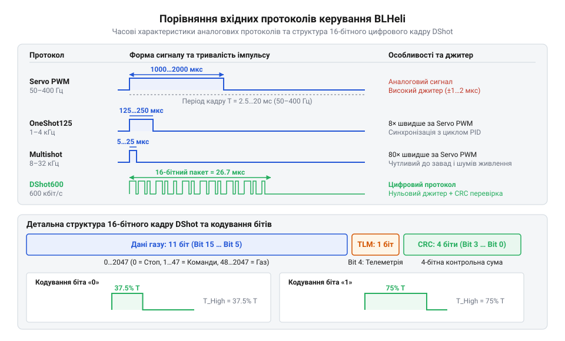
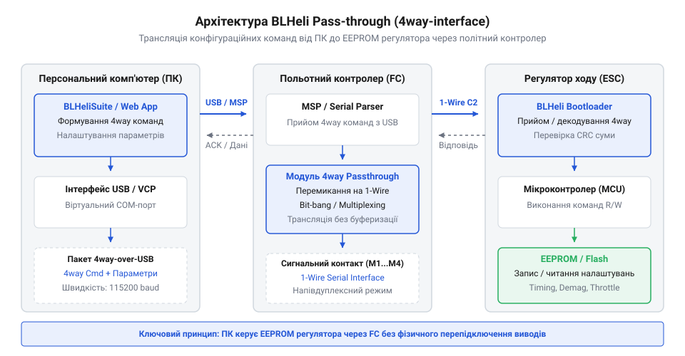

# Програмний інтерфейс, протоколи керування та карти параметрів BLHeli

## Нестабільність силового приводу без впорядкованого керування

Безколекторний двигун постійного струму (@@en|BLDC@@, від англ. *brushless direct current*) не може обертатися від прямої подачі напруги на силові обмотки. Для створення обертового магнітного поля електронний регулятор ходу (@@en|ESC@@, від англ. *electronic speed controller*) повинен послідовно перемикати фази статора у чіткій синхронізації з положенням ротора. Швидкість та плавність цього обертання повністю залежать від вхідних команд, які регулятор отримує від зовнішнього мікроконтролера чи польотного контролера. Коли між вхідним сигналом керування та силовим блоком регулятора виникає неузгодженість, привід втрачає керованість і перетворюється на джерело високовольтних викидів та теплових втрат. BLDC@@, від англ. *brushless direct current*) | Для глибокого розуміння фізичних принципів виявлення положення ротора за зворотною ЕРС ознайомтеся з матеріалом про [бездатчикову комутацію BLDC за зворотною ЕРС](root:cat-hw-drivers/bldc-bemf-commutation).

Аналогові лінії керування силовим приводом чутливі до фазового тремтіння сигналів — джиттеру (@@en|jitter@@, від англ. *jitter*). При високому рівні електромагнітних завад від комутації потужних ключів тривалість керувального імпульсу змінюється хаотично. Це викликає мікросмикання мотора, шум та надмірне нагрівання силових транзисторів (@@en|MOSFET@@, від англ. *metal-oxide-semiconductor field-effect transistor*). Іншою поширеною проблемою є неузгодженість меж діапазону газу. Якщо порогові значення мінімального та максимального сигналу в пам'яті регулятора не відповідають діапазонові польотного контролера, виникають «мертві зони» (@@en|deadband@@): мотор або починає обертатися із запізненням, або досягає граничних обертів за довго до крайнього положення важеля керування.

Найбільш критичною апаратною аварією є зрив синхронізації комутатора — десинхронізація (@@en|desync@@, від англ. *desynchronization*). Вона виникає під час різкого прискорення або при некоректно вибраних внутрішніх таймінгах регулятора. При десинхронізації регулятор подає силовий імпульс не у свою фазу, що спричиняє зупинку обертального моменту, гучний вереск мотора та стрибок струму в сотні ампер, здатний миттєво спалити ключі @@en|MOSFET@@. Щоб запобігти цим явищам, прошивки родини @@en|BLHeli@@ (включаючи @@en|BLHeli_S@@ та @@en|BLHeli_32@@) вимагають як високоточних вхідних протоколів з низькими затримками, так і належної конфігурації карти внутрішніх параметрів.

## Протоколи керування від PWM до DShot

Передача команд швидкості від мікроконтролера до регулятора ходу пройшла шлях від повільних аналогових імпульсів до завадостійких цифрових кадрів. Класичний протокол @@en|Servo PWM@@ використовує імпульси тривалістю від 1000 мкс (0% газу) до 2000 мкс (100% газу) із частотою оновлення 50–490 Гц. При такій частоті затримка між зміною команди й реакцією мотора може досягати 20 мс.

Для розрахунку тривалості аналогового імпульсу `T_pulse` для заданого рівня газу `Throttle` (від 0.0 до 1.0) застосовують вираз:

```
T_pulse = T_min + Throttle × (T_max - T_min)
= 1000 + 0.5 × (2000 - 1000)      [розрахунок для 50% газу]
= 1500 мкс                       [тривалість імпульсу Servo PWM]
```

Для зменшення затримок було розроблено протоколи @@en|OneShot125@@ (тривалість імпульсу 125–250 мкс) та @@en|Multishot@@ (тривалість імпульсу 5–25 мкс, частота оновлення до 80 кГц). Проте будь-який аналоговий протокол залишається вразливим до зсуву напруги «землі» та наводок.

Цифровий протокол @@en|DShot@@ (від англ. Digital Shot). *Digital Shot*) повністю вирішує проблему аналогових завад. Він передає значення у вигляді 16-бітного кадру за допомогою послідовного кодування тривалістю високого рівня прямокутного сигналу. Цифра після назви протоколу (@@en|DShot150@@, @@en|DShot300@@, @@en|DShot600@@, @@en|DShot1200@@) визначає бітрейт у кілобітах на секунду.


*Порівняльна часова діаграма вхідних протоколів керування регуляторів BLHeli від аналогових імпульсів до цифрового кадру DShot.*

Структура 16-бітного цифрового кадру @@en|DShot@@ складається з трьох полів:
1. Біти 15–5 (11 біт): значення газу від 0 до 2047 (0 — вимкнено, 1–47 — службові команди, 48–2047 — робочий діапазон газу).
2. Біт 4 (1 біт): прапор запиту телеметрії (@@en|telemetry request@@).
3. Біти 3–0 (4 біти): циклічний надлишковий код (@@en|CRC@@, від англ. *cyclic redundancy check*).

Обчислення 4-бітної контрольної суми @@en|CRC@@ здійснюється шляхом побітового додавання за модулем 2 (XOR) 4-бітних сегментів корисного навантаження (значення газу та прапора телеметрії):

```
Payload = (Throttle << 1) | Telemetry
CRC = (Payload ^ (Payload >> 4) ^ (Payload >> 8)) & 0x0F
```

:::tabs
@tab C (ESP-IDF)
```c|esp-idf
#include <stdint.h>
#include <stdbool.h>

// Формування 16-бітного кадру DShot з обчисленням 4-бітної CRC
uint16_t dshot_prepare_frame(uint16_t throttle, bool telemetry_req) {
    if (throttle > 2047) {
        throttle = 2047;
    }
    
    // Формуємо 12-бітну корисну інформацію: 11 біт газу + 1 біт телеметрії
    uint16_t payload = (throttle << 1) | (telemetry_req ? 1 : 0);
    
    // Обчислюємо 4-бітну CRC шляхом XOR-зсувів 4-бітних ніблів
    uint8_t crc = (payload ^ (payload >> 4) ^ (payload >> 8)) & 0x0F;
    
    // Упаковуємо підсумковий 16-бітний кадр: [12 біт payload][4 біт CRC]
    return (payload << 4) | crc;
}
```
@tab C++ (Arduino)
```cpp|arduino
#include <Arduino.h>

// Клас для побудови завадостійких цифрових кадрів DShot
class DShotFrameBuilder {
public:
    static uint16_t buildFrame(uint16_t throttleValue, bool requestTelemetry = false) {
        uint16_t clampedThrottle = constrain(throttleValue, 0, 2047);
        uint16_t payload = (clampedThrottle << 1) | (requestTelemetry ? 1 : 0);
        uint8_t crc = (payload ^ (payload >> 4) ^ (payload >> 8)) & 0x0F;
        return (payload << 4) | crc;
    }
};
```
:::

Використання @@en|DShot@@ гарантує, що регулятор або отримує стовідсотково достовірне значення газу, або повністю відкидає пошкоджений кадр без виникнення хибних сплесків обертів. DShot@@ гарантує, що регулятор або отримує | Докладніше про розширений механізм зворотного зв'язку та вимірювання частоти обертання ротора читайте у статті про [двонаправлений DShot та мікросекундне вимірювання обертів](root:cat-hw-drivers/dshot-bidirectional-telemetry).

## Карта конфігураційних параметрів прошивки BLHeli

Отримавши керувальний сигнал, регулятор @@en|BLHeli@@ повинен узгодити силову комутацію з електричними та механічними характеристиками конкретного мотора. Для цього прошивка надає карту конфігураційних параметрів, що зберігаються у енергонезалежній пам'яті (@@en|EEPROM@@, від англ. *electrically erasable programmable read-only memory*).

Головні параметри прошивки та їхній вплив на роботу приводу:

1. **Випередження комутації (@@en|Motor Timing@@)**. Визначає кут випередження подачі напруги на фазу відносно моменту переходу зворотної ЕРС (@@en|BEMF@@, від англ. *back electromotive force*) через нуль. Низькі значення (Medium-Low, 15°) забезпечують максимальний ККД для моторів з високою індуктивністю та низьким коефіцієнтом швидкості обертання (@@en|KV@@). Високі значення (High, 22.5°–30°) збільшують максимальну потужність та стійкість до десинхронізації на високовертких моторах (високий @@en|KV@@), але підвищують нагрів мотора та регулятора.

2. **Компенсація розмагнічування (@@en|Demag Compensation@@)**. Захищає від десинхронізації, викликаної затримкою згасання струму в обмотці після перемикання фази. Коли обмотка має високу індуктивність, індуковане поле зникає повільно, що заважає правильному визначенню переходу зворотної ЕРС @@en|BEMF@@. Режим `High` затримує ввімкнення наступної фази до повного згасання струму розмагнічування, запобігаючи зривам синхронізації при різкому скиданні чи додаванні газу.

3. **Стартова потужність (@@en|Startup Power@@)**. Визначає обмеження максимального струму під час запуску мотора, коли зворотна ЕРС @@en|BEMF@@ ще відсутня і регулятор працює у відкритому контурі (@@en|open-loop@@). Занадто мале значення призводить до сіпання (@@en|stuttering@@) мотора при старті, а занадто велике — до сплеску струму та перегріву.

4. **Частота широтно-імпульсної модуляції (@@en|PWM Frequency@@)**. Визначає частоту перемикання силових ключів @@en|MOSFET@@ (типово 24 кГц, 48 кГц або 96 кГц). Підвищення частоти робить ходові характеристики плавнішими, зменшує акустичний шум мотора та знижує нагрів обмоток, проте збільшує динамічні втрати на перемикання в самих транзисторах регулятора.

Залежність вибору параметрів від типу мотора підсумовано у таблиці:

| Параметр | Мотори з високим KV (міні-дрони) | Мотори з низьким KV (важкі мультиротори) |
| :--- | :--- | :--- |
| @@en|Motor Timing@@ | High (22.5° – 30°) | Medium-Low (15°) |
| @@en|Demag Compensation@@ | High | Low / Off |
| @@en|Startup Power@@ | 0.50 – 1.00 | 0.12 – 0.25 |
| @@en|PWM Frequency@@ | 48 кГц – 96 кГц | 24 кГц |

## Калібрування та інтерфейс pass-through BLHeli

Зміна налаштувань прошивки @@en|BLHeli@@ та калібрування діапазону газу здійснюються без прямого підключення програматора до сигнальних п'ятаків регулятора. Для цього застосовується режим наскрізного шлюзування даних (@@en|pass-through@@, від англ. *pass-through*).

У режимі @@en|pass-through@@ мікроконтролер польотного контролера (@@en|FC@@, від англ. *flight controller*) призупиняє виконання основного циклу стабілізації і прозоро транслює команди з ПК через послідовний інтерфейс у сигнальні лінії регуляторів за допомогою протоколу @@en|4way-interface@@.


*Архітектура проходження конфігураційних команд у режимі pass-through через польотний контролер до пам'яті EEPROM регулятора ходу.*

Утиліти конфігурування, такі як @@en|BLHeliSuite@@ або @@en|BLHeli Configurator@@, підключаються до віртуального @@en|COM@@-порту польотного контролера, зчитують вміст @@en|EEPROM@@ регулятора та дозволяють змінювати значення параметрів @@en|Motor Timing@@, @@en|Demag Compensation@@ та напрямок обертання мотора.

Для аналогових протоколів керування (@@en|Servo PWM@@, @@en|OneShot125@@, @@en|Multishot@@) обов'язковою є процедура калібрування газу:
1. У програмі конфігурування виставляється максимальний рівень сигналу газу (наприклад, 2000 мкс).
2. На регулятор подається силове живлення. Регулятор фіксує імпульс і зберігає його як верхню межу `PPM Max Throttle`.
3. Рівень газу знижується до мінімуму (наприклад, 1000 мкс). Регулятор зберігає його як нижню межу `PPM Min Throttle` і видає звуковий сигнал готовності.

Цифровий протокол @@en|DShot@@ не потребує калібрування газу, оскільки значення передаються як абсолютні числові коди, прив'язані до внутрішньої кварцової або @@en|RC@@-частоти мікроконтролера.

## Діагностика збоїв та налаштування захисту

Завершальним етапом налаштування силової системи є діагностика нестабільностей та активація апаратних захистів у прошивці @@en|BLHeli@@. 

Головним симптомом десинхронізації (@@en|desync@@) під час польоту є раптовий перехил апарата при різкій зміні газу, що супроводжується специфічним металевим писком мотора. У логах телеметрії це відображається як миттєве зростання запитуваного струму до максимуму при різкому падінні обертів. Для усунення десинхронізації послідовно підвищують рівень @@en|Demag Compensation@@ до значення `High`, збільшують кут @@en|Motor Timing@@ або знижують значення @@en|Startup Power@@.

Для збереження приводу при аварійних ситуаціях прошивка регулятора підтримує такі захисні механізми:

1. **Таймаут втрати сигналу (@@en|Failsafe Timeout@@)**. Захисний режим (@@en|Failsafe@@, від англ. *fail-safe*). Якщо регулятор не отримує валідних керувальних імпульсів або цифрових кадрів протягом заданого часу (типово 300 мс), силова частина негайно знеструмлюється, запобігаючи неконтрольованому обертанню гвинтів.

2. **Акустичний маяк (@@en|Beacon Delay@@ та @@en|Beacon Strength@@)**. Якщо вхідний сигнал відсутній протягом налаштованого часу (наприклад, 10 хвилин), регулятор починає подавати короткі імпульси струму на обмотки мотора, змушуючи його працювати як динамік. Це дозволяє знайти упалий апарат за звуком.

3. **Температурний захист (@@en|Temperature Protection@@)**. У прошивці @@en|BLHeli_32@@ при досягненні силовою платою порогової температури (наприклад, 140 °C) регулятор автоматично обмежує максимальну потужність або вимикає комутацію для запобігання тепловому пробою ключів @@en|MOSFET@@.

4. **Захист від просідання напруги (@@en|Low Voltage Limiting@@)**. При падінні напруги силового акумулятора нижче безпечної межі регулятор пропорційно знижує віддачу потужності, зберігаючи живлення для системи керування.
