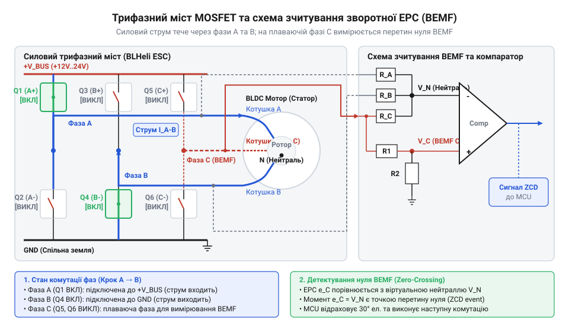
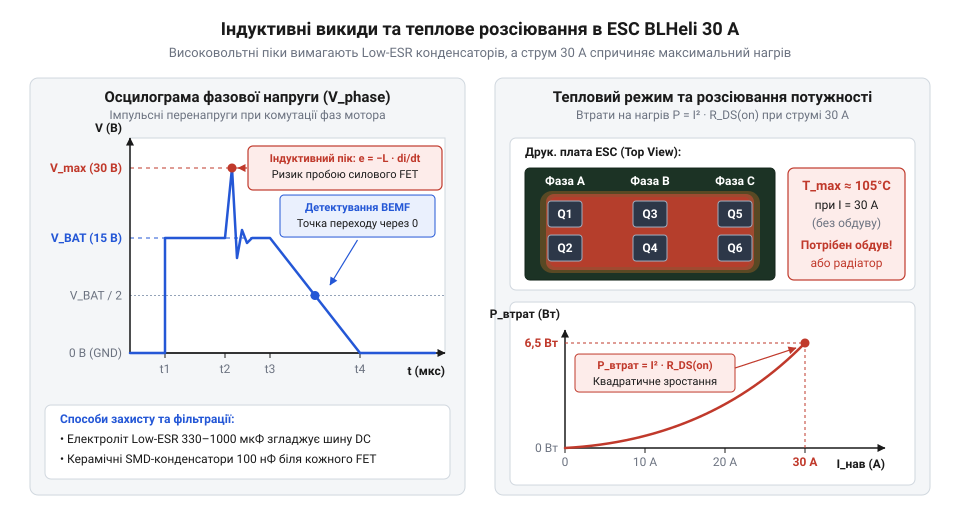
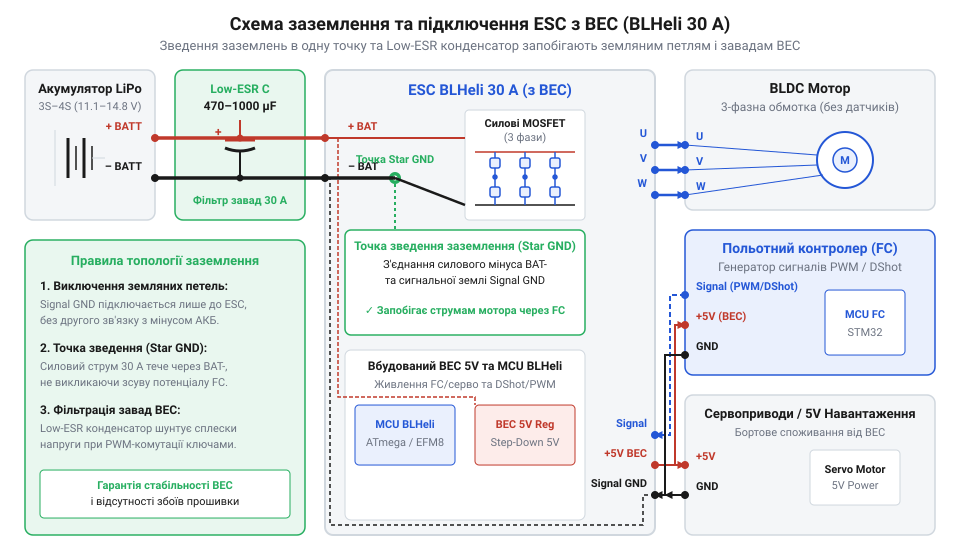
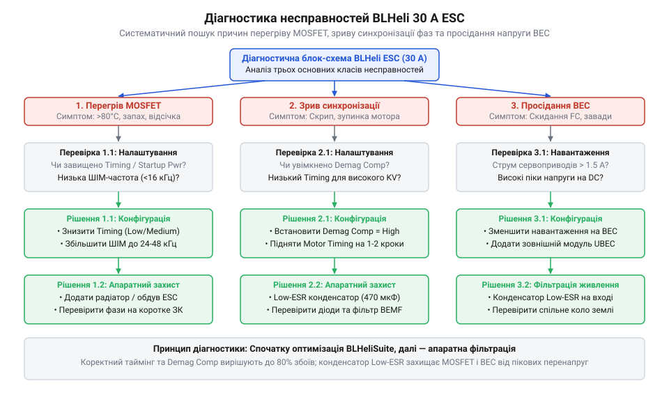

# ESC BLHeli 30 А з BEC

## Пряме підключення безколекторного мотора до батареї

Якщо підключити виводи звичайного колекторного двигуна постійного струму (англ. @@en|brushed DC motor@@, від старофр. @@fr|broisse@@ — щітка) до акумулятора, мотор одразу почне обертатися. Перемикання струму в його обмотках відбувається механічно — за допомогою @@en|commutator@@ (від лат. @@la|commutare@@ — змінювати, перемикати) та вугільних щіток, які послідовно подають напругу на рухомі котушки ротора. Проте у безколекторному двигуні постійного струму (англ. @@en|brushless DC motor@@, @@en|BLDC@@) механічного вузла комутації немає. Його постійні магніти розміщені на статорі (англ. @@en|stator@@, від лат. @@la|stare@@ — стояти), а рухомі силові обмотки — на роторі (англ. @@en|rotor@@, від лат. @@la|rotare@@ — обертатися).

Спроба подати постійну напругу силового акумулятора безпосередньо на фазні виводи @@en|BLDC@@-мотора спричиняє аварійний режим. Оскільки статорні котушки виконані з товстого мідного дроту з малим числом витків, їхній власний омічний опір постійному струму є надзвичайно низьким — зазвичай у межах десятків міліом. 

За законом Ома струм через статорну обмотку при прямому підключенні до акумулятора напругою 12 В обчислюється так:

I_dc = U_bat / (2 * R_ph)
= 12 / 0.05      [підстановка напруги 12 В та опору обмотки 0.05 Ом]
= 240 А          [струм короткого замикання]

Такий великий струм миттєво перегріває мідний дріт, плавить лакову ізоляцію та призводить до згоряння мотора й пошкодження силових роз'ємів акумулятора. При цьому сталого обертання не виникає: ротор лише одноразово притягується до утвореного фіксованого полюса статора, заклинює в цьому положенні й залишається нерухомим.

Щоб змусити ротор безупинно обертатися, необхідно створювати обертове магнітне поле, послідовно й дуже швидко перемикаючи струм між фазами статора. Для цього між акумулятором та мотором встановлюють спеціальний електронний пристрій — регулятор ходу (англ. @@en|electronic speed controller@@, @@en|ESC@@). У системі живлення безколекторних приводів [родина регуляторів ходу](root:cat-hw-drivers/overview-blheli-esc-family) виконує роль силіцієвого аналога механічного колектора, що формує змінний струм потрібної частоти й амплітуди, а також живить бортовий мікроконтролер через вбудоване джерело зниженої напруги. @@en|stator slots@@, `N`) і постійних магнітних полюсів ротора (англ. Конструктивно двигун визначається співвідношенням кількості пазів статора (англ. @@en|stator slots@@, N) і постійних магнітних полюсів ротора (англ. @@en|rotor poles@@, P). @@en|rotor poles@@, `P`). Для поширеного силового мотора конфігурації 12N14P 12 пазів статора (по 4 котушки на кожну з 3 фаз) взаємодіють із 14 полюсами ротора, що дає p = P / 2 = 14 / 2 = 7 полюсних пар (англ. @@en|pole pairs@@). @@en|pole pairs@@, `p`). Дробове співвідношення `N / P = 12 / 14 = 6 / 7` забезпечує високий обертовий момент і плавність ходу, але вимагає від електроніки точного розрахунку частоти: за один повний механічний оберт вала магнітне поле статора має здійснити 7 повних електричних циклів комутації. @@en|electrical frequency@@, `f_el`) розраховується за формулою `f_el = (N_mech × p) / 60`, де `N_mech` — швидкість обертання вала в обертах за хвилину (англ. Необхідна електрична частота (англ. @@en|electrical frequency@@, f_el) розраховується за формулою f_el = (N_mech × p) / 60, де N_mech — швидкість обертання вала в обертах за хвилину (англ. @@en|RPM@@). @@en|revolutions per minute@@, @@en|RPM@@). Наприклад, для двигуна 12N14P з 7 полюсними парами на швидкості 24 000 об/хв електрична частота становить `(24000 × 7) / 60 = 2800` Гц. Оскільки один електричний цикл трифазного двигуна складається з 6 послідовних кроків комутації, мікроконтролер регулятора змушений виконувати `2800 × 6 = 16 800` окремих фазових перемикань щосекунди. Паралельно з керуванням частотою комутації регулятор змінює обертовий момент і вихідну потужність двигуна через регулювання амплітуди напруги на обмотках. Оскільки акумулятор дає фіксовану напругу `U_bat`, регулювання амплітуди здійснюється за допомогою високочастотної широтно-імпульсної модуляції (англ. @@en|pulse-width modulation@@, @@en|PWM@@, від лат. @@la|modulatio@@ — розміреність). @@en|duty cycle@@, `D`). Ефективна напруга на фазі обчислюється як `U_eff = U_bat × D`: при малому газі `D` є невеликим, обмежуючи середній струм і магнітний потік, а при повному газі `D = 1` (100%), подаючи на обмотки повну напругу батареї.

## Трифазний міст MOSFET та бездавачева комутація

Внутрішня силова частина регулятора ходу побудована на трифазному інверторі (англ. Внутрішня силова частина регулятора ходу побудована на трифазному інверторі (англ. @@en|inverter@@), який складається з шести потужних польових транзисторів (англ. @@en|MOSFET@@). @@en|metal-oxide-semiconductor field-effect transistor@@, @@en|MOSFET@@). Транзистори згруповані у три півмости: у кожному півмості один N-канальний ключ підключений до позитивного полюса силової шини (верхній ключ, англ. @@en|high-side switch@@), а другий — до спільного мінуса (нижній ключ, англ. @@en|low-side switch@@). Середня точка кожного півмоста з'єднана з однією з трьох фазних обмоток мотора (позначуваних A, B і C).

Під час шестикрокової трапецеїдальної комутації (англ. @@en|six-step commutation@@) у кожен момент часу відкриті лише два транзистори. @@en|trapezoidal commutation@@) мікроконтролер регулятора відкриває одночасно лише два транзистори з шести. Наприклад, відкритий верхній ключ фази A подає струм від акумулятора в обмотку, а відкритий нижній ключ фази B замикає коло на землю. Третя фаза C у цей момент залишається повністю знеструмленою та перебуває у плаваючому стані (англ. @@en|floating phase@@).


*Схема трифазного містку MOSFET з відкритими ключами двох фаз та дільником напруги на третій фазі для відстеження нуля зворотної ЕРС.*

Коли постійні магніти ротора обертаються повз непідключену обмотку фази C, вони індукують у ній змінну електрорушійну силу — зворотну ЕРС (англ. @@en|back electromotive force@@, @@en|BEMF@@). Напруга на плаваючій фазі змінюється лінійно та в певний момент часу перетинає рівень напруги віртуальної нейтральної точки (англ. @@en|virtual neutral point@@) статора. Подія перетину цього рівня називається моментом нуль-переходу (англ. @@en|zero-crossing@@). 

Дільник напруги знижує сигнал плаваючої фази, проте високочастотна широтно-імпульсна модуляція (англ. @@en|PWM@@) створює сильні сплески завад. @@en|pulse-width modulation@@, @@en|PWM@@) силових транзисторів створює в ній сильні комутаційні завади. Щоб компаратор не спрацьовував хибно від цих сплесків, сигнал із дільника проходить через апаратний фільтр низьких частот (англ. @@en|low-pass filter@@, від лат. @@la|filtrum@@ — повсть) на пасивному RC-колі. Відфільтрована напруга подається на вхід аналогового компаратора (англ. @@en|comparator@@, від лат. @@la|comparare@@ — порівнювати) усередині мікроконтролера. Фіксація моменту нуль-переходу дозволяє точно вирахувати положення ротора без застосування фізичних давачів Холла. У шестикроковій трапецеїдальній комутації нуль-перехід виникає точно посередині між перемиканнями фаз, що відповідає затримці у 30 електричних градусів до наступного кроку. Власне [визначення положення ротора](root:hw-sensing/sensorless-bldc-bemf-zero-crossing-detection) за зворотною ЕРС дає можливість мікроконтролеру відрахувати цю затримку за допомогою апаратного таймера (англ. @@en|hardware timer@@). Алгоритм вимірює тривалість попереднього 60-градусного сектора, обчислює необхідний час затримки в 30 градусів і подає команду на наступне перемикання ключів інвертора чітко в момент закінчення відліку. Проте апаратне RC-коло вносить додатковий фазовий зсув сигналу, який зростає зі збільшенням обертів і вимагає програмної компенсації таймінгу. Однак такий спосіб зворотного зв'язку працює лише під час руху магнітів ротора повз обмотки. На нульових та наднизьких обертах швидкість зміни магнітного потоку прямує до нуля, тому зворотна ЕРС взагалі не індукується і компаратор не бачить сигналу нуль-переходу. Без вхідного сигналу регулятор не може визначити початковий кут ротора для першого комутаційного кроку. Щоб зрушити мотор з місця, мікроконтролер запускає алгоритм стартового розгону в розімкненому контурі (англ. @@en|open-loop startup@@). @@en|open-loop ramp-up@@). У цьому режимі регулятор примусово комутує фази з наперед визначеною частотою та поступово нарощує швидкість перемикання, розганяючи ротор за принципом крокового двигуна. Щойно оберти зростають і напруга зворотної ЕРС перевищує поріг чутливості компаратора, мікроконтролер підхоплює моменти нуль-переходу й переключається у замкнений контур (англ. @@en|closed-loop@@) керування. Фізичне моделювання комутаційних процесів та розрахунок втрат деталізовані у [математичній моделі комутації](root:cat-hw-drivers/esc-blheli/math-esc-commutation-and-thermal-losses.md).

Окрім керування силовими транзисторами, регулятор ходу має забезпечувати стабільне живлення власної цифрової мікроконтролерної частини та зовнішніх бортових систем від високовольтної сирої напруги акумулятора. Для цього до складу ESC вбудовують схему усунення батареї (англ. @@en|battery eliminator circuit@@, @@en|BEC@@). Сучасні [вбудовані модулі BEC](root:hw-power/embedded-bec-voltage-regulators-in-esc) перетворюють напругу батареї 7.4–25.2 В на стабільну напругу 5 В або 3.3 В, позбавляючи потреби встановлювати на борт окремий важкий акумулятор для електроніки. Силова схема ключів, драйвери та виводи живлення розглянуті в [описі електричного інтерфейсу](root:cat-hw-drivers/esc-blheli/api-blheli-30a-esc-hardware-interface.md) регулятора.

## Індуктивні викиди, перегрів та збої синхронізації

Обмотки безколекторного мотора мають відчутну індуктивність. Коли силовий ключ @@en|MOSFET@@ інвертора раптово закривається для переривання струму фази, накопичена в магнітному полі енергія прагне втримати проходження струму. Це викликає зворотний сплеск напруги — `@@en|flyback voltage@@` (від англ. *flyback* — швидке повернення). Висока швидкість зміни струму призводить до виникнення коротких індуктивних піків напруги, які спроможні перевищити критичну напругу пробою "стік-витік" транзисторів і пробити силіконову структуру.

Величина індуктивної перенапруги прямо залежить від швидкості зміни струму та індуктивності фазної обмотки мотора:

```
V_spike = V_in + L × (dI / dt)    [розрахунок пікової напруги на стоці MOSFET]
```

де `V_in` — напруга батареї живлення, `L` — індуктивність обмотки фази, `dI / dt` — швидкість спаду струму під час вимикання транзистора.

Швидкість спаду струму `dI / dt` та амплітуда індуктивного сплеску напряму залежать від струму розряду затвора `@@en|gate driver current@@` (від англ. *gate driver current* — струм драйвера затвора). Високий струм драйвера швидко викачує заряд із затвора силового транзистора @@en|MOSFET@@, викликає стрімке закриття каналу та збільшує похідну `dI / dt`. Надмірне уповільнення закриття ключа збільшує динамічне тепловиділення та створює ризик одночасного відкриття верхнього й нижнього транзисторів півмоста. Такий стан призводить до виникнення руйнівного наскрізного струму `@@en|shoot-through@@` (від англ. *shoot through* — прострілювати наскрізь) напряму з силової шини на землю. Для запобігання наскрізному пробою між вимиканням одного ключа та вмиканням протилежного впроваджують часову паузу — мертвий час @@en|dead time@@ (від англ. *dead time* — мертвий час). Оптимальну швидкість комутації та безпечний рівень `dI / dt` формують добором опору резистора затвора `@@en|gate resistor@@` (від англ. *gate resistor* — резистор затвора). Для захисту півмостів від залишкових руйнівних сплесків застосовують демпферні `@@en|snubber@@` (від англ. *snub* — приборкувати) ланцюги та керамічні згладжувальні конденсатори. Вони приймають на себе високочастотну енергію комутації. Якщо еквівалентний послідовний опір @@en|ESR@@ (від англ. *equivalent series resistance* — еквівалентний послідовний опір) цих елементів зависокий, струмові пульсації перетворюються на високочастотні сплески напруги. @@en|Equivalent Series Resistance@@) фільтруючих конденсаторів силової шини занадто високий, індуктивні імпульси не поглинаються і створюють потужні електромагнітні завади в сигнальних лініях. Для розрахунку демпферного @@en|RC snubber@@ ланцюжка ємність демпферного конденсатора `C_s` обирають у 2–4 рази більшою за паразитну вихідну ємність `C_oss` силового транзистора @@en|MOSFET@@ (`C_s ≈ 2...4 × C_oss`). Це зміщує резонансну частоту контуру вниз і зменшує швидкість наростання напруги `dV / dt`. Опір демпферного резистора `R_s` розраховують відповідно до хвильового опору паразитних елементів за формулою `R_s ≈ √(L_p / C_oss)`, де `L_p` — паразитна індуктивність силових провідників. Таке узгодження забезпечує критичне демпфування `@@en|critical damping@@` (від англ. *critical damping* — критичне демпфування), розсіює енергію коливань у вигляді тепла та запобігає виникненню високовольтного резонансного дзвеніння. Для зрізання імпульсів надвисокої енергії паралельно силовій шині встановлюють захисні `@@en|TVS-diode@@` (від англ. *transient voltage suppressor* — приборкувач перехідних напруг) діоди. Напругу пробою `V_BR` (від англ. *breakdown voltage* — напруга пробою) супресора обирають вищою за максимальну робочу напругу батареї `V_in(max)`. Водночас напругу затискання `V_clamp` (від англ. *clamping voltage* — напруга затискання) обирають суворо нижчою за граничну напругу пробою стік-витік `V_(BR)DSS` транзистора @@en|MOSFET@@. При виникненні сплеску діод лавинно відкривається за одиниці пікосекунд @@en|ps@@ і шунтує надлишковий струм на землю.


*Формування індуктивного піку напруги під час розмикання силових ключів та залежність теплового розсіювання містка від величини струму.*

При проходженні струму до 30 А силові транзистори регулятора ходу @@en|ESC@@ зазнають значного теплового навантаження. Сумарні втрати потужності складаються зі статичних втрат на опорі відкритого каналу та динамічних втрат під час переходів між станами за частоти широтно-імпульсної модуляції @@en|PWM@@:

```
P_loss = P_cond + P_sw
= I² × R_DS(on) + 0.5 × V_in × I × (t_r + t_f) × f_sw    [сума втрат провідності та комутації]
```

де `I` — робочий струм фази, `R_DS(on)` — опір відкритого каналу, `t_r` і `t_f` — тривалість наростання та спаду струму, `f_sw` — частота ШІМ.

Оскільки опір відкритого каналу напівпровідника зростає з підвищенням температури, виникає позитивний зворотний зв'язок: нагрівання транзистора підвищує опір, що викликає ще більше виділення тепла. Без належного тепловідводу або мідних теплових перехідних отворів на друкованій платі кристал швидко досягає критичної межі, що запускає процес теплового саморуйнування @@en|thermal runaway@@ (від англ. *runaway* — втіклий, неконтрольований) або призводить до короткого замикання півмоста. Детальні формули для обчислення [втрат потужності силових](root:cat-hw-drivers/esc-blheli/math-esc-commutation-and-thermal-losses.md) транзисторів наведено у відповідному математичному довіднику.

Іншим критичним явищем у роботі `@@en|BLDC@@`-регулятора є десинхронізація `@@en|desynchronization@@` (від грец. *syn* — разом та *chronos* — час). При бездавачевому керуванні прошивка @@en|BLHeli@@ виявляє момент переходу зворотної ЕРС @@en|BEMF@@ через нуль для своєчасної комутації наступної фази. При різкому збільшенні навантаження або надмірному прискоренні струм у фазі створює тривалий перехідний процес, який перекриває сигнал зворотної ЕРС.

Втрата сигналу переходу через нуль призводить до того, що мікроконтролер подає комутаційний імпульс на невчасно вирівняний ротор. Замість обертання виникає гальмування, мотор починає смикатися, а струм через силові ключі стрімко зростає до рівня короткого замикання. Точне налаштування кута випередження комутації `@@en|timing@@` (від англ. *time* — час) дає змогу компенсувати індуктивне запізнення струму і зберегти надійне зчитування сигналу при [відстеженні положення ротора](root:hw-sensing/sensorless-bldc-bemf-zero-crossing-detection) під навантаженням.

## Узгодження ESC із мотором та батареєю

Надійна робота приводної системи вимагає точного узгодження граничних параметрів @@en|ESC@@, безколекторного мотора та акумуляторної батареї. Силові ключі 30-амперного регулятора розраховані на тривалий струм 30 А, проте пікові кидки при розгоні можуть досягати 40 А протягом кількох секунд. Мотор повинен добиратися так, щоб його максимальний споживаний струм на повному газу не перевищував номінальний струм регулятора, а робоча напруга батареї @@en|LiPo@@ (наприклад, 3S–4S, тобто 11.1 В – 14.8 В) відповідала допустимому діапазону вхідної напруги @@en|MOSFET@@-драйверів. Величина цього струмового навантаження напряму залежить від геометричних параметрів повітряного гвинта та значення @@en|KV rating@@ (від англ. *velocity* — швидкісний коефіцієнт, оберти на вольт) мотора. Збільшення діаметра гвинта чи його кроку `@@en|propeller pitch@@` (від англ. *pitch* — крок лопаті) стрімко підвищує аеродинамічний опір обертанню, який зростає пропорційно квадрату обертів. Мотор із високим значенням @@en|KV rating@@ намагається розвинути вищу швидкість при тій самій напрузі, вимагаючи від регулятора кратно більшого струму для подолання механічного моменту опору. Під час стрімкого набору газу важкий або висококроковий гвинт створює інерційне запізнення ротора, через що силовий місток тривалий час працює під піковим струмом, що перевищує 40 А. Оскільки теплові втрати на внутрішньому опорі @@en|MOSFET@@-транзисторів зростають пропорційно квадрату струму, такі перевантаження вичерпують тепловий запас регулятора та призводять до критичного перегріву ключів. Загальний опис технічних обмежень міститься в [огляді лінійки BLHeli](root:cat-hw-drivers/overview-blheli-esc-family) для безколекторних систем.

Важливим вузлом регулятора є вбудована схема живлення бортової електроніки @@en|BEC@@. *linearis* — лінійний) та імпульсний перетворювач `@@en|buck converter@@` (від англ. *linearis* — лінійний) та імпульсний перетворювач `@@en|buck converter@@` (від англ. *buck* — чинити опір, знижувати). Лінійний регулятор гасить надлишок напруги батареї перетворенням її на тепло:

```
P_linear = (V_in - V_out) × I_load    [теплові втрати лінійного BEC]
```

де `V_in` — вхідна напруга батареї, `V_out` — вихідна напруга п'ять вольт, `I_load` — струм споживання бортової електроніки.

При підключенні 4S @@en|LiPo@@ (16.8 В у повністю зарядженому стані) та живленні бортових сервоприводів струмом 1 А лінійний @@en|BEC@@ виділятиме понад 11 Вт тепла, що неминуче призведе до перегріву та вимкнення регулятора. У таких умовах слід застосовувати імпульсний перетворювач @@en|UBEC@@, який має високий коефіцієнт корисної дії та не перегрівається при високій вхідній напрузі. Порівняльний аналіз [топологій регуляторів живлення](root:hw-power/embedded-bec-voltage-regulators-in-esc) показує переваги імпульсних схем для багатобанкивих батарей.

Недостатній струмовий запас `@@en|BEC@@` під час одночасної роботи кількох сервоприводів спричиняє короткочасне просідання напруги живлення — `@@en|brownout@@` (від англ. *brownout* — часткове затемнення, зниження напруги). Якщо напруга п'ятивольтової шини падає нижче порогу скидання польотного контролера або приймача, відбувається перезавантаження бортового комп'ютера в польоті, що призводить до повної втрати керування.


*Правильна топологія з'єднання силового та сигнального контурів ESC для запобігання завадам і просіданню напруги BEC.*

Для запобігання збоям у сигнальному колі необхідно дотримуватися правил розведення кабелів. Силовий струм мотора, що досягає 30 А, створює відчутне падіння напруги на загальному дріті заземлення. Якщо сигнальний дріт керування @@en|PWM@@ або @@en|DShot@@ підключений без окремого заземлювального провідника, імпульсні завади від силового містка накладаються на логічний рівень керування. Правильна топологія вимагає організації зірчастого заземлення `@@en|star grounding@@` (від англ. *star* — зірка) у єдиній точці та встановлення низькоімпедансного електролітичного конденсатора безпосередньо на вхідних силових клемах @@en|ESC@@.

Налаштування часових параметрів, вибір протоколу керування та калібрування діапазону газу здійснюються за допомогою програмного забезпечення @@en|BLHeliSuite@@. Для детального ознайомлення з розпіновкою та схемотехнікою зверніться до документа, де описуються [електричні характеристики регулятора](root:cat-hw-drivers/esc-blheli/api-blheli-30a-esc-hardware-interface.md). Програмні налаштування деталізовано в описі [програмних параметрів прошивки](root:cat-hw-drivers/esc-blheli/api-blheli-firmware-protocol-interface.md), а нюанси обміну даними розкрито в описі [протоколів цифрового керування](root:com-devices/dshot-protocol). Практичний порядок підключення та випробувань викладено в керівництві з [діагностики на стенді](root:cat-hw-drivers/esc-blheli/proj-blheli-esc-bench-setup-and-tuning.md).

Для збереження стабільності бортової електроніки під час рефлекторних маневрів модельних сервоприводів імпульсний перетворювач @@en|UBEC@@ повинен ефективно трансформувати високу вхідну напругу акумулятора `4S LiPo` без критичного перегріву та шкідливого шуму на сигнальній лінії. Коефіцієнт корисної дії `η` імпульсного перетворювача розраховується як відношення корисної вихідної потужності `P_out` до сумарної споживаної потужності, яка включає втрати `P_loss` на статичному опорі відкритих каналів @@en|MOSFET@@-ключів та динамічні перемикання:

```
P_out = V_out × I_load                                    [виділена корисна потужність]
η = P_out ÷ (P_out + P_loss) × 100%                       [коефіцієнт корисної дії]
```

**Обчислення ККД імпульсного UBEC при вихідному струмі 3 А від акумулятора 14.8 В:**
```
P_out = 5.0 × 3.0 = 15.0                                  [корисна потужність живлення, Вт]
P_in = 15.0 + 1.65 = 16.65                                [загальна потужність із втратами 1.65 Вт, Вт]
η = 15.0 ÷ 16.65 × 100% ≈ 90.1%                           [підсумковий ККД перетворення]
```

Висока ефективність понад 90% досягається за рахунок широтно-імпульсної модуляції з коефіцієнтом заповнення `D = V_out ÷ V_in`, проте комутація індуктивності викликає змінну складову струму. Размах пульсацій струму `ΔI_L` у силовому дроселі `L` на робочій частоті `f_sw` визначається формулою:

```
ΔI_L = ((V_in - V_out) × V_out) ÷ (V_in × f_sw × L)       [амплітуда пульсацій струму дроселя]
```

**Розрахунок пульсацій струму дроселя при V_in = 14.8 В, V_out = 5.0 В, f_sw = 500 кГц та L = 10 мкГн:**
```
D = 5.0 ÷ 14.8 ≈ 0.338                                    [коефіцієнт заповнення імпульсів]
ΔI_L = ((14.8 - 5.0) × 0.338) ÷ (500000 × 0.000010)        [підстановка параметрів дроселя]
     = 3.312 ÷ 5.0 = 0.6624                               [амплітуда пульсацій струму, А]
```

Амплітуда пульсацій близько 0.66 А створює високі вимоги до вихідних фільтрувальних конденсаторів. Якщо еквівалентний послідовний опір `@@en|ESR@@` (від англ. *equivalent series resistance* — еквівалентний послідовний опір) цих елементів зависокий, струмові пульсації перетворюються на високочастотні сплески напруги, що детальніше розкрито в описі [топологій регуляторів живлення](root:hw-power/embedded-bec-voltage-regulators-in-esc) для безколекторних систем.

## Правила електричного підключення та фільтрації завад

Робота трифазного інвертора на струмах до 30 А супроводжується високочастотним перемиканням силових транзисторів @@en|MOSFET@@ (англ. *metal-oxide-semiconductor field-effect transistor* — польовий транзистор зі структурою метал-оксид-напівпровідник) із частотою ШІМ 24–48 кГц. Швидка зміна струму в силових провідниках створює високі значення крутизни імпульсів струму `di/dt`, що через наявність паразитної індуктивності дротів живлення викликає значні сплески напруги та високочастотні електромагнітні завади. Прямі фазні провідники, рознесені на значну відстань один від одного, утворюють контури з великою площею, які випромінюють змінні магнітні поля. Для мінімізації цього випромінювання застосовують фізичне скручування трьох фазних дротів у щільний джгут за принципом скручування провідників. Спіральна геометрія джгута змушує магнітні потоки суміжних напіввитків компенсувати один одного в навколишньому просторі. Не менш важливим є просторове рознесення високострумових силових ліній і слабкострумових сигнальних дротів керування на максимальну відстань з їх перетином суворо під прямим кутом. Паралельне трасування сигнального провідника вздовж силових кабелів створює паразитний @@en|inductive coupling@@ (англ. *inductive coupling* — індуктивний зв'язок), через який імпульсні струми наводять хибні сплески напруги в лініях передачі даних. Без правильно організованого трасування дротів та заходів фільтрації ці завади й наводки проникають у кола живлення мікроконтролера польотного контролера та в лінії чутливого бездавачевого вимірювання, викликаючи збої синхронізації чи перезавантаження керуючої плати.

Першою лінією захисту від імпульсних перенапруг є правильний монтаж силових конденсаторів із низьким еквівалентним послідовним опором @@en|Low ESR@@ (англ. *low equivalent series resistance* — низький еквівалентний послідовний опір). Електролітичні або керамічні накопичувальні конденсатори ємністю від 330 до 1000 мкФ підключаються якомога ближче до вхідних силових клем регулятора. У момент закриття силового ключа індуктивність підвідних дротів акумулятора намагається підтримувати струм, спричиняючи викид напруги; накопичувач приймає цей імпульсний струм на себе, демпфуючи коливальний процес. Математичні рівняння [обчислення індуктивних втрат](root:cat-hw-drivers/esc-blheli/math-esc-commutation-and-thermal-losses.md) показують, як опір ємності впливає на рівень згладжування пульсацій у силовій шині.

Другим критичним фактором є запобігання утворенню замкнених контурів заземлення, відомих як @@en|ground loop@@ (англ. *ground loop* — земляна петля). Якщо сигнальний дріт керування від польотного контролера має власний дріт заземлення, який підключено паралельно до потужної силової мінусової шини регулятора, частина високого силового струму повернення починає протікати через слабкострумову сигнальну землю. Це створює падіння напруги на сигнальному провідникові, що спотворює амплітуду командних імпульсів. Щоб усунути цей ефект, застосовують принципи @@en|star grounding@@ (англ. *star grounding* — зірчасте заземлення), де всі силові й сигнальні мінусові провідники сходяться в єдиній точці @@en|common ground@@ (англ. *common ground* — спільна земля) на розподільчій платі живлення.

Не меншої уваги вимагає захист шини живлення бортової електроніки від вбудованого модуля @@en|BEC@@ (англ. *battery eliminator circuit* — схема усунення батареї). Імпульсний знижувальний перетворювач @@en|Buck converter@@ (англ. *buck converter* — знижувальний імпульсний перетворювач) генерує власні комутаційні завади на частоті перемикання свого ключа. Для захисту приймача й польотного контролера від цих пульсацій на вихідну лінію 5 В встановлюють феритові кільця або додаткові LC-фільтри. Детальні схематичні варіанти підключення дротів та розпіновки описує [схема підключення силових дротів](root:cat-hw-drivers/esc-blheli/api-blheli-30a-esc-hardware-interface.md) для 30-амперних регуляторів. Подробиці топології [імпульсних та лінійних регуляторів](root:hw-power/embedded-bec-voltage-regulators-in-esc) дають змогу глибше зрозуміти різницю між типами BEC.


*Схема зірчастого заземлення силових та сигнальних кіл ESC, розміщення Low ESR конденсатора на вхідних клемах та фільтрації виходу BEC: підключення сигнальної землі й силового мінуса в єдиній точці усуває земляні петлі, а вхідний Low ESR конденсатор та вихідний LC-фільтр мінімізують високочастотні пульсації напруги.*

## Конфігурація прошивки BLHeli та діагностика несправностей

Розвиток програмного забезпечення для 8-бітних мікроконтролерів у регуляторах ходу пройшов шлях від простих аналогових алгоритмів до високооптимізованої прошивки BLHeli. Ранні ESC використовували стандартний аналоговий ШІМ-сигнал із частотою оновлення 50 Гц, що створювало затримку відгуку мотора до 20 мс і суттєво обмежувало динаміку мультироторних систем. Оптимізація асемблерного коду під мікроконтролери Atmega та SiLabs дозволила реалізувати апаратну обробку переривань і перейти до високочастотних протоколів Oneshot, Multishot, а згодом — до повністю цифрових протоколів родини DShot, де швидкість передачі даних сягає 600 кбіт/с без потреби в калібруванні аналогового діапазону. Паралельно з еволюцією прошивки змінювалася схемотехніка вбудованих джерел живлення BEC: лінійні регулятори з низьким коефіцієнтом корисної дії та високим тепловиділенням поступилися місцем високоефективним імпульсним Buck-перетворювачам. Це усунуло ризик критичного перегріву ESC при живленні бортової електроніки від акумуляторів із високою напругою 4S–6S.

Налаштування параметрів прошивки здійснюється через спеціалізовану утиліту @@en|BLHeliSuite@@. Підключення регулятора до комп'ютера виконується через польотний контролер у режимі наскрізного програмування (@@en|passthrough@@). У середовищі програми здійснюється вибір цифрового протоколу керування: при виборі сучасних [цифрових протоколів передачі](root:com-devices/dshot-protocol) даних @@en|DShot@@ зникає потреба проводити @@en|throttle calibration@@ (англ. *throttle calibration* — калібрування діапазону газу), оскільки значення швидкості передаються у вигляді цифрових кадрів із контрольною сумою CRC.

Для досягнення максимального ККД та стабільності мотора конфігурують кут випередження комутації @@en|motor timing@@ (англ. *motor timing* — таймінг мотора). Для моторів із високим значенням KV (кількість обертів на вольт) встановлюють середній або високий таймінг (18°–22°), що забезпечує вчасну комутацію силових ключів до того, як струм фази досягне піку. На етапі рушання ротора з місця, коли зворотна ЕРС ще відсутня, вирішальну роль відіграє параметр @@en|Startup Power@@ (англ. *startup power* — пускова потужність): він задає амплітуду початкових імпульсів для розгону у розімкненому контурі. Занадто низька пускова потужність призводить до зриву старту під навантаженням, а надмірна — викликає ударні струмові перевантаження ключових транзисторів і локальний перегрів обмоток. Для миттєвого відгуку на скидання газу вмикають режим @@en|Damped Light@@ (англ. *damped light* — режим активного гальмування), який реалізує комплементарне ШІМ-комутування силових ключів. Замість пасивного вибігу ротора нижні транзистори замкнених фаз короткочасно закорочують обмотки, перетворюючи кінетичну енергію обертання на гальмівний магнітний момент. Це радикально підвищує керованість мотора та динаміку уповільнення, але створює регенеративні сплески напруги на силовій шині живлення, які вимагають надійного демпфування. Також важливим параметром є @@en|demag compensation@@ (англ. *demagnetization compensation* — компенсація демагнетизації): цей механізм запобігає передчасній комутації фази під час швидкого спадання магнітного поля в обмотках статора. Повна карта регістрів та [список програмних налаштувань](root:cat-hw-drivers/esc-blheli/api-blheli-firmware-protocol-interface.md) прошивки описує всі доступні параметри утиліти.

Діагностика несправностей регулятора базується на локалізації трьох типових проблем: перегріву ключових транзисторів, аварійних перезавантажень та зривів синхронізації. Перегрів @@en|MOSFET@@ зазвичай спричинений занадто високим значенням таймінгу або відсутністю фільтруючого конденсатора, через що силові ключі тривалий час працюють в активній зоні комутаційних втрат. Просідання напруги BEC та явище @@en|brownout@@ (англ. *brownout* — просідання напруги). *brownout* — аварійне просідання живлення) виникають при перевищенні допустимого струму споживання сервоприводами; перевірка стану модуля здійснюється під навантаженням за допомогою мультиметра чи осцилографа.

Найбільш небезпечним збоєм є зрив синхронізації @@en|desynchronization@@ (англ. *desynchronization* — втрата синхронізації), коли мікроконтролер втрачає відстеження @@en|BEMF@@ (англ. *back electromotive force* — зворотна ЕРС) під час різкого набору обертів. Фізика виявлення [моменту переходу через нуль](root:hw-sensing/sensorless-bldc-bemf-zero-crossing-detection) зворотного сигналу демонструє, чому слабкий сигнал ЕРС на низьких обертах призводить до блокування ротора. Перевірка силового містка виконується вимірюванням опору між вихідними фазними клемами й силовими шинами живлення: нульовий опір свідчить про пробій транзистора. Детальний порядок [проведення стендових випробувань](root:cat-hw-drivers/esc-blheli/proj-blheli-esc-bench-setup-and-tuning.md) описує покрокові алгоритми безпечного запуску системи через обмежувальну лампу розжарювання або запобіжник. Для загального огляду лінійки пристроїв корисно переглянути [сімейство регуляторів BLHeli](root:cat-hw-drivers/overview-blheli-esc-family).


*Блок-схема покрокової діагностики несправностей регулятора BLHeli: послідовний аналіз симптомів дозволяє швидко локалізувати перегрів MOSFET, аварійні просідання напруги BEC та зриви синхронізації для усунення апаратних і програмних збоїв.*
