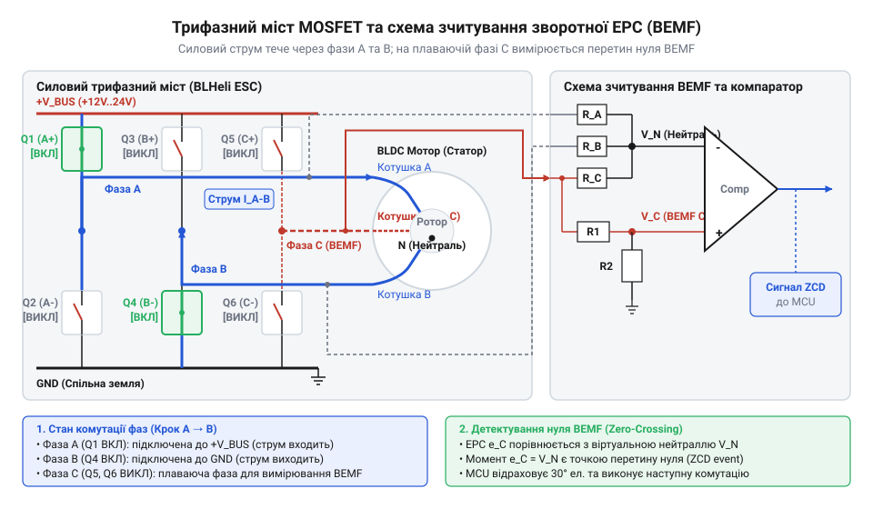
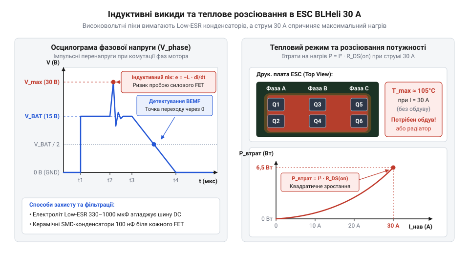
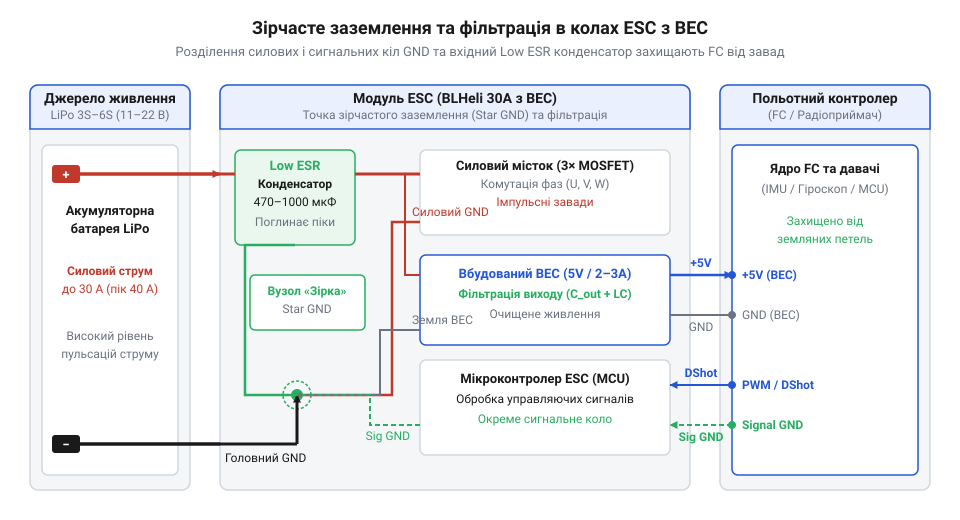

# ESC BLHeli 30 А з BEC

<preknowlist>
- [Бездавачеве виявлення нуль-переходу зворотної ЕРС](root:hw-sensing/sensorless-bldc-bemf-zero-crossing-detection) — базові принципи вимірювання зворотної ЕРС для визначення положення ротора BLDC-двигуна
- [Огляд родини регуляторів ходу BLHeli](root:cat-hw-drivers/overview-blheli-esc-family) — призначення регуляторів ходу в системах приводу безколекторних моторів
- [Вбудовані модулі регуляторів живлення BEC](root:hw-power/embedded-bec-voltage-regulators-in-esc) — концепція пониження напруги живлення для бортової електроніки
</preknowlist>

## Пряме підключення безколекторного мотора до батареї

Підключення @@en|BLDC-мотора@@ (від англ. *brushless direct current* — безщітковий постійного струму) напряму до акумулятора спричиняє коротке замикання. Через мікроскопічний омічний опір `R` обмоток статора (кілька міліом) постійний струм миттєво перегріває дріт, а вал лишається нерухомим.

Через відсутність механічного колектора функцію перемикання фаз бере на себе зовнішній регулятор ходу — @@en|ESC@@ (від англ. *electronic speed controller* — електронний регулятор швидкості). Він створює обертове магнітне поле та дозує потужність за допомогою @@en|ШІМ@@ (від англ. *pulse-width modulation* — широтно-імпульсна модуляція).

Щоб магнітне поле статора оберталося синхронно з ротором, регулятор має комутувати фази з електричною частотою `f_e` (в @@en|Гц@@). Для мотора з `P` парами полюсів при швидкості обертання вала `N` (в об/хв) розрахунок виконують за формулою:

**Розрахунок електричної частоти для мотора на 24 000 об/хв із 7 парами полюсів:**
```
f_e = (N ÷ 60) × P
= (24000 ÷ 60) × 7      [ділення обертів на хвилину для отримання механічної частоти]
= 400 × 7               [множення механічної частоти на кількість пар полюсів]
= 2800                  [електрична частота комутації у Гц]
```

Отже, при 24 000 об/хв силові ключі регулятора мусять перемикати фази 2800 разів на секунду.

## Трифазний міст MOSFET та бездавачева комутація

Силовий інвертор @@en|ESC@@ складається з шести N-канальних @@en|MOSFET-транзисторів@@ (англ. *metal-oxide-semiconductor field-effect transistor*), згрупованих у три півмости для фаз A, B і C.

У трапецеїдальному режимі струм у кожен момент проводять дві фази (один верхній ключ і один нижній), а третя залишається у плаваючому стані.


*Інвертор перемикає активні фази, а плаваюча фаза подає зворотну ЕРС на компаратор.*

Плаваюча фаза індукує зворотну ЕРС від магнітів ротора. Момент перетину цією напругою півсуми живлення називають @@en|нуль-переходом@@ — за ним мікроконтролер обчислює положення ротора й перемикає крок із затримкою в 30 електричних градусів. Докладніше про це — у [бездавачевому виявленні нуль-переходу](root:hw-sensing/sensorless-bldc-bemf-zero-crossing-detection).

На нульових обертах зворотна ЕРС відсутня. Тому @@en|ESC@@ розганяє мотор у розімкненому контурі імпульсами зростаючої частоти, а після появи ЕРС переходить у замкнений контур.

## Індуктивні сплески, перегрів та збої синхронізації

Комутація струму через обмотки створює індуктивні сплески напруги під час вимкнення ключів. Одночасне відкриття двох @@en|MOSFET@@ у півмості спричиняє наскрізне замикання, чому запобігає павза @@en|dead time@@ (від англ. *dead time*) *dead time* — мертвий час). Для поглинання викидів паралельно живленню встановлюють @@en|Low ESR@@-конденсатори, @@en|RC-демпфери@@ та @@en|TVS-діоди@@.


*Формування індуктивних викидів та зростання втрат у ключах із температурою.*

Втрати ключа складаються зі статичного опору `R_DS(on)` та динамічних втрат перемикання. Нагрів підвищує опір каналу, що загрожує тепловим саморуйнуванням.

При різкому навантаженні ротор відстає від поля, зміщуючи сигнал зворотної ЕРС. Втрата нуль-переходу викликає десинхронізацію: мотор смикається й споживає критичний струм.

## Узгодження, живлення BEC та фільтрація завад

Номінальний струм @@en|ESC@@ (наприклад, 30 А) обирають із запасом 20–30% від пікового споживання мотора з гвинтом під напругою батареї (3S–4S).

Для живлення контролера @@en|ESC@@ має модуль @@en|BEC@@ (від англ. *battery eliminator circuit* — схема усунення окремої батареї); порівняння лінійних схем та імпульсних @@en|UBEC@@ висвітлюють [вбудовані модулі BEC](root:hw-power/embedded-bec-voltage-regulators-in-esc).


*З'єднання силової та сигнальної землі в одній точці запобігає завадам на лінії керування та просіданню живлення.*

Зірчасте заземлення силового й сигнального мінуса усуває земляні петлі, а низькоімпедансний конденсатор на майданчиках @@en|ESC@@ пригнічує сплески напруги.

У програмі @@en|BLHeliSuite@@ налаштовують [протокол DShot](root:cat-hw-drivers/dshot-protocol), гальмування [Damped Light](root:cat-hw-drivers/damped-light-active-braking), таймінг і пускову потужність (огляд має [родина регуляторів BLHeli](root:cat-hw-drivers/overview-blheli-esc-family)). Перший запуск виконують без гвинта через обмежувач струму.
