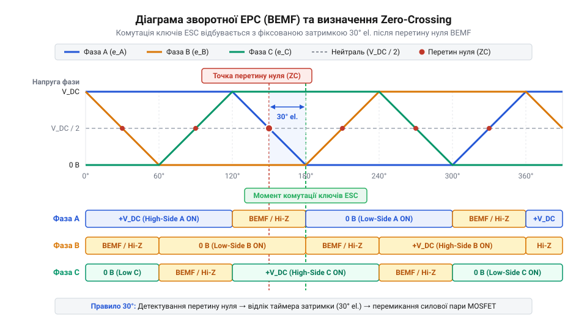
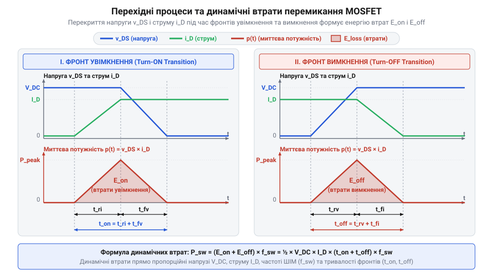

# Математичне моделювання комутації, зворотної ЕРС та втрат потужності ESC

## Неконтрольований перегрів та розсинхронізація ключів

У сучасних електроприводах безколекторні двигуни постійного струму ([BLDC-двигун](root:hw-motion/bldc-motor)) керуються електронними регуляторами ходу (@@en|Electronic Speed Controller@@, ESC). Щоби відмовитися від громіздких і чутливих до навколишнього середовища фізичних датчиків положення ротора (ротор, лат. @@la|rotare@@ — обертатися), бездавачеві (@@en|sensorless@@) ESC розраховують моменти комутації (лат. @@la|commutatio@@ — зміна, перетворення) силових ключів за електричними сигналами від самих обмоток двигуна. Силовий каскад регулятора побудований за топологією трифазного мостового інвертора (лат. @@la|invertere@@ — перевертати, обертати) на польових транзисторах (MOSFET).

Коли транзистор інвертора вимикає фазу для вимірювання напруги, фазна індуктивність (лат. @@la|inductio@@ — наведення, спонукання) статора `L_ph` протидіє миттєвій зміні струму. Накопичена в магнітному полі енергія продовжує штовхати фазний струм `I_ph` у тому самому напрямку. Цей струм змушений протікати через вбудовані зворотні діоди (діод, грец. @@el|dia@@ — через + @@el|hodos@@ — шлях; @@en|freewheeling diode@@) силових ключів назад у шину живлення `U_DC`. Доки триває процес розмагнічування обмотки, потенціал фази залишається притиснутим до одного з полюсів живлення, що повністю блокує вимірювання напруги зворотної ЕРС `e_bemf`. Часова затримка спаду струму `Δt_decay` визначається відношенням накопиченого магнітного потоку до напруги шини живлення:

```
Δt_decay = (L_ph · I_ph) / U_DC      [залежність часу спаду струму від індуктивності та навантаження]
```

Зростання фазної індуктивності або струму навантаження подовжує інтервал `Δt_decay`. У результаті скорочується часове вікно для визначення точки Zero-Crossing, що викликає зсув моменту комутації на високих обертах.

Під час роботи регулятора під високим навантаженням або при інтенсивному розгоні через силові MOSFET протікають значні фазні струми `I_ph`. Це створює дві критичні фізичні проблеми, здатні повністю зруйнувати силовий модуль.

Перша проблема — неконтрольований тепловий пробій напівпровідникового кристала. Втрати потужності на активному опорі відкритого каналу транзистора `R_DS(on)` квадратично залежать від струму (`P_cond ∝ I_ph²`). При проходженні струму температура кристала `T_j` зростає. Опір каналу кремнієвого MOSFET має додатний температурний коефіцієнт: із підвищенням температури `R_DS(on)` збільшується. Це викликає додаткове зростання втрат провідності, що ще сильніше розігріває кристал. Виникає лавиноподібний позитивний зворотний зв'язок — тепловий розгін (@@en|thermal runaway@@). Якщо тепловідведення є недостатнім, температура переходу перевищує максимально допустиму межу (зазвичай 150–175 °C), кристал плавиться і виникає коротке замикання.

Друга проблема — втрата синхронізації (розсинхронізація, грец. @@el|syn@@ — разом + @@el|chronos@@ — час) керування ключами. Бездавачевий регулятор визначає момент положення ротора за точкою перетину нуля (@@en|Zero-Crossing@@) зворотної ЕРС (@@en|Back-EMF@@, BEMF) у вимкненій фазі. Проте під великим навантаженням індуктивність обмоток спричиняє затримку спаду струму: після вимкнення ключів фазний струм продовжує протікати через вбудовані зворотні діоди транзисторів (інтервал рекуперації або фривілінгу, @@en|freewheeling@@). Цей струм маскує справжній сигнал BEMF. Якщо мікроконтролер помилково визначає або пропускає момент Zero-Crossing, комутація фаз відбувається із хибним кутом. Перемикання напруги на обмотку в момент, коли її BEMF спрямована назустріч прикладній напрузі, створює потужне гальмівне зусилля, ротор миттєво випадає із синхронізму (@@en|out-of-step@@), а струмовий сплеск викликає наскрізний пробій плечей моста.

> 🔧 **Навіщо це.**
> Розуміння фізичних причин теплового пробою та розсинхронізації показує розробнику: бездавачевий ESC не можна спроектувати «із запасом» лише за номінальним струмом. Інженер мусить мати математичну модель для аналітичного розрахунку часових інтервалів комутації BEMF та точного визначення сумарних втрат тепловиділення силових ключів.

## Математика бездавачевої комутації та BEMF

У 6-кроковому бездавачевому режимі керування з трапецеїдальною (грец. @@el|trapezion@@ — столик) комутацією в кожен момент часу струм протікає лише через дві фази двигуна: одна підключена до додатної шини живлення `V_DC` через верхній ключ, друга — до спільної землі `GND` через нижній ключ. Третя фаза залишається знеструмленою — її ключі закриті, а фазний вивід перебуває в високоімпедансному стані (@@en|high-Z@@). Саме ця «плаваюча» фаза використовується як датчик кутового положення ротора.

Обертання ротора з постійними магнітами наводить у фазних обмотках статора зворотну ЕРС. Позначимо напруги на клемах фаз відносно землі як `V_A`, `V_B`, `V_C`, а наведені значення BEMF — як `e_a`, `e_b`, `e_c`.

У бездавачевому двигуні внутрішня нейтральна точка `n` зіркоподібних обмоток схована всередині корпусу і не має зовнішнього виводу для підключення компаратора. Для відтворення її рівня на платі регулятора будують віртуальну нейтральну точку (англ. @@en|virtual neutral point@@, від латин. @@la|virtualis@@ — можливий, уявний) з трьох однакових резисторів, зведених у спільний вузол від силових фаз `V_A`, `V_B`, `V_C`. Для узгодження високовольтних фазних сигналів із безпечним діапазоном мікроконтролера кожне плече формують як резистивний дільник напруги (англ. @@en|voltage divider@@) із коефіцієнтом передачі `k_div = R_2 / (R_1 + R_2)`. За першим законом Кірхгофа (нім. @@de|Kirchhoff@@), сума струмів у зірці резисторів дорівнює нулю, завдяки чому вузол математично усереднює фазні напруги до рівня `V_n_virt = (V_A + V_B + V_C) / 3`. Технологічний розкид опорів резисторів `ΔR` порушує симетрію дільників та зміщує потенціал нейтралі, викликаючи часовий джиттер фіксації точки перетину нуля. Під час перемикання ШІМ і протікання рекупераційного струму через зворотні діоди (@@en|freewheeling@@) на дільниках виникають імпульсні завади, тому зчитування напруги вимагає апаратного фільтрування або стробування замірів. З урахуванням цих фізичних процесів потенціал нейтральної точки зірки `V_n` у загальному випадку описується рівнянням:

```
V_n
= (V_A + V_B + V_C) / 3 - (e_a + e_b + e_c) / 3   [загальний потенціал нейтралі 3-фазного двигуна]
```

Для симетричного трифазного двигуна сума наведених зворотної ЕРС у трьох фазах у будь-який момент часу дорівнює нулю: `e_a + e_b + e_c = 0`.

Розглянемо інтервал, коли відкриті верхній ключ фази A (`V_A = V_DC`) та нижній ключ фази B (`V_B = 0 В`), а фаза C є плаваючою. Потенціал нейтралі набирає вигляду:

```
V_n = (V_DC + 0 В + V_C) / 3 = (V_DC + V_C) / 3   [потенціал нейтралі через напруги фаз]
```

Оскільки струм у вимкненій фазі C дорівнює нулю (`I_C = 0`), напруга на її клемі визначається сумою потенціалу нейтралі та наведеної BEMF `e_c`:

```
V_C = V_n + e_c                                   [напруга на клемі вимкненої фази C]
```

Підставимо вираз для `V_n` у рівняння напруги `V_C`:

```
V_C
= (V_DC + V_C) / 3 + e_c                          [підстановка потенціалу нейтралі V_n]
= V_DC / 3 + V_C / 3 + e_c                        [розкриття дужок дробу]
```

Перенесемо доданок `V_C / 3` у ліву частину рівняння:

```
V_C - V_C / 3
= V_DC / 3 + e_c                                  [перегрупування змінних напруги V_C]
(2 / 3) · V_C
= V_DC / 3 + e_c                                  [зведення подібних доданків у лівій частині]
V_C
= (3 / 2) · [ V_DC / 3 + e_c ]                    [множення обох частин на 3/2]
= V_DC / 2 + (3 / 2) · e_c                        [розкриття дужок і скорочення]
```

Отримане рівняння дає фундаментальний математичний висновок: у момент, коли зворотна ЕРС плаваючої фази проходить через нуль (`e_c = 0`), напруга на її клемі точно дорівнює половині напруги живлення DC-шини:

```
V_C_zc = V_DC / 2                                 [умова перетину нуля зворотної ЕРС]
```

Амплітуда зворотної ЕРС `E_p` пропорційна кутовій швидкості обертання ротора `ω_m` та конструктивній сталій двигуна `K_e`:

```
E_p = K_e · ω_m                                   [амплітуда зворотної ЕРС]
```


*Часові діаграми зворотної ЕРС трьох фаз: перетин рівня V_DC/2 фіксує момент Zero-Crossing, після якого мікроконтролер відраховує часову затримку Δt_comm для перемикання силових ключів.*

У 6-кроковому циклі один електричний оберт (360° елек.) ділиться на 6 секторів по 60° елек. Точка перетину нуля BEMF розташована точно посередині 60-градусного інтервалу вимкненого стану фази — тобто за 30° елек. до моменту необхідної наступної комутації ключів.

Якщо для оптимізації роботи двигуна задано кут випередження комутації (таймінг, @@en|timing advance@@) `γ` (в електричних градусах), то кутова затримка від моменту Zero-Crossing до перемикання ключів становить:

```
Δθ_delay = 30° - γ                                [кутова затримка комутації від точки перетину нуля]
```

При частоті обертання електричного поля `f_elec` (Гц) або кутовій швидкості `ω_e = 2 · π · f_elec` (рад/с) часова затримка комутації `Δt_comm` розраховується за формулою:

```
Δt_comm
= (30° - γ) / (360° · f_elec)                     [часова затримка комутації в секундах]
```

> 🔧 **Навіщо це.**
> Точна формула часової затримки `Δt_comm` дозволяє мікроконтролеру регулятора апаратно налаштовувати таймери порівняння. Це забезпечує перемикання силових ключів строго в оптимальний момент кутового положення ротора, запобігаючи виникненню гальмівних струмів та втраті синхронізму під навантаженням.

## Статичні та динамічні втрати MOSFET

Тепловий розрахунок силового каскаду ESC вимагає обчислення сумарної потужності втрат, що розсіюється на півпровідникових ключах. Втрати силового MOSFET складаються зі статичних втрат провідності (`P_cond`), динамічних втрат на перемикання (`P_sw`) та втрат зворотного відновлення внутрішнього діода (`P_rr`).

Статичні втрати провідності виникають під час проходження фазного струму через опір відкритого каналу транзистора `R_DS(on)`. Оскільки опір каналу зростає при нагріванні кристала, його значення обчислюють за формулою:

```
R_DS(on)(T_j)
= R_DS(on)(25°C) · [ 1 + α · (T_j - 25°C) ]       [залежність опору каналу від температури кристала]
```

де `α` — температурний коефіцієнт опору (для кремнієвих MOSFET `α ≈ 0.005...0.008 1/°C`), a `T_j` — температура p-n переходу (°C).

У 6-кроковому режимі кожен із 6 ключів проводить струм протягом 1/3 частини електричного періоду (двох секторів із шести). З урахуванням широтно-імпульсної модуляції ([ШІМ-модуляція](root:hw-analog/pwm)) з коефіцієнтом заповнення `D_PWM` (від 0 до 1), статична потужність втрат одного MOSFET дорівнює:

```
P_cond
= I_ph² · R_DS(on)(T_j) · (1 / 3) · D_PWM         [статичні втрати провідності силового ключа]
```

Динамічні втрати перемикання виникають на частоті ШІМ `f_PWM` через те, що фронти напруги та струму не є миттєвими. Під час вмикання протягом часу наростання струму `t_r` (@@en|rise time@@) та під час вимкнення протягом часу спаду струму `t_f` (@@en|fall time@@) на транзисторі одночасно присутні висока напруга `V_DC` та високий струм `I_ph`.

Динамічна потужність втрат перемикання одного MOSFET за час його активної роботи обчислюється як:

```
P_sw
= 0.5 · V_DC · I_ph · (t_r + t_f) · f_PWM · (1 / 3) [динамічні втрати перемикання ключа]
```


*Часові діаграми фронтів перемикання MOSFET: одночасна наявність високої напруги V_DS та струму I_D під час інтервалів t_r і t_f формує імпульси миттєвої потужності P_inst, що визначають динамічні втрати.*

Додатково під час увімкнення верхнього ключа зворотний діод нижнього ключа розряджає свій заряд зворотного відновлення `Q_rr` (@@en|reverse recovery charge@@), що створює втрати:

```
P_rr
= Q_rr · V_DC · f_PWM · (1 / 3)                   [втрати зворотного відновлення діода]
```

Сумарна розсіювана теплова потужність одного силового MOSFET становить:

```
P_total_MOSFET
= P_cond + P_sw + P_rr                            [повна теплова потужність одного ключа]
```

**Розрахунок теплових втрат силового моста ESC при струмі 30 А**
Розрахуємо втрати потужності одного ключа та всього 6-транзисторного інвертора при напрузі DC-шини `V_DC = 24 В`, фазному струмі `I_ph = 30 А`, частоті ШІМ `f_PWM = 20000 Гц`, коефіцієнті заповнення `D_PWM = 0.8`, опорі каналу `R_DS(on)(25°C) = 2.0 мОм` (0.002 Ом), робочій температурі кристала `T_j = 100 °C`, `α = 0.006 1/°C`, тривалостях фронтів `t_r = 25 нс` (`25 · 10⁻⁹ с`), `t_f = 35 нс` (`35 · 10⁻⁹ с`) та заряді відновлення `Q_rr = 40 нК` (`40 · 10⁻⁹ Кл`).

Крок 1. Розрахунок опору відкритого каналу при температурі 100 °C:

```
R_DS(on)(100°C)
= 0.002 · [ 1 + 0.006 · (100 - 25) ]              [температурна корекція опору каналу]
= 0.002 · [ 1 + 0.006 · 75 ]                      [обчислення різниці температур]
= 0.002 · [ 1 + 0.45 ]                            [обчислення темпу зростання]
= 0.002 · 1.45                                    [температурний коефіцієнт 1.45]
= 0.0029 Ом                                       [опір відкритого каналу 2.9 мОм при 100 °C]
```

Крок 2. Обчислення статичних втрат провідності:

```
P_cond
= (30)² · 0.0029 · (1 / 3) · 0.8                  [підстановка струму, опору та коефіцієнта заповнення]
= 900 · 0.0029 · 0.3333 · 0.8                     [піднесення фазного струму до квадрата]
= 2.61 · 0.2667                                   [добуток усереднених співмножників]
≈ 0.696 Вт                                        [статичні втрати провідності одного ключа]
```

Крок 3. Обчислення динамічних втрат перемикання:

```
P_sw
= 0.5 · 24 · 30 · (25 · 10⁻⁹ + 35 · 10⁻⁹) · 20000 · (1 / 3) [підстановка напруги, струму та фронтів]
= 360 · (60 · 10⁻⁹) · 20000 · 0.3333              [сумування часу тривалості фронтів]
= 360 · 0.00000006 · 6666.7                       [добуток середньої частоти на інтервали]
≈ 0.144 Вт                                        [динамічні втрати перемикання одного ключа]
```

Крок 4. Обчислення втрат зворотного відновлення діода:

```
P_rr
= (40 · 10⁻⁹) · 24 · 20000 · (1 / 3)              [підстановка заряду відновлення та напруги шини]
= 0.00000004 · 24 · 6666.7                        [обчислення добутку параметрів]
≈ 0.0064 Вт                                       [втрати зворотного відновлення діода]
```

Крок 5. Обчислення сумарної потужності втрат одного MOSFET та всього силового моста:

```
P_total_MOSFET
= 0.696 + 0.144 + 0.0064                          [сума всіх трьох складових втрат]
≈ 0.846 Вт                                        [повна теплова потужність одного ключа]
```

Оскільки в будь-який момент часу в 6-ключовому мосту струм проводять 2 транзистори (а всього ключів 6), загальне тепловиділення силового каскаду ESC становить:

```
P_bridge
= 6 · P_total_MOSFET                              [сумарне тепловиділення 6 ключів силового моста]
= 6 · 0.846                                       [підстановка теплової потужності одного ключа]
≈ 5.08 Вт                                         [сумарна теплова потужність силового моста ESC]
```

> 🔧 **Навіщо це.**
> Аналітичний розрахунок втрат `P_total_MOSFET` та `P_bridge` дає розробнику точне значення розсіюваної теплової потужності (5.08 Вт у наведеному прикладі). Ці дані є прямим вхідним параметром для [розрахунку тепловідведення силових транзисторів](root:hw-components/thermal-chain), площі мідних полігонів друкованої плати та вибору радіатора охолодження для гарантування надійної роботи ESC без перегріву.

## Тепловий бюджет та розрахунок охолодження

Електричні втрати потужності `P_total`, розраховані для силових транзисторів, не зникають безслідно, а повністю перетворюються на тепло всередині напівпровідникового кристала. Якщо це тепло не відводити в навколишнє середовище, температура кристала швидко перевищить гранично допустиму межу, що призведе до катастрофічного руйнування ключа через `@@en|thermal runaway@@`.

Для розрахунку теплового стану регулятора застосовують теплову аналогію закону Ома. У цій моделі виділювана потужність P_total виступає джерелом струму, різниця температур ΔT відповідає різниці потенціалів, а @@en|thermal resistance@@ (англ. thermal resistance, від латинського resistere — протистояти) R_th виконує роль електричного опору. *thermal resistance*, від латинського *resistere* — протистояти) `R_th` виконує роль електричного опору. Тепловий потік долає три послідовні бар'єри: від кристала до корпусу `R_th(j-c)`, від корпусу до радіатора `R_th(c-s)` та від радіатора до довкілля `R_th(s-a)`. Фізику теплового контакту та розрахунок опору прокладок між корпусом транзистора і радіатором розглянуто у матеріалі про [теплопровідні інтерфейси та прокладки силових модулів](root:hw-components/thermal-interface-materials).

Сумарний тепловий опір `R_th_total` визначає загальну здатність системи розсіювати тепло. Знаючи температуру навколишнього повітря T_a, температуру кристал-переходу @@en|junction temperature@@ (англ. junction temperature, від латинського iunctio — з'єднання) T_j обчислюють через тепловий баланс. *junction temperature*, від латинського *iunctio* — з'єднання) `T_j` обчислюють через тепловий баланс.

```
T_j = T_a + ΔT
    = T_a + P_total · R_th_total                 [закон Ома для теплового кола]
    = T_a + P_total · (R_th(j-c) + R_th(c-s) + R_th(s-a))  [сумування послідовних опорів]
```

Отриманий вираз показує, що температура кристала зростає лінійно зі збільшенням втрат потужності та теплового опору. Щоб запобігти виходу транзистора за межі `@@en|safe operating area@@` (`@@en|SOA@@`), температура `T_j` не повинна перевищувати максимально допустиме значення `T_j_max` (зазвичай 150 °C для кремнію, з урахуванням запасу надійності розраховують на 125 °C).

Максимально допустима розсіювана потужність одного ключа обмежується формулою:

```
P_max = (T_j_max - T_a) ÷ R_th_total
```

Оскільки втрати провідності пропорційні квадрату струму `P_cond = I_rms² · R_DS(on)`, обмеження по потужності `P_max` безпосередньо задає граничний фазний струм ESC.

**Розрахунок температурного режиму транзистора без додаткового тепловідведення**

```
R_th_total = R_th(j-c) + R_th(c-a)
           = 1.8 + 50            [сумування опорів кристал-корпус та корпус-середовище]
           = 51.8                [значення у °C/Вт]

T_j = T_a + P_total · R_th_total
    = 40 + 1.5 × 51.8            [підстановка втрат 1.5 Вт при T_a = 40 °C]
    = 40 + 77.7                  [перегрів у °C]
    = 117.7                      [температура кристала у °C]
```

При втратах 1.5 Вт кристал нагрівається до 117.7 °C. *heat sink*, від англійського *heat* — тепло та *sink* — приймач) зменшує опір `R_th(s-a)` до 10 °C/Вт, що знижує `T_j` до 57.7 °C і запобігає вимушеному `@@en|derating@@` (англ. Встановлення зовнішнього @@en|heat sink@@ (англ. heat sink, від англійського heat — тепло та sink — приймач) зменшує опір R_th(s-a) до 10 °C/Вт, що знижує T_j до 57.7 °C і запобігає вимушеному @@en|derating@@ (англ. derating, від rate — оцінювати, зі зменшувальним префіксом de-) робочого струму. *derating*, від *rate* — оцінювати, зі зменшувальним префіксом *de-*) робочого струму. Розрахований `@@en|thermal budget@@` силової частини доповнюється втратами допоміжної електроніки.

## Енергетика та втрати модулів BEC

Живлення польотного контролера та сервоприводів здійснюється від вбудованого модуля `@@en|BEC@@` (`@@en|Battery Eliminator Circuit@@`, від англійського *eliminate* — усувати), який понижує високу напругу ходової батареї `V_DC` до стандартних 5 В. Тепло, що виділяється в цьому модулі, додається до теплового бюджету силового моста всередині спільного корпусу ESC.

У лінійних модулях `@@en|linear BEC@@` (`@@en|LBEC@@`) надлишкова напруга гаситься на регулювальному транзисторі. Струм споживання навантаження `I_bec` повністю протікає через вхідне коло. Втрати потужності `P_lbec` визначаються різницею вхідної `V_in` та вихідної `V_out` напруг:

```
P_lbec = P_in - P_out
       = V_in · I_bec - V_out · I_bec    [нехтуючи струмом спокою регулятора]
       = (V_in - V_out) · I_bec           [винесення спільного множника]
```

Коефіцієнт корисної дії лінійного регулятора `η_lbec = V_out ÷ V_in` стрімко падає зі зростанням вхідної напруги. Наприклад, при живленні від акумулятора 6S LiPo (`V_in = 25.2 В`) і вихідній напрузі `V_out = 5 В` ККД становить лише `5 ÷ 25.2 ≈ 19.8%`. При струмі навантаження `I_bec = 1.5 А` втрати сягають `P_lbec = (25.2 - 5) × 1.5 = 30.3 Вт`, що перевищує втрати всього силового моста й неминуче викликає перегрів.

Для високовольтних систем використовують switched-mode BEC (SBEC), побудований за топологією buck converter (англ. buck converter, від англійського buck — понижувати). *buck converter*). Він передає енергію імпульсами через індуктивність із високим ККД `η_sbec` (зазвичай 85–92%), який майже не залежить від вхідної напруги. Втрати потужності в `@@en|SBEC@@` обчислюють через вихідну потужність `P_out = V_out · I_bec`: Докладний розрахунок індуктивності та математичне моделювання втрат імпульсних схем висвітлено у статті про [проектування імпульсних понижувальних перетворювачів](root:hw-power/buck).

```
P_sbec = P_in - P_out
       = (P_out ÷ η_sbec) - P_out           [визначення вхідної потужності через ККД]
       = P_out · (1 ÷ η_sbec - 1)          [винесення P_out за дужки]
       = V_out · I_bec · (1 - η_sbec) ÷ η_sbec  [зведення до спільного знаменника]
```

При тих самих параметрах `V_in = 25.2 В`, `V_out = 5 В`, `I_bec = 1.5 А` та ККД `η_sbec = 88%` втрати становлять `P_sbec = 5 × 1.5 × (1 - 0.88) ÷ 0.88 = 1.02 Вт`, що в 30 разів менше за втрати `@@en|LBEC@@`.

Сумарна потужність тепловиділення регулятора ходу складається з втрат силових ключів `P_mosfet_total` та модуля `@@en|BEC@@`:

```
P_esc_total = P_mosfet_total + P_bec
```

Для систем із напругою батареї до `3S LiPo` (12.6 В) та малим струмом сервоприводів доцільно застосовувати `@@en|LBEC@@` через простоту та відсутність електромагнітних завад. При напругах понад `3S LiPo` або струмах живлення понад 1 А використання `@@en|SBEC@@` є обов'язковим для збереження теплового балансу та загального ККД регулятора.
